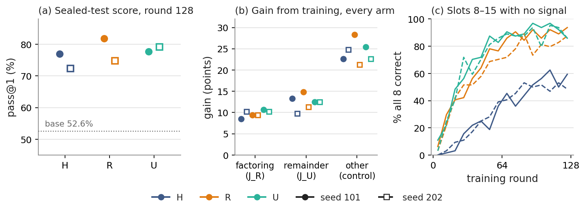

# Further things: open questions after the Nov 12, 2026 experiments

Follows [understanding-experiments.md](understanding-experiments.md) (the 5–10 minute guide)
and [experiments-report.md](experiments-report.md) (full detail).

## In short

GRPO training made Qwen3-1.7B much better at math in every arm and every subject tested. What filled the other 8
training slots (factoring drills, remainder drills or more hard problems) mattered much less. Its effect flipped with
the training seed. We found no evidence of interference, and the easy drills stopped giving a learning signal by about
round 64.

*(a) Sealed-test pass@1 after 128 rounds (128 problems × 32 answers); dotted line = base model. (b) Gain from round 0 to
round 128 on the factoring probe, the remainder probe and the control set of other subjects. Every arm gains on
everything, and other subjects gain most. (c) Share of slot 8–15 problems where all 8 answers were already correct, so
no learning signal was left. Colour = arm; filled/solid = seed 101; open/dashed = seed 202.*

## Open questions

1. **How much does R − U vary between runs?** It was +4.2 points in one seed and −4.4 in the other. More seeds of the
   same recipe, trained and scored on one GPU type, would measure that spread. This is the most important open question.
2. **Does skill-specific practice help when it stays challenging?** Our drills became too easy by about round 64. A pool
   that keeps getting harder, so groups stay mixed right and wrong, would test the original idea properly. This is a
   new recipe, so it is a separate study from question 1.
3. **Where does the broad improvement come from?** Geometry, counting, precalculus and prealgebra gained 21–28 points
   without any training on them. An arm trained only on easy drills, or only on hard problems for fewer rounds, would
   show how much of this gain each part of the mixture produces.
4. **Why do some runs produce answers that are cut off?** R's loss in seed 202 came almost entirely from answers that hit
   the 12,288-token limit. Tracking answer length during training, or training with a longer limit, would test whether
   this belongs to a run or to an arm.
5. **Is the bottleneck recognising when to factor?** Readers most often judged that a failed answer missed the
   factoring step (26 of 70 readings), not that the factoring went wrong (9). A one-sentence hint did not help. Practice
   problems that require *choosing* factoring, not just doing it, could target this.
6. **Is there interference too small for our test?** Repeat measurements of one model differed by 2.5–3.1 points, so
   the one-update test could not see smaller effects. More problems and answers per measurement, plus a defined
   measure of a learning stall, would be needed.
7. **Did the GPU mix matter for the seed-202 H result?** A single-GPU-type rerun completed on Nov 12 but was not
   analysed. Its outputs remain on the cluster (`test-eval/qis-cgpu-H-s202`).
