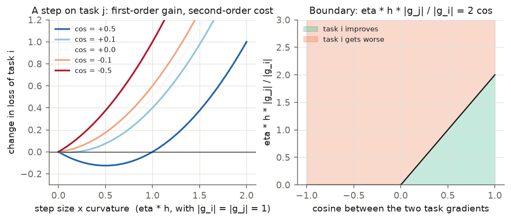
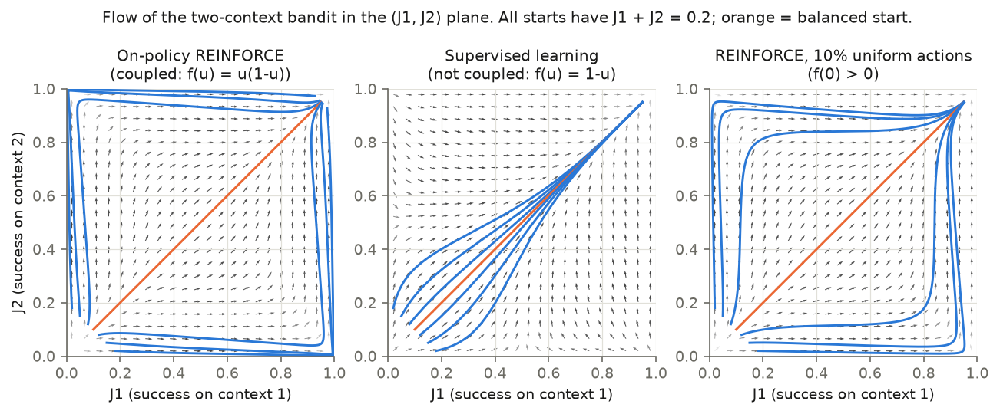
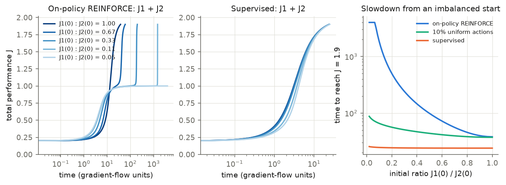
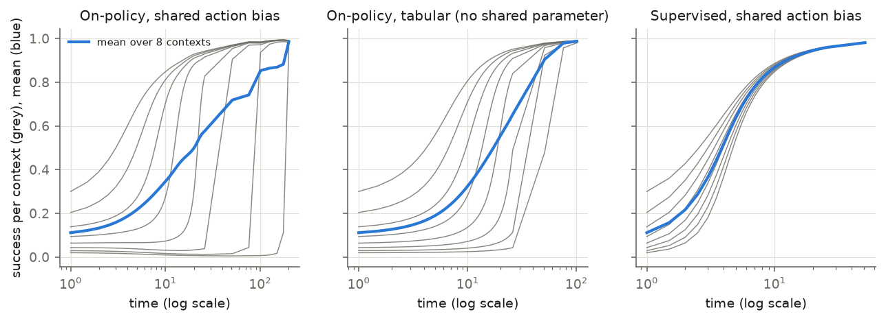
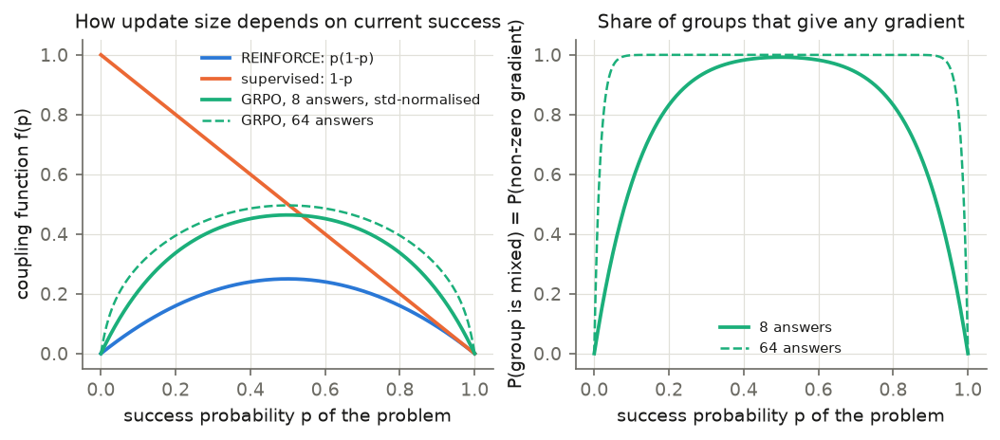
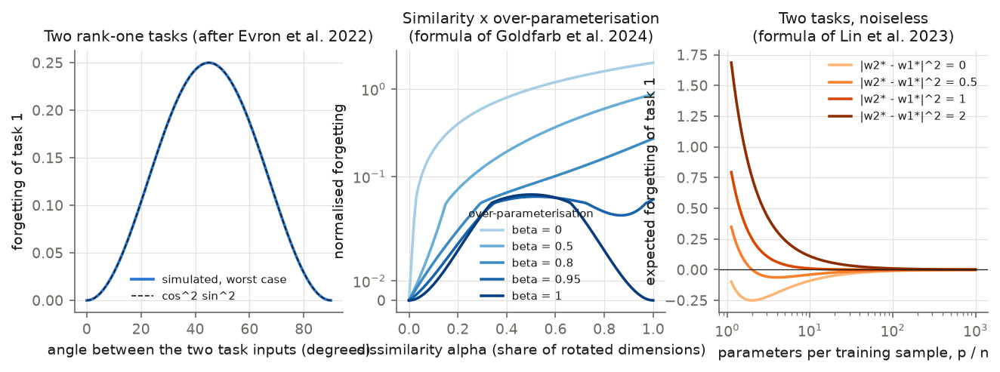
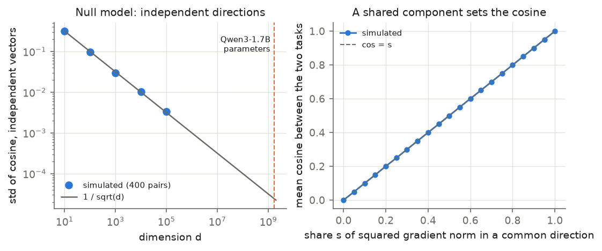
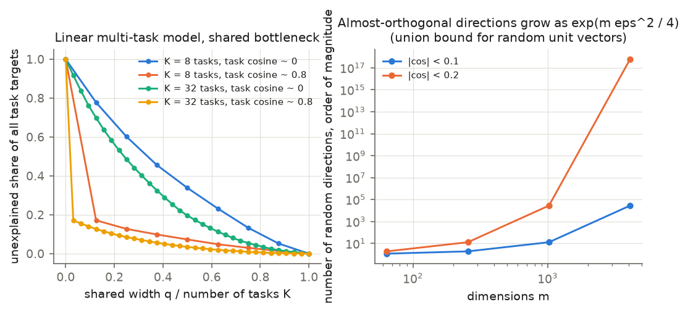
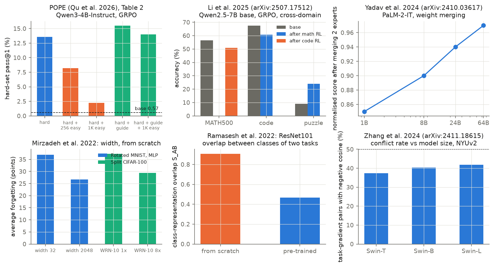

# Interference between tasks in one network: definitions, theory and evidence

Purpose: this document states what "interference" means, derives the main results about it, and summarises the
evidence. It is the theory base for [`01-understanding.md`](01-understanding.md), which asks why our first study
saw no interference. It assumes no knowledge of the papers.

**How to read the labels.** Each cited source carries a label in the reference list (§7): *read* (the paper text was
read for the cited facts), *abstract* (abstract only) or *not verified*. Each derivation says whether it comes from a
paper or is our own. Figures T1–T9 are ours. Script: [`build/theory_figs.py`](build/theory_figs.py). Numbers quoted
from the simulations: [`tables/theory_numbers.json`](tables/theory_numbers.json).

## Summary

1. **"Interference" has six definitions in the literature, and they are not equivalent.** They measure a gradient
   angle, an outcome, a kernel, a representation, a weight vector, or a learning dynamic (§1).
2. **To first order, all of them reduce to one number:** the inner product of two gradients. A step on task A changes
   the loss of task B by −η⟨g_B, g_A⟩ (§2.1). The sign of this number is the sign of the interaction.
3. **A negative inner product is not enough for harm.** Harm needs more. In supervised multi-task learning it needs
   unequal gradient sizes and high curvature (§2.2). In on-policy RL it needs *coupling*: the learning signal for a
   task must vanish when success on that task is low (§3). In sequential training it needs a non-zero error signal on
   the new task and overlapping features (§4).
4. **Ray interference is the on-policy RL case.** Schaul et al. (2019) prove it for a two-context bandit. The
   two-context result is exact. The extension to many tasks and to deep RL is argued and simulated, not proven (§3).
5. **Three factors reduce interference in theory:** high dimension with low-dimensional task updates (§5.1),
   over-parameterisation (§5.2, §5.3), and small steps from a good starting point (§4). Pre-training supplies all
   three at once, which is why its separate effects are hard to tell apart.
6. **No paper we found measures the gradient cosine between domains under a policy-gradient loss as a function of
   model size or pre-training.** The scale question in our mandate is open in the literature (§6).

## 1. Definitions of interference

Notation: one network with parameters θ ∈ R^d. Tasks (or domains, or single examples) k = 1…K with objectives J_k
(larger is better) or losses L_k = −J_k. Gradients g_k = ∇_θ L_k. Learning rate η.

| # | Name | Definition | Measures | Main sources |
|---|---|---|---|---|
| D1 | Gradient interference | ρ_{kk'} = ⟨∇J_k, ∇J_k'⟩ / (‖∇J_k‖‖∇J_k'‖). ρ < 0: interference. ρ > 0: transfer. ρ = 0: neither. Some papers use the inner product without normalisation. | direction of updates at one point θ | Schaul et al. 2019 (Def. 1); Riemer et al. 2019 (Eq. 1–2); Yu et al. 2020 (Def. 1, "conflicting gradients"); Lopez-Paz & Ranzato 2017 (constraint ⟨g, g_k⟩ ≥ 0); Bengio et al. 2020 (un-normalised) |
| D2 | Outcome interference | Joint or sequential training gives a worse result on task k than a reference. *Negative transfer*: risk with the other task > risk without it (Wang et al. 2019). *Backward transfer*: BWT = (1/(T−1)) Σ_{i<T} (R_{T,i} − R_{i,i}) < 0, with R_{i,j} the accuracy on task j after training task i (Lopez-Paz & Ranzato 2017). *Forgetting*: best earlier accuracy − current accuracy (Chaudhry et al. 2019). | what the user sees | as cited |
| D3 | One-step outcome | Change of task j's loss after one real step on task i. *Affinity* Z_{i→j} = 1 − L_j(θ after a step on i) / L_j(θ) (Fifty et al. 2021). *Update interference*: increase of expected squared TD error (Liu et al. 2023). | D1 plus curvature and step size | as cited |
| D4 | Kernel (function-space) interference | Tangent kernel K_θ(x', x) = ⟨∇_θ f(x'), ∇_θ f(x)⟩. Forgetting = ‖f_after(X_A) − f_before(X_A)‖², governed by the overlap of the two tasks' feature subspaces (Doan et al. 2021). | how much a step on x moves the output on x' | Jacot et al. 2018; Doan et al. 2021; Ramasesh et al. 2021 |
| D5 | Representational interference | Overlap of internal representations. Classic: overlapping distributed codes (French 1999). Feature level: off-diagonal entries of WᵀW when more features than dimensions are stored ("superposition"; Elhage et al. 2022). Class level: trace overlap S_AB of class features (Ramasesh et al. 2022). | whether two tasks use the same units or directions | as cited |
| D6 | Weight-space interference | For task vectors τ_t = θ_t − θ_0 from separate fine-tuning: sign disagreement of coordinates (Yadav et al. 2023); failure of *weight disentanglement*, f(x; θ_0 + Σ_t α_t τ_t) = Σ_t g_t(x; α_t τ_t) + g_0(x) with g_t = 0 outside the domain of task t (Ortiz-Jimenez et al. 2023). | whether separately learned updates can be added | as cited |
| D7 | Dynamical interference (ray interference) | Negative D1 **and** coupling of learning signal to performance. Result: winner-take-all phases and plateaus in the learning curve (Schaul et al. 2019). | a property of the whole training path | Schaul et al. 2019 |

Three points follow from the table.

- **D1 is local and symmetric.** It describes one point θ. It says nothing about step size, curvature, or the path.
- **D2 is what matters in practice, and it is relative.** "Worse than what" must be stated: than single-task training,
  than the same budget on one task, or than before. Our first study used the comparison with the hard-only arm.
- **D7 is the only definition that needs reinforcement learning.** The others apply to supervised learning too.

## 2. The local theory: what one step does

### 2.1 First order: all definitions meet (standard derivation)

Take one gradient step on task A: θ' = θ − η g_A. Expand the loss of task B:

    L_B(θ') = L_B(θ) − η ⟨g_B, g_A⟩ + (η²/2) g_Aᵀ H_B g_A + O(η³),   H_B = ∇²L_B(θ).        (1)

To first order, the step on A lowers L_B exactly when ⟨g_B, g_A⟩ > 0. This is D1.

The same step changes the network output on any input x' by

    f(x'; θ') − f(x'; θ) = −η K_θ(x', x) ∂ℓ/∂f(x) + O(η²),   K_θ(x', x) = ⟨∇_θ f(x'), ∇_θ f(x)⟩.     (2)

So the kernel K (D4) is the gradient inner product (D1) with the error signals taken out. The affinity of D3 is
Z_{A→B} ≈ η ⟨g_A, g_B⟩ / L_B. To first order, D1, D3 and D4 are one quantity. Assumption: η is small enough that the
second-order term of (1) is negligible. §2.2 states when it is not.

**Policy-gradient form.** For a policy π_θ and a sampled answer y to prompt x with advantage A, one policy-gradient
step changes the log-probability of another answer y' to another prompt x' by

    Δ log π(y'|x') = η A ⟨∇ log π(y|x), ∇ log π(y'|x')⟩ + O(η²)                                  (3)

(Nguyen et al. 2025, per-step influence). This is equation (2) for a language model. In GRPO the advantage of every
answer is zero when all answers in a group have the same reward (Shao et al. 2024). Such a group gives no gradient
and therefore, by (3), cannot interfere with or help anything.

**With Adam (our derivation).** Adam's step is Δθ = −η P m, where m is the momentum and P = diag(1/(√v + ε)) the
preconditioner. The first-order change of L_B is −η g_Bᵀ P m. Two consequences. First, a task's own step still lowers
its own loss, because g_Aᵀ P g_A > 0. Second, the cross term g_Bᵀ P g_A can have a different sign from ⟨g_B, g_A⟩,
because P reweights coordinates. A cosine measured on raw gradients is therefore not the last word for an Adam run.
Malladi et al. (2023) make the related point that early Adam follows a sign-gradient kernel
⟨∇f(x'), sign ∇f(x)⟩, which is not symmetric.

### 2.2 Second order: when a conflict hurts, and when alignment does not help

Equation (1) shows two ways for a step on A to raise L_B.

1. ⟨g_B, g_A⟩ < 0 (conflict).
2. ⟨g_B, g_A⟩ > 0, but the curvature term is larger: (η/2) g_Aᵀ H_B g_A > ⟨g_B, g_A⟩.

Write h for the curvature of L_B along the unit direction of g_A. The step raises L_B when

    η h ‖g_A‖ / ‖g_B‖ > 2 cos(g_A, g_B).                                                          (4)

*Figure T4. Left: change of task B's loss after a step on task A, for unit gradients and unit curvature, by cosine.
Right: the boundary (4). Above the line, the step hurts task B even when the gradients agree. Our figure from
equation (1).*

Yu et al. (2020) name the conditions under which conflict harms joint training the *tragic triad*: (a) conflicting
gradients, cos < 0; (b) dominating gradients, measured by Φ = 2‖g_i‖‖g_j‖ / (‖g_i‖² + ‖g_j‖²) being small; (c) high
curvature. They state that conflict alone is harmless: the average gradient still descends the average loss. Their
Theorem 2 proves that their projection method (PCGrad) gives a lower total loss after one step than the plain summed
gradient when conflict, magnitude gap, curvature and step size are all large enough.

**Assumptions and where they fail.** The theorem covers two tasks and one step. It compares total loss after that
step. It proves nothing about final performance. Later work found that well-tuned plain summation matches the
gradient-surgery methods on standard benchmarks (Kurin et al. 2022; Xin et al. 2022; Royer et al. 2023).

**What equation (4) means for small steps.** The left side of (4) is proportional to η. For a small enough step, only
the sign of the cosine matters, and the size of the effect is first order: −η⟨g_B, g_A⟩. A small learning rate removes
the curvature route to interference. It does not remove the first-order route.

### 2.3 The conflict rate has a null value of 50%

Many papers report the *conflict rate*: the share of gradient pairs with negative cosine. For two independent random
directions the cosine is symmetric around zero, so the null conflict rate is 50%, not 0%. Reported rates of 32–42%
between tasks (Zhang et al. 2024) are therefore mild alignment, not strong conflict. Elich et al. (2023) found that
conflicts between samples of *one* task are as frequent as conflicts between tasks. A conflict rate needs a
within-task baseline to mean anything. We use one in `01-understanding.md`.

## 3. Ray interference: the on-policy RL theory (Schaul et al. 2019)

### 3.1 The claim

> A learning system suffers from plateaus if it has (a) negative interference between the components of its
> objective, and (b) coupled performance and learning progress. — Schaul et al. (2019), introduction

The objective is a sum, J = Σ_k J_k. Components can be tasks, contexts or start states. *Coupling* means that the
agent generates its own training data, so the learning signal for J_k shrinks when J_k is low.

### 3.2 The exact model

A contextual bandit with two contexts and two actions. In context k the action a = k gives reward 1, the other gives
0. The policy is a sigmoid with three parameters, one per context plus a **shared action bias** θ_3:

    J_1 = π(a=1|s_1) = σ(θ_1 + θ_3),    J_2 = π(a=2|s_2) = σ(θ_2 − θ_3).

The shared bias is the only shared parameter. Raising it helps context 1 and hurts context 2. The gradients are

    ∇J_1 = J_1(1−J_1) (1, 0, 1)ᵀ,    ∇J_2 = J_2(1−J_2) (0, 1, −1)ᵀ,    so ρ = −1/2 at every θ.

Expected on-policy REINFORCE is gradient ascent on J (the expected update for context k is ∇J_k). In the limit of
small steps, d/dt J_k = ⟨∇J_k, ∇J⟩, which gives a closed system in (J_1, J_2):

    dJ_1/dt = 2 J_1²(1−J_1)² − J_1(1−J_1) J_2(1−J_2)                                             (5)
    dJ_2/dt = 2 J_2²(1−J_2)² − J_1(1−J_1) J_2(1−J_2)

The first term is a task's own progress. The second is the interference. Both scale with J_k(1−J_k): this factor is
the coupling.

### 3.3 Results of the model

- **Fixed points.** (0,0) unstable, (1,1) stable, (0,1) and (1,0) saddle points.
- **Winner-take-all (WTA) regions.** dJ_1/dt < 0 when 2 J_1(1−J_1) < J_2(1−J_2). Near the origin this is J_2 > 2 J_1.
  In that region context 2 improves and context 1 gets *worse*. For starts near the origin with a uniformly random
  direction, the probability of starting in one of the two WTA regions is (4/π) arctan(1/2) ≈ 59%.
- **Plateau.** The trajectory then passes close to a saddle. The learning curve has an inflection point on the line
  J_1 + J_2 = 1, where the speed is ε = 2 J_1²(1−J_1)². This vanishes as J_1 → 0. The paper states a slowdown of
  order 1/ε. It gives no closed-form escape time.

*Figure T1. Flow field of the bandit in the (J_1, J_2) plane with trajectories from seven starts on J_1 + J_2 = 0.2.
Left: on-policy REINFORCE, equation (5). Middle: supervised learning on the same policy. Right: REINFORCE with 10%
uniformly random actions. Our simulation of the model of Schaul et al. (2019); compare their Figure 1.*

*Figure T2. Left and middle: total performance over time for five starts with J_1 + J_2 = 0.2. Right: time to reach
J = 1.9 against the initial ratio J_1(0)/J_2(0). The on-policy curve is cut at t = 4,000. Our simulation.*

Numbers from our simulation (Euler steps of 0.02): a balanced start reaches J = 1.9 at t = 38. A start with ratio 1:3
needs t = 201, and ratio 1:9 needs t = 1,503. The slowest speed on the path falls from 1.6e-2 (balanced) to 1.2e-4
(ratio 1:3) and 1.6e-6 (ratio 1:9). Supervised learning needs t = 24 to 26 for every start.

### 3.4 Which ingredient does what: the coupling function

Schaul et al. generalise to ∇J_k = f_k(J_k) v_k(θ), where f_k is the *coupling function*. On-policy REINFORCE has
f(u) = u(1−u). Supervised learning on the same policy has f(u) = 1−u. The interference is the same in both
(ρ = −1/2), but supervised learning has no saddle and no plateau. The paper's sufficient condition for a saddle is
**f_k(0) = 0**: no learning signal at zero performance.

What removes the effect in the paper (their §2.6 and Figure 3):

| Change | Removes | Result |
|---|---|---|
| Tabular policy or one network per context (no shared parameter) | interference | no WTA region |
| Uniform random behaviour policy (off-policy) | coupling | no saddle, no plateau |
| Supervised learning | coupling | no saddle, no plateau |
| 10% uniform random actions | part of the coupling, f(0) > 0 | much weaker plateaus (our Figure T2: t = 37 to 88) |

*Figure T3. Eight contexts and eight actions, initial success from 0.02 to 0.30. Grey: success per context. Blue: mean.
With a shared action bias and on-policy updates, contexts are learned one after the other and the weakest ones first
get worse. Without the shared bias, or with supervised updates, they do not. Our simulation of the K × n bandit of
Schaul et al. (2019); compare their Figure 4.*

### 3.5 Assumptions, and where they fail

1. **Expected updates and small steps.** The analysis ignores sampling noise and optimiser effects.
2. **Shared parameters with opposite effect.** ρ = −1/2 is built in by the shared bias. The paper does not show that
   real tasks have negative ρ.
3. **Coupling function with f(0) = 0.** This holds for on-policy policy gradient with sparse reward. It fails with
   exploration noise, off-policy data, dense rewards or supervised signal.
4. **Additive objective.** Stated by the authors as imperfect.
5. **K > 2 and deep RL.** Not proven. The paper has no deep-RL experiment; all experiments are bandit simulations.

Two errata we found while checking the appendix. Appendix B.1 states the determinant (5/4)(1−2J_1)(1−2J_2) for a
matrix whose determinant is (3/4)(1−2J_1)(1−2J_2). The classification of the fixed points does not change. The exact
Jacobian of (5) in (J_1, J_2) coordinates is zero at all four corners, so the printed matrix is not that Jacobian.
We checked the final polynomial for d²J/dt² symbolically and it is correct.

### 3.6 The coupling function of GRPO (our derivation)

GRPO differs from REINFORCE in two ways that matter for coupling. Let p be the success probability of a problem, G
the number of sampled answers, and s = ∇ log π(answer) the score of an answer.

*Step 1.* The exact policy gradient is ∇p = E[r s] = p E[s | correct]. Because E[s] = 0, we have
p E[s|correct] + (1−p) E[s|wrong] = 0, so

    ∇p = p(1−p) (E[s | correct] − E[s | wrong]).

The factor p(1−p) is the REINFORCE coupling.

*Step 2.* GRPO divides the advantage by the group's standard deviation. In a group with c correct answers, p̂ = c/G,
the advantages are +√((1−p̂)/p̂) for correct and −√(p̂/(1−p̂)) for wrong answers. The group update is

    (1/G) Σ_i A_i s_i = √(p̂(1−p̂)) (s̄_correct − s̄_wrong),

with s̄ the within-group means. The expected size along the direction (E[s|correct] − E[s|wrong]) is

    f_GRPO(p) = Σ_c Binom(c; G, p) √((c/G)(1 − c/G)).

*Figure T9. Left: coupling functions. Right: probability that a group of G answers is mixed, 1 − p^G − (1−p)^G. Only
mixed groups give a gradient. Our derivation.*

Consequences. f_GRPO(0) = 0, so the saddle condition of §3.4 still holds: a problem that is never solved gives no
signal. But the coupling is weaker than in REINFORCE. At p = 0.05 with G = 8, f_GRPO = 0.117 against 0.0475. At
p = 0.01 it is 0.026 against 0.0099. Assumptions: s here is the score of the whole answer; implementations that
average log-probabilities over tokens (as ours does) change the per-answer weights; the clipping of the policy ratio
is ignored.

An optimiser with normalised steps (Adam, or gradient clipping) weakens coupling further. The step size no longer
shrinks with the gradient norm. What remains is *relative* coupling: inside one minibatch, a problem with a small
gradient has a small share of the summed direction.

## 4. The kernel view: interference when training stays near a starting point

### 4.1 When training is linear

A network is in the *lazy* or *kernel* regime when its output stays close to its first-order expansion,
f_lin(x; θ) = f(x; θ_0) + ⟨∇f(x; θ_0), θ − θ_0⟩, during training. Then K of equation (2) is constant, and training is
kernel regression.

- Jacot et al. (2018) and Lee et al. (2019) prove this for infinitely wide networks from random initialisation under
  a specific parameterisation. Lee et al. bound the deviation by O(width^−1/2).
- Chizat et al. (2019) give a criterion that does not need width: κ = ‖f(θ_0) − y*‖ · ‖D²f‖ / ‖Df‖² ≪ 1. The output
  must reach its target before the Jacobian changes. A model that starts close to the solution satisfies it more
  easily. Their experiments show that standard networks trained from scratch are **not** lazy.
- For pre-trained language models, Malladi et al. (2023) prove kernel behaviour for prompt-based fine-tuning in an
  infinite-width limit when the pre-trained model nearly solves the task. Empirically 8 of 14 few-shot tasks on
  RoBERTa-base showed it. Ortiz-Jimenez et al. (2023) found that full fine-tuning of CLIP is not linear.

So linearity of fine-tuning is an empirical question for each setting. Nobody has tested it for GRPO. We test it for
our runs in `01-understanding.md`.

### 4.2 Forgetting in the kernel regime (Doan et al. 2021)

Train on task A, then on task B, in the kernel regime with weight decay. Let φ(X_τ) = U_τ Σ_τ V_τᵀ be the singular
value decomposition of the Jacobian of task τ. The change of the outputs on task A is

    forgetting = ‖ U_A Σ_A (V_Aᵀ V_B) M_B ỹ_B ‖²,                                                 (6)

where V_Aᵀ V_B is the *overlap matrix* of the two feature subspaces, ỹ_B = y_B − f(X_B) is the residual of task B
before training on it, and M_B = Σ_B(Σ_B² + λI)^−1 U_Bᵀ. Three factors multiply:

1. the high-variance directions of task A (Σ_A);
2. the overlap of the feature subspaces (V_Aᵀ V_B);
3. the size of the error signal on task B (ỹ_B).

**Zero forgetting follows from zero overlap or from zero residual.** Identical tasks overlap fully and still do not
interfere, because the residual is zero. This is why overlap is necessary and not sufficient (also Ramasesh et al.
2021, Lemma 1). Assumption: constant kernel. Features do not move, so (6) cannot describe representation change.

### 4.3 Task similarity: the worst case is in the middle

In over-parameterised linear regression, fitting task after task is a sequence of projections (Evron et al. 2022).
For two rank-one tasks with unit inputs at angle θ, the forgetting of task 1 is at most cos²θ sin²θ ‖w*‖² (derived
from their update rule; our Figure T6 left confirms it numerically to 1e-16). It is zero for identical tasks (θ = 0)
and for orthogonal tasks (θ = 90°), and largest at 45°.

*Figure T6. Left: forgetting of task 1 against the angle between two rank-one tasks. Middle: the closed form of
Goldfarb et al. (2024) for forgetting against dissimilarity α, for several degrees of over-parameterisation β. Right:
the closed form of Lin et al. (2023) for two tasks against parameters per sample. Our plots of the cited formulas.*

Goldfarb et al. (2024) give the joint dependence on dissimilarity α and over-parameterisation β = 1 − rank/p in a
two-task linear model. When β → 1 the forgetting is α²(1−α)², largest at α = 1/2. At β = 0 it is 2α: forgetting rises
steadily with dissimilarity. Lee et al. (2021) and Ramasesh et al. (2021) report the same intermediate-similarity
peak in non-linear networks.

**What this predicts.** "Very different domains interfere most" is only true for models with little spare capacity.
In a highly over-parameterised model, very different tasks use different directions and do not interact. The danger
zone is tasks that share features and need different outputs.

## 5. Why large pre-trained models may show little interference

### 5.1 High dimension, low-dimensional updates

Two independent isotropic random vectors in R^d have a cosine of order 1/√d (Vershynin 2018, Remark 3.2.5). For
d = 1.72 × 10⁹, the parameter count of Qwen3-1.7B without the tied output layer, 1/√d = 2.4 × 10⁻⁵.

*Figure T5. Left: standard deviation of the cosine between independent Gaussian vectors against dimension (points:
simulation; line: 1/√d). Right: if two task gradients share a common component that carries a share s of their squared
norm, and are otherwise independent, their cosine is s. Our simulation.*

This null model is a floor, not a prediction. Real gradients are not isotropic. They concentrate in few directions:
Gur-Ari et al. (2018) found that 93% of the gradient norm of a small classifier lies in a 10-dimensional subspace.
Aghajanyan et al. (2021) found that a fine-tuning task of a pre-trained language model is solved to 90% by moving in
a random subspace of a few hundred to a few thousand dimensions, and that this number falls with more pre-training
and with larger models (RoBERTa-Base 896, RoBERTa-Large 207 on MRPC).

Two readings follow, and they point in opposite directions.

- *Room to avoid.* If each task needs about 10³ directions in a space of 10⁹, two unrelated tasks can use disjoint
  directions. Cosine ≈ 0. No interference and no transfer.
- *Shared subspace.* If the tasks' gradients concentrate in the **same** low-dimensional subspace, the cosine is set
  by their relation inside that subspace and can be large with either sign (Figure T5, right).

A measured cosine distinguishes the two. A cosine that is small but many null standard deviations from zero means a
weak shared component. Both the sign and the size need a test against the null and against a within-task baseline.

### 5.2 Capacity: when the model can fit everything, conflict disappears at the solution

Three results state this in different models.

- Kurin et al. (2022, Prop. 5): if the network can minimise all task losses at once, plain summed-loss training
  converges to a point where every task gradient is zero.
- Hu et al. (2023): in a two-layer linear network with hidden width q and k tasks, if q ≥ k every task reaches its
  optimum and the Pareto front is one point. If q < k the tasks compete for capacity, and fixed loss weights cannot
  reach every trade-off.
- Wu et al. (2020, Prop. 1): with a shared module of rank r ≥ k, the joint optimum equals the single-task optima.
  There is then no transfer in either direction.

*Figure T7. Left: a linear multi-task model with a shared bottleneck of width q. The unexplained share of the task
targets falls to zero at q = K, and falls faster when the tasks are similar (pairwise cosine 0.8). Right: the number
of random directions that fit in m dimensions with pairwise |cosine| below a bound grows exponentially in m (union
bound). Our simulation and calculation.*

Numbers from Figure T7: with 8 unrelated tasks and half the needed width (q = K/2), 34% of the target variance is
unexplained. With task cosine 0.8 it is 7%.

**Limit of this argument.** These results are about the *solution*. Interference can still occur on the *path*. Royer
et al. (2023) measured that the gradient conflict rate hardly changes with model capacity, while the outcome (D2)
improves with capacity. Zhang et al. (2024) measured a small increase of the conflict rate with model size (37.4% to
41.8%, Swin-Tiny to Swin-Large). Capacity reduces outcome interference without reducing gradient conflict.

**Superposition as a capacity model.** Elhage et al. (2022) study a toy network that stores n features in m < n
dimensions. Interference between features is the off-diagonal part of WᵀW. Sparse features can share dimensions at a
small cost; dense features cannot. Scherlis et al. (2022) express this as a capacity budget. Extending this to
interference between *tasks* in trained language models is plausible, and we found no paper that shows it.

### 5.3 Over-parameterisation in sequential training

In linear models forgetting falls with the ratio of parameters p to samples n: at most (66√(n/p) + 12/(pγ))‖θ‖² in
the model of Goldfarb & Hand (2023), and proportional to powers of r = 1 − n/p in Lin et al. (2023) (Figure T6,
right). Mirzadeh et al. (2022) report that wider networks forget less (Rotated MNIST 36.9 → 26.7 points from width 32
to 2048) and offer three explanations in figures: more orthogonal gradients, sparser gradients, and lazier training.

### 5.4 Pre-training

- Pre-trained models forget far less than models trained from scratch, and the advantage grows with model size and
  pre-training data (Ramasesh et al. 2022: ViT-B loses under 0.5% on split CIFAR-10; ResNets trained from scratch do
  not improve with size). Their proposed mechanism: class representations overlap less (0.466 pre-trained against
  0.907 from scratch for ResNet101). They did not test causality.
- Pre-trained weights lie in wider minima (Mehta et al. 2023).
- Task arithmetic (adding separately learned updates) works only from pre-trained weights and improves with model
  size (Ortiz-Jimenez et al. 2023; Yadav et al. 2024: normalised score after merging two experts 0.85 at 1B and 0.97
  at 64B parameters). Ortiz-Jimenez et al. prove a sufficient condition for linearised models: each task must be
  represented by kernel eigenfunctions that vanish outside the task's own inputs (*kernel localisation*).

**Scale is contested for language models.** Luo et al. (2023) found that forgetting during continual instruction
tuning *grows* from 1B to 7B parameters (on a metric relative to the initial score). Scialom et al. (2022) concluded
that pre-training, not scale, makes T0 models continual learners.

### 5.5 On-policy RL moves the policy little (theory and evidence for language models)

- **Theorem (Shenfeld et al. 2025, Thm 5.2).** For a finite output set, binary reward and a convex policy family,
  policy gradient converges to the optimal policy closest in KL divergence to the starting policy. Neural networks do
  not meet the convexity assumption exactly. Empirically, the KL on the new task predicts forgetting of old tasks
  (R² = 0.71 for language models); weight distance predicts it poorly.
- **Sharpening.** RL with verifiable rewards raises pass@1 and majority-vote accuracy much more than large-k coverage
  (Shao et al. 2024; Yue et al. 2025). Huang et al. (2024) formalise this as *sharpening*: the cost of improving
  scales with 1/π_base(correct answer).
- **Existing mechanisms are reused.** Fine-tuning on arithmetic improved entity tracking, an untrained task, through
  the same circuit (Prakash et al. 2024).
- **Warning.** Shao et al. (2025) found that random rewards gave Qwen2.5-Math-7B +21.4 points on MATH-500 (true
  rewards: +29.1), because GRPO amplified a strategy the model already preferred. Uniform gains on all subjects can
  be this signature.

## 6. Known empirical results, by setting

*Figure T8. Six reported results, redrawn from the numbers in the cited papers. Top: on-policy RL of language models
(POPE Table 2; Li et al. 2025) and weight merging against model size (Yadav et al. 2024). Bottom: width and
forgetting (Mirzadeh et al. 2022), representation overlap (Ramasesh et al. 2022), conflict rate against model size
(Zhang et al. 2024).*

| Finding | Setting, model scale, tasks | Source |
|---|---|---|
| Adding 256 easy problems to 256 hard ones lowers hard pass@1 from 13.55% to 8.22%; adding 1,000 lowers it to 2.24% | GRPO, Qwen3-4B-Instruct, math; hard = base model never correct in 128 tries; 1,000 steps, lr 1e-6 | Qu et al. 2026 (POPE), Table 2 |
| An unrelated easy problem stalls a hard problem in a two-problem run. The caption and the text disagree about the related easy problem (slower, or slightly faster). No numbers given | same model; one easy + one hard problem | Qu et al. 2026, Figure 5 |
| Math RL lowers code accuracy (67.46 → 60.60); code RL lowers math for the base model (56.40 → 50.80) and raises it for the instruct model (69.00 → 72.00) | GRPO, Qwen2.5-7B, math / code / puzzle | Li et al. 2025 |
| Math-only RL raises other reasoning tasks (30.2 → 60.0) and non-reasoning tasks (45.7 → 53.2); SFT lowers the latter (→ 21.1) | GRPO, Qwen3-14B-Base, about 47K math problems | Huan et al. 2025 |
| Cosine between task score functions about 10⁻¹ for SFT and 10⁻³ for RL | DeepSeek-R1-Distill-Qwen 1.5B and 7B; math, code, science | Zhu et al. 2026 (*abstract and §4 read*) |
| RL fine-tuning suppresses low-likelihood problems; large-k pass@k declines | GRPO, Qwen2.5-Math 1.5B and 7B, Llama-3.2-3B | Nguyen et al. 2025 |
| A second agent started at a plateau doubles the score (6,600 → 14,500) | Rainbow, Montezuma's Revenge; +25% median over Atari | Fedus et al. 2020 |
| Gradient cosine tracks language relatedness; negative early in training for distant pairs | multilingual Transformers, 8 layers (small on purpose) and 375M | Wang, Lipton & Tsvetkov 2020; Wang et al. 2021 |
| Larger models show less negative transfer; conflict rate hardly changes | ViT-S, ResNet; Transformers 120M–165M | Royer et al. 2023; Xin et al. 2022; Standley et al. 2020 |
| Conflict does not predict generalisation | RoBERTa-Base, GLUE | Mueller et al. 2024 |
| Task vectors of different tasks are close to orthogonal | CLIP, separate fine-tuning, 8 tasks (values in a figure only) | Ilharco et al. 2023 |
| 68.5–96% of weights unchanged after RL (BF16 comparison); disputed as a precision artifact | several 7B–70B models | Mukherjee et al. 2025; Shenfeld et al. 2025 |

Two gaps matter for us. First, POPE is the only study with easy-plus-hard mixtures under GRPO, and it reports an
outcome, not a gradient cosine. Second, the cross-domain RL studies use domains far apart (math against code). No
study covers two skills inside one subject, which is our case.

## 7. What we know about interference

**Proven (under the stated assumptions)**

1. A small step on task A changes task B's loss by −η⟨g_B, g_A⟩; the kernel form is equation (2). *Standard.*
2. A step with positive cosine can still hurt when η × curvature × ‖g_A‖/‖g_B‖ > 2 cos (equation 4). *Standard.*
3. In the two-context bandit with a shared bias, on-policy policy gradient has ρ = −1/2, saddle points at (0,1) and
   (1,0), winner-take-all regions and plateaus with speed 2J_1²(1−J_1)². Supervised learning with the same
   interference has none. *Schaul et al. 2019; expected updates, small steps.*
4. A coupling function with f(0) = 0 is sufficient for a saddle. *Schaul et al. 2019; under their factorisation.*
5. In the kernel regime, forgetting is the product of source variance, feature-subspace overlap and target residual.
   *Doan et al. 2021; constant kernel.*
6. In over-parameterised linear regression, forgetting is zero for identical and for orthogonal tasks and largest in
   between; it falls as parameters per sample grow. *Evron et al. 2022; Goldfarb et al. 2024; Lin et al. 2023.*
7. If the model can fit all tasks at once, summed-loss training ends where all task gradients vanish. *Kurin et al.
   2022; Hu et al. 2023; Wu et al. 2020.*
8. Policy gradient with binary reward converges to the KL-closest optimal policy. *Shenfeld et al. 2025; finite
   outputs, convex policy family.*
9. Independent directions in d dimensions have cosine of order 1/√d. *Vershynin 2018.*

**Empirically supported**

1. Outcome interference under on-policy RL exists in language models: between easy and hard math problems (POPE) and
   between math and code (Li et al. 2025). It exists in Atari (Fedus et al. 2020).
2. Larger and pre-trained models show less outcome interference in vision and in weight merging.
3. Gradient cosine tracks task relatedness.
4. RL post-training changes outputs and representations less than supervised fine-tuning, and forgets less.
5. RL post-training mostly makes existing behaviour more reliable.
6. Conflict rates are near 30–45% in the settings measured and are similar within and between tasks.

**Conjecture or contested**

1. That ray interference explains plateaus in deep RL or in language-model RL. The mechanism is proven only for
   bandits. POPE and Nguyen et al. show outcomes consistent with it and do not measure ρ or the coupling.
2. That gradient conflict *causes* outcome interference. Evidence for: PCGrad, Gradient Vaccine. Against: Kurin,
   Xin, Royer, Mueller, Elich.
3. That scale by itself reduces interference. In vision the gain needs pre-training. For language models the results
   disagree (Luo et al. against Ramasesh et al. and Yadav et al.).
4. That fine-tuning of language models is linear in the weights. True for some few-shot tasks, false for CLIP,
   untested for RL.
5. Why pre-training helps: orthogonal representations, flat minima, small steps and kernel localisation are each
   supported by correlation only.
6. That superposition capacity governs interference between tasks. No direct evidence found.
7. How the cross-domain gradient cosine under a policy-gradient loss depends on model size. Not measured anywhere we
   found.

## 8. What this means for the next document

The theory gives five separate conditions under which a mixed training run shows **no** outcome interference. Each
one is testable on our checkpoints.

| Condition | Theory | Test in `01-understanding.md` |
|---|---|---|
| The domain gradients do not conflict (ρ ≥ 0) | §2.1 | cosine of per-domain GRPO gradients with within-domain baseline |
| The steps are small, so only first-order effects exist | §2.2, §4.1 | linearity of the log-probability change along the training direction |
| The coupling is weak: hard problems rarely fall to zero success | §3.4, §3.6 | share of all-wrong groups (first study), coupling function of GRPO |
| The interfering domain stops producing gradient | §2.1 (zero advantage) | share of mixed practice groups over training (first study) |
| The evaluation cannot see an effect of the size that exists | §1 (D2 is relative) | predicted first-order effect size against measurement noise |

## References

Labels: **R** = text read for the cited facts; **A** = abstract only; **NV** = citation not verified in the source.
Venues marked * are from memory and were not checked.

- Aghajanyan, Zettlemoyer, Gupta (2021). Intrinsic dimensionality explains the effectiveness of language model fine-tuning. arXiv:2012.13255. **R**
- Bengio, Pineau, Precup (2020). Interference and generalization in temporal difference learning. arXiv:2003.06350. **R** (sections 1–4)
- Chaudhry, Ranzato, Rohrbach, Elhoseiny (2019). Efficient lifelong learning with A-GEM. ICLR. arXiv:1812.00420. **R**
- Chizat, Oyallon, Bach (2019). On lazy training in differentiable programming. NeurIPS. arXiv:1812.07956. **R**
- Doan, Bennani, Mazoure, Rabusseau, Alquier (2021). A theoretical analysis of catastrophic forgetting through the NTK overlap matrix. AISTATS. arXiv:2010.04003. **R**
- Elhage et al. (2022). Toy models of superposition. arXiv:2209.10652. **R** (pp. 1–14)
- Elich, Kirchdorfer, Köhler, Schott (2023). Examining common paradigms in multi-task learning. arXiv:2311.04698. **R** (abstract, §4.2)
- Evron, Moroshko, Ward, Srebro, Soudry (2022). How catastrophic can catastrophic forgetting be in linear regression? COLT. arXiv:2205.09588. **R** (main text)
- Fedus, Ghosh, Martin, Bellemare, Bengio, Larochelle (2020). On catastrophic interference in Atari 2600 games. arXiv:2002.12499. **R** (sections 1–5)
- Fifty, Amid, Zhao, Yu, Anil, Finn (2021). Efficiently identifying task groupings for multi-task learning. NeurIPS. arXiv:2109.04617. **R**
- French (1999). Catastrophic forgetting in connectionist networks. Trends in Cognitive Sciences 3(4). **R**
- Goldfarb, Hand (2023). Analysis of catastrophic forgetting for random orthogonal transformation tasks in the overparameterized regime. AISTATS*. arXiv:2207.06475. **R**
- Goldfarb, Evron, Weinberger, Soudry, Hand (2024). The joint effect of task similarity and overparameterization on catastrophic forgetting. ICLR. arXiv:2401.12617. **R** (main text; limits re-derived)
- Gur-Ari, Roberts, Dyer (2018). Gradient descent happens in a tiny subspace. arXiv:1812.04754. **R**
- Hu, Xian, Wu, Fan, Yin, Zhao (2023). Revisiting scalarization in multi-task learning: a theoretical perspective. NeurIPS. arXiv:2308.13985. **R**
- Huan et al. (2025). Does math reasoning improve general LLM capabilities? arXiv:2507.00432. **R**
- Huang, Block, Foster, Rohatgi, Zhang, Simchowitz, Ash, Krishnamurthy (2024). Self-improvement in language models: the sharpening mechanism. arXiv:2412.01951. **R**
- Ilharco, Ribeiro, Wortsman, Gururangan, Schmidt, Hajishirzi, Farhadi (2023). Editing models with task arithmetic. ICLR. arXiv:2212.04089. **R**
- Jacot, Gabriel, Hongler (2018). Neural tangent kernel. NeurIPS. arXiv:1806.07572. **R**
- Kurin, De Palma, Kostrikov, Whiteson, Kumar (2022). In defense of the unitary scalarization for deep multi-task learning. NeurIPS. arXiv:2201.04122. **R**
- Lee, Xiao, Schoenholz, Bahri, Novak, Sohl-Dickstein, Pennington (2019). Wide neural networks of any depth evolve as linear models under gradient descent. NeurIPS. arXiv:1902.06720. **R**
- Lee, Goldt, Saxe (2021). Continual learning in the teacher-student setup: impact of task similarity. ICML. arXiv:2107.04384. **R**
- Li, Pan, Lin, Sun, He, Wu (2025). Can one domain help others? arXiv:2507.17512. **R**
- Lin, Ju, Liang, Shroff (2023). Theory on forgetting and generalization of continual learning. ICML*. arXiv:2302.05836. **R** (T = 2 case re-derived)
- Liu, Wang, Tao, Javed, White, White (2023). Measuring and mitigating interference in reinforcement learning. CoLLAs. arXiv:2307.04887. **R** (sections 3–6)
- Lopez-Paz, Ranzato (2017). Gradient episodic memory for continual learning. NeurIPS. arXiv:1706.08840. **R**
- Luo, Yang, Meng, Li, Zhou, Zhang (2023). An empirical study of catastrophic forgetting in large language models during continual fine-tuning. arXiv:2308.08747. **R**
- Malladi, Wettig, Yu, Chen, Arora (2023). A kernel-based view of language model fine-tuning. ICML. arXiv:2210.05643. **R**
- Mehta, Patil, Chandar, Strubell (2023). An empirical investigation of the role of pre-training in lifelong learning. JMLR 24. arXiv:2112.09153. **R**
- Mirzadeh, Chaudhry, Yin, Hu, Pascanu, Gorur, Farajtabar (2022). Wide neural networks forget less catastrophically. ICML. arXiv:2110.11526. **R**
- Mueller, Dredze, Andrews (2024). Can optimization trajectories explain multi-task transfer? TMLR. arXiv:2408.14677. **R**
- Mukherjee, Yuan, Hakkani-Tür, Peng (2025). Reinforcement learning finetunes small subnetworks in large language models. arXiv:2505.11711. **R**
- Nguyen, La, Nguyen, Chawla, Nguyen, Doan (2025). The reasoning boundary paradox: how reinforcement learning constrains language models. arXiv:2510.02230. **R** (sections 1–5)
- Ortiz-Jimenez, Favero, Frossard (2023). Task arithmetic in the tangent space. NeurIPS*. arXiv:2305.12827. **R** (main text)
- Prakash, Shaham, Haklay, Belinkov, Bau (2024). Fine-tuning enhances existing mechanisms: a case study on entity tracking. arXiv:2402.14811. **R**
- Qu, Setlur, Smith, Salakhutdinov, Kumar (2026). POPE: learning to reason on hard problems via privileged on-policy exploration. arXiv:2601.18779. **R**
- Ramasesh, Dyer, Raghu (2021). Anatomy of catastrophic forgetting: hidden representations and task semantics. arXiv:2007.07400. **R**
- Ramasesh, Lewkowycz, Dyer (2022). Effect of scale on catastrophic forgetting in neural networks. ICLR. **R** (anonymous submission PDF)
- Riemer, Cases, Ajemian, Liu, Rish, Tu, Tesauro (2019). Learning to learn without forgetting by maximizing transfer and minimizing interference. ICLR. arXiv:1810.11910. **R** (main text)
- Royer, Blankevoort, Ehteshami Bejnordi (2023). Scalarization for multi-task and multi-domain learning at scale. NeurIPS*. arXiv:2310.08910. **R**
- Schaul, Borsa, Modayil, Pascanu (2019). Ray interference: a source of plateaus in deep reinforcement learning. arXiv:1904.11455. **R** (full text, appendices checked)
- Scherlis, Sachan, Jermyn, Benton, Shlegeris (2022). Polysemanticity and capacity in neural networks. arXiv:2210.01892. **R**
- Scialom, Chakrabarty, Muresan (2022). Fine-tuned language models are continual learners. arXiv:2205.12393. **R**
- Shao, Wang, Zhu, Xu, Song, Bi, Zhang, Zhang, Li, Wu, Guo (2024). DeepSeekMath. arXiv:2402.03300. **R**
- Shao et al. (2025). Spurious rewards: rethinking training signals in RLVR. arXiv:2506.10947. **R**
- Shenfeld, Pari, Agrawal (2025). RL's razor: why online reinforcement learning forgets less. arXiv:2509.04259. **R**
- Standley, Zamir, Chen, Guibas, Malik, Savarese (2020). Which tasks should be learned together in multi-task learning? ICML. arXiv:1905.07553. **R**
- Vershynin (2018). High-dimensional probability. Cambridge University Press*. **R** (Section 3.2)
- Wang, Dai, Póczos, Carbonell (2019). Characterizing and avoiding negative transfer. CVPR*. arXiv:1811.09751. **R** (definition)
- Wang, Lipton, Tsvetkov (2020). On negative interference in multilingual models. EMNLP*. arXiv:2010.03017. **R**
- Wang, Tsvetkov, Firat, Cao (2021). Gradient vaccine. ICLR*. arXiv:2010.05874. **R**
- Wu, Zhang, Ré (2020). Understanding and improving information transfer in multi-task learning. ICLR. arXiv:2005.00944. **R**
- Xin, Ghorbani, Garg, Firat, Gilmer (2022). Do current multi-task optimization methods in deep learning even help? NeurIPS. arXiv:2209.11379. **R**
- Yadav, Tam, Choshen, Raffel, Bansal (2023). TIES-merging. NeurIPS*. arXiv:2306.01708. **R**
- Yadav, Vu, Lai, Chronopoulou, Faruqui, Bansal, Munkhdalai (2024). What matters for model merging at scale? arXiv:2410.03617. **R**
- Yu, Kumar, Gupta, Levine, Hausman, Finn (2020). Gradient surgery for multi-task learning. NeurIPS. arXiv:2001.06782. **R**
- Yue, Chen, Lu, Zhao, Wang, Yue, Song, Huang (2025). Does reinforcement learning really incentivize reasoning capacity in LLMs beyond the base model? arXiv:2504.13837. **R**
- Zhang, Shen, Cao, Dai, Zhou, Zhang, Zhang, Shutova (2024). Proactive gradient conflict mitigation in multi-task learning: a sparse training perspective. arXiv:2411.18615. **R**
- Zhu et al. (2026). SFT conflicts, RL coexists. arXiv:2608.03573. **R** (abstract and Section 4)

**Not verified, and therefore not used as evidence:** McCloskey & Cohen (1989) and Ratcliff (1990) (known only
through French 1999); Caruana (1997); the numeric task-vector cosines of Ilharco et al. (figure only).
