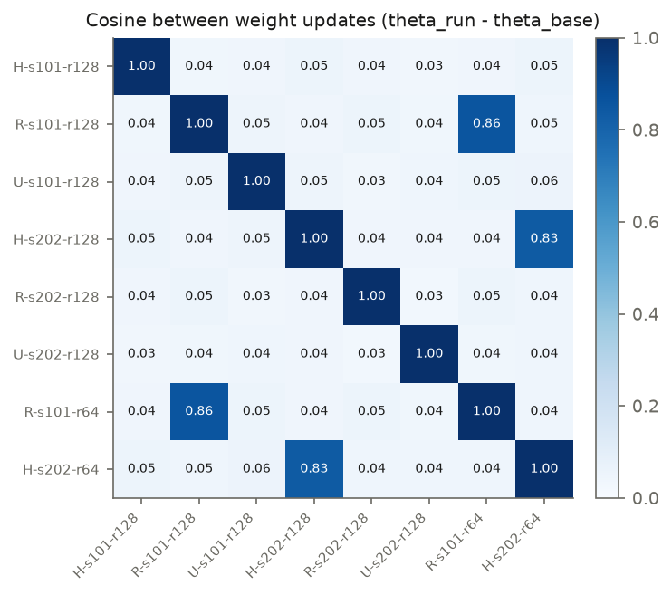
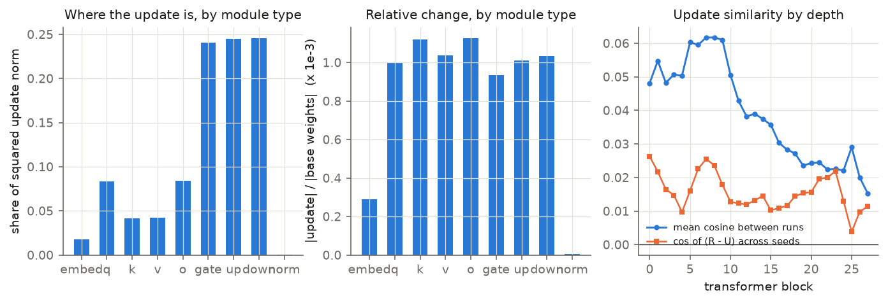
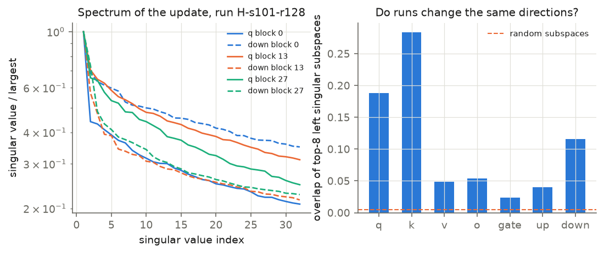
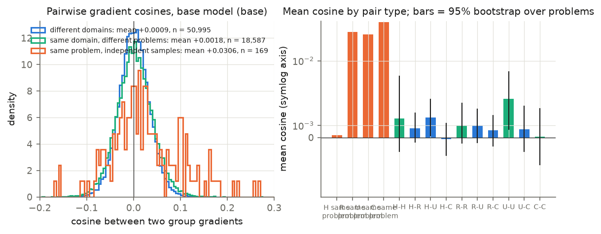
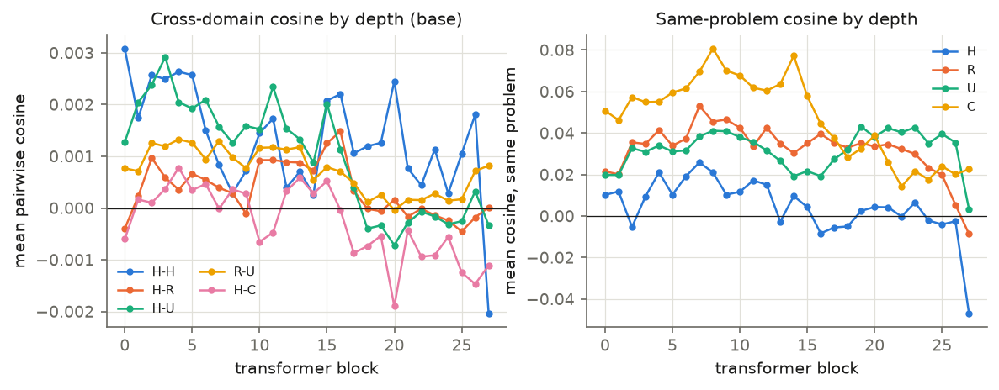
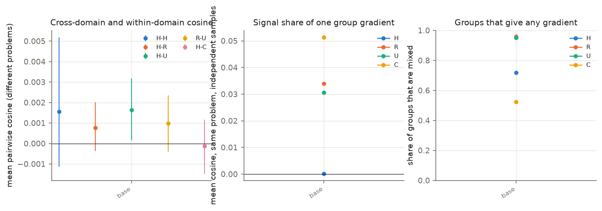
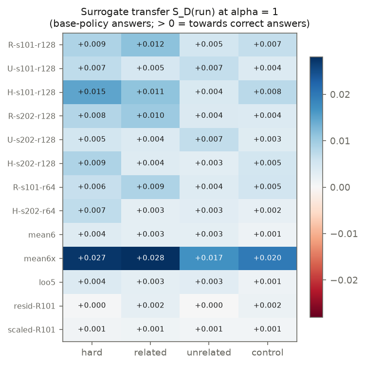
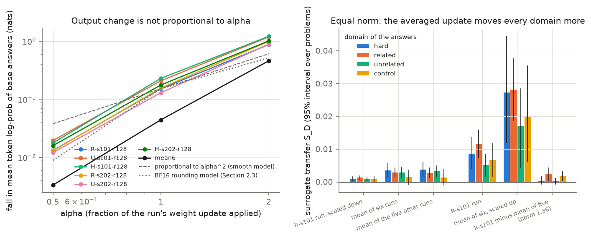
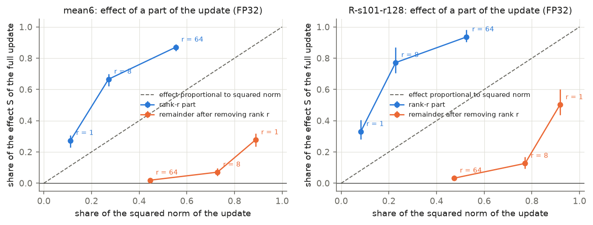

# Why the first study saw no interference: measurements, theory and proposed experiments

Purpose: this document explains why GRPO training of Qwen3-1.7B on three math domains showed no interference between
the domains. Section 1 reports what we measured on the stored checkpoints. Section 2 builds the explanation and marks
each claim as derived, supported or speculation. Section 3 proposes the experiments that would separate the
explanations that remain. Background theory and literature: [`00-initial-theory.md`](00-initial-theory.md).

Status of the evidence (2026-11-13, 03:45 EST): Sections 1.1–1.7 rest on completed jobs. One value is **pending**:
the dev accuracy of the weight set mean6x (Section 1.5). Six of the seven accuracy rows are measured. The owner removed all gradient measurements on Qwen3-0.6B and Qwen3-4B from this study on 2026-11-12.
They are future work (Section 3, M1).

## Summary

**The domains did not interfere because their training signals did not point in different directions.** At the base
model, the expected gradient of each domain has a small positive overlap with the expected gradient of every other
domain. The overlap between two domains is about as large as the overlap between two problems of one domain. We found
no negative overlap between domains in any measurement. A negative overlap appears only when the reward itself
changes: a brevity reward opposes the correctness reward (`04-domains-to-explore.md`, Section 4).

The measurements give five results.

1. **Gradients of different problems are almost orthogonal, with a small positive mean.** The mean cosine between two
   group gradients is 0.020 for the same problem, 0.0003–0.0013 for two problems of one domain, and 0.0003–0.0007 for
   two domains. Conflict rates between different problems are 48.7–49.8% (independent directions give 50%).
2. **Every run moved every domain in the helpful direction.** Each of the six trained models raises the probability of
   correct base-model answers relative to wrong ones, on all four domains (24 of 24 values positive; 17 of 24 with a
   95% interval above zero). Each practice arm moves its own domain about 1.7–1.8 times more than the other runs do.
3. **About 96% of each run's weight update is specific to that run.** Two runs share a cosine of 0.03–0.05, and the
   arm does not matter. The shared 4% carries most of the effect: removing it from one run removes 75–96% of that
   run's effect on the four domains.
4. **The shared part formed in rounds 1–64.** First-half updates of two runs have cosine 0.044; second-half updates
   0.004. By round 64 the repeatable part of the gradient is no longer measurable at our sample size.
5. **The model that is sampled and scored is a rounded copy of the trained weights.** Only 20–23% of the weights
   differ from the base model after rounding to BF16. Rounding makes the output change grow much faster than the
   update: half of an update gives 8–9% of the output change with rounded weights and 26–27% in FP32.

The verdicts on the hypotheses of the mandate:

| Hypothesis | Verdict |
|---|---|
| Gradient alignment from pre-training | Supported in a weak form: no conflict, small positive overlap. Not supported in a strong form: the cosines are near zero, not large |
| Capacity | Not needed to explain our result, because there is no conflict to absorb. Not tested: we have one model size. The learned change needs little of the model: 8 directions per weight matrix (0.6% of the parameters) carry 67–77% of the effect (Section 1.7) |
| Domains too similar | Supported, and stronger than expected: even geometry and probability problems share the direction |
| Training too short, learning rate too small | Not supported as stated: the update is small (0.05% of the weight norm), but the outputs changed a lot, so "too small to matter" is false. A longer run could still meet conflict later; untested |
| Evaluation cannot detect interference | Supported for the one-update test of the first study. Not the reason for the main result |

The more important question that came out of this work is different from the one we started with. The runs learned
mostly one thing that all domains share, and sampling noise produced most of the weight change. The useful next
question is what that shared direction is and when domain-specific signal exists at all. Section 3 is built around it.

## Terms used in this document

| Term | Meaning |
|---|---|
| Group | the 8 answers sampled for one problem in one round. GRPO computes one gradient per group |
| Mixed group | a group with at least one correct and one wrong answer. Only mixed groups give a gradient |
| Group gradient | g = (1/8) Σ A_i ∇(mean token log-probability of answer i), A_i = (r_i − mean r)/(sd r + 1e-6), as in the training code |
| Domain | the pool a problem comes from: hard (H), related = factoring drills (R), unrelated = remainder drills (U), control = other subjects (C) |
| Update of a run | τ = trained weights − base weights (FP32) |
| Cosine | ⟨a, b⟩ / (‖a‖ ‖b‖) |
| Conflict rate | share of gradient pairs with negative cosine. Independent directions give 50% (00, §2.3) |
| BF16 | 16-bit floating point with 8 significant bits. The forward pass and the sampler use BF16 copies of the FP32 weights |

## 1. Empirical understanding

### 1.0 What we measured, and where the code is

All measurements use forward and backward passes on stored checkpoints. No model was trained. One model size exists in
the first study (Qwen3-1.7B), so this study has no measurement on a second size (Section 1.7).

| Measurement | Job (`qis-ui-…`) | Code | Table |
|---|---|---|---|
| Weight updates of the six runs | `wdelta` | `src/qis/interf/wdelta.py`; `build/analyze_wdelta.py`, `build/analyze_halves.py` | `tables/wdelta_summary.json`, `tables/halves.json` |
| Group gradients at the base model and five trained checkpoints | `geom-base`, `geom-base64`, `geom-<run>-r64/r128` | `src/qis/interf/grad_geom.py`, `sketch.py`, `summ.py`; `build/analyze_geom.py`, `build/analyze_geom_extra.py` | `tables/geom_summary.json`, `tables/geom_extra.json` |
| Log-probability of base answers under each trained model | `lp` | `src/qis/interf/logp_path.py`; `build/analyze_lp.py` | `tables/lp_summary.json` |
| Precision test of the response along the update | `lpprec` | `src/qis/interf/logp_path.py --precision`; `build/analyze_lpprec.py` | `tables/lpprec.json` |
| Rank-r parts of the update (Section 1.7) | `lowrank-mean6`, `lowrank-R101` | `src/qis/interf/lowrank_path.py`; `build/analyze_lowrank.py` | `tables/lowrank.json` |
| Averaged checkpoints | `soup`, `soup-b` | `src/qis/interf/make_soup.py`; `qis.evaluate_ckpt` | 1.5 (mean6x accuracy pending) |

Paths are relative to the repository root for `src/` and to this folder for `build/` and `tables/`. The job recipes
are in `research/Nov-12-2026-01-vineeth-babel-slurm-understanding-interference/recipes/`.

**How gradients are compared.** The model has 1.72 × 10⁹ parameters, so we cannot store one gradient per group. We
store a count sketch of each gradient: a random signed projection to 2²¹ numbers that preserves inner products without
bias. Norms are exact. The ratio of sketch norm to exact norm is 0.998–1.002. The sketch adds noise of about
2⁻¹⁰·⁵ = 0.0007 to one cosine; means over thousands of pairs are much more precise.

**Samples.** For each checkpoint we sample answers from that checkpoint, as training does. The main base-model run
(`geom-base64`) uses 64 answers per problem, split into 8 groups, for all problems of the four pools: 1,512 mixed
groups from 221 problems. The other runs use 16 answers per problem (2 groups). Confidence intervals resample problems
(300 draws, 95%).

### 1.1 Weight updates: the runs share 4% of their update, and the arm does not matter

| Quantity (round 128, six runs) | Value |
|---|---|
| Size of the update relative to the weights, ‖τ‖/‖θ‖ | 4.9 × 10⁻⁴ to 5.8 × 10⁻⁴ |
| Cosine between two runs, same seed, different arm | mean 0.039 (0.029–0.048) |
| Cosine between two runs, same arm, different seed | mean 0.050 (0.045–0.054) |
| Cosine between two runs, different arm and seed | mean 0.039 (0.031–0.047) |
| Cosine expected for independent directions | 0 ± 2.4 × 10⁻⁵ |
| Share of coordinates where two runs moved in the same direction | 54% |
| Mean absolute change of one weight | 11–13 learning rates (512 steps of 2 × 10⁻⁶) |
| Stable rank of the update of one weight matrix (median of the 196 matrices in the blocks) | 12.7 |

*Figure W1. Cosine between the weight updates of the runs. Code: `build/analyze_wdelta.py`.*

Three observations follow.

1. **The updates are far from random, and far from equal.** A cosine of 0.04 is 1,600 times the value for
   independent directions. It also means that 96% of the squared norm of each update is not shared with another run.
2. **The arm leaves a small trace.** The direction "R update minus U update" has cosine 0.016 between the two seeds.
   The same number is 0.012 for R minus H and 0.009 for U minus H. Controls built from seed differences give at
   most 0.0045. So arm-specific learning exists, and it is about 1% of the update.
3. **The update looks like a random walk with a small drift.** A weight that moved one learning rate in the same
   direction at each of 512 steps would move 512 learning rates. A weight that moved one learning rate in a random
   direction at each step would move about 18. The measured mean is 11–13.

**Where the update sits.** The three MLP matrices of each block hold about 24% of the squared update each. The
attention matrices hold 4–8% each and the embedding 2%. The relative change is about 10⁻³ for every matrix type and
0.3 × 10⁻³ for the embedding. The value for the whole model (0.5 × 10⁻³) is lower because the normalisation weights
hold a large share of the weight norm and almost did not change (relative change 6 × 10⁻⁶). The cosine between runs is 0.05–0.06 in blocks 0–9 and falls to about 0.02 in the last
blocks. It is highest in the embedding (0.16).

*Figure W2. Share of the update and cosine between runs, by matrix type and by depth.*

**The updates are low-rank and share input directions.** The top 8 singular directions hold 25% of the squared update
of a matrix (a random matrix of the same shape: 0.5%). Two runs share 49% of their top-8 input subspace and 11% of
their top-8 output subspace (random: 0.5%). The runs read from the same directions and write to different ones.

*Figure W3. Singular-value energy and subspace overlap of the updates.*

**The shared part formed in the first half of training.** Two runs have a round-64 checkpoint (R-s101 and H-s202), so
we can split their updates into rounds 1–64 and rounds 65–128.

| Pair of update halves | Cosine |
|---|---|
| R-s101 first half, H-s202 first half | 0.044 |
| R-s101 second half, H-s202 second half | 0.004 |
| R-s101 first half, R-s101 second half | 0.018 |
| H-s202 first half, H-s202 second half | 0.010 |
| The four other runs (full update) with a first half | 0.036–0.057 |
| The four other runs (full update) with a second half | −0.001 to 0.016 |

The second half is also smaller: its norm is 0.65 (R-s101) and 0.75 (H-s202) against 1.06 and 1.13 for the first
half. The learning rate was constant, so a schedule does not explain this. Code: `build/analyze_halves.py`.

### 1.2 Gradients at the base model: no conflict, and domains do not separate

*Figure G1. Left: distribution of the cosine between two group gradients (16-answer run). Right: mean cosine by pair
type with 95% intervals (64-answer run); X\* = two groups of the same problem. Code: `build/analyze_geom.py`.*

| Pair type (base model, 64 answers) | Pairs | Mean cosine | 95% interval | Conflict rate |
|---|---|---|---|---|
| Same problem, independent samples | 4,778 | 0.0201 | — | 40–44% |
| H–H, different problems | 40,188 | 0.00025 | [−0.00033, 0.00100] | 49.8% |
| R–R, different problems | 114,301 | 0.00085 | [0.00019, 0.00159] | 49.2% |
| U–U, different problems | 114,307 | 0.00125 | [0.00042, 0.00228] | 48.7% |
| C–C, different problems | 33,239 | 0.00042 | [−0.00026, 0.00112] | 49.6% |
| H–R | 138,334 | 0.00044 | [0.00005, 0.00084] | 49.5% |
| H–U | 138,334 | 0.00046 | [−0.00007, 0.00089] | 49.5% |
| R–U | 232,324 | 0.00042 | [−0.00006, 0.00091] | 49.5% |
| H–C | 74,907 | 0.00027 | [−0.00020, 0.00076] | 49.5% |
| R–C | 125,802 | 0.00039 | [−0.00003, 0.00081] | 49.4% |
| U–C | 125,802 | 0.00066 | [0.00017, 0.00122] | 49.1% |

The standard deviation of one pair cosine is 0.031–0.042. Three facts matter.

1. **One group gradient is mostly sampling noise.** Two independent groups of the *same* problem have a cosine of
   0.020. So about 2% of the squared norm of a group gradient repeats when the same problem is sampled again. The
   other 98% is noise from the 8 sampled answers.
2. **Different problems share very little, but what they share is positive.** All ten means are positive. Four intervals exclude zero; the other six start just below zero. No mean is negative.
3. **The domain boundary is invisible.** Cross-domain cosines (0.0003–0.0007) are as large as within-domain cosines
   (0.0003–0.0013). The ratio of the cross-domain inner product to the geometric mean of the two within-domain inner
   products is 0.45–1.26 over the six domain pairs (`tables/geom_extra.json`, no interval available). A value of 1
   means the two domains have the same expected gradient direction; a value of 0 means unrelated directions.

**The cosine between the expected domain gradients.** A group gradient is noisy, so the mean pair cosine understates
how well the *expected* gradients of two domains agree. `summ.py` estimates that cosine, ρ, by dividing the mean
cross-domain inner product by the signal power of each domain.

| Domain pair | ρ | 95% interval |
|---|---|---|
| R–U | 0.29 | [−0.08, 0.49] |
| R–C | 0.41 | [−0.05, 0.67] |
| U–C | 0.56 | [0.11, 0.83] |
| H–R | 0.55 | [−0.05, 1.21] |
| H–U | 0.30 | [−0.52, 0.92] |
| H–C | 0.21 | [−0.53, 1.02] |

All six estimates are positive. The intervals for the pairs with the hard pool are wide, because hard problems give
weaker signal (their same-problem cosine is 0.011, against 0.020–0.023 for the other pools). One caution: this
estimator's denominator includes same-problem pairs, so it understates |ρ| by a factor of about 1.3–1.7. With that
correction the value ρ = −1/2, which the ray-interference model needs (Section 2.4), stays excluded for R–U, R–C and
U–C. It is not excluded for H–U and H–C.

**Where in the network the shared part sits.** The same-problem cosine is 1.2–2.7% in blocks 0–26. The cosine between
different problems is 4–8 × 10⁻⁴ in blocks 0–17 and 0–2 × 10⁻⁴ in blocks 18–27. The part of the gradient that
different problems share sits in the first two thirds of the network. The weight updates show the same pattern
(Section 1.1).

*Figure G4. Cosine between group gradients by transformer block, base model, 64 answers.*

### 1.3 Gradients during training: the repeatable part fades by round 64

*Figure G2. Left: mean cosine between different problems, by domain pair and checkpoint. Middle: same-problem cosine.
Right: share of groups that are mixed.*

| Checkpoint | Pass rate H / R / U | Mixed groups | Same-problem cosine | Cross-domain cosine | Conflict rate, cross-domain |
|---|---|---|---|---|---|
| Base, 64 answers | 0.21 / 0.59 / 0.58 | 1,512 | 0.0201 (4,778 pairs) | 0.00045 | 49.4% |
| R-s101, round 64 | 0.79 / 0.97 / 0.94 | 139 | 0.0070 (41 pairs) | 0.00021 | 49.3% |
| H-s202, round 64 | 0.81 / 0.91 / 0.88 | 231 | −0.0017 (80) | −0.00011 | 50.2% |
| R-s202, round 128 | 0.81 / 0.97 / 0.89 | 185 | 0.0102 (61) | 0.00039 | 49.5% |
| U-s202, round 128 | 0.81 / 0.94 / 0.96 | 170 | 0.0069 (58) | 0.00034 | 49.2% |
| H-s101, round 128 | 0.89 / 0.94 / 0.91 | 154 | −0.0029 (44) | 0.00036 | 49.1% |
| Five trained checkpoints, pooled | | 879 | 0.0037 (284) | 0.00019 (58,964 pairs) | 49.6% |

Pass rates are for 16 answers per problem on the training pools (the hard pool is the *training* hard pool, so its
rate is higher than a held-out score). Two things change during training.

1. **Fewer groups give a gradient.** At the base model 95% of practice groups and 72–78% of hard groups are mixed. At
   the trained checkpoints 13–48% of practice groups and 36–63% of hard groups are mixed. This agrees with the first
   study's finding that the practice pools stopped giving signal by about round 64.
2. **The gradient that remains repeats less.** The pooled same-problem cosine is 0.0037 against 0.0201 at the base
   model. With 284 pairs and a pair standard deviation of about 0.04, the standard error is about 0.0024. So the
   repeatable part fell by a factor of at least 2 and may be zero.

The cross-domain cosine stays at or slightly above zero at every checkpoint. We see no sign that domains begin to
conflict later in training. The trained-checkpoint runs use 16 answers per problem, so they cannot resolve cosines
below about 0.001 for one domain pair.

**Adam-scaled gradients.** Adam divides each gradient coordinate by a running estimate of its size. The optimizer
state exists for five checkpoints, so we also computed cosines between gradients scaled the way Adam scales them. The
pooled cross-domain cosine of the scaled gradients is 0.0000–0.0002 per checkpoint, and the same-problem cosine is
between −0.008 and 0.016. The conclusion is the same: no conflict, very little shared signal.

### 1.4 What each run did to each domain: all effects positive

The gradient tells us the direction each domain wants. The next measurement tells us what each run delivered. We take
answers sampled from the *base* model, 8 per problem, and compute their log-probability under each trained model. For
a domain D and a run,

    S_D(run) = mean over mixed groups of D of (1/8) Σ_i A_i [lp_i(run) − lp_i(base)],

where lp_i is the mean token log-probability of answer i and A_i its GRPO advantage. S_D is the change of the GRPO
objective of domain D, evaluated at the base model's samples. S_D > 0 means the run made correct base answers more
likely relative to wrong ones. S_D < 0 for a domain the run did not train on would be interference in the sense of
definition D2 of `00-initial-theory.md`.

*Figure L1. S_D for each trained model (rows) and domain (columns). Code: `build/analyze_lp.py`.*

| Run (round 128) | S hard | S related | S unrelated | S control |
|---|---|---|---|---|
| R-s101 | 0.0086 | **0.0115** | 0.0051 | 0.0067 |
| R-s202 | 0.0081 | **0.0101** | 0.0040 | 0.0038 |
| U-s101 | 0.0072 | 0.0048 | **0.0066** | 0.0039 |
| U-s202 | 0.0052 | 0.0038 | **0.0069** | 0.0034 |
| H-s101 | **0.0147** | 0.0112 | 0.0043 | 0.0075 |
| H-s202 | **0.0087** | 0.0037 | 0.0030 | 0.0052 |

Bold marks the domain that the arm practised in slots 8–15. All arms train on hard problems in slots 0–7. The numbers
of mixed groups are 34 (hard), 61 (related), 59 (unrelated), 33 (control). Intervals are in `tables/lp_summary.json`.

1. **No negative entry.** All 24 values are positive; 17 have a 95% interval above zero. The R runs raise the
   remainder domain, the U runs raise the factoring domain, and all runs raise the control subjects.
2. **Each practice arm moved its own domain more than the other runs did, on average.** The R runs score 0.0101–0.0115 on the related pool against
   0.0037–0.0112 for the other four runs. The U runs score 0.0066–0.0069 on the unrelated pool against 0.0030–0.0051.
   The ranges overlap for one run (H-s101 scores 0.0112 on the related pool). The ratio of the means is 1.8 for R and
   1.7 for U. This is domain-specific learning, on top of the common gain.
   The first study's probes did not show it; the probes started at 81% and had little room.
3. **The log-probability of base answers fell for correct and wrong answers alike.** Under the trained models the
   mean token log-probability of a base answer is lower by 0.11–0.28 nats, for all domains. S_D comes from the small difference between the two: for R-s101 on the hard pool, correct answers fall by 0.146 and wrong ones by 0.167. So the main
   change of the trained models is common to all answers. Section 1.6 returns to this.

### 1.5 Averaged updates: the shared 4% carries the effect

If the useful part of an update is the part the runs share, then averaging the six updates should keep the effect and
remove run-specific noise. We built five weight sets (`make_soup.py`).

| Weight set | Definition | Norm | Cosine with the R-s101 update |
|---|---|---|---|
| mean6 | base + mean of the six updates | 0.60 | 0.43 |
| mean6x | mean6 scaled to the norm of the R-s101 update | 1.26 | 0.43 |
| loo5 | base + mean of the five updates other than R-s101 | 0.65 | 0.09 |
| resid-R101 | base + (R-s101 update − loo5 update) | 1.36 | 0.88 |
| scaled-R101 | R-s101 update scaled to the norm of mean6 | 0.60 | 1.00 |

The norm of mean6 agrees with a simple model. If each update is a shared part plus an independent part, and two
updates have cosine 0.04, the mean of six has 0.04 + 0.96/6 = 0.20 of the squared norm of one update, so 0.45 of its
norm. The measured ratio is 0.598/1.332 = 0.45, where 1.332 is the mean norm of the six updates.

*Figure L2. Left: fall in mean token log-probability of base answers against the fraction α of the update that is
applied (Section 1.6). Right: S_D for weight sets of equal norm.*

| Weight set | S hard | S related | S unrelated | S control |
|---|---|---|---|---|
| R-s101 update (norm 1.26) | 0.0086 | 0.0115 | 0.0051 | 0.0067 |
| mean6x (norm 1.26) | 0.0273 | 0.0280 | 0.0169 | 0.0198 |
| resid-R101 (norm 1.36) | 0.0004 | 0.0024 | 0.0002 | 0.0017 |
| scaled-R101 (norm 0.60) | 0.0010 | 0.0013 | 0.0008 | 0.0008 |
| mean6 (norm 0.60) | 0.0036 | 0.0028 | 0.0028 | 0.0014 |
| loo5 (norm 0.65) | 0.0038 | 0.0027 | 0.0032 | 0.0014 |

1. **At equal norm the averaged update is 2.4–3.3 times more effective than one run** (mean6x against R-s101). The same holds at the smaller norm (mean6 against
   scaled-R101: 1.8–3.6 times).
2. **Removing the shared part removes most of the effect.** resid-R101 keeps 88% of the direction of the R-s101
   update, and its norm is larger (1.36 against 1.26). Its S falls by 95% on hard, 79% on related, 96% on unrelated and 75% on control.
3. **A small effect remains on the related pool and on control.** The residual of this R run keeps a positive effect on the related pool
   (0.0024, interval [0.0005, 0.0043]) and on control (0.0017, [0.0003, 0.0031]). On hard and unrelated it is zero
   within the interval.
4. **An average that never saw R-s101 does as well as one that did.** loo5 matches mean6 on every domain.

These are effects on the log-probability of base answers. Whether the averaged weights also *score* well is the
direct test. Jobs `qis-ui-soup` and `qis-ui-soup-b` evaluate each model on the first study's dev panel (53 problems ×
32 answers = 1,696 answers, 12,288-token limit).

| Model | Update norm | pass@1 | pass@8 | Mean answer length (tokens) | Answers cut at the limit |
|---|---|---|---|---|---|
| Base | 0 | 41.4% | 65.3% | 1,734 | 0% |
| R-s101, round 128 | 1.26 | 72.4% | 89.9% | 5,753 | 19.0% |
| mean6 (mean of six runs) | 0.60 | 63.6% | 86.8% | 4,078 | 6.4% |
| scaled-R101 (R-s101 at the norm of mean6) | 0.60 | 52.7% | 78.3% | 2,947 | 0.4% |
| resid-R101 (R-s101 minus the mean of the other five) | 1.36 | 43.3% | 72.4% | 3,063 | 1.2% |
| loo5 (mean of the five runs without R-s101) | 0.65 | 64.3% | 83.3% | 3,966 | 5.7% |
| mean6x (mean6 scaled to the norm of R-s101) | 1.26 | pending | pending | pending | pending |

The accuracy results agree with the log-probability results.

1. **At equal norm the averaged update gains twice as much as one run.** mean6 gains 22.2 points of pass@1 over the
   base model; scaled-R101 gains 11.3 points at the same norm of 0.60.
2. **Removing the shared part removes the accuracy gain.** resid-R101 keeps 88% of the direction of the R-s101
   update, with a larger norm. It gains 1.9 points, against 31.0 for R-s101.
3. **The mean of the six runs keeps 71% of the gain of one run** (22.2 of 31.0 points) with an update of half the
   norm. The mean holds two runs of each arm, so the part that the arms share carries most of the accuracy gain.
4. **Answers become longer in every weight set, also without an accuracy gain.** resid-R101 writes answers 1.8 times
   longer than the base model and gains 1.9 points.

We did not compute intervals for these values; the summaries hold totals only. The first study reported a repeat
noise of 2.5–3.1 points for its one-update test. If the dev panel behaves alike, the 1.9 points of resid-R101 are
within noise.

5. **An average that never saw R-s101 scores as well as one that did.** loo5 reaches 64.3% pass@1 against 63.6% for
   mean6. The gain is therefore not a copy of R-s101 inside the average.

**Pending:** the mean6x row. Its evaluation started at 02:20 EST on 2026-11-13 in job `qis-ui-soup-b`. It gives the
comparison with R-s101 at equal norm 1.26.

### 1.6 The output change is not proportional to the update, and rounding is the cause

We applied a fraction α of each run's update, θ_base + α τ, and measured the mean token log-probability of base
answers (Figure L2, left).

| Quantity, six runs × four domains | α = 0.5 relative to α = 1 | α = 2 relative to α = 1 |
|---|---|---|
| Fall in log-probability of base answers | 0.076–0.100 | 4.9–7.3 |
| A smooth second-order model (fall ∝ α²) | 0.25 | 4 |
| S_D (median; range) | 0.13 (0.02–0.31) | 2.1 (−1.9 to 6.5) |
| A first-order model (S ∝ α) | 0.5 | 2 |

Half of the update produces 8–10% of the output change, not 25–50%. Two facts explain why this can happen.

**Fact 1: the fall in log-probability is a second-order quantity (derived).** The answers are samples of the base
policy. For samples x of a policy π₀, E[log π₁(x) − log π₀(x)] = −KL(π₀ ‖ π₁) ≤ 0. The first-order term is zero,
because E[∇ log π₀(x)] = 0. So a smooth model predicts a fall proportional to α², and the measured fall of 0.11–0.28
nats per token is a divergence between the trained and the base policy, not a loss of skill.

**Fact 2: the forward pass rounds the weights (measured).** Training keeps FP32 weights. The forward pass, the
gradient computation and the sampler use BF16 copies. The base model is stored in BF16, so every base weight lies
exactly on a BF16 value. A weight then changes in the forward pass only if its accumulated FP32 change exceeds half a
BF16 step.

| Quantity (`tables/wdelta_summary.json`) | Round 64 | Round 128 |
|---|---|---|
| Share of weights whose BF16 value differs from the base model | 16.8–17.7% | 19.5–22.7% |
| Cosine between the rounded update and the FP32 update | 0.60–0.61 | 0.64–0.69 |
| Norm of the rounded update relative to the FP32 update | 0.78–0.80 | 0.83–0.88 |

**A rounding model (derived; supported at α < 1).** Assume the accumulated change of a weight is Gaussian, and the
half-step is 1.25 standard deviations. This one number reproduces the 21% of changed weights at α = 1. At α = 0.5 the
half-step is 2.5 standard deviations and only 1.2% of the weights change. The squared size of the rounded update then
predicts an output change at α = 0.5 of 0.059 times the change at α = 1. The measurement is 0.076–0.100; the smooth
model gives 0.25. At α = 2 the rounding model predicts 3.4 and the smooth model 4; the measurement is 4.9–7.3, so a
further nonlinearity acts at large updates. The model uses one threshold for all weights, which is a simplification.

**The precision test confirms that rounding of the weights is the cause (measured).** Job `qis-ui-lpprec` repeated
the measurement in three ways, for R-s101 at round 128 and for mean6 (the mean of the six runs, Section 1.5), on the
872 hard and related answers (109 problems, 95 mixed groups). Code: `src/qis/interf/logp_path.py --precision`,
`build/analyze_lpprec.py`; numbers: `tables/lpprec.json`. Each ratio is relative to α = 1 in the same row.

| Weights; compute | Update | Fall at α = 1 (nats per token) | α = 0.25 | α = 0.5 | α = 2 |
|---|---|---|---|---|---|
| FP32; FP32 | R-s101 | 0.415 | 0.066 | 0.274 | 2.92 |
| FP32; FP32 | mean6 | 0.291 | 0.060 | 0.255 | 3.27 |
| Rounded to BF16; FP32 | R-s101 | 0.172 | 0.007 | 0.087 | 5.72 |
| Rounded to BF16; FP32 | mean6 | 0.045 | 0.007 | 0.076 | 10.4 |
| FP32 under BF16 autocast (training setup) | R-s101 | 0.173 | 0.007 | 0.087 | 5.68 |
| FP32 under BF16 autocast (training setup) | mean6 | 0.045 | 0.006 | 0.075 | 10.4 |
| Smooth model (fall ∝ α²) | | | 0.0625 | 0.25 | 4 |

The table gives three results.

1. With FP32 weights the fall follows α² for α ≤ 1 (0.060–0.066 at α = 0.25, 0.255–0.274 at α = 0.5). At α = 2 it is
   below α² (2.9–3.3). The smooth model holds for small updates.
2. Rounding the weights alone reproduces the training setup: the falls agree within 1% at α ≥ 0.5 and within
   0.00003 nats at α = 0.25. BF16 arithmetic in the forward pass adds nothing measurable. The cause is the rounding of the weights.
3. Rounding removes a large part of the effect of the full update. With rounded weights the fall at α = 1 is 41% of
   the FP32 fall for R-s101 and 15% for mean6. mean6 has half the norm of R-s101, so fewer of its weights cross a
   rounding boundary.

The same holds for the surrogate S on these two domains (pooled; 95% interval over problems):

| Weights; compute | Update | S at α = 0.5 | S at α = 1 | S at α = 2 |
|---|---|---|---|---|
| FP32; FP32 | R-s101 | 0.0075 [0.0053, 0.0097] | 0.0146 [0.0080, 0.0213] | 0.0022 [−0.0141, 0.0179] |
| FP32; FP32 | mean6 | 0.0047 [0.0029, 0.0064] | 0.0169 [0.0116, 0.0224] | 0.0320 [0.0181, 0.0463] |
| Rounded to BF16; FP32 | R-s101 | 0.0014 [0.0009, 0.0018] | 0.0105 [0.0073, 0.0137] | 0.0061 [−0.0081, 0.0193] |
| Rounded to BF16; FP32 | mean6 | 0.0003 [0.0002, 0.0005] | 0.0031 [0.0020, 0.0042] | 0.0254 [0.0177, 0.0327] |

In FP32, half of the R-s101 update gives 51% of its S, as the first-order model predicts. For mean6 it gives 28%, which
the first-order model does not explain; the intervals are wide. In FP32, mean6 has an S at least as large as R-s101
(0.0169 against 0.0146) at half the norm, so the result of Section 1.5 does not depend on rounding. Rounding hides
most of it: the rounded mean6 has 18% of its FP32 value of S.

The single-threshold rounding model above is too simple at α = 2. It predicts 3.4; rounded weights give 5.7 and 10.4
on these two domains, and FP32 weights give 2.9–3.3. The faster growth at large α is therefore also an effect of
rounding.

**Answers became much longer.** On the dev set the base model's answers have a mean length of 1,734 tokens. The
answers of R-s101 at round 128 have a mean length of 5,753 tokens, and 19% of them reach the 12,288-token limit (job
`qis-ui-soup`, 53 problems × 32 answers). The first study reported the truncation; the factor of 3.3 in length is
new. It is a change that all domains share. We measured the length for the models of Section 1.5 only.

### 1.7 Model size and capacity: what one model size can show

**Main point.** Our checkpoints cannot test the capacity hypothesis. They can measure how much of the model the
learned change needs. It needs little: 0.6% of the parameters carry two thirds of the effect.

**What the literature tests, and how.** We reviewed the work that links model size to interference (verified entries:
`research/Nov-12-2026-01-vineeth-babel-slurm-understanding-interference/LIT-NOTES.md`). Every result that supports
"larger models interfere less" comes from a comparison across sizes, widths or trainable subspaces.

| Source | What was varied | Result |
|---|---|---|
| Aghajanyan et al. 2020 | model size; training in a random subspace | the subspace dimension that reaches 90% of full performance on MRPC falls from 1,608 (BERT-Base) to 207 (RoBERTa-Large) |
| Ortiz-Jimenez et al. 2023 | CLIP model size | "larger models are more weight disentangled" |
| Yadav et al. 2024 | PaLM-2 size, 1B to 64B | "larger models are consistently easier to merge" |
| Shaham et al. 2023 (abstract only) | translation model size against data size | substantial interference mainly when the model is very small relative to the data |
| Luo et al. 2023 | BLOOMZ size, 1B to 7B | the opposite direction: forgetting grows with size (the authors note the higher starting score as a possible cause) |

No source tests capacity on checkpoints of one size. The direction of the size effect is also not settled (last row).

**Sparse updates are not evidence of spare capacity.** Mukherjee et al. 2025 report that RL fine-tuning changes only
5–30% of the parameters and read this as a sub-network. Their models are stored in BF16. Shenfeld et al. 2025 show
that the sparsity comes from BF16 training and disappears in FP32 with equal performance. Miahi and Belilovsky 2026
and Gao and Gao 2026 report the same rounding effect under GRPO, the latter on Qwen3-1.7B. Zhu et al. 2025 qualify
it: rounding amplifies the sparsity and does not explain all of it. Our data agree with the rounding explanation:
20–23% of the BF16 weights changed, the FP32 update is dense, and rounding alone reproduces the training-setup
response (Section 1.6). We therefore do not count the 20–23% as a measure of capacity use.

**What we measured: the number of directions that carry the effect.** For each of the 197 weight matrices (196 in the blocks, and the embedding) we split
the update into its best rank-r part (truncated SVD) and the remainder. We applied each part alone to the base model,
with FP32 weights and FP32 compute, and measured S and the fall in log-probability on the base answers of the four
domains (1,888 answers: 8 for each of the 236 problems of the four pools). Code: `src/qis/interf/lowrank_path.py`, `build/analyze_lowrank.py`; numbers:
`tables/lowrank.json`; jobs `qis-ui-lowrank-mean6` and `qis-ui-lowrank-R101`. Intervals: bootstrap over problems.

| Part of the update applied | mean6: share of squared norm | mean6: S relative to full | mean6: fall relative to full | R-s101: share of squared norm | R-s101: S relative to full | R-s101: fall relative to full |
|---|---|---|---|---|---|---|
| Rank 1 per matrix | 11% | 0.27 [0.23, 0.31] | 0.27 | 8% | 0.33 [0.28, 0.41] | 0.19 |
| Rank 8 per matrix | 27% | 0.67 [0.62, 0.70] | 0.69 | 23% | 0.77 [0.70, 0.87] | 0.60 |
| Rank 64 per matrix | 55% | 0.87 [0.85, 0.89] | 0.88 | 53% | 0.94 [0.91, 0.98] | 0.85 |
| Remainder after rank 1 | 89% | 0.28 [0.23, 0.32] | 0.24 | 92% | 0.50 [0.44, 0.60] | 0.37 |
| Remainder after rank 8 | 73% | 0.07 [0.05, 0.10] | 0.04 | 77% | 0.13 [0.09, 0.17] | 0.08 |
| Remainder after rank 64 | 45% | 0.02 [0.01, 0.03] | 0.006 | 47% | 0.03 [0.02, 0.05] | 0.013 |

The full update gives S = 0.0140 [0.0100, 0.0179] for mean6 (norm 0.60) and 0.0126 [0.0082, 0.0170] for R-s101 at
round 128 (norm 1.26). S is the mean over the four domains; 187 mixed groups.

*Figure C1. Effect of the rank-r part of the update and of the remainder, relative to the full update.*

The table gives four results.

1. **Eight directions per matrix carry most of the effect.** The rank-8 part holds 23–27% of the squared norm and
   gives 67–77% of S. The remainder holds 73–77% of the squared norm and gives 7–13% of S.
2. **Almost half of the update has no measurable effect.** The remainder after rank 64 holds 45–47% of the squared
   norm. It gives 2–3% of S and about 1% of the fall in log-probability.
3. **The result holds for one run and for the mean of six runs.** Averaging is therefore not what makes the effect
   low-rank. It also holds for each domain: the rank-8 part gives 0.62–0.68 of S per domain for mean6 and 0.63–0.86
   for R-s101.
4. **The parts do not add.** The rank-1 part and its remainder give 0.27 + 0.28 = 0.55 of S for mean6 and 0.83 for
   R-s101. S is not a linear function of the update at this size, as Section 1.6 found for mean6 at α = 0.5.

**What this does and does not show.**

1. It shows that the *demand* is small. A rank-8 change per matrix has 10.0 × 10⁶ parameters, 0.58% of the model
   (computed from the matrix shapes). The training signal of four domains fits in it together.
2. It does not show that the model has spare capacity for conflicting demands. The domains ask for one shared
   change (Sections 1.4 and 1.5), so nothing competed for these directions.
3. The rank-r directions come from the finished update. A run restricted to rank 8 from the start may not find them.
4. Three earlier results point the same way. The update is 0.05% of the weight norm. Two runs share 49% of their
   top-8 input subspace per matrix. The shared 4% of the update carries 75–96% of the effect.

**Conclusion for this study.** A capacity limit can matter only where two domains need changes that oppose each
other. We found no such pair, so the capacity hypothesis is neither supported nor refuted. A test needs (a) a pair
of domains with measured conflict (`04-domains-to-explore.md`) and (b) a variable that changes capacity: model size
(Section 3, E2) or the rank of the trainable update at one size (Section 3, E6).

### 1.8 What we could not measure

| Question | Why not | What would measure it |
|---|---|---|
| Gradient geometry in rounds 1–32, when the shared part formed | no checkpoint before round 64 | a rerun that saves early checkpoints (Section 3, M1) |
| Whether domain-specific signal exists late in training | 16 answers per problem gives 16–61 mixed groups per pool | 64 answers at the trained checkpoints, about 10 GPU-hours each |
| An interval for the ratio of cross-domain to within-domain overlap | the full cosine matrix of the 64-answer run is 4.3 MB, above the 2 MB harvest limit; it is on Babel at `~/ae-qis/results-large/` | a job that bootstraps the ratio on the cluster |
| Alignment of base gradients with the run updates | the count sketch has noise 0.0007 per cosine; the mean over 374 groups is 0.3 × 10⁻⁴ ± 0.4 × 10⁻⁴ | exact inner products with the six updates, computed during the gradient pass |
| Anything about a second model size after training | the first study trained one size | Section 3, E2 |

### 1.9 Mechanistic studies worth doing

These follow from the measurements. None needs training, except where noted.

1. **Name the shared direction.** Take mean6x − base as a vector in weight space. Measure what it changes: answer
   length, the probability of the end-of-answer token at each position, the rate of self-checking phrases, and the
   per-block change of the residual stream on a fixed set of prompts. The measurements above predict that the change
   concentrates in blocks 0–17 and in the embedding. Cost: forward passes, under 5 GPU-hours.
2. **Do the domains use different input directions?** The updates of two runs share 49% of their top-8 input subspace
   per matrix. Compute the same overlap between the *arm differences* (R − U) of the two seeds, per matrix. A high
   overlap in a few matrices would locate the factoring-specific and remainder-specific parts. Cost: CPU only, from
   the stored checkpoints.
3. **Which weights crossed a rounding boundary, and do runs agree on them?** For each pair of runs, compute the
   overlap of the sets of weights whose BF16 value changed, against the overlap expected by chance (about 21% × 21%).
   This tests whether the effective update is more shared than the FP32 update. Cost: CPU only.
4. **Patch the shared and the residual parts by block.** Apply mean6x − base to blocks 0–17 only, and to blocks 18–27
   only, and evaluate. Do the same for resid-R101. This tests whether the generic gain and the domain-specific gain
   sit at different depths. Cost: about 2.5 GPU-hours per evaluated weight set on the dev set.
5. **Per-problem gradient clustering.** With 8 groups per problem at the base model, average the sketches of each
   problem and cluster the 221 problem gradients. If clusters follow the pools, domains differ in direction even
   though their mean overlap is positive. Cost: CPU only, on the cluster, from the stored sketches.

## 2. Theory

Each claim carries a label: **[derived]** follows from stated assumptions by mathematics; **[supported]** agrees with
our measurements or with cited ones; **[speculation]** is a proposal that the data do not test.

### 2.1 What interference requires

`00-initial-theory.md` gives the definitions. Outcome interference (D2) means: training on domain A lowers the
performance on domain B below what B would reach without A. Three conditions are jointly necessary for it in a mixed
training run. **[derived, from 00 §2.1, §2.2 and §3.4]**

- **C1, direction.** An update that helps A must, on average, hurt B. To first order the effect of a step on B is
  −η ⟨g_B, P g_A⟩, where P is the optimiser's scaling (the identity for SGD; the inverse root of the second-moment
  estimate for Adam). Interference needs ⟨g_B, P g_A⟩ < 0 for the expected gradients.
- **C2, size.** The harmful part of the step must be large enough to change the outputs on B.
- **C3, persistence.** The harm must not be repaired by B's own updates. In on-policy RL this is where the coupling
  enters: if B's success falls, B produces less signal, and the harm can lock in. This is ray interference.

If C1 fails, C2 and C3 do not matter at first order. A step can still hurt at second order when the cosine is
positive (00, equation 4), but only if the step is large compared with the curvature.

### 2.2 C1 fails in our setting: the expected gradients do not conflict

**Claim 1 [supported].** At the base model, the expected GRPO gradients of the four domains have non-negative
pairwise inner products. Evidence: Section 1.2. All six cross-domain means are positive, two intervals exclude zero,
and the estimated cosines between expected gradients are 0.21–0.56. The same holds for Adam-scaled gradients at the
trained checkpoints, within a resolution of about 0.001 (Section 1.3).

**Claim 2 [supported].** The delivered effect agrees with the gradients. Every run raised the objective of every
domain at the base model's samples (Section 1.4; 24 of 24 positive).

**Claim 3 [supported].** The domains do not have distinct gradient directions at the resolution we have. The
cross-domain overlap is 0.45–1.26 of the within-domain overlap. This includes the control pool, whose problems come
from geometry, counting, probability, precalculus and prealgebra.

**What the data do not say.** A positive mean cosine of 0.0005 is not "strongly aligned gradients". The honest summary
is: nearly orthogonal, with a small common component. The hypothesis "pre-training made the domain gradients
correlated" is therefore supported only in its weak form (no conflict). We cannot attribute the common component to
pre-training, because we have no model without pre-training to compare with. **[the attribution is speculation]**

### 2.3 Why a common component of 0.05% is enough: signal adds, noise does not

**Model [derived].** Write the gradient of one group as g = μ + ε, where μ is a direction common to all groups and ε
is independent noise with zero mean. Let c = ‖μ‖²/E‖g‖² be the common share. Sum T such gradients:

    ‖Σ g‖² ≈ T² ‖μ‖² + T E‖ε‖²,   so the common share of the sum is  cT / (1 + cT)   (for c ≪ 1).

The common part grows with T, the noise with √T. Two independent sums of T gradients have cosine cT/(1 + cT).

**Check against the base-model gradients [supported, with a gap].** The cosine between groups of different problems
is c ≈ 0.0005. A run takes 512 steps on about 10–14 mixed groups each, so T is about 6,000 and the model predicts a
shared share of 0.75. The runs also train on the same 46 hard problems, and same-problem gradients share 2%, which
raises the prediction further. The measured cosine between runs is 0.04. So the base-model signal did **not** persist
through training. A cosine of 0.04 corresponds to cT ≈ 0.04, that is about 80 group gradients at the base-model
value of c, or roughly the first 6–8 steps.

**Interpretation [supported in direction, not in size].** The common signal decays early. Three measurements agree:
the shared part of the updates formed in rounds 1–64 (Section 1.1); the repeatable part of the gradient fell from
2.0% to at most 0.9% by round 64 (Section 1.3); the share of mixed practice groups fell from 95% to 13–48%. The model
above is for SGD. Adam rescales each coordinate and takes larger steps in the first few updates, so the number "6–8
steps" is not a measurement of when the signal ended. **[the step count is speculation]**

**Consequence for interference [derived from the model, supported by Section 1.5].** If most of an update is noise
that is independent across runs and has no preferred effect on any domain, then:

- the effect of a run on each domain comes from the small common part and the small arm-specific part;
- the noise part lowers performance on all domains alike, if it has any effect;
- averaging runs removes noise and keeps the common part.

Section 1.5 confirms the third point at the level of log-probabilities: the averaged update is 2.4–3.3 times more
effective at equal norm, and the residual of one run has a small effect on its own domain and on control and none on the other two. The model predicts
a factor of √(0.20/0.04) = 2.2 for a response that is linear in the common part. The measured factor is larger, which
agrees with the nonlinear response of Section 1.6.

### 2.4 Ray interference cannot start: both of its ingredients are missing

Ray interference (Schaul et al. 2019; 00, §3) needs negative coupling between the components of the objective and a
learning signal that vanishes when success vanishes.

1. **The direction ingredient is missing [supported].** In the bandit model the interference constant is ρ = −1/2. We
   estimate ρ between 0.21 and 0.56, and −1/2 is excluded for R–U, R–C and U–C (Section 1.2). For the pairs with the
   hard pool the intervals are too wide to exclude it; the delivered effects on hard are positive for the R and U runs
   (Section 1.4).
2. **The coupling ingredient is weak [derived in 00 §3.6; supported by the first study].** GRPO's signal for a problem
   with success probability p is f_GRPO(p), which is 0 at p = 0. A stall needs hard problems to sit near p = 0. Our
   hard pool was chosen so that the base model solves each problem 2–12 times in 32 tries (p = 0.06–0.38). The first
   study found that all-wrong hard groups were rare after round 32 (0.4–7%).
3. **The interfering domain went silent [supported by the first study and Section 1.3].** A group with all answers
   correct gives exactly zero gradient. After round 64, 78–92% of practice groups gave no signal in the first study (our samples at the trained checkpoints
   give 52–87%, Section 1.3). A
   domain that gives no gradient cannot interfere, whatever its direction.

So our study was not a test in which ray interference could have appeared and did not. It was a setting in which its
preconditions were absent. POPE (Qu et al. 2026, Table 2) found interference with hard problems that the base model
never solved in 128 tries. That is the regime of ingredient 2, and we did not enter it.

### 2.5 Rounding sets a threshold on what any update can do

**Claim 4 [derived from the training code; confirmed by the precision test of Section 1.6].** The model that is sampled, differentiated
and evaluated is the BF16 rounding of the FP32 weights. A weight contributes to any change of behaviour only after its
accumulated FP32 change exceeds half a BF16 step. After 512 steps this holds for 20–23% of the weights.

**Consequence 1 [derived].** One optimiser step moves a weight by about one learning rate (2 × 10⁻⁶) or less. A BF16
half-step is between 1/512 and 1/256 of the weight's magnitude. At the base model all weights sit on BF16 values, so a
single step changes only weights smaller than about 10⁻³ in magnitude. We did not measure how many weights that is.
The first study's one-update test looked for a drop in the hard score after one update on practice problems. This
argument predicts that one update changes very few effective weights, so the test had little to detect.
**[the prediction is derived; that it explains the null result of that test is speculation]**

**Consequence 2 [speculation].** Rounding may act as a filter that favours shared signal. A weight whose gradient has
a consistent sign drifts across a rounding boundary. A weight that receives only noise performs a random walk and
crosses later. This would make the *effective* update more shared than the FP32 update. Mechanistic study 3 of
Section 1.9 tests it. Against this idea: the cosine between two runs in FP32 is only 0.04, and we have not measured
the cosine of the rounded updates.

### 2.6 Verdict on each hypothesis

| Hypothesis | What it predicts for our measurements | What we measured | Verdict |
|---|---|---|---|
| H1. Pre-training aligned the domain gradients | cross-domain cosine > 0; cross-domain overlap close to within-domain overlap | cosine 0.0003–0.0007 > 0; ratio 0.45–1.26 | **Consistent** in the weak form (no conflict). The strong form (large cosine) is **not consistent**: the cosine of group gradients is below 0.001. The role of pre-training is untested |
| H2. Capacity absorbs the conflict | conflict exists in the gradients (cosine < 0) but outcomes are fine; updates of different arms use different parameters | no negative cosine; arm-specific part is 1% of the update; updates share input subspaces (49%) | **Not needed** for our result. **Untested** as a statement about smaller models. The demand is small: a rank-8 part per matrix carries 67–77% of the effect (Section 1.7) |
| S1. The domains are too similar | no domain structure in gradients or in effects | cross-domain ≈ within-domain overlap; control subjects gain as much as trained ones | **Consistent.** The domains are similar in what the training signal asks for, even where the subject differs |
| S2. Training too short or learning rate too small | small weight change; outputs change little | weight change 0.05% of the norm, but dev pass@1 41% → 72% and answers 3.3 times longer | **Not consistent** as stated: the outputs changed a lot. A longer run could still meet conflict later; untested |
| S3. The evaluation cannot detect interference | effects below the noise of the test | one update changes few effective weights (Section 2.5); repeat noise was 2.5–3.1 points | **Consistent** for the one-update test. **Not the explanation** of the main result, since the delivered effects are positive |
| N1. The run learned one generic behaviour (new) | one shared direction carries the effect on all domains | removing the shared part removes 75–96% of the effect; all domains move together | **Consistent** |
| N2. Updates are mostly sampling noise (new) | low cosine between runs; averaging helps | cosine 0.04; averaged update 2.4–3.3 times more effective at equal norm | **Consistent** for log-probabilities and for dev accuracy at norm 0.60 (22.2 against 11.3 points); accuracy at norm 1.26 **pending** |

Two statements of the mandate deserve a direct answer.

- *"Maybe gradient updates for our domains do not conflict at scale."* They do not conflict at 1.7B. Whether this is
  because of scale is unknown: no other size was measured.
- *"Smaller models may show interference because updates must share the same parameters."* Our data cannot test this.
  One observation bears on it: at 1.7B the runs already share parameters and input directions heavily, and still do
  not conflict. Sharing parameters is not sufficient for conflict; the directions must also oppose.

### 2.7 What the theory does not explain

1. **Why the common signal fades so early.** The model of Section 2.3 needs it to fade within tens of steps. We
   measured its absence at round 64, not its decay. Possible causes: the policy leaves the region where base-model
   gradients are valid; the easy gains (for example, longer answers) are collected in the first rounds; Adam's
   scaling hides it. **[speculation]**
2. **What the shared direction is.** Longer answers are one candidate, measured for one model. We have not shown that
   the shared weight direction causes them.
3. **Why R and U flipped between seeds in the first study.** If 96% of an update is run-specific noise, large
   run-to-run differences in final score are expected, and a 4-point flip needs no arm effect. **[supported in
   direction; the size is not derived]** The first study linked the flip to truncated answers, which fits a noisy
   drift in answer length.
4. **The size of the response at large updates.** Doubling the update multiplies the output change by 5–7. The
   precision test shows that rounding causes the excess over α² (Section 1.6); the single-threshold rounding model
   does not reproduce its size.

## 3. Proposed experiments

No training run was started in this study. The cost basis is the first study: one 128-round run of Qwen3-1.7B took
19.5–29.5 GPU-hours on L40 or L40S GPUs (first study, `experiments-report.md`). Costs for other model sizes are
estimates, scaled from that number, and are marked "est.". Evaluation of one trained checkpoint on the 53-problem dev
set with 32 answers took 2.3 GPU-hours in this study.

Every training experiment below should save checkpoints at rounds 2, 4, 8, 16, 32, 64 and 128 and the optimizer state,
so that the measurements of Section 1 can be repeated at each point.

### E1. Domain experiment: domains that ask for opposite things

**Hypothesis tested.** S1 and N1: our domains did not interfere because they ask for the same generic change.
Interference appears when two domains ask for changes that oppose each other.

**Design.** Keep the hard math pool (H) in slots 0–7. Fill slots 8–15 with a second domain (arms a to c). Arm d is the
reference without a second domain.

| Arm | Second domain | Why |
|---|---|---|
| E1-a | R, the factoring drills (as before) | reference: no conflict expected |
| E1-b | Code generation with executable tests (for example, short Python functions) | a different subject and output format; Li et al. 2025 report that math RL lowers code accuracy at 7B |
| E1-c | A task rewarded only for a correct answer within a short token limit (for example, mental arithmetic with a 256-token cap) | a designed conflict: the trained math models write answers 3.3 times longer; this domain rewards the opposite |
| E1-d | H only, 16 slots | reference for the hard score without a second domain |

A first measurement of this kind exists. A brevity reward on the base-model answers of our pools has a negative
cosine with the correctness gradient in all 16 domain pairs; 10 intervals lie below zero
([`04-domains-to-explore.md`](04-domains-to-explore.md), Section 4). The conflict that E1-c needs is therefore
present at the base model.

Before training, run the gradient measurement of Section 1.2 at the base model for each pair (64 answers per problem,
about 3 GPU-hours per pair). This gives ρ for each pair and makes the prediction below quantitative in advance.

| Outcome | If S1/N1 hold (direction decides) | If H2 holds (capacity absorbs conflict at 1.7B) | If H1-strong holds (pre-training aligns everything) |
|---|---|---|---|
| ρ at the base model, H against the second domain | E1-a > 0; E1-c < 0; E1-b near 0 | any sign | > 0 for all |
| Hard score of E1-c against E1-d | lower, and the gap grows with rounds | equal | equal or higher |
| Second-domain score of E1-c against a run on that domain alone | lower | equal | equal |
| S_D matrix (Section 1.4) | negative off-diagonal entries for E1-c | all positive | all positive |

**Cost.** 4 arms × 2 seeds × 128 rounds at 1.7B: about 200 GPU-hours. Two single-domain reference runs: 50 GPU-hours.
Gradient measurements and evaluations: about 40 GPU-hours. Total about 290 GPU-hours. E1-b needs a sandboxed code
verifier, which the repository does not have; E1-a, E1-c and E1-d need no new infrastructure and cost about 190
GPU-hours.

### E2. Scale experiment: the same recipe on smaller and larger models

**Hypothesis tested.** H2: below some size, updates for different domains must share parameters in a way that
conflicts.

**Design.** Run arms H, R and U (the first study's recipe) on Qwen3-0.6B and Qwen3-4B, two seeds each. Add arm E1-c
at each size if E1 shows conflict at 1.7B; a capacity effect is visible only where a conflict exists. Rebuild the
pools for each size so that the base model's success rates match the first study's bands (hard: 2–12 of 32; practice:
12–24 of 32). Without this, a smaller model is likely to have few mixed hard groups, and the comparison confounds
size with signal.

| Outcome | If H2 holds | If S1/N1 hold | If scale does not matter |
|---|---|---|---|
| ρ at initialisation against size | falls with smaller size, negative at 0.6B | positive at all sizes for H/R/U | same at all sizes |
| R or U against H on the hard score, 0.6B | practice arms fall below H | practice arms at or above H, as at 1.7B | as at 1.7B |
| Cosine between arm updates against size | larger at 0.6B (forced sharing) with negative arm-difference effects | similar | similar |
| E1-c gap against size | grows as size falls | present at all sizes, similar size | present, similar |

**Cost (est.).** 0.6B: 6 runs × about 12 GPU-hours = about 70. 4B: 6 runs × about 60 GPU-hours = 360, on 80 GB GPUs (FP32
weights, gradients and two Adam moments for 4 × 10⁹ parameters need about 64 GB). Pool rebuilding and evaluation:
about 60. Total about 490 GPU-hours. The 0.6B half alone costs about 100 GPU-hours and tests the direction of H2.

The 64-answer gradient measurement at initialisation (M1) gives the first row of the prediction table for the
current pools at no training cost.

### E3. Coupling experiment: a hard pool the model cannot solve yet

**Hypothesis tested.** Ray interference proper (00, §3): a stall needs hard problems near zero success. Our hard pool
was above that regime.

**Design.** Build a hard pool of problems the base model solves in at most 1 of 128 tries (the POPE criterion). Train
(a) this pool alone, (b) this pool plus R drills, (c) this pool plus drills that are replaced when they become
all-correct, so the easy domain never goes silent. Track, per round: the share of all-wrong hard groups, the hard
success rate on a held-out set with 64 answers per problem, and ρ between hard and easy gradients at each saved
checkpoint.

| Outcome | If ray interference operates | If direction decides (ρ ≥ 0) |
|---|---|---|
| Hard success in (b) and (c) against (a) | lower; plateau while easy success rises; (c) worse than (b) | equal or higher; (c) at least as good as (b) |
| ρ between hard and easy | negative during the plateau | non-negative |
| Share of all-wrong hard groups | rises in (b) and (c) | falls in all arms |

**Cost.** 3 arms × 2 seeds × about 30 GPU-hours = 180 GPU-hours, plus about 20 for pool selection (128 answers per
candidate problem) and 30 for evaluations. Total about 230 GPU-hours.

### E4. Precision experiment: does rounding shape what is learned?

**Hypothesis tested.** Section 2.5: the effective update is the rounded update, and rounding delays and filters
learning.

**Design.** Repeat R-s101 with (a) the original setup, (b) FP32 forward pass and FP32 sampler weights, (c) the
original setup with a learning rate 4 times larger. Compare the dev curve in the first 16 rounds, the cosine of each
update with mean6, and the share of changed BF16 weights per round.

| Outcome | If rounding matters | If it does not |
|---|---|---|
| Dev score in rounds 1–8, (b) against (a) | (b) improves earlier | equal |

**Cost.** 3 runs × about 25 GPU-hours, FP32 sampling about twice slower (est.): about 100 GPU-hours. Job
`qis-ui-lpprec` tested the forward-pass half of the claim and confirmed it (Section 1.6). E4 tests the other half:
whether rounding changes what is learned.

### E5. Control: is the shared gain driven by the reward at all?

**Hypothesis tested.** N1. Shao et al. 2025 ("Spurious rewards") report gains from RL with rewards that carry little
or no information about correctness, for some model families. If our shared direction is of that kind, the domains
could not interfere because the reward did not select domain-specific behaviour in the first place.

**Design.** Two runs of the H recipe: (a) reward shuffled inside each group, so the advantages are random; (b)
reward 1 for any answer with a boxed final answer. Evaluate dev and control sets, and measure the cosine of these
updates with mean6.

| Outcome | If the shared gain is reward-driven | If it is partly reward-independent |
|---|---|---|
| Dev and control gain of (a) and (b) | near zero | a visible share of the gain |
| Cosine of the (b) update with mean6 | near the null | comparable to 0.09, the cosine of a real run with the mean of the five others |

**Cost.** 2 runs × about 25 GPU-hours + evaluation: about 60 GPU-hours.

### E6. Capacity experiment at one model size: limit the rank of the update

**Hypothesis tested.** H2, without a second model size. If capacity absorbs conflict, a run that may change only a
few directions per matrix has less room, and interference appears as the rank falls.

**Design.** Train low-rank adapters (LoRA) of rank 1, 8 and 64 on all weight matrices of Qwen3-1.7B, and full
fine-tuning as the reference. Use two mixtures: H + R (no conflict measured) and the mixture with the strongest
measured conflict from [`04-domains-to-explore.md`](04-domains-to-explore.md). For each rank also train each domain
alone. The interference measure is the score of a domain in the mixture minus its score when trained alone, at
equal rank.

| Outcome | If H2 holds (capacity absorbs conflict) | If direction decides (S1/N1) |
|---|---|---|
| H + R, all ranks | no gap at any rank | no gap at any rank |
| Conflicting mixture, gap against rank | the gap grows as the rank falls; near zero at full rank | the gap is present at every rank, of similar size |
| Rank 8 against full fine-tuning, single domain | not predicted: Section 1.7 gives 67–77% for directions chosen after training | not predicted |

A limit of this design: rank is not model size. A rank-limited run still reads all features of the 1.7B model. E6
tests whether room in the *update* matters; E2 tests whether room in the *model* matters.

**Cost (est.).** 4 capacity levels × 2 mixtures × 2 seeds, plus single-domain references (4 levels × 3 domains):
28 runs. Adapter runs need less memory but the same sampling, so about 20 GPU-hours each: about 560 GPU-hours. A
first pass with ranks 1 and 64, one seed and the conflicting mixture only costs about 120 GPU-hours.

### M1. Measurements that need no new recipe

| Measurement | Purpose | Cost |
|---|---|---|
| One rerun of R-s101 with checkpoints at rounds 2, 4, 8, 16, 32 and 64; gradient geometry with 64 answers at each | when the shared signal forms and fades (Section 2.7, item 1) | 25 + 6 × 4 ≈ 50 GPU-hours |
| 64-answer gradient geometry at the five stored trained checkpoints | whether domain-specific or conflicting signal exists late | about 50 GPU-hours |
| 64-answer gradient geometry at initialisation on Qwen3-0.6B and Qwen3-4B (recipes `qis-ui-geom-q06x64`, `qis-ui-geom-q4x64` exist; not run) | whether the cross-domain cosine or the conflict rate changes with model size | about 8 GPU-hours each (est.; the 1.7B run took about 4) |
| Dev accuracy of averaged checkpoints (done except mean6x; Section 1.5) | whether the shared part carries the *accuracy* gain | about 15 GPU-hours |
| Mechanistic studies 1–5 of Section 1.9 | what the shared direction is and where it sits | under 20 GPU-hours |

### Recommended order

1. Finish the accuracy evaluation of mean6x (running; no new cost). Averaging already helps accuracy at norm 0.60;
   mean6x gives the comparison at norm 1.26.
2. M1 without the 0.6B and 4B rows, and the mechanistic studies (about 120 GPU-hours). They tell us what the shared direction is.
3. E1 without the code arm (about 190 GPU-hours). It is the direct test of the main conclusion: interference appears
   when the directions oppose.
4. E2 at 0.6B (about 100 GPU-hours), with the E1-c arm if E1 found conflict.
5. E3, E4, E5, E6 and the 4B half of E2, in the order that the results of steps 1–4 suggest. Run E6 only after E1 or
   the mixtures of `04-domains-to-explore.md` show a conflict; without one, E6 cannot separate the hypotheses.

## References

Full entries, with a label for how each source was checked, are in the reference list of
[`00-initial-theory.md`](00-initial-theory.md). The sources of Section 1.7 were checked on 2026-11-12 against the
arXiv pages; the notes are in `research/Nov-12-2026-01-vineeth-babel-slurm-understanding-interference/LIT-NOTES.md`.
Where a title is missing below, we did not record it. Sources cited in this document:

- Aghajanyan, Zettlemoyer, Gupta (2020). Intrinsic dimensionality explains the effectiveness of language model
  fine-tuning. arXiv:2012.13255.
- Gao, Gao (2026). arXiv:2610.41073.
- Li, Pan, Lin, Sun, He, Wu (2025). Can one domain help others? arXiv:2507.17512.
- Luo et al. (2023). arXiv:2308.08747.
- Miahi, Belilovsky (2026). arXiv:2602.03839.
- Mukherjee, Yuan, Hakkani-Tur, Peng (2025). arXiv:2505.11711.
- Ortiz-Jimenez, Favero, Frossard (2023). Task arithmetic in the tangent space. arXiv:2305.12827.
- Qu, Setlur, Smith, Salakhutdinov, Kumar (2026). POPE. arXiv:2601.18779.
- Schaul, Borsa, Modayil, Pascanu (2019). Ray interference. arXiv:1904.11455.
- Shaham et al. (2023). arXiv:2212.07530 (abstract only).
- Shao et al. (2025). Spurious rewards: rethinking training signals in RLVR. arXiv:2506.10947.
- Shenfeld, Pari, Agrawal (2025). arXiv:2509.04259.
- Yadav et al. (2024). arXiv:2410.03617.
- Zhu et al. (2025). arXiv:2511.08567.
- First study: [`understanding-experiments.md`](../Nov-12-2026-00-vineeth-babel-slurm-initial-study/understanding-experiments.md),
  [`experiments-report.md`](../Nov-12-2026-00-vineeth-babel-slurm-initial-study/experiments-report.md).
