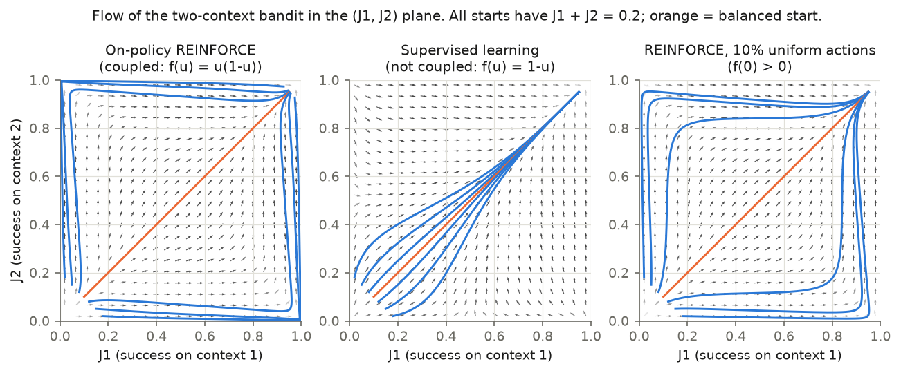
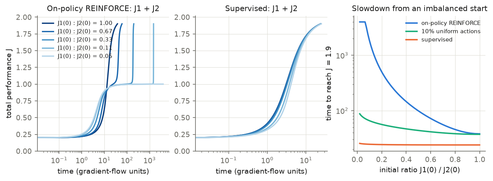
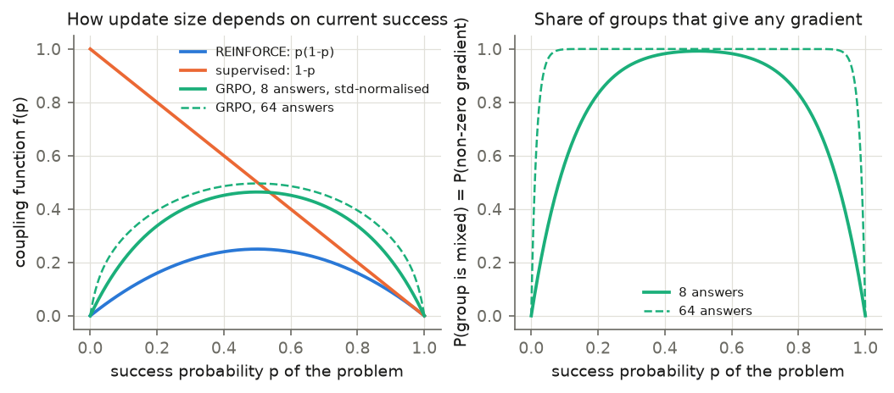
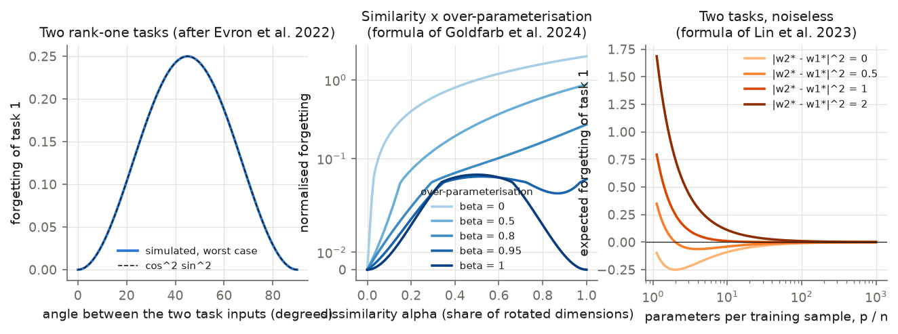
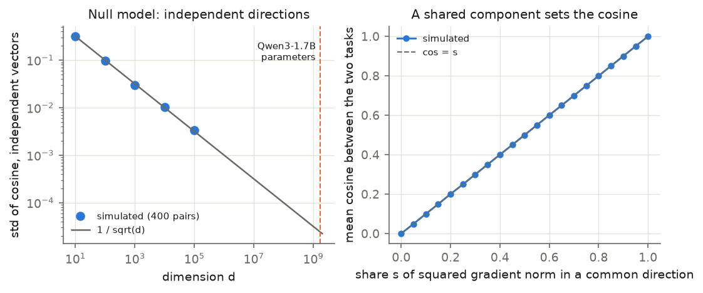
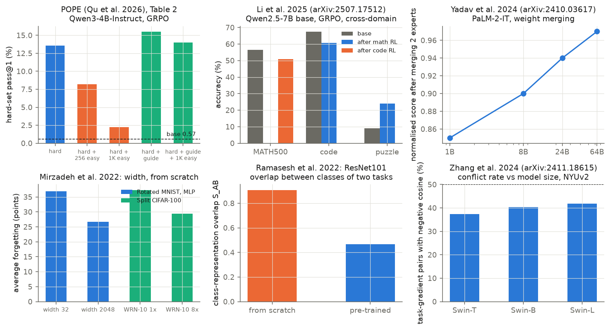

# Interference: theory synopsis (10–15 minute read)

This is the synopsis of [`00-initial-theory.md`](00-initial-theory.md) for study `Nov-12-2026-01-vineeth-babel-slurm-understanding-interference`. See also [`03-understanding-synopsis.md`](03-understanding-synopsis.md), [`04-domains-to-explore.md`](04-domains-to-explore.md) and [`05-summary.md`](05-summary.md).

## Main points

*Interference* means that learning one task harms another task in the same network. The source reaches four conclusions.

1. To first order, every definition reduces to one number: the inner product of two task gradients.
2. A negative inner product is not enough for harm. On-policy reinforcement learning (RL) also needs *coupling*: the learning signal for a task vanishes when success on that task is low.
3. Three factors reduce interference in theory: high dimension with low-dimensional task updates, over-parameterisation, and small steps from a good starting point. Pre-training supplies all three at once, so their separate effects are hard to tell apart.
4. No paper the source found measures the gradient cosine between domains under a policy-gradient loss as a function of model size or pre-training. That question is open.

Labels follow the source: *standard*, *from a paper*, or *our derivation*. All figures are ours.

## 1. Definitions of interference

Notation: parameters θ, tasks k with objectives J_k and losses L_k = −J_k, gradients g_k = ∇_θ L_k, learning rate η. The source summary counts six kinds of definition. Its table has seven rows, because two rows measure an outcome.

| # | Name | What it measures |
|---|---|---|
| D1 | Gradient interference | Cosine ρ of two task gradients at one point θ. ρ < 0: interference. ρ > 0: transfer. |
| D2 | Outcome interference | A worse result on task k than a reference (negative transfer, backward transfer, forgetting). |
| D3 | One-step outcome | Change of task j's loss after one real step on task i. |
| D4 | Kernel interference | How much a step on input x moves the output on x'. |
| D5 | Representational interference | Whether two tasks use the same units or directions. |
| D6 | Weight-space interference | Whether separately learned updates can be added. |
| D7 | Ray interference | Negative D1 **and** coupling. A property of the whole training path. |

- D1 is local and symmetric. It says nothing about step size, curvature or the path.
- D2 is what matters in practice, and it is relative: "worse than what" must be stated. The first study compared with the hard-only arm.
- D7 is the only definition that needs RL.

Full text: `00-initial-theory.md`, Section 1.

## 2. The local theory: what one step does

**First order (standard).** Take one step on task A, θ' = θ − η g_A. The loss of task B becomes

    L_B(θ') = L_B(θ) − η ⟨g_B, g_A⟩ + (η²/2) g_Aᵀ H_B g_A + O(η³),   H_B = ∇²L_B(θ).        (1)

The step lowers L_B exactly when ⟨g_B, g_A⟩ > 0. To first order D1, D3 and D4 are one quantity. This assumes that η is small enough to neglect the second-order term.

**Policy-gradient form** (Nguyen et al. 2025). A step on answer y to prompt x with advantage A changes another log-probability by

    Δ log π(y'|x') = η A ⟨∇ log π(y|x), ∇ log π(y'|x')⟩ + O(η²)                                  (3)

GRPO is the policy-gradient method of our runs. It samples a group of answers per problem. When all answers in a group have the same reward, every advantage is zero (Shao et al. 2024). Such a group gives no gradient, so it cannot interfere with or help anything.

**Adam (our derivation).** Adam rescales each coordinate. The cross-task term can then have a different sign from ⟨g_B, g_A⟩. A cosine of raw gradients is therefore not the last word for an Adam run.

**Second order.** Let h be the curvature of L_B along g_A. A step on A raises L_B, even when the gradients agree, when

    η h ‖g_A‖ / ‖g_B‖ > 2 cos(g_A, g_B).                                                          (4)

Yu et al. (2020) name three conditions for harm in joint training: conflicting gradients, dominating gradients and high curvature. They state that conflict alone is harmless. Their theorem covers two tasks and one step, and proves nothing about final performance. Later work found that well-tuned plain summation matches the gradient-surgery methods (Kurin et al. 2022). A small learning rate removes the curvature route to interference. It does not remove the first-order route.

**Conflict rate.** The *conflict rate* is the share of gradient pairs with negative cosine. Its null value for independent random directions is 50%, not 0%. Reported rates of 32–42% between tasks (Zhang et al. 2024) are therefore mild alignment. Conflicts inside *one* task are as frequent as conflicts between tasks (Elich et al. 2023). A conflict rate needs a within-task baseline.

Full text: `00-initial-theory.md`, Section 2.

## 3. Ray interference: the on-policy RL theory

**Claim** (Schaul et al. 2019). A learning system suffers from plateaus if it has (a) negative interference between the components of its objective and (b) coupled performance and learning progress. Coupling arises because the agent generates its own training data.

**Exact model.** A bandit has two contexts and two actions. Success is J_1 = σ(θ_1 + θ_3) and J_2 = σ(θ_2 − θ_3). The shared action bias θ_3 is the only shared parameter, and it gives ρ = −1/2 at every θ. Expected on-policy REINFORCE with small steps gives

    dJ_1/dt = 2 J_1²(1−J_1)² − J_1(1−J_1) J_2(1−J_2)                                             (5)
    dJ_2/dt = 2 J_2²(1−J_2)² − J_1(1−J_1) J_2(1−J_2)

The first term is a task's own progress. The second is the interference. The factor J_k(1−J_k) is the coupling.

**Results of the model.**

1. Fixed points: (0,0) unstable, (1,1) stable, (0,1) and (1,0) saddle points.
2. *Winner-take-all (WTA) regions*: near the origin, J_2 > 2 J_1 makes context 1 get worse while context 2 improves. A random start direction near the origin lies in a WTA region with probability (4/π) arctan(1/2) ≈ 59%.
3. Plateau: the path then passes close to a saddle. The speed there is ε = 2 J_1²(1−J_1)². The paper states a slowdown of order 1/ε and gives no closed-form escape time.

*Figure T1. Left (on-policy): unbalanced starts run along the edges and pass a saddle corner before they reach (1,1). Middle (supervised): every start goes directly to (1,1). Right: 10% uniformly random actions.*

*Figure T2. Left: on-policy curves stall at total performance 1, longer for less balanced starts. Right: time to reach J = 1.9 against the initial ratio; the on-policy curve is cut at t = 4,000.*

| Start (our simulation, Euler steps of 0.02) | Time to J = 1.9 | Slowest speed |
|---|---|---|
| Balanced | 38 | 1.6e-2 |
| Ratio 1:3 | 201 | 1.2e-4 |
| Ratio 1:9 | 1,503 | 1.6e-6 |
| Supervised, every start | 24 to 26 | — |

**The coupling function.** Schaul et al. write ∇J_k = f_k(J_k) v_k(θ), with f_k the *coupling function*. On-policy REINFORCE has f(u) = u(1−u). Supervised learning has f(u) = 1−u, with the same ρ = −1/2, and has no saddle and no plateau. The sufficient condition for a saddle is **f_k(0) = 0**.

| Change | Removes | Result |
|---|---|---|
| No shared parameter | interference | no WTA region |
| Uniform random behaviour policy, or supervised learning | coupling | no saddle, no plateau |
| 10% uniform random actions | part of the coupling, f(0) > 0 | much weaker plateaus (t = 37 to 88) |

**Where it fails.** The analysis uses expected updates and small steps. The shared bias builds in ρ = −1/2; the paper does not show that real tasks have negative ρ. The condition f(0) = 0 fails with exploration noise, off-policy data, dense rewards or supervised signal. The case of more than two contexts and deep RL is not proven; all experiments are bandit simulations. The source found two errata in the paper's Appendix B.1. Neither changes the classification of the fixed points.

**GRPO coupling (our derivation).** Let p be the success probability of a problem and G the number of sampled answers. GRPO divides the advantage by the group's standard deviation. The expected update size is

    f_GRPO(p) = Σ_c Binom(c; G, p) √((c/G)(1 − c/G)).

f_GRPO(0) = 0, so the saddle condition still holds. The coupling is weaker than in REINFORCE: at p = 0.05 with G = 8, 0.117 against 0.0475; at p = 0.01, 0.026 against 0.0099. The derivation ignores ratio clipping and uses whole-answer scores; our implementation averages log-probabilities over tokens. Adam or gradient clipping weakens coupling further. What remains is *relative* coupling inside one minibatch.

*Figure T9. Left: the GRPO coupling lies above REINFORCE and still reaches zero at p = 0. Right: only mixed groups give a gradient; their probability is 1 − p^G − (1−p)^G.*

Full text: `00-initial-theory.md`, Section 3.

## 4. The kernel view: training near a starting point

A network is in the *kernel regime* when its output stays close to its first-order expansion around θ_0. Training is then kernel regression with a constant kernel. Linearity of fine-tuning is an empirical question for each setting.

- Standard networks trained from scratch are **not** in this regime (Chizat et al. 2019).
- 8 of 14 few-shot tasks on RoBERTa-base showed kernel behaviour (Malladi et al. 2023).
- Full fine-tuning of CLIP is not linear (Ortiz-Jimenez et al. 2023).
- Nobody has tested it for GRPO.

**Forgetting** (Doan et al. 2021). Train on task A, then on task B, in the kernel regime:

    forgetting = ‖ U_A Σ_A (V_Aᵀ V_B) M_B ỹ_B ‖²,                                                 (6)

Three factors multiply: the high-variance directions of task A (Σ_A), the overlap of the feature subspaces (V_Aᵀ V_B), and the error signal on task B (ỹ_B). Zero overlap or zero residual gives zero forgetting. Overlap is necessary and not sufficient. Equation (6) cannot describe representation change.

**Task similarity.** In over-parameterised linear regression, forgetting for two rank-one tasks at angle θ is at most cos²θ sin²θ ‖w*‖² (derived from the update rule of Evron et al. 2022). It is zero for identical and for orthogonal tasks and largest at 45°. Goldfarb et al. (2024) add over-parameterisation β: forgetting is α²(1−α)² when β → 1 and 2α at β = 0, for dissimilarity α.

*Figure T6. Left: forgetting peaks at 45°. Middle: the peak at intermediate dissimilarity appears only for high β. Right: forgetting falls as parameters per sample grow.*

"Very different domains interfere most" is only true for models with little spare capacity. In a highly over-parameterised model the danger zone is tasks that share features and need different outputs.

Full text: `00-initial-theory.md`, Section 4.

## 5. Why large pre-trained models may show little interference

| Argument | What the source states | Limit |
|---|---|---|
| High dimension (5.1) | Independent isotropic vectors in R^d have cosine of order 1/√d (Vershynin 2018). For d = 1.72 × 10⁹ (Qwen3-1.7B without the tied output layer), 1/√d = 2.4 × 10⁻⁵. | A floor, not a prediction. Real gradients concentrate in few directions. |
| Capacity (5.2) | If the network can minimise all task losses at once, summed-loss training converges where every task gradient is zero (Kurin et al. 2022, Prop. 5). | This concerns the solution, not the path. The conflict rate hardly changes with capacity, while the outcome improves (Royer et al. 2023). |
| Over-parameterisation (5.3) | In linear models forgetting falls with parameters per sample. Wider networks forget less: Rotated MNIST 36.9 → 26.7 points from width 32 to 2048 (Mirzadeh et al. 2022). | Three explanations offered, none singled out. |
| Pre-training (5.4) | Pre-trained models forget far less, and the advantage grows with size: ViT-B loses under 0.5% on split CIFAR-10. Class representations overlap less: 0.466 against 0.907 for ResNet101 (Ramasesh et al. 2022). Merging two experts scores 0.85 at 1B and 0.97 at 64B parameters (Yadav et al. 2024). | Causality not tested. For language models, forgetting *grows* from 1B to 7B (Luo et al. 2023). |
| Small on-policy moves (5.5) | Theorem: policy gradient with binary reward converges to the optimal policy closest in KL divergence to the start. KL on the new task predicts forgetting, R² = 0.71 (Shenfeld et al. 2025). | Neural networks do not meet the convexity assumption exactly. |

*Figure T5. Left: the cosine of independent vectors shrinks as 1/√d. Right: a common component that carries a share s of the squared norm gives cosine s.*

A fine-tuning task is solved to 90% in a random subspace of a few hundred to a few thousand dimensions (Aghajanyan et al. 2021). Two readings follow, and they point in opposite directions. *Room to avoid*: unrelated tasks use disjoint directions, so the cosine is ≈ 0, with no interference and no transfer. *Shared subspace*: the gradients concentrate in the same subspace, and the cosine can be large with either sign. A measured cosine distinguishes the two. It needs a test against the null and against a within-task baseline.

**Warning** (Shao et al. 2025). Random rewards gave Qwen2.5-Math-7B +21.4 points on MATH-500 (true rewards: +29.1). GRPO amplified a strategy the model already preferred. Uniform gains on all subjects can be this signature.

Full text: `00-initial-theory.md`, Section 5.

## 6. Known empirical results, by setting

| Finding | Setting | Source |
|---|---|---|
| Adding 256 easy problems to 256 hard ones lowers hard pass@1 from 13.55% to 8.22%; adding 1,000 lowers it to 2.24% | GRPO, Qwen3-4B-Instruct, math | Qu et al. 2026 (POPE), Table 2 |
| Math RL lowers code accuracy (67.46 → 60.60); code RL lowers math for the base model (56.40 → 50.80) and raises it for the instruct model (69.00 → 72.00) | GRPO, Qwen2.5-7B | Li et al. 2025 |
| Math-only RL raises other reasoning tasks (30.2 → 60.0) and non-reasoning tasks (45.7 → 53.2); supervised fine-tuning (SFT) lowers the latter (→ 21.1) | GRPO, Qwen3-14B-Base | Huan et al. 2025 |
| Cosine between task score functions about 10⁻¹ for SFT and 10⁻³ for RL | DeepSeek-R1-Distill-Qwen 1.5B and 7B | Zhu et al. 2026 |
| RL fine-tuning suppresses low-likelihood problems | GRPO, 1.5B to 7B models | Nguyen et al. 2025 |
| A second agent started at a plateau doubles the score (6,600 → 14,500) | Rainbow, Montezuma's Revenge | Fedus et al. 2020 |
| Conflict rate rises slightly with model size (37.4% to 41.8%) | Swin-Tiny to Swin-Large | Zhang et al. 2024 |

*Figure T8. Top left: easy problems lower hard-set pass@1 in POPE. Bottom right: the conflict rate stays below the 50% null at every model size.*

Two gaps matter. POPE is the only study with easy-plus-hard mixtures under GRPO, and it reports an outcome, not a gradient cosine. No study covers two skills inside one subject, which is our case.

Full text: `00-initial-theory.md`, Section 6.

## 7. What we know about interference

| Status | Statements |
|---|---|
| **Proven** (under the stated assumptions) | Equations (1) and (4). The bandit results of Section 3, and f(0) = 0 as sufficient for a saddle. Kernel-regime forgetting as a product of three factors. Linear-regression forgetting: zero for identical and orthogonal tasks, largest in between. A model that fits all tasks ends where all task gradients vanish. Convergence to the KL-closest optimal policy. Cosine of order 1/√d for independent directions. |
| **Empirically supported** | Outcome interference under on-policy RL exists in language models (easy against hard math; math against code) and in Atari. Larger and pre-trained models show less outcome interference in vision and in weight merging. RL post-training forgets less than SFT and mostly makes existing behaviour more reliable. Conflict rates are near 30–45% and similar within and between tasks. |
| **Conjecture or contested** | Ray interference explains plateaus in deep RL or language-model RL: proven only for bandits. Gradient conflict *causes* outcome interference. Scale by itself reduces interference. Fine-tuning of language models is linear in the weights: untested for RL. Why pre-training helps: each mechanism is supported by correlation only. The dependence of the cross-domain gradient cosine on model size: not measured. |

Full text: `00-initial-theory.md`, Section 7.

## 8. What this means for the study

The theory gives five conditions under which a mixed training run shows **no** outcome interference. `01-understanding.md` tests each one.

| Condition | Test |
|---|---|
| The domain gradients do not conflict (ρ ≥ 0) | cosine of per-domain GRPO gradients with within-domain baseline |
| The steps are small, so only first-order effects exist | linearity of the log-probability change along the training direction |
| The coupling is weak: hard problems rarely fall to zero success | share of all-wrong groups, coupling function of GRPO |
| The interfering domain stops producing gradient | share of mixed practice groups over training |
| The evaluation cannot see an effect of the size that exists | predicted first-order effect size against measurement noise |

Full text: `00-initial-theory.md`, Section 8.

## References

Labels: **R** = text read for the cited facts; **A** = abstract only; **NV** = citation not verified in the source.
Venues marked * are from memory and were not checked.

- Aghajanyan, Zettlemoyer, Gupta (2021). Intrinsic dimensionality explains the effectiveness of language model fine-tuning. arXiv:2012.13255. **R**
- Chizat, Oyallon, Bach (2019). On lazy training in differentiable programming. NeurIPS. arXiv:1812.07956. **R**
- Doan, Bennani, Mazoure, Rabusseau, Alquier (2021). A theoretical analysis of catastrophic forgetting through the NTK overlap matrix. AISTATS. arXiv:2010.04003. **R**
- Elich, Kirchdorfer, Köhler, Schott (2023). Examining common paradigms in multi-task learning. arXiv:2311.04698. **R** (abstract, §4.2)
- Evron, Moroshko, Ward, Srebro, Soudry (2022). How catastrophic can catastrophic forgetting be in linear regression? COLT. arXiv:2205.09588. **R** (main text)
- Fedus, Ghosh, Martin, Bellemare, Bengio, Larochelle (2020). On catastrophic interference in Atari 2600 games. arXiv:2002.12499. **R** (sections 1–5)
- Goldfarb, Evron, Weinberger, Soudry, Hand (2024). The joint effect of task similarity and overparameterization on catastrophic forgetting. ICLR. arXiv:2401.12617. **R** (main text; limits re-derived)
- Huan et al. (2025). Does math reasoning improve general LLM capabilities? arXiv:2507.00432. **R**
- Kurin, De Palma, Kostrikov, Whiteson, Kumar (2022). In defense of the unitary scalarization for deep multi-task learning. NeurIPS. arXiv:2201.04122. **R**
- Li, Pan, Lin, Sun, He, Wu (2025). Can one domain help others? arXiv:2507.17512. **R**
- Luo, Yang, Meng, Li, Zhou, Zhang (2023). An empirical study of catastrophic forgetting in large language models during continual fine-tuning. arXiv:2308.08747. **R**
- Malladi, Wettig, Yu, Chen, Arora (2023). A kernel-based view of language model fine-tuning. ICML. arXiv:2210.05643. **R**
- Mirzadeh, Chaudhry, Yin, Hu, Pascanu, Gorur, Farajtabar (2022). Wide neural networks forget less catastrophically. ICML. arXiv:2110.11526. **R**
- Nguyen, La, Nguyen, Chawla, Nguyen, Doan (2025). The reasoning boundary paradox: how reinforcement learning constrains language models. arXiv:2510.02230. **R** (sections 1–5)
- Ortiz-Jimenez, Favero, Frossard (2023). Task arithmetic in the tangent space. NeurIPS*. arXiv:2305.12827. **R** (main text)
- Qu, Setlur, Smith, Salakhutdinov, Kumar (2026). POPE: learning to reason on hard problems via privileged on-policy exploration. arXiv:2601.18779. **R**
- Ramasesh, Lewkowycz, Dyer (2022). Effect of scale on catastrophic forgetting in neural networks. ICLR. **R** (anonymous submission PDF)
- Royer, Blankevoort, Ehteshami Bejnordi (2023). Scalarization for multi-task and multi-domain learning at scale. NeurIPS*. arXiv:2310.08910. **R**
- Schaul, Borsa, Modayil, Pascanu (2019). Ray interference: a source of plateaus in deep reinforcement learning. arXiv:1904.11455. **R** (full text, appendices checked)
- Shao, Wang, Zhu, Xu, Song, Bi, Zhang, Zhang, Li, Wu, Guo (2024). DeepSeekMath. arXiv:2402.03300. **R**
- Shao et al. (2025). Spurious rewards: rethinking training signals in RLVR. arXiv:2506.10947. **R**
- Shenfeld, Pari, Agrawal (2025). RL's razor: why online reinforcement learning forgets less. arXiv:2509.04259. **R**
- Vershynin (2018). High-dimensional probability. Cambridge University Press*. **R** (Section 3.2)
- Yadav, Vu, Lai, Chronopoulou, Faruqui, Bansal, Munkhdalai (2024). What matters for model merging at scale? arXiv:2410.03617. **R**
- Yu, Kumar, Gupta, Levine, Hausman, Finn (2020). Gradient surgery for multi-task learning. NeurIPS. arXiv:2001.06782. **R**
- Zhang, Shen, Cao, Dai, Zhou, Zhang, Zhang, Shutova (2024). Proactive gradient conflict mitigation in multi-task learning: a sparse training perspective. arXiv:2411.18615. **R**
- Zhu et al. (2026). SFT conflicts, RL coexists. arXiv:2608.03573. **R** (abstract and Section 4)
