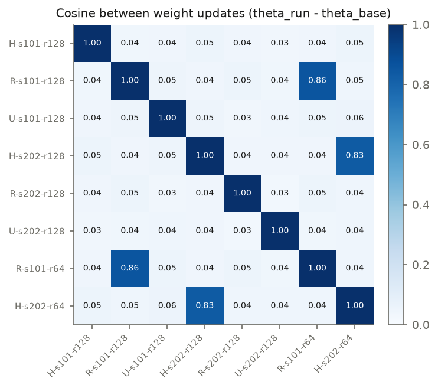
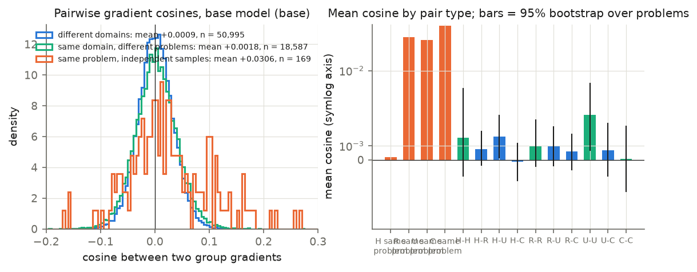
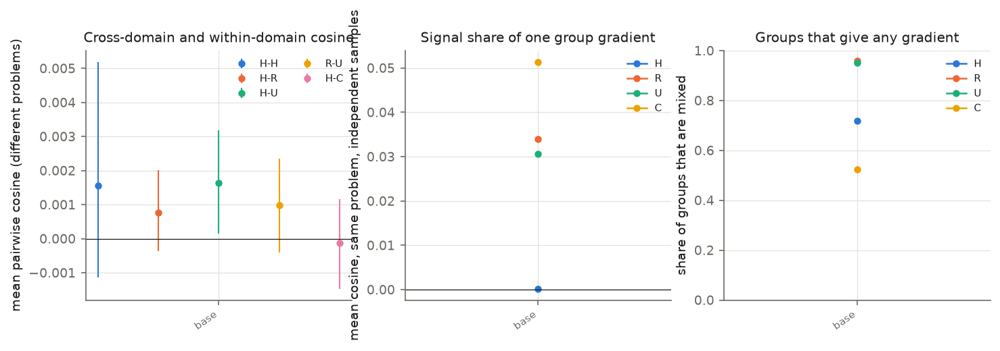
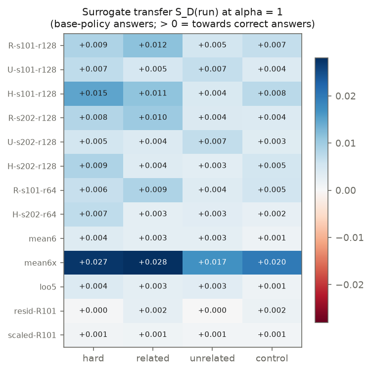
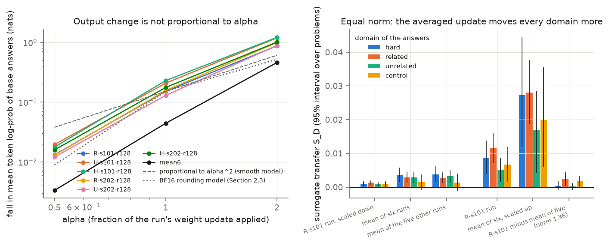
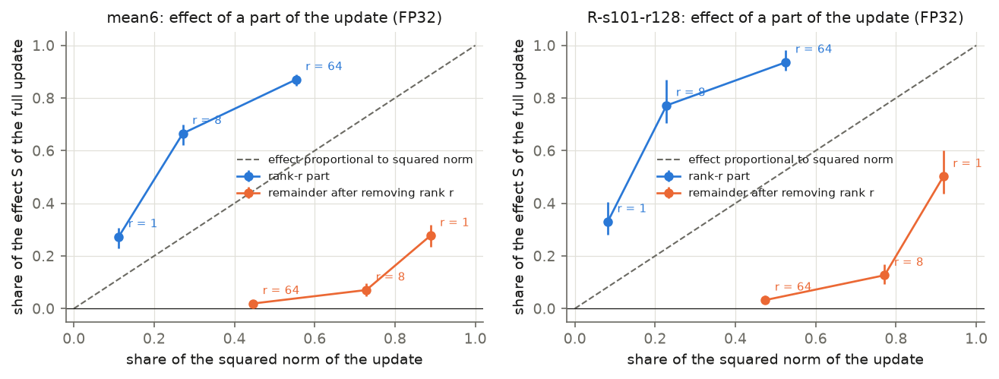

# Why the first study saw no interference: synopsis (10–15 minute read)

This is the synopsis of [`01-understanding.md`](01-understanding.md), the full version, for study `Nov-12-2026-01-vineeth-babel-slurm-understanding-interference`.

## Purpose and how to read

The first study trained Qwen3-1.7B with GRPO on three math domains and saw no interference between the domains. This document states why. It gives the measurements, the verdict on each hypothesis, and the proposed experiments. Each section ends with a pointer into `01-understanding.md`.

The source labels each claim, and this synopsis keeps the labels. **Derived** follows from stated assumptions by mathematics. **Supported** agrees with our measurements or with cited ones. **Speculation** is a proposal that the data do not test.

Status of the evidence (2026-11-13, 07:30 EST): all results rest on completed jobs. Nothing is pending. The owner removed all gradient measurements on Qwen3-0.6B and Qwen3-4B on 2026-11-12; they are future work (M1).

## The answer in five sentences

1. The domains did not interfere because their training signals did not point in different directions.
2. At the base model, the expected gradient of each domain has a small positive overlap with that of every other domain, and no measurement shows a negative overlap.
3. Every one of the six trained models moved every one of the four domains in the helpful direction (24 of 24 values positive).
4. The runs learned mostly one thing that all domains share, and sampling noise produced most of the weight change.
5. The capacity hypothesis is neither supported nor refuted, because no pair of domains conflicts and the study has one model size.

The useful next question is what the shared direction is, and when domain-specific signal exists at all.

## 1. What was measured

| Term | Meaning |
|---|---|
| Group | the 8 answers sampled for one problem in one round. GRPO computes one gradient per group |
| Mixed group | a group with at least one correct and one wrong answer. Only mixed groups give a gradient |
| Domain | hard (H), related = factoring drills (R), unrelated = remainder drills (U), control = other subjects (C) |
| Update of a run | τ = trained weights − base weights (FP32) |
| Conflict rate | share of gradient pairs with negative cosine. Independent directions give 50% |
| BF16 | 16-bit floating point with 8 significant bits. The forward pass and the sampler use BF16 copies of the FP32 weights |

All measurements use forward and backward passes on stored checkpoints.

| Measurement | Job (`qis-ui-…`) | Result |
|---|---|---|
| Weight updates of the six runs | `wdelta` | 2.1 |
| Group gradients at the base model and five trained checkpoints | `geom-base`, `geom-base64`, `geom-<run>-r64/r128` | 2.2, 2.3 |
| Log-probability of base answers under each trained model | `lp` | 2.4 |
| Averaged checkpoints | `soup`, `soup-b` | 2.5 |
| Precision test of the response along the update | `lpprec` | 2.6 |
| Rank-r parts of the update | `lowrank-mean6`, `lowrank-R101` | 2.7 |

The model has 1.72 × 10⁹ parameters, so the study stores a count sketch of each gradient. The sketch preserves inner products without bias and adds noise of about 0.0007 to one cosine. The main base-model run (`geom-base64`) uses 64 answers per problem: 1,512 mixed groups from 221 problems. The other runs use 16 answers per problem. Confidence intervals resample problems (300 draws, 95%).

Full text: `01-understanding.md`, "Terms used in this document" and Section 1.0.

## 2. Results

### 2.1 Weight updates: the runs share 4% of their update, and the arm does not matter

| Quantity (round 128, six runs) | Value |
|---|---|
| Size of the update relative to the weights, ‖τ‖/‖θ‖ | 4.9 × 10⁻⁴ to 5.8 × 10⁻⁴ |
| Cosine between two runs, same seed, different arm | mean 0.039 (0.029–0.048) |
| Cosine between two runs, same arm, different seed | mean 0.050 (0.045–0.054) |
| Cosine between two runs, different arm and seed | mean 0.039 (0.031–0.047) |
| Cosine expected for independent directions | 0 ± 2.4 × 10⁻⁵ |
| Mean absolute change of one weight | 11–13 learning rates (512 steps of 2 × 10⁻⁶) |

*Figure W1. The cosine between the weight updates of any two runs is 0.03–0.05, whether or not the two runs share an arm.*

1. **The updates are far from random, and far from equal.** A cosine of 0.04 is 1,600 times the value for independent directions. It also means that 96% of the squared norm of each update is not shared with another run.
2. **The arm leaves a small trace.** The direction "R update minus U update" has cosine 0.016 between the two seeds. Controls built from seed differences give at most 0.0045. Arm-specific learning is about 1% of the update.
3. **The update looks like a random walk with a small drift.** A constant direction at each of the 512 steps gives 512 learning rates. A random direction gives about 18. The measured mean is 11–13.
4. **Two runs share input directions.** They share 49% of their top-8 input subspace and 11% of their top-8 output subspace (random: 0.5%).
5. **The shared part formed in rounds 1–64.** The first-half updates of R-s101 and H-s202 have cosine 0.044; their second-half updates 0.004.

Full text: `01-understanding.md`, Section 1.1.

### 2.2 Gradients at the base model: no conflict, and domains do not separate

| Pair type (base model, 64 answers) | Mean cosine | Conflict rate |
|---|---|---|
| Same problem, independent samples | 0.0201 | 40–44% |
| Two problems of one domain (H–H, R–R, U–U, C–C) | 0.00025 to 0.00125 | 48.7–49.7% |
| Two domains (six pairs) | 0.00027 to 0.00066 | 49.1–49.5% |

*Figure G1. The mean cosine is 0.020 for two groups of the same problem and close to zero, but positive, for every other pair type.*

1. **One group gradient is mostly sampling noise.** About 2% of the squared norm of a group gradient repeats when the same problem is sampled again. The other 98% is noise.
2. **Different problems share very little, but what they share is positive.** All ten means are positive. Four intervals exclude zero; the other six start just below zero.
3. **The domain boundary is invisible.** Cross-domain cosines (0.0003–0.0007) are as large as within-domain cosines (0.0003–0.0013). The ratio of cross-domain to within-domain overlap is 0.45–1.26 over the six domain pairs (no interval available).

A group gradient is noisy, so the mean pair cosine understates how well the *expected* gradients of two domains agree. The estimate of that cosine, ρ, is positive for all six pairs.

| Domain pair | ρ | 95% interval |
|---|---|---|
| R–U | 0.29 | [−0.08, 0.49] |
| R–C | 0.41 | [−0.05, 0.67] |
| U–C | 0.56 | [0.11, 0.83] |
| H–R | 0.55 | [−0.05, 1.21] |
| H–U | 0.30 | [−0.52, 0.92] |
| H–C | 0.21 | [−0.53, 1.02] |

The ray-interference model needs ρ = −1/2. That value stays excluded for R–U, R–C and U–C. It is not excluded for H–U and H–C, because hard problems give weaker signal.

Full text: `01-understanding.md`, Section 1.2.

### 2.3 Gradients during training: the repeatable part fades by round 64

| Checkpoint | Mixed groups | Same-problem cosine | Cross-domain cosine | Conflict rate, cross-domain |
|---|---|---|---|---|
| Base, 64 answers | 1,512 | 0.0201 (4,778 pairs) | 0.00045 | 49.4% |
| Five trained checkpoints, pooled | 879 | 0.0037 (284 pairs) | 0.00019 (58,964 pairs) | 49.6% |

*Figure G2. From the base model to the trained checkpoints, the same-problem cosine (middle) and the share of mixed groups (right) fall, and the cosine between different problems (left) stays near zero.*

1. **Fewer groups give a gradient.** At the base model 95% of practice groups and 72–78% of hard groups are mixed. At the trained checkpoints 13–48% of practice groups and 36–63% of hard groups are mixed.
2. **The gradient that remains repeats less.** The pooled same-problem cosine is 0.0037 against 0.0201 at the base model, with a standard error of about 0.0024. The repeatable part fell by a factor of at least 2 and may be zero.
3. **No conflict appears later.** The cross-domain cosine stays at or slightly above zero at every checkpoint, also for Adam-scaled gradients. These runs cannot resolve cosines below about 0.001 for one domain pair.

Full text: `01-understanding.md`, Section 1.3.

### 2.4 What each run did to each domain: all effects positive

The measurement takes answers sampled from the *base* model and computes their log-probability under each trained model. S_D(run) is the change of the GRPO objective of domain D at these samples. S_D > 0 means the run made correct base answers more likely relative to wrong ones. S_D < 0 for a domain the run did not train on would be interference.

| Run (round 128) | S hard | S related | S unrelated | S control |
|---|---|---|---|---|
| R-s101 | 0.0086 | **0.0115** | 0.0051 | 0.0067 |
| R-s202 | 0.0081 | **0.0101** | 0.0040 | 0.0038 |
| U-s101 | 0.0072 | 0.0048 | **0.0066** | 0.0039 |
| U-s202 | 0.0052 | 0.0038 | **0.0069** | 0.0034 |
| H-s101 | **0.0147** | 0.0112 | 0.0043 | 0.0075 |
| H-s202 | **0.0087** | 0.0037 | 0.0030 | 0.0052 |

Bold marks the domain that the arm practised in slots 8–15. All arms train on hard problems in slots 0–7.

*Figure L1. Every cell of S_D, for each trained model (rows) and domain (columns), is positive.*

1. **No negative entry.** All 24 values are positive; 17 have a 95% interval above zero.
2. **Each practice arm moved its own domain more than the other runs did, on average.** The ratio of the means, own arm against the other four runs, is 1.8 for R and 1.6 for U. This is domain-specific learning, on top of the common gain.
3. **The log-probability of base answers fell for correct and wrong answers alike.** The fall is 0.11–0.28 nats per token, for all domains. S_D comes from the small difference between the two.

Full text: `01-understanding.md`, Section 1.4.

### 2.5 Averaged updates: the shared 4% carries the effect

If the useful part of an update is the shared part, averaging the six updates keeps the effect and removes run-specific noise. The study built five weight sets.

| Weight set | Definition |
|---|---|
| mean6 | base + mean of the six updates |
| mean6x | mean6 scaled to the norm of the R-s101 update |
| loo5 | base + mean of the five updates other than R-s101 |
| resid-R101 | base + (R-s101 update − loo5 update) |
| scaled-R101 | R-s101 update scaled to the norm of mean6 |

| Weight set | S hard | S related | S unrelated | S control |
|---|---|---|---|---|
| R-s101 update (norm 1.26) | 0.0086 | 0.0115 | 0.0051 | 0.0067 |
| mean6x (norm 1.26) | 0.0273 | 0.0280 | 0.0169 | 0.0198 |
| resid-R101 (norm 1.36) | 0.0004 | 0.0024 | 0.0002 | 0.0017 |
| scaled-R101 (norm 0.60) | 0.0010 | 0.0013 | 0.0008 | 0.0008 |
| mean6 (norm 0.60) | 0.0036 | 0.0028 | 0.0028 | 0.0014 |
| loo5 (norm 0.65) | 0.0038 | 0.0027 | 0.0032 | 0.0014 |

*Figure L2. Left: the fall in log-probability grows much faster than the applied fraction α of the update (Section 2.6); right: at equal norm the averaged update gives a larger S_D than one run.*

1. **At equal norm the averaged update has an S 2.4–3.3 times larger than one run** (`mean6x` against R-s101). The same holds at the smaller norm (`mean6` against `scaled-R101`: 1.9–3.6 times).
2. **Removing the shared part removes most of the effect.** `resid-R101` keeps 88% of the direction of the R-s101 update, with a larger norm. Its S falls by 96% on hard, 79% on related, 97% on unrelated and 75% on control.
3. **A small effect remains on the related pool and on control.** The residual keeps a positive effect on the related pool and on control. On hard and unrelated it is zero within the interval.
4. **An average that never saw R-s101 does as well as one that did.** `loo5` matches `mean6` on every domain.

The direct test is accuracy. Jobs `qis-ui-soup` and `qis-ui-soup-b` evaluate each model on the first study's dev panel (53 problems × 32 answers, 12,288-token limit). All seven models are done.

| Model | Update norm | pass@1 | pass@8 | Mean answer length (tokens) | Answers cut at the limit |
|---|---|---|---|---|---|
| Base | 0 | 41.4% | 65.3% | 1,735 | 0% |
| R-s101, round 128 | 1.26 | 72.4% | 89.9% | 5,753 | 19.0% |
| mean6 (mean of six runs) | 0.60 | 63.6% | 86.8% | 4,078 | 6.4% |
| scaled-R101 (R-s101 at the norm of mean6) | 0.60 | 52.7% | 78.3% | 2,947 | 0.4% |
| resid-R101 (R-s101 minus the mean of the other five) | 1.36 | 43.3% | 72.4% | 3,063 | 1.2% |
| loo5 (mean of the five runs without R-s101) | 0.65 | 64.3% | 83.3% | 3,966 | 5.7% |
| mean6x (mean6 scaled to the norm of R-s101) | 1.26 | 44.8% | 59.9% | 10,048 | 55.2% |

1. **At equal norm the averaged update gains twice as much as one run.** `mean6` gains 22.2 points of pass@1; `scaled-R101` gains 11.3 points at the same norm.
2. **Removing the shared part removes the accuracy gain.** `resid-R101` gains 1.9 points, against 31.0 for R-s101.
3. **An average that never saw R-s101 scores as well as one that did.** `loo5` reaches 64.3%, `mean6` 63.6%.
4. **Scaled to the norm of one run, the averaged update overshoots.** `mean6x` scores 44.8% pass@1 against 72.4% for R-s101 at norm 1.26, and its pass@8 is below the base model's. Its mean answer has 10,048 tokens; 55.2% of the answers reach the token limit. `mean6x` applies the shared direction about 2.3 times more strongly than any single run. The fair comparison is at norm 0.60 (result 1).

The mean of the six runs keeps 22.2 of the 31.0 points that R-s101 gained over the base model (71%), with an update of half the norm. The source gives no intervals for these values. The larger S of `mean6x` (first table) does not carry over to accuracy: S scores answers of the base model and cannot see answers that are too long to finish.

Full text: `01-understanding.md`, Section 1.5.

### 2.6 Rounding: the output change is not proportional to the update

The study applied a fraction α of each run's update and measured the fall in mean token log-probability of base answers. Half of the update produces 8–10% of the output change, not 25–50%. Two facts explain this.

- **The fall in log-probability is a second-order quantity (derived).** A smooth model predicts a fall proportional to α². The fall is a divergence between the trained and the base policy, not a loss of skill.
- **The forward pass rounds the weights (measured).** Training keeps FP32 weights; the forward pass and the sampler use BF16 copies. A weight changes in the forward pass only if its accumulated FP32 change exceeds half a BF16 step. At round 128 this holds for 19.5–22.7% of the weights.

Job `qis-ui-lpprec` tested the cause on the 872 hard and related answers. Each ratio is relative to α = 1 in the same row.

| Weights; compute | Update | Fall at α = 1 (nats per token) | α = 0.5 | α = 2 |
|---|---|---|---|---|
| FP32; FP32 | R-s101 | 0.415 | 0.274 | 2.92 |
| FP32; FP32 | mean6 | 0.291 | 0.255 | 3.27 |
| Rounded to BF16; FP32 | R-s101 | 0.172 | 0.087 | 5.72 |
| Rounded to BF16; FP32 | mean6 | 0.045 | 0.076 | 10.4 |
| FP32 under BF16 autocast (training setup) | R-s101 | 0.173 | 0.087 | 5.68 |
| FP32 under BF16 autocast (training setup) | mean6 | 0.045 | 0.075 | 10.4 |
| Smooth model (fall ∝ α²) | | | 0.25 | 4 |

1. With FP32 weights the fall follows α² for α ≤ 1.
2. Rounding the weights alone reproduces the training setup. BF16 arithmetic in the forward pass adds nothing measurable.
3. Rounding removes a large part of the effect of the full update. With rounded weights the fall at α = 1 is 41% of the FP32 fall for R-s101 and 15% for `mean6`.
4. The result of Section 2.5 does not depend on rounding. In FP32, `mean6` has an S at least as large as R-s101 (0.0169 against 0.0146) at half the norm.

Answers also became much longer: the mean length on the dev set rose by a factor of 3.3 for R-s101 (table in Section 2.5).

Full text: `01-understanding.md`, Section 1.6.

### 2.7 Capacity: what one model size can show

The checkpoints cannot test the capacity hypothesis, because the study has one model size. They can measure how much of the model the learned change needs.

For each of the 197 weight matrices, the study split the update into its best rank-r part and the remainder. It applied each part alone to the base model, in FP32.

| Part of the update applied | mean6: share of squared norm | mean6: S relative to full | R-s101: share of squared norm | R-s101: S relative to full |
|---|---|---|---|---|
| Rank 1 per matrix | 11% | 0.27 [0.23, 0.31] | 8% | 0.33 [0.28, 0.41] |
| Rank 8 per matrix | 27% | 0.67 [0.62, 0.70] | 23% | 0.77 [0.70, 0.87] |
| Rank 64 per matrix | 55% | 0.87 [0.85, 0.89] | 53% | 0.94 [0.91, 0.98] |
| Remainder after rank 8 | 73% | 0.07 [0.05, 0.10] | 77% | 0.13 [0.09, 0.17] |
| Remainder after rank 64 | 45% | 0.02 [0.01, 0.03] | 47% | 0.03 [0.02, 0.05] |

*Figure C1. The rank-8 part of the update gives most of the effect of the full update, and the remainder after rank 64 gives almost none.*

1. **Eight directions per matrix carry most of the effect.** The rank-8 part holds 23–27% of the squared norm and gives 67–77% of S. A rank-8 change per matrix has 10.0 × 10⁶ parameters, 0.58% of the model.
2. **Almost half of the update has no measurable effect.** The remainder after rank 64 holds 45–47% of the squared norm and gives 2–3% of S.
3. **The result holds for one run and for the mean of six runs.** Averaging is not what makes the effect low-rank.

This shows that the *demand* is small. It does not show that the model has spare capacity for conflicting demands. The domains ask for one shared change, so nothing competed for these directions.

Full text: `01-understanding.md`, Section 1.7.

## 3. The explanation

Outcome interference in a mixed run needs three conditions together (derived). **C1, direction:** an update that helps A must, on average, hurt B. **C2, size:** the harmful part of the step must be large enough to change the outputs on B. **C3, persistence:** B's own updates must not repair the harm. If C1 fails, C2 and C3 do not matter at first order.

1. **C1 fails in our setting (supported).** The expected GRPO gradients of the four domains have non-negative pairwise inner products at the base model. The delivered effects agree.
2. **The gradients are not strongly aligned.** A positive mean cosine of 0.0005 is nearly orthogonal, with a small common component. The attribution of that component to pre-training is speculation.
3. **Signal adds, noise does not (derived).** Write a group gradient as a common direction plus independent noise. Over T gradients the common part grows with T and the noise with √T. Averaging runs therefore removes noise and keeps the common part (supported by Section 2.5).
4. **The common signal decays early (supported in direction, not in size).** A persisting base-model signal predicts a shared share of 0.75 between runs. The measured cosine is 0.04.
5. **Ray interference cannot start.** The direction ingredient is missing (supported). The coupling ingredient is weak: the hard pool has success probability p = 0.06–0.38, not near zero. The practice domain went silent: after round 64, 78–92% of practice groups gave no signal in the first study.
6. **Rounding sets a threshold on what any update can do (derived from the training code; confirmed by the precision test).** That this explains the null result of the first study's one-update test is speculation.

Full text: `01-understanding.md`, Sections 2.1–2.5.

## 4. Verdict per hypothesis

| Hypothesis | What we measured | Verdict |
|---|---|---|
| H1. Pre-training aligned the domain gradients | cosine 0.0003–0.0007 > 0; ratio 0.45–1.26 | **Consistent** in the weak form (no conflict). The strong form (large cosine) is **not consistent**. The role of pre-training is untested |
| H2. Capacity absorbs the conflict | no negative cosine; arm-specific part is 1% of the update; updates share input subspaces (49%) | **Not needed** for our result. **Untested** as a statement about smaller models. A rank-8 part per matrix carries 67–77% of the effect |
| S1. The domains are too similar | cross-domain ≈ within-domain overlap; control subjects gain as much as trained ones | **Consistent** |
| S2. Training too short or learning rate too small | weight change 0.05% of the norm, but dev pass@1 41% → 72% and answers 3.3 times longer | **Not consistent** as stated: the outputs changed a lot. A longer run could still meet conflict later; untested |
| S3. The evaluation cannot detect interference | one update changes few effective weights; repeat noise was 2.5–3.1 points | **Consistent** for the one-update test. **Not the explanation** of the main result |
| N1. The run learned one generic behaviour (new) | removing the shared part removes 75–97% of the effect; all domains move together | **Consistent** |
| N2. Updates are mostly sampling noise (new) | cosine 0.04; S of the averaged update 2.4–3.3 times larger at equal norm | **Consistent** for log-probabilities and for dev accuracy at norm 0.60 (22.2 against 11.3 points). At norm 1.26 the averaged update overshoots: 44.8% against 72.4% |

The gradient updates do not conflict at 1.7B; whether this is because of scale is unknown. Sharing parameters is not sufficient for conflict; the directions must also oppose.

Full text: `01-understanding.md`, Section 2.6.

## 5. What remains unexplained

1. **Why the common signal fades so early.** The study measured its absence at round 64, not its decay. No checkpoint exists before round 64.
2. **What the shared direction is.** Longer answers are one candidate. The study has not shown that the shared weight direction causes them.
3. **Why R and U flipped between seeds in the first study.** If 96% of an update is run-specific noise, a 4-point flip needs no arm effect (supported in direction; the size is not derived).
4. **The size of the response at large updates.** Doubling the update multiplies the output change by 5–7. Rounding causes the excess over α²; the rounding model does not reproduce its size.

Section 1.9 of the source lists five mechanistic studies that address point 2. The rerun with early checkpoints (M1) addresses point 1.

Full text: `01-understanding.md`, Sections 1.8, 1.9 and 2.7.

## 6. Proposed experiments

No training run was started in this study. The cost basis is the first study: one 128-round run of Qwen3-1.7B took 19.5–29.5 GPU-hours. Costs for other model sizes are estimates ("est.").

| Id | Question | Design in one line | Decisive prediction | Cost |
|---|---|---|---|---|
| E1 | Does interference appear when two domains ask for opposite things? (S1, N1) | H in slots 0–7; slots 8–15 hold R (E1-a), code generation (E1-b), a short-answer task with a 256-token cap (E1-c), or H only (E1-d); 2 seeds | If S1/N1 hold: ρ < 0 for E1-c, hard score of E1-c below E1-d with a gap that grows, negative off-diagonal S_D entries. If H2 or H1-strong holds: equal scores, all S_D positive | about 290 GPU-hours; about 190 without E1-b |
| E2 | Does a smaller model show conflict? (H2) | Arms H, R, U on Qwen3-0.6B and Qwen3-4B, two seeds each, pools rebuilt per size | If H2 holds: ρ negative at 0.6B and practice arms fall below H on the hard score. If S1/N1 hold: ρ positive at all sizes | about 490 GPU-hours (est.); the 0.6B half about 100 |
| E3 | Does ray interference operate when hard problems sit near zero success? | Hard pool solved in at most 1 of 128 tries; (a) alone, (b) plus R drills, (c) plus drills replaced when all-correct | If ray interference operates: hard success in (b) and (c) below (a), (c) worse than (b), ρ negative during the plateau. If direction decides: equal or higher, ρ non-negative | about 230 GPU-hours |
| E4 | Does rounding shape what is learned? | Repeat R-s101 with (a) the original setup, (b) FP32 forward pass and sampler weights, (c) a learning rate 4 times larger | If rounding matters: (b) improves earlier in rounds 1–8. If not: equal | about 100 GPU-hours |
| E5 | Is the shared gain driven by the reward at all? (N1) | Two runs of the H recipe: (a) reward shuffled inside each group, (b) reward 1 for any boxed final answer | If reward-driven: dev and control gain near zero. If partly reward-independent: a visible share of the gain, and a cosine with `mean6` comparable to 0.09 | about 60 GPU-hours |
| E6 | Does room in the update matter, at one model size? (H2) | LoRA of rank 1, 8 and 64 and full fine-tuning; mixtures H + R and the strongest measured conflict from `04-domains-to-explore.md` | If H2 holds: the gap of the conflicting mixture grows as the rank falls. If direction decides: the gap is present at every rank, of similar size | about 560 GPU-hours (est.); first pass about 120 |
| M1 | When does the shared signal form and fade, and does anything change late or with size? | Measurements with no new recipe (table below) | — | see below |

| M1 measurement | Cost |
|---|---|
| One rerun of R-s101 with early checkpoints; gradient geometry with 64 answers at each | about 50 GPU-hours |
| 64-answer gradient geometry at the five stored trained checkpoints | about 50 GPU-hours |
| 64-answer gradient geometry at initialisation on Qwen3-0.6B and Qwen3-4B (recipes exist; not run) | about 8 GPU-hours each (est.) |
| Dev accuracy of averaged checkpoints (done; Section 2.5) | about 15 GPU-hours |
| Mechanistic studies 1–5 | under 20 GPU-hours |

A limit of E6: rank is not model size. E6 tests whether room in the *update* matters; E2 tests whether room in the *model* matters.

Full text: `01-understanding.md`, Section 3.

## 7. Recommended order

1. Done: the accuracy evaluation of the averaged checkpoints (Section 2.5). A cheap follow-up is the accuracy of `mean6` scaled by 1.25, 1.5 and 1.75 (about 6 GPU-hours).
2. Run M1 without the 0.6B and 4B rows, and the mechanistic studies (about 120 GPU-hours). They tell us what the shared direction is.
3. Run E1 without the code arm (about 190 GPU-hours). It is the direct test of the main conclusion: interference appears when the directions oppose.
4. Run E2 at 0.6B (about 100 GPU-hours), with the E1-c arm if E1 found conflict.
5. Run E3, E4, E5, E6 and the 4B half of E2, in the order that the results of steps 1–4 suggest. Run E6 only after E1 or the mixtures of `04-domains-to-explore.md` show a conflict.

## 8. Where to find details

| Topic | Section of `01-understanding.md` |
|---|---|
| Code, jobs and tables for each measurement | 1.0 |
| Weight updates, depth profile, rank, update halves | 1.1 |
| Base-model gradient cosines, ρ, depth | 1.2 |
| Gradients at trained checkpoints, Adam-scaled gradients | 1.3 |
| S_D definition and matrix | 1.4 |
| Averaged weight sets and dev accuracy | 1.5 |
| Linearity, rounding model, precision test | 1.6 |
| Capacity literature and rank-r parts | 1.7 |
| What could not be measured; mechanistic studies | 1.8, 1.9 |
| Conditions C1–C3, signal model, ray interference, rounding | 2.1–2.5 |
| Verdict table; open points | 2.6, 2.7 |
| Experiments E1–E6, M1, recommended order | 3 |

See also: [`02-theory-synopsis.md`](02-theory-synopsis.md), [`04-domains-to-explore.md`](04-domains-to-explore.md) and [`05-summary.md`](05-summary.md).
