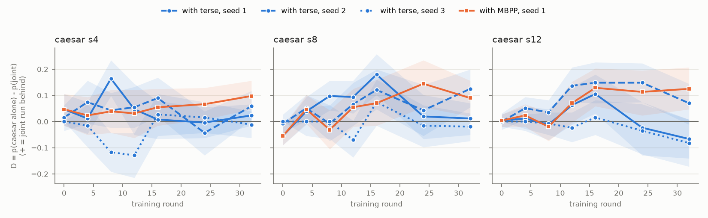
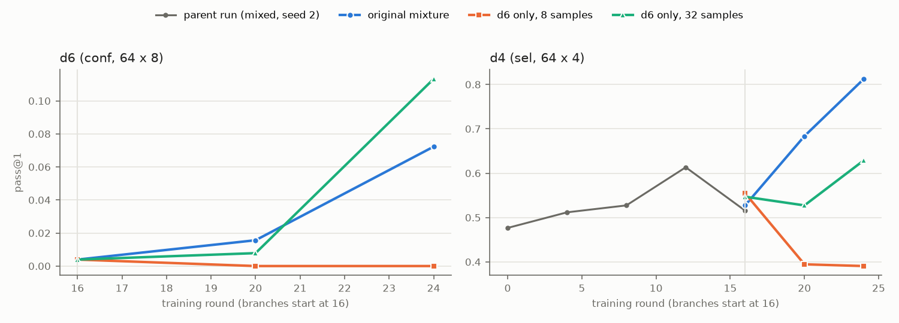

# When Does Learning One Skill Impede Another? Interference and Feedback Dynamics in GRPO Training of Qwen3-1.7B

## Abstract

Reinforcement learning with verifiable rewards is now routinely applied to several tasks at once, yet little is
known about how the tasks affect one another during training. We studied this question for Group Relative Policy
Optimization (GRPO) applied to Qwen3-1.7B, using small tasks with exact graders: Caesar-cipher decoding, Python
programming (MBPP), addition in base 9 and base 10, and a "terse" arithmetic task that rewards answers without
written working. We asked two questions. First, when two tasks are trained together, when does learning one slow
the other? Second, does the on-policy nature of GRPO amplify an initial disadvantage, because a skill that succeeds
less often also receives less learning signal?

Three results stand out. First, interference followed behaviour rather than domain. A task that rewards short
answers delayed the harder Caesar problems in two of three seeds, and in each of those seeds Caesar answers became
shorter during the delay. Training on one task also often damaged an untrained behaviour, here the terse format.
Second, an apparent cross-domain lag (Caesar trained with MBPP) was fully explained by the optimizer giving each
task a smaller share of every update, not by interference. Third, within base-9 addition, the medium-difficulty
problems sometimes collapsed to near-zero accuracy during training (2 of 5 seeds). Once every training sample on
those problems was wrong, GRPO produced no gradient for them and the skill stayed collapsed; a single rare correct
sample, or transfer from easier problems, was enough to restart learning. This confirms the persistence step of the
proposed feedback loop. The cause of the collapse itself remains unidentified. All results are exploratory: most
conditions have one to three seeds.

## 1. Introduction

Large language models are increasingly post-trained with reinforcement learning on several tasks at once. Each
task contributes reward signal and gradient updates to one shared set of weights. Whether these contributions
cooperate or conflict matters for how training mixtures are designed. A common intuition holds that similar tasks
help each other and dissimilar tasks interfere, but this intuition has rarely been tested in the regime of
policy-gradient fine-tuning, where the data a model learns from depends on its own current behaviour.

That dependence is the second motivation for this study. GRPO estimates the value of each response relative to
other responses to the same prompt. If all responses to a prompt receive the same reward, all wrong or all
correct, the prompt contributes no gradient at all. A skill whose success rate falls toward zero therefore loses
its learning signal at exactly the moment it most needs it. This suggests a feedback loop: an adverse update lowers
a skill's success rate, which produces fewer prompts with mixed outcomes, which slows further learning of that
skill. If the loop is real, small early disadvantages could grow into lasting deficits.

We therefore asked two research questions:

1. **Interference between tasks.** When two tasks are trained together, when does learning one impede the other?
   We classify each pair as transfer, independence, a temporary delay, or a lasting deficit.
2. **Amplification through on-policy feedback.** Does the loop described above occur, and does it turn an initial
   disadvantage into a persistent one?

The study had a budget of two non-preemptible and six preemptible GPUs for about one day. We therefore favoured
small, controlled comparisons over broad sweeps, and we replicated a finding only when it changed the direction of
the investigation.

## 2. Methods

### 2.1 Model and training

All experiments fine-tuned Qwen3-1.7B in non-thinking mode with GRPO. In each training round the model generated
eight responses per prompt. Each response received a binary reward from an exact grader. Rewards were normalised
within the group of eight, so a prompt with all-correct or all-wrong responses contributed zero advantage. We used
the clipped policy objective (clip range 0.2) without a KL penalty, and AdamW at learning rate 2×10⁻⁶ with four
optimizer steps per round. A typical run lasted 32 rounds with eight prompt groups per task per round. The
hyperparameters were selected in an earlier study on the same model and code base, and a canary run verified the
training, checkpointing and resume path before any experiment.

One detail of the loss matters for interpreting joint training. Each response's loss is averaged over its tokens,
and the sum over responses is divided by a fixed number (32 responses per optimizer step). This makes the raw
gradient contributed by a task the same whether it is trained alone or alongside another task. The Adam optimizer,
however, rescales updates by a running estimate of gradient magnitude. When a second task contributes gradient,
each task therefore receives a smaller share of a roughly fixed-size update. We return to this point in Section
3.3, where it explains one apparent case of interference.

### 2.2 Tasks

We chose tasks with exact graders, measurable but imperfect starting accuracy, and room to improve. Several tasks
were divided into difficulty levels, so that easy and hard versions of the same skill could be compared directly.

| Task | Description | Starting accuracy |
|---|---|---|
| Caesar (shift 4, 8, 12) | Decode a Caesar-shifted sentence | 0.30, 0.07, 0.04 |
| Base-9 addition (4, 6, 8 digits) | Add two base-9 numbers | 0.50, 0.18, 0.04 |
| Terse multiplication | Multiply two 2-digit numbers; give only the answer, in at most 24 tokens | about 0.45 |
| Decimal addition (14 digits) | Add two 14-digit base-10 numbers | about 0.50 |
| MBPP | Write a Python function that passes hidden unit tests | 0.59 |
| ARC-Challenge, Countdown | Multiple-choice science; reach a target number arithmetically | 0.81, 0.85 |

The terse task deserves comment. Its arithmetic is easy for the model; what is hard is the behavioural constraint
of answering without writing out steps. It therefore lets us distinguish a competing behavioural objective from a
competing skill. Caesar decoding and base-9 addition, in contrast, benefit from written working.

Before training, a calibration audit of base-model outputs found and fixed three grader faults (code split across
several blocks in MBPP answers, Countdown answers that boxed the target instead of the expression, and unboxed ARC
letters). Every task's data was split into disjoint training, selection and confirmation sets.

### 2.3 Experimental designs

The study combined five kinds of experiment.

- **Single-task references.** Each target task was trained alone. These runs measure its own learning curve and
  its side effects on every other task, which was evaluated but not trained.
- **Joint runs.** A target task and a competitor task were trained together, eight groups of each per round. The
  target's prompts and random seeds matched its single-task reference, so the two runs differ only in the presence
  of the competitor. We summarise each comparison by the gap D = (accuracy alone) − (accuracy in the joint run),
  computed per difficulty level; a positive gap means the joint run is behind.
- **Within-task mixtures.** Base-9 addition was trained on a mixture of its three difficulty levels, and on each
  level alone or in subsets, to see how difficulty levels interact inside one skill.
- **Branching experiments.** Starting from a saved checkpoint (model and optimizer state), several short
  continuations were run under different training conditions. All other factors, including prompts and seeds, were
  held fixed. This isolates the effect of the condition from the history that led to the checkpoint.
- **A step-size control.** One reference run used half the learning rate. This shows how much a smaller effective
  update alone would slow learning.

### 2.4 Measurement and statistics

Each evaluation used 64 held-out problems per task and difficulty level, with four samples per problem (eight for
the confirmation set used in branching experiments). We report pass@1, the fraction of correct samples. Uncertainty
is a 95% bootstrap interval over problems. When two runs are compared, the bootstrap pairs each problem across the
two runs, which removes variation due to problem difficulty. Evaluations of the same model in different jobs
differed by up to 0.04 because the inference engine's sampling is not bit-reproducible. Effects of 0.15 or more are
therefore well above evaluation noise, while effects near 0.07 are only about twice it.

Results that changed the direction of the study were re-examined by an independent reviewer, who recomputed the
numbers from raw metrics and actively looked for alternative explanations. This review corrected one of our
conclusions (Section 3.4). A separate audit recomputed a sample of 18 reported numbers and found no discrepancies.

## 3. Results

### 3.1 Training a single task often damages untrained behaviour

Before asking how two trained tasks interact, we measured what training a single task does to tasks that are not
trained. Figure 1 shows the change in accuracy on every evaluated task after 32 rounds of training on one task.

*Figure 1. Change in accuracy from round 0 to round 32, by trained task (rows) and evaluated task (columns). Bold
values have 95% intervals that exclude zero.*

Each task learned what it was trained on. Caesar decoding improved sharply at every difficulty level and in all
three seeds; even the hardest shift rose from 0.04 to between 0.64 and 0.71. MBPP improved by 0.14, and mixed
base-9 training improved the 4-digit level by 0.25.

The more striking pattern concerns the terse task, which none of these runs trained. Caesar training lowered terse
accuracy in all three seeds, by between 0.11 and 0.40. Its multiplications stayed correct; the answers simply grew
longer, from about 19 to over 100 tokens on average, and so broke the 24-token limit. The step-by-step style that
Caesar training reinforced spread to a task where it is penalised. Base-9 training also lowered terse accuracy
(by 0.34 in the mixed run and 0.42 when trained on 4-digit problems only), but through a different route: the model
stopped putting its answer in the required box. Not every task did this. MBPP training, whose answers also contain
explanation, left terse accuracy unchanged, and training on 6- or 8-digit problems alone actually raised it. We have
no explanation for this difference between difficulty levels of the same task.

Other side effects were small. MBPP training lowered ARC accuracy by 0.04, and Caesar training raised 6-digit base-9
accuracy by 0.11. Within base-9 addition, the effects were large and of both signs. Training on 4-digit problems
alone raised 6-digit accuracy by 0.21, a clear case of transfer. Training on 8-digit problems alone lowered 4-digit
accuracy by 0.25 and 6-digit accuracy by 0.15, while 8-digit accuracy itself did not improve. On 8-digit problems
the model almost never succeeds, so nearly every gradient came from groups with a single correct answer out of
eight. Section 3.4 returns to this.

The lesson for multi-task training is that a behaviour that no task currently trains is not protected. Whether it
survives depends on the stylistic habits that the other tasks reinforce, and these differ even between closely
related tasks.

### 3.2 A behavioural objective can delay a skill that needs written working

Our first joint pair trained Caesar decoding together with the terse task. Terse was learned within four rounds,
rising from about 0.4 to above 0.9. After that almost all its prompt groups were all-correct, so it contributed
little gradient for the rest of training. Nonetheless, Caesar learning was slowed on the harder shifts. Figure 2
shows the gap to the single-task reference.

*Figure 2. Gap between Caesar accuracy trained alone and in a joint run (positive: joint run behind), by shift
size. Blue: joint training with the terse task, three seeds. Orange: joint training with MBPP. Bands are 95% paired
bootstrap intervals.*

In seeds 1 and 2, the joint run fell behind on shifts 8 and 12 by 0.11 to 0.18 at round 16. In seed 1 the gap
closed by round 24. In seed 2 it persisted on shift 8 until the end of training (0.12 at round 32). Seed 3 showed
no delay at any point.

A plausible mechanism emerged from the length of Caesar answers during training. In the two seeds with a delay, the
joint run's Caesar answers were 5–12% shorter than the reference's during rounds 1–16. Caesar decoding benefits from
writing out the shifted letters, so shorter answers plausibly mean worse answers. In seed 3, the joint run's answers
were 6% longer, and there was no delay. The terse objective therefore appears to slow Caesar learning when, and only
when, its preference for brevity spills over into Caesar answers. This is a correlation across three seeds. We did
not test it by intervention, for example by loosening the terse length limit.

During the delay, the joint runs also had fewer Caesar prompt groups with mixed outcomes, and more with all-wrong
outcomes, than the references. In seed 1, for example, rounds 9–16 had 44 mixed groups against 51. This is the first
link of the proposed feedback loop. The effect was small, however, and in seed 1 it disappeared once the gap closed.

The pairing also protected terse. When terse was trained alongside Caesar, its accuracy stayed above 0.9, whereas
Caesar training alone had driven it down.

### 3.3 An apparent cross-domain conflict was explained by update sharing

Our second pair crossed domains: Caesar decoding with Python programming. MBPP learned as fast as it did alone
(gap 0.03, not significant). Caesar fell behind on all three shifts, by 0.09 to 0.12 at round 32 (Figure 2,
orange), and had not caught up by the end of training. This looked like cross-domain interference.

Unlike terse, however, MBPP remained an active learner throughout training, contributing mixed groups in every
block of rounds. Because Adam produces updates of roughly fixed size, the two tasks shared each update, and Caesar
received a smaller effective step than when trained alone. To measure what this alone would do, we trained Caesar by
itself at half the learning rate. Halving the step cost Caesar 0.14, 0.53 and 0.37 on the three shifts at round
32, far more than the 0.09–0.12 lag in the joint run. Since a shared update leaves Caesar with an effective step
between half and full size, the joint-run lag lies well within what update sharing alone predicts. We therefore do
not attribute it to interference.

This control has a broader implication. With Adam, a joint-run lag is not by itself evidence that one task harms
another, because any active competitor reduces each task's share of the update. The Caesar-terse delay of Section
3.2 survives this check, because terse contributed almost no gradient after the first few rounds.

Two further pairs combined base-9 addition with a competitor: decimal addition, which shares surface form but uses
a different carry rule, and the terse task. Neither harmed base-9 learning. In both joint runs the 4-digit accuracy
tracked the reference within 0.06, and the 6-digit level reached 0.52–0.53, well above the single-task reference of
the same seed, which suffered the collapse described next. The terse task again learned quickly and was protected.
A related observation came from the Caesar-MBPP pair: there, terse accuracy rose from 0.40 to 0.68, although
neither task trained it and Caesar alone had driven it down.

Across the four pairs, then, interference did not follow domain. Two arithmetic tasks with conflicting carry rules
coexisted without harm. A cross-domain pair produced a lag explained entirely by update sharing. The one delay
that survived scrutiny came from a behavioural objective acting on a skill that needs written working.

### 3.4 A skill can collapse within a single task

The clearest evidence on the second research question came from inside one task. When base-9 addition was trained
on a mixture of 4-, 6- and 8-digit problems, 6-digit accuracy usually rose steadily. In two of five seeds, however,
it first rose to between 0.30 and 0.49 and then fell to near zero within a few rounds (Figure 3). In one seed it
dropped from 0.30 to 0.00 between rounds 12 and 16; in the other, from 0.49 to 0.09 between rounds 16 and 24. Both
stayed below 0.1 until training ended.

*Figure 3. Accuracy on 6-digit base-9 problems under each training condition. Colour shows the condition; line
style distinguishes seeds. The two mixed-difficulty seeds that collapsed are the blue lines that fall to near zero.*

The collapse was not caused by longer or truncated answers. Answer length stayed between about 1,000 and 1,250
tokens and fewer than 1% of answers were truncated. Decoded answers showed the model still following the same
method (convert both numbers to decimal, add, convert back), with errors appearing in the first conversion. We
inspected only a handful of answers, so this should be read as an illustration, not a measurement.

We tested several explanations for what triggers the collapse.

- **6-digit training alone.** Training on 6-digit problems alone did not collapse in the one seed tested, so the
  skill does not appear inherently unstable at this learning rate.
- **4-digit updates.** Training on 4-digit problems alone improved 6-digit accuracy (Section 3.1), so they are
  unlikely to cause it.
- **8-digit updates.** We first suspected the 8-digit problems, since training on them alone harmed the other
  levels. This explanation did not survive closer inspection. In the seed that collapsed earliest, the 8-digit
  problems produced a gradient in only two rounds, both at least nine rounds before the collapse; in all other
  rounds every 8-digit sample was wrong. The independent review confirmed this and rejected the explanation.
- **The presence of 8-digit problems.** Removing them from the mixture gave 0 collapses in 5 seeds, compared with 2
  in 5 when they were present. With five seeds per condition this difference is not significant (Fisher's exact
  test, p = 0.44). Adding a second task to the full mixture also gave no collapse (0 of 2).
- **Unusually large updates.** The earliest collapse was preceded by the largest update of its run. But a run
  without 8-digit problems had a larger update than the other collapsing seed ever had, and did not collapse.

The trigger therefore remains unidentified. The collapse is an occasional event of the full mixture, occurring in
about two of five seeds, and no condition we tested differs from it significantly. Candidate explanations that our
data cannot separate include an interaction between 4- and 6-digit updates, drift from sparse and noisy updates
under Adam, and a weak effect of the 8-digit problems.

### 3.5 Recovery requires a success

What happens after the collapse speaks directly to the second research question. In the earliest-collapsing seed,
6-digit training success fell from 0.50 at round 12 to zero by round 14. For the next 13 rounds, all 39 of its
6-digit prompt groups were all-wrong. Under GRPO such groups produce no gradient, so the skill received no direct
learning signal. Its accuracy recovered only slightly, to 0.07, by round 32.

To test whether the missing signal is what keeps the skill down, we branched from the collapsed checkpoint (round
16, 6-digit accuracy 0.00) and continued for eight rounds under three conditions (Figure 4).

*Figure 4. Eight-round continuations from the collapsed checkpoint at round 16. Left: 6-digit accuracy on the
confirmation set. Right: 4-digit accuracy. Grey: the original run before the branch point.*

With 6-digit problems only and the usual eight samples per prompt, the model never produced a correct 6-digit
answer. Every group was all-wrong, the gradient was exactly zero on every step, and accuracy stayed at 0.00. With
four times as many samples per prompt (32), one group in round 20 contained two correct answers among 96. After
that single update, accuracy rose to 0.11 by round 24, even though all later groups were again all-wrong. The
difference between these two branches was 0.11 (95% interval 0.07 to 0.17). Continuing the original mixture also
restarted learning: the 4-digit problems kept supplying mixed groups and gradient, and 6-digit accuracy reached
0.07, which is 0.07 above the zero-gradient branch (interval 0.04 to 0.12).

These branches show the persistence step of the feedback loop directly. Without a correct sample, GRPO cannot
repair the skill. A single rare success, or transfer from a related skill that still learns, is enough to restart
it.

The independent review identified three qualifications. First, the zero-gradient branch took no learning step at
all. Its weights moved only through optimizer momentum carried over from the checkpoint, and that momentum alone
lowered 4-digit accuracy by 0.16. Second, the recovery in the 32-sample branch stems from one update. Because the
loss divides by a fixed number of responses, a group of 32 samples also carries four times the weight of a group of
eight. The branch therefore does not separate "more samples" from "a larger step". Third, the whole experiment
rests on one collapse state and one branch per condition.

### 3.6 A note on optimizer momentum

Two observations show that, with Adam, a round without gradient is not a round without change. In the
zero-gradient branch above, the weights kept moving for many steps on momentum from earlier updates, and this
movement alone degraded a skill that was no longer trained. In the 32-sample branch, a single non-zero update was
followed by continued improvement over the next few rounds, consistent with momentum extending that one step. This
matters for any analysis that treats rounds with all-equal groups as "null" updates.

## 4. Discussion

**Interference between tasks.** We found transfer, independence and a temporary or lasting delay, but these did not
follow the similarity of the tasks. Decimal and base-9 addition, which share surface form but follow conflicting
carry rules, coexisted without harm. A pair from different domains, Caesar decoding and programming, produced a lag
that a simple update-size control fully explained. The interaction that survived scrutiny involved a competing
behavioural objective rather than a competing skill. Rewarding short answers slowed a skill that benefits from
written working, in the seeds where the brevity preference reached that skill's answers. The single-task results
point the same way. The largest side effects of training were on an untrained behaviour (the terse format), and
they arose through stylistic habits: longer answers in one case, unboxed answers in another. These results caution
against assuming that different domains conflict or that similar ones cooperate. They suggest that the relevant
variable is what behaviour each task rewards.

**Amplification through on-policy feedback.** The proposed loop has three steps, and the evidence for each differs.
An adverse change in a skill's success rate was observed, both in the within-task collapse and in the Caesar delay,
but its cause is unknown in the first case and only correlationally supported in the second. Lower success
produced fewer informative prompt groups in both cases, strikingly so after the collapse, where 39 consecutive
groups carried no signal. The final step, that scarce signal prevents recovery, is the best supported. From the
collapsed state, the skill did not recover without a correct sample and did recover after one. We therefore
conclude that GRPO's dependence on mixed-outcome groups can lock a collapsed skill in place. We do not conclude that
it amplifies small disadvantages in general. Where any correct samples remained, or where a related skill kept
learning, the deficit closed.

**Practical implications.** Three follow from the results. First, in multi-task GRPO, behaviours that no task
trains need monitoring, because style learned on one task spreads to others. Second, lags in joint training should
be compared with an update-size control before they are attributed to interference. Third, a skill whose success
rate has fallen to zero can be revived by increasing the number of samples per prompt or by training a related,
easier variant alongside it.

## 5. Limitations

All results are exploratory. Most single-run findings rest on one seed, and the multi-seed findings on three to
five. The study used one model (Qwen3-1.7B), one learning rate, the Adam optimizer, and a small set of synthetic and
benchmark tasks. "No harm detected" means that the 95% interval included zero, typically within about ±0.08, not
that harm is absent. The cause of the within-task collapse remains unidentified. The brevity explanation for the
Caesar delay is a correlation across three seeds and was not tested by intervention. The recovery experiment uses
one collapse state, and it does not separate the number of samples from the size of the update. Finally, the
update-size control was run for Caesar only, so it bounds the update-sharing explanation for that task but not for
others.

## 6. Conclusion

In this setting, how tasks interact under GRPO depended on behaviour more than on domain. The one robust
cross-task delay came from an objective that rewarded short answers acting on a skill that needs written working.
The largest side effects of training appeared on behaviours that no task was training. An apparent cross-domain
conflict disappeared once the optimizer's sharing of each update was taken into account. Within a single task, a
skill could collapse, and once it produced no correct samples GRPO could not repair it; a single success, or
transfer from a related skill, was enough to restart learning. The open questions are what triggers such collapses,
and whether the brevity effect can be confirmed by direct intervention.

## Appendix A. Training configuration

| Setting | Value |
|---|---|
| Model | Qwen3-1.7B, non-thinking mode |
| Samples per prompt | 8 (32 in one branching condition) |
| Prompt groups per round | 8 per task (16 in joint runs) |
| Optimizer | AdamW, learning rate 2×10⁻⁶ (1×10⁻⁶ in the control), β = (0.9, 0.999), no weight decay, gradient clip 1.0 |
| Updates | 4 optimizer steps per round; 32 rounds per run |
| Objective | clipped policy ratio (0.2), no KL penalty; loss averaged over tokens, then divided by 32 responses |
| Generation | temperature 1.0, at most 4,096 tokens |
| Evaluation | 64 held-out problems per task and level; 4 samples (selection set) or 8 (confirmation set) |

## Appendix B. Validity checks

- **Grader audit.** Three grader faults found in base-model calibration were fixed before any training run.
- **Data separation.** Training, selection and confirmation problems were disjoint, including commuted duplicates
  of addition problems.
- **Pipeline validation.** A canary run exercised two tasks, checkpointing, and a forced interruption and resume
  before the main experiments.
- **Independent review.** The within-task results were recomputed from raw metrics by a reviewer who did not use
  the study's analysis code. The reviewer rejected the initial claim that 8-digit updates trigger the collapse;
  the report reflects that correction.
- **Numerical audit.** A sample of 18 reported numbers was recomputed independently, with no discrepancies, and
  every evaluation was confirmed to use 64 problems.
- **Operational events.** One run was resumed after preemption and replayed eight rounds. Its evaluations were
  unaffected, and duplicated training records were excluded from all counts. When shared storage filled, two
  runs ended after their final evaluations, so their results are complete; a third was rerun from the start. One
  faulty compute node was excluded.

The experiment list, with job identifiers, code versions and final states, is in the accompanying file `runs.md`.
