# Auxiliary math practice during GRPO training of Qwen3-1.7B: related practice, unrelated practice, or more hard problems

Version 4, 12 Nov 2026, 12:00 PM EST (owner instruction A27); revises version 3 ([archived](archive/REPORT-v3-2026-11-12.md)),
which was audited under A26. Changes from version 3: Appendix J.

This report defines the task, the data and the training procedure, then states what each measurement shows and what it
cannot show. Terms follow [`research/DEFINITIONS.md`](../research/DEFINITIONS.md) v1.1. Every number comes from the
audited tables in [`tables/v3/`](tables/v3/) or from the audit file named beside it. Differences are in percentage
points ("points"). Times are EST.

## 1. Task and experimental setting

**What the model receives.** The policy is Qwen3-1.7B (Hugging Face revision `70d244cc`) in non-thinking mode. Each
request holds one math problem in the chat template. The user turn reads:

> Solve the following problem. Show your working and put your final answer in \boxed{}.
>
> *problem text*

**What it generates.** The model writes one response, called an *attempt*. In training, an attempt may use up to 8,192
tokens in rounds 1–32 and up to 12,288 tokens in rounds 33–128. In-run evaluations use the cap of the last trained
round. The sealed-test, stress, control and cue evaluations use 12,288 for every policy, the base included.

**What earns reward.** An attempt earns reward 1 when the content of its last `\boxed{}` verifies against the gold answer
(Math-Verify) and the response finished before the cap. Every other attempt earns 0. An attempt that reaches the cap is
*truncated* and earns 0, even if a box matches.

**One training round.** GRPO fills 16 *prompt slots* with problems and samples 8 attempts per slot. A slot is a
position in the round, not a problem: the slots draw from larger pools (46 H_train problems, 63 R problems, 63 U
problems), so each problem recurs across rounds. The 8 attempts of one
slot form a *group*. Each attempt's advantage is its reward relative to the mean and spread of its group.

| Slots | H (hard only) | R (related practice) | U (unrelated practice) |
|---|---|---|---|
| 0–7 | 8 shared hard problems | the same 8 shared hard problems | the same 8 shared hard problems |
| 8–15 | 8 more hard problems | 8 direct factoring exercises | 8 direct modular-arithmetic exercises, matched one-to-one to R's |

Within one training seed, the shared slots hold the same problems, in the same order, with the same request seeds, in all
three arms. **Why the allocation of slots 8–15 matters:** every optimizer step uses 2 groups from the shared slots and 2
groups from slots 8–15. Half of every update therefore trains on the arm's allocation. The study asks whether that half
is better spent on direct practice of a skill the hard problems use (R), on practice of a skill they do not use (U), or
on more hard problems (H).

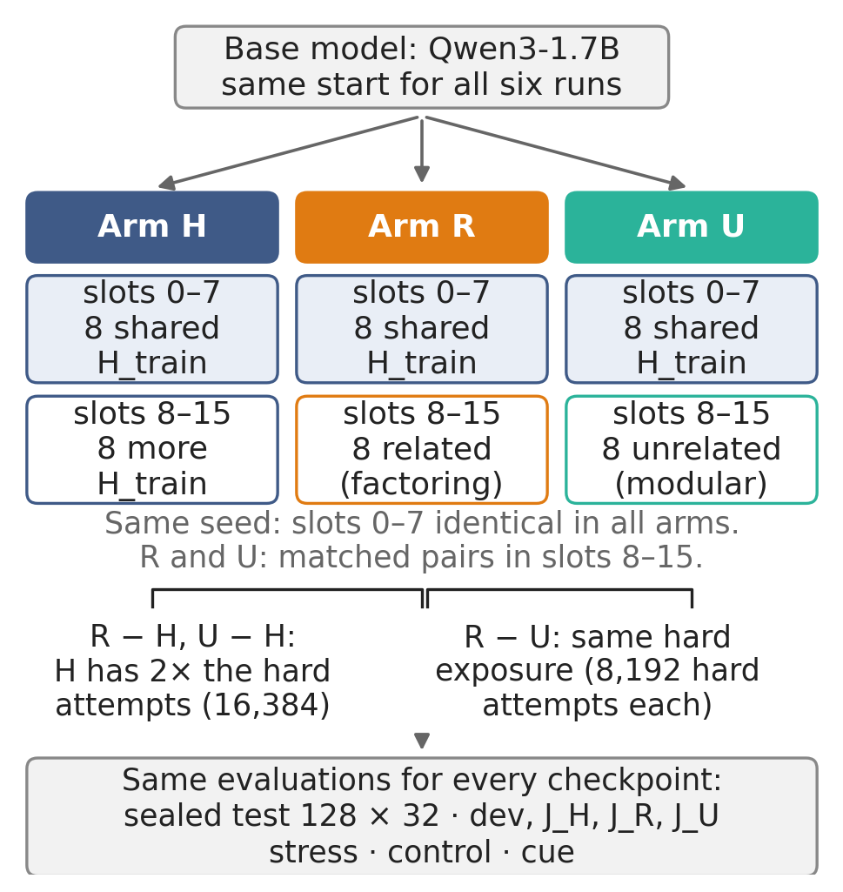

*Figure 1. Study design. All six runs (3 arms × training seeds 101 and 202) start from the same base weights and run
128 rounds of 16 slots × 8 attempts. Slots 0–7 are identical across arms within a seed, so R − U compares two
allocations of slots 8–15 at equal exposure to hard problems (8,192 hard attempts each). H spends slots 8–15 on more
hard problems, so R − H and U − H compare practice against twice the hard exposure. Every checkpoint is scored on the
same evaluation panels with the same evaluation seeds.*

**One group of eight, with numbers.** Suppose a hard problem's 8 attempts earn rewards 1, 0, 0, 1, 0, 0, 0, 0. The
group mean is 0.25 and the population standard deviation is 0.433. The two correct attempts get advantage +1.73 and the
six wrong ones −0.58. The update raises the probability of the tokens in the correct attempts and lowers it for the
wrong ones. If all 8 attempts are wrong (or all 8 correct), every advantage is 0: the group carries no within-group
reward contrast and contributes no gradient. (This example is illustrative; recorded advantages match the formula to
within 1.2 × 10⁻⁷ in all six runs, [`pass-b/data/train_groups.json`](../research/audit-a26/pass-b/data/train_groups.json).)

**Two examples.** Texts were read from the pinned MATH source (local copy `../data/external/a17/math_*.parquet`; the
number in each ID is the row index). They agree with the annotation quotes in [`../data/annotations/`](../data/annotations/).

| | Related practice item (R pool) | Hard training problem (H_train) |
|---|---|---|
| ID and source | `algebra/train/01732`; MATH train, algebra, Level 3; one of the 9 natural items among the 63 R problems | `intermediate_algebra/train/00481`; MATH train, intermediate algebra, Level 5 |
| Text | "For how many values of $x$ is the expression $\frac{x^2-9}{(x^2+2x-3)(x-3)}$ undefined?" | "Evaluate the infinite sum $\sum_{n=1}^{\infty}\frac{n}{n^4+4}$." |
| Gold | `3` | `\dfrac 3 8` (three eighths) |
| Why it has this label | A direct exercise: factor the denominator into $(x-1)(x+3)(x-3)$ and count the roots. | The problem never mentions factoring. The solver must see that $n^4+4$ factors as $(n^2+2n+2)(n^2-2n+2)$; the fraction then splits into a telescoping sum. |
| Role | R slots 8–15. Its matched U partner is `number_theory/train/00437` ("Find the remainder when $8735 + 8736 + 8737 + 8738$ is divided by 11.", gold `10`). | Shared slots in all arms; extra slots in H. |
| Base-model screening (cap 8,192) | 24 of 32 attempts correct ([`related_k8_s2k8_counts.jsonl`](../data/screening/related_k8_s2k8_counts.jsonl)) | 5 of 32 attempts correct ([`hsel_k8.json`](../data/screening/hsel_k8.json)) |

## 2. Datasets, arms, probes and metrics

### 2.1 Sets

The table introduces every set before the report uses its shorthand. "Problems" counts distinct problem IDs.

| Set | Purpose | Source | Problems | Overlap with other sets | Affects training? | Evaluated: when; attempts; cap |
|---|---|---|---|---|---|---|
| H_train | hard training pool | MATH train 25, Omni-MATH 21 | 46 | none by ID or text; two close variants in dev and sealed test (§2.3) | yes: shared slots (all arms), extra slots (H) | never evaluated as a panel |
| R pool | related practice | MATH train 9, authored 54 | 63 | paired one-to-one with U | yes: R slots 8–15 | — |
| U pool | unrelated practice | MATH train number theory 9, authored 54 | 63 | paired one-to-one with R | yes: U slots 8–15 | — |
| calib_train / calib_val | learning-rate and clip selection before the main runs | MATH train, own splits | 59 / 56 | none | selection only | calibration runs only |
| dev | in-run held-out target | MATH train, split `study_dev`; rubric only | 53 | contains J_H | no | rounds 0, 32, 64, 96, 128 of every run; 8; 8,192 at rounds 0 and 32, then 12,288 |
| J_H | hard probe | the first 32 problems of dev | 32 | subset of dev | no | computed from the dev attempts above |
| J_R | factoring probe | MATH train `study_dev` | 28 | none | no | with dev; 8; same caps |
| J_U | modular-arithmetic probe | MATH train `study_dev`, number theory | 32 | none | no | with dev; 8; same caps |
| sealed test | primary endpoint | MATH official test; rubric only | 128 | one close variant of an H_train problem | no | base and round-128 endpoints; 32; 12,288 |
| Harder / SuperHard | stress transfer | MATH 69 / 60, Omni-MATH 15 / 52, OlympiadBench 11 / 14 | 95 / 126 | none within the stress-panel similarity rule | no | base, six endpoints, two round-64 checkpoints; 8; 12,288 |
| control | gains on unpractised subjects (added in the audit) | MATH test: geometry, counting and probability, precalculus, prealgebra; Levels 4–5 | 64 | none | no | base and six endpoints; 8; 12,288 |
| cue | effect of a one-sentence factoring hint | MATH test | 24 | none | no | base and four R/U endpoints; 8 per form; 12,288 |
| response audit | reading of failures | 8 Harder + 8 SuperHard problems | 16 | subset of stress | no | attempt 0 of six policies (96 responses) |

Manifests: [`../data/main_v1_manifest.json`](../data/main_v1_manifest.json) (keys `hard`, `related`, `unrelated`, `dev`,
`probe_J_H`, `probe_J_R`, `probe_J_U`); [`../data/panels/panels.json`](../data/panels/panels.json) (dev, sealed test,
probes); [`match_k8.json`](../data/screening/match_k8.json) (R/U pairs); [`stress_v1.json`](../data/stress/stress_v1.json);
[`control_v1.json`](../data/control/control_v1.json); [`../data/cue/`](../data/cue/);
[`audit_sample_v1.json`](../research/evidence/a17/panels/audit_sample_v1.json). Full inventory:
[`pass-a/data-inventory.md`](../research/audit-a26/pass-a/data-inventory.md).

### 2.2 How the labels were assigned

Agent annotators read each candidate problem and its reference solution (two passes, plus a third read on disagreement).
They recorded whether factoring is central to the solution, whether the problem is a direct factoring exercise, and
whether it uses modular arithmetic. Some labels then combine with a base-model screen.

| Label | Rule | Screened by base-model success? |
|---|---|---|
| hard (H_train) | factoring central, not direct practice; base 2–12 of 32 attempts correct at cap 8,192 (31 "core" problems at 2–8, 15 "moderate" at 9–12) | yes |
| related (R pool) | factoring central and a direct factoring exercise; base 12–24 of 32 correct | yes |
| unrelated (U pool) | factoring absent, modular arithmetic present, direct practice; base 12–24 of 32; matched to R within provenance on success count, prompt length, response length and answer type (53 of 63 pairs have equal success counts) | yes |
| dev, J_H, sealed test | factoring central, not direct practice, MATH Levels 4–5 | no |
| J_R / J_U | factoring central and direct practice / number theory with modular arithmetic and no factoring; Levels 1–5 (J_R 14 of 28 and J_U 16 of 32 problems are Levels 1–3) | no |
| Harder | a factoring step that must be recognised inside a solution of at least 3 steps, with no cue | no |
| SuperHard | Harder plus one documented obstacle (hidden substitution, choice of approach, case analysis, non-obvious grouping, or several factorizations) | no |

"Hard" therefore has several senses. In this report, *hard problems* means H_train unless another set is named. For dev,
J_H and the sealed test, "hard" is a rubric label, not a measured difficulty: the base model scored 40.3–42.2% on dev at
round 0. The stress tiers come from one annotation pass; a blind second read agreed on the tier for 171 of 219 problems.
SuperHard was harder in fact: the base model scored 25.8% on SuperHard and 52.5% on Harder.

### 2.3 Held-out status

No problem ID, exact text or normalised text is shared between sets, except the intended inclusion of J_H in dev. No
pair reaches the split rule (5-word-shingle Jaccard ≥ 0.7). A stricter template rule (masked word-3-gram Jaccard ≥ 0.5)
finds two close variants of H_train problems: dev problem `algebra/train/01291` (not in J_H) and sealed-test problem
`intermediate_algebra/test/00383`. Removing them changes no per-seed contrast by more than 0.27 points and no interval's
relation to zero ([`discrepancies.md`](../research/audit-a26/discrepancies.md) §3.1).

### 2.4 Measurements

| Measure | Definition as computed | Denominator |
|---|---|---|
| pass@1 | mean over problems of c/n (c correct of n attempts); with equal n this is correct attempts ÷ all attempts | all attempts; a verifier "unknown" counts as incorrect |
| pass@8, n 32 (sealed test) | unbiased estimate 1 − C(n−c, 8)/C(n, 8), averaged over problems: the chance that 8 of the 32 attempts, drawn without replacement, contain a correct one | problems |
| pass@8, n 8 (dev, stress, cue, control) | 1 if c ≥ 1, else 0, averaged over problems; identical to observed coverage at 8 | problems |
| observed coverage at n | share of problems with at least one correct attempt among n | problems |
| truncation | share of attempts that reach the cap without finishing | all attempts |
| accuracy among finished | correct ÷ finished attempts, pooled over problems; pass@1 equals (1 − truncation) × this accuracy | finished attempts only |
| success within 8,192 | correct and at most 8,192 tokens, read from 12,288-cap traces | all attempts |

The report uses each unit in one sense. A *problem* is one distinct item. An *attempt* is one sampled response. A *group*
is the 8 attempts of one slot in one round. A *round* is one schedule–generate–grade–update cycle. A *checkpoint* is the
weights saved after a given number of completed rounds; "r64" means after round 64. A *run* is one arm × training seed,
for example R-s202.

**What exactly is J_H?** J_H is pass@1 on 32 fixed problems: the first 32 IDs of the 53-problem dev panel, listed under
`probe_J_H` in [`../data/main_v1_manifest.json`](../data/main_v1_manifest.json). In each run it is computed from the dev
attempts at rounds 0, 32, 64, 96 and 128 (8 attempts per problem; cap 8,192 at rounds 0 and 32, 12,288 after). J_H is a
label for factoring-central MATH problems; none was screened by model success. J_R and J_U are separate panels. Every
policy is scored on all three, so an H or R run also has a J_U score. A second J_H measurement exists only in the local
one-step diagnostic (§5.4.4): a separate evaluation with 16 attempts per problem at cap 8,192.

## 3. Research questions

| # | Question | Specified | Comparison that answers it |
|---|---|---|---|
| P1 | At equal exposure to hard problems, does related practice (R) beat unrelated practice (U)? | primary; frozen 7 Nov, before any endpoint result ([`PROTOCOL.md`](../research/PROTOCOL.md) §1, A9) | R − U in sealed-test pass@1 at round 128, per training seed, paired over problems |
| S1 | Is either kind of practice worth more than 8 more hard problems? | secondary; frozen 7 Nov | R − H and U − H, same table |
| E1 | When did the arms separate during training? | in-run dev and probes frozen 7 Nov; timing question added 10 Nov (A17) | R − U on dev, J_H, J_R, J_U at rounds 0–128, per seed |
| E2 | Did training reach new problems or make known problems more reliable? | 9 Nov (A15), extended 10 Nov (A17) | coverage at n against pass@1, per problem |
| E3 | Did the policy lose accuracy, or stop finishing within the cap? Would more tokens help? | decomposition 10 Nov (A17); length extension 11 Nov (A19) | truncation decomposition; continuation of capped attempts from 12,288 to 16,384 tokens |
| E4 | Does one update of one kind lower hard-problem success (interference)? | one-step diagnostic frozen 7 Nov (PROTOCOL §8); training-record analyses 9–10 Nov (A15, A17) | one-step ΔJ against a no-update reference; loss and recovery on training problems; group statistics |
| E5 | Do the gains and the arm order transfer to harder factoring problems? | 10 Nov (A17) | Harder and SuperHard pass@1 per policy and contrast |
| E6 | Does a written factoring hint change success? | 9 Nov (A15) | cued − uncued pass@1 per policy |
| E7 | What kind of failures remain? | 10 Nov (A17) | blind reading of 96 fixed responses |
| E8 | Why do J_U and J_R rise in arms that never practise those skills? | 11 Nov (A26), pre-registered | gains on the control panel against probe gains |

All questions after P1 and S1 are exploratory. E2–E8 were added after training outputs were visible; each panel and
rule was fixed before its own evaluation outputs existed.

## 4. Methods

### 4.1 One GRPO round

1. The schedule fills 16 slots. Slots 0–7 take 8 distinct H_train problems from a shuffled cycle over the 46. Slots
   8–15 take 8 more H_train problems that differ from the shared ones (H), or the R or U problems of 8 pair indices from
   a shuffled cycle over the 63 pairs (R and U use the same pair indices).
2. vLLM samples 8 attempts per slot (temperature 1.0, top-p 1.0): 128 attempts in total.
3. The verifier grades each attempt.
4. Each group gets advantages (r − mean)/(population std + 1e-6). A group whose 8 rewards are equal (all correct or all
   wrong) gets advantage 0 for every attempt. A *mixed group* has 1–7 correct attempts; only mixed groups carry nonzero
   advantages.
5. The 16 groups split into 4 minibatches of 4 complete groups: 2 shared-slot groups and 2 groups from slots 8–15.
6. Each minibatch gives one AdamW step: clipped policy-ratio objective (clip 0.2 on both sides), token mean per attempt,
   divided by 32 attempts; no KL or entropy term; learning rate 2e-6; gradient-norm clip 1.0; weight decay 0. The ratio
   uses the learner's own log probabilities at the start of the round.
7. After 4 steps the new weights go to vLLM for the next round.

An all-correct or all-wrong group adds no gradient, but it still counts in the divisor of 32. AdamW still steps when all
4 groups of a minibatch have equal rewards: the gradient is exactly 0, and the stored moments move the weights. This
report calls such a step a *momentum-only step*.

**What data trained R?** Each R run trained on 16,384 attempts: 8,192 on the 46 H_train problems in the shared slots
(each problem 20–23 times as a group) and 8,192 on the 63 R pool problems (each 15–17 times). Nothing else entered R's
training: no dev, probe, test, stress or control problem. U is the same with the U pool. H trained on 16,384 attempts on
the 46 H_train problems (each 40–50 times). Counts: [`pass-a/schedules.md`](../research/audit-a26/pass-a/schedules.md) §5.

### 4.2 The run

| Setting | Value |
|---|---|
| Model and template | Qwen3-1.7B `70d244cc`, full-parameter, non-thinking; FP32 weights and optimizer moments, BF16 generation |
| Arms × training seeds | H, R, U × 101, 202: six runs |
| Length | 128 rounds, 512 optimizer steps, 2,048 groups, 16,384 attempts per run |
| Response cap | 8,192 tokens in rounds 1–32, 12,288 in rounds 33–128 (all six runs) |
| In-run evaluation | dev, J_R, J_U at rounds 0, 32, 64, 96, 128; 8 attempts; cap of the last trained round |
| Checkpoints | saved every 4 rounds (every 16 for U-s202 and for R-s202 from round 17); older saves deleted unless retained |
| Endpoint | the round-128 checkpoint of each run, evaluated on the sealed test with 32 attempts at cap 12,288 |

All six runs reached round 128. Four runs continued from a saved checkpoint after an interruption; rounds replayed after
a resume replace the earlier ones (Appendix B). Retained weights below round 128: R-s101 r64, H-s202 r64, a copy of
H-s202 r116 and two partial R-s202 saves. No same-seed pair of R and U checkpoints survives below round 128.

**Seeds.** The training seed drives the problem schedule, the request seed of each slot and the minibatch order. It does
not set the initial weights (every run starts from the same base) or any evaluation seed.

| Within one training seed, across H, R and U | Same | Can differ |
|---|---|---|
| Shared-slot problems, slot order, request seeds | yes (128 of 128 rounds per seed) | — |
| Sampled attempts | — | yes: vLLM sampling depends on the batch; round-1 shared-slot attempts were token-identical in only 0–11 of 64 between arms |
| Grouping of shared groups into minibatches | R and U identical | H differs (same pairs in 0 of 128 rounds for seed 101, 2 of 128 for seed 202) |
| Evaluation seeds | shared by all runs for the same panel, problem, round and n | — |
| Training GPU type | — | see the next paragraph |

**Training hardware.** H-s101 trained on L40. R-s101, U-s101 and U-s202 trained on L40S. H-s202 trained on L40 for rounds
1–60 and on L40S for rounds 61–128. R-s202 trained on L40 for rounds 1–16 and on L40S for rounds 17–128. The arm
contrasts are therefore not hardware-matched in training.

### 4.3 Evaluation, verifier and statistics

The sealed test has 128 problems × 32 attempts at cap 12,288, with one evaluation seed per problem shared by every
policy. The verifier reads the last `\boxed{}` only; an "unknown" verdict counts as incorrect. Only the base cell has
unknowns: 2 of 4,096 attempts (effect on pass@1 at most 0.049 points).

The statistical unit is the problem. A per-seed interval is a 95% paired problem bootstrap: the problems are resampled
10,000 times with replacement, the same draw for both policies, and each problem keeps its observed attempts. It covers
problem and attempt sampling for these fixed checkpoints. It says nothing about variation between training runs. With
two runs per arm, a two-seed mean is reported as a description only.

**Why the common-GPU rerun exists.** The original sealed-test evaluations ran R on L40 and U on L40S in both seeds. A
rerun of all four R/U endpoints on L40S, with the original seeds, checks whether the GPU type explains R − U.

**Why the round-116 fallback exists.** H-s202 restarted from round 60 late in the study. A rule fixed in advance said:
if it could not finish in time, evaluate its latest saved checkpoint outside the primary table. That checkpoint, round
116, was evaluated. The round-128 endpoint then finished and replaces it; the fallback remains a supplementary row.

## 5. Results

Each subsection states why the analysis was needed, what was compared, what happened, and which explanations remain.
**Rounding (applies to every table):** each displayed number is rounded independently from the unrounded value, so a
displayed difference can differ by 0.1 from the difference of the displayed scores.

### 5.1 Endpoints on the sealed test

**Why and what.** This is the primary comparison (P1) and the secondary one (S1): the base policy and the six round-128
endpoints, each with 4,096 attempts (128 problems × 32).

| Policy | Correct / attempts | pass@1 (%) | 95% interval | Gain over base (points) | 95% interval | pass@8 (%) | Coverage at 32 | Truncated attempts | Accuracy among finished (%) |
|---|---|---|---|---|---|---|---|---|---|
| base | 2,153 / 4,096 | 52.6 | [46.5, 58.6] | — | — | 83.5 | 116 / 128 | 2 | 52.6 |
| H-s101 | 3,152 / 4,096 | 77.0 | [71.5, 82.2] | +24.4 | [+19.7, +29.2] | 93.7 | 125 / 128 | 445 | 86.3 |
| R-s101 | 3,353 / 4,096 | 81.9 | [76.7, 86.7] | +29.3 | [+24.5, +34.2] | 96.1 | 125 / 128 | 437 | 91.6 |
| U-s101 | 3,182 / 4,096 | 77.7 | [72.4, 82.7] | +25.1 | [+20.5, +29.8] | 94.5 | 125 / 128 | 501 | 88.5 |
| H-s202 | 2,965 / 4,096 | 72.4 | [66.4, 78.0] | +19.8 | [+15.3, +24.5] | 90.8 | 122 / 128 | 632 | 85.6 |
| R-s202 | 3,063 / 4,096 | 74.8 | [69.1, 80.1] | +22.2 | [+18.0, +26.4] | 92.2 | 123 / 128 | 538 | 86.1 |
| U-s202 | 3,245 / 4,096 | 79.2 | [74.0, 84.0] | +26.7 | [+21.9, +31.5] | 94.9 | 124 / 128 | 333 | 86.2 |
| *Supplementary, not endpoints* | | | | | | | | | |
| H-s202 r116 fallback | 3,044 / 4,096 | 74.3 | [68.5, 79.8] | — | — | 92.8 | 123 / 128 | 605 | 87.2 |
| R-s101 L40S rerun | 3,369 / 4,096 | 82.3 | [77.2, 87.0] | — | — | 96.2 | 125 / 128 | 448 | 92.4 |
| R-s202 L40S rerun | 3,118 / 4,096 | 76.1 | [70.6, 81.4] | — | — | 93.4 | 123 / 128 | 506 | 86.9 |
| U-s101 L40S rerun | 3,187 / 4,096 | 77.8 | [72.6, 82.7] | — | — | 95.1 | 124 / 128 | 505 | 88.7 |
| U-s202 L40S rerun | 3,245 / 4,096 | 79.2 | [74.0, 84.0] | — | — | 94.9 | 124 / 128 | 333 | 86.2 |

Intervals: problem bootstrap (pass@1), paired problem bootstrap (gain). Sources:
[`t01_endpoints.md`](tables/v3/t01_endpoints.md); accuracy among finished and coverage from
[`pass-b/eval.md`](../research/audit-a26/pass-b/eval.md) §3.

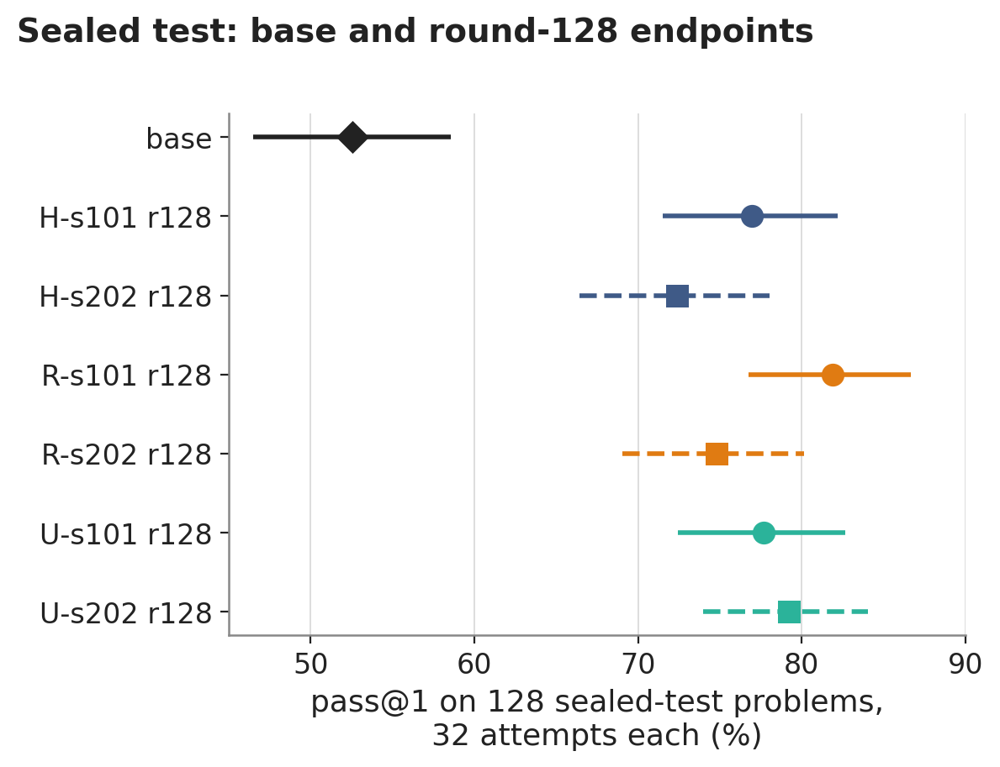

*Figure 2. Sealed-test pass@1 of the base policy and the six round-128 endpoints; 128 problems × 32 attempts, cap
12,288. Bars: 95% problem-bootstrap intervals (10,000 resamples of the problems). They include problem-to-problem
variation, so compare policies with the paired contrasts in Figure 3, not by overlap.*

| Contrast A − B | Seed | A pass@1 (%) | B pass@1 (%) | A − B (points) | 95% interval |
|---|---|---|---|---|---|
| R − U | 101 | 81.9 | 77.7 | +4.2 | [+2.0, +6.3] |
| R − U | 202 | 74.8 | 79.2 | −4.4 | [−7.3, −1.8] |
| R − H | 101 | 81.9 | 77.0 | +4.9 | [+2.1, +7.9] |
| R − H | 202 | 74.8 | 72.4 | +2.4 | [−0.5, +5.3] |
| U − H | 101 | 77.7 | 77.0 | +0.7 | [−1.9, +3.6] |
| U − H | 202 | 79.2 | 72.4 | +6.8 | [+3.6, +10.2] |
| R − U, L40S reruns | 101 | 82.3 | 77.8 | +4.4 | [+2.4, +6.6] |
| R − U, L40S reruns | 202 | 76.1 | 79.2 | −3.1 | [−6.0, −0.4] |

Intervals: paired problem bootstrap over the 128 problems. Source: [`t02_contrasts_test.md`](tables/v3/t02_contrasts_test.md).

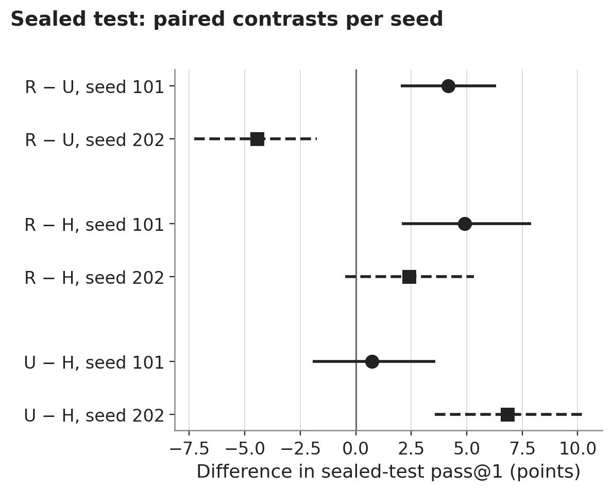

*Figure 3. Sealed-test R − U, R − H and U − H between endpoints of the same training seed (128 problems × 32 attempts).
Bars: 95% paired problem-bootstrap intervals (10,000 draws, the same resampled problems for both policies). They do not
describe variation across training runs.*

**What happened.**
- Every endpoint beat the base policy. Over the six round-128 endpoints, pass@1 ranged from 72.4% (H-s202) to 81.9%
  (R-s101), gains of +19.8 to +29.3 points over the base's 52.6%. Every gain interval excludes zero.
- R − U took opposite signs in the two seeds. R-s101 answered correctly in 3,353 of 4,096 attempts and U-s101 in 3,182
  (+4.2 points). R-s202 answered correctly in 3,063 of 4,096 attempts (74.8%) and U-s202 in 3,245 (79.2%), −4.4 points.
  Both intervals exclude zero, in opposite directions.
- The L40S reruns keep both signs (+4.4 and −3.1 points). A rerun moved a single endpoint by at most +1.3 points
  (R-s202, interval [+0.2, +2.6], which excludes zero). The GPU type matters at that scale but does not explain R − U.
- R − H and U − H point estimates are positive in both seeds (+4.9 and +2.4; +0.7 and +6.8). Two of the four intervals
  include zero (R − H in seed 202, U − H in seed 101). An interval that includes zero is not evidence that two arms are
  equal. The seed-202 H cell mixed two GPU types (65 problems on L40S, 63 on RTX A6000). Against the r116 fallback,
  seed-202 R − H is +0.5 points [−2.2, +3.2] and U − H is +4.9 [+2.1, +7.9]
  ([`pass-b/eval.md`](../research/audit-a26/pass-b/eval.md) §4).

| Contrast | Seed-101 value (points) | Seed-202 value (points) | Mean of the two seeds (points) | Half the difference between seeds (points) |
|---|---|---|---|---|
| R − U | +4.2 | −4.4 | −0.1 | 4.3 |
| R − H | +4.9 | +2.4 | +3.6 | 1.3 |
| U − H | +0.7 | +6.8 | +3.8 | 3.1 |

The two-seed means are descriptions. A paired t interval with 1 degree of freedom has half-widths of 54.8 (R − U), 16.0
(R − H) and 38.8 (U − H) points. Two runs per arm cannot estimate the spread of effects across future runs, so these
data support no curriculum recommendation.

**Cost.** Each run generated 16,384 training attempts; H spent all of them on hard problems, R and U half. H generated
68.6 M (s101) and 74.7 M (s202) response tokens in training, against 52.8–65.1 M for the four R and U runs. Canonical training
GPU-h were at most 29.5 for each H run and 19.5–26.0 for the R and U runs, on mixed GPU types (Appendix C).

**What remains possible.** The data show a seed-dependent R − U of about 4 points in either direction, measured
precisely for each pair of checkpoints. They cannot separate an arm effect from run-to-run variation, which here includes
different training GPUs (§6).

### 5.2 Learning dynamics and probes

**Why and what.** The endpoint shows where the runs ended; the in-run evaluations show when the arms separated (E1).
They score dev (53 problems), J_H, J_R and J_U at rounds 0, 32, 64, 96 and 128, with 8 attempts per problem. Round 0
evaluates the identical base weights with identical seeds in every run, so its spread is sampling noise between
evaluation jobs. The cap was 8,192 at rounds 0 and 32 and 12,288 from round 64, so any change from round 32 to round 64
mixes training with the larger cap.

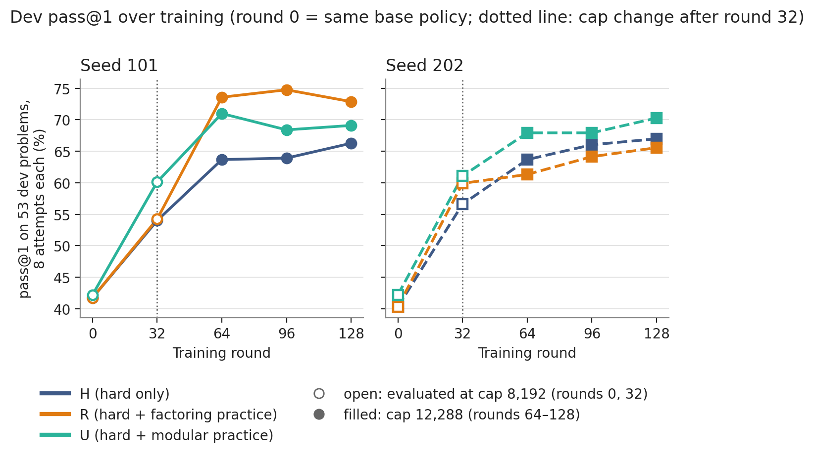

*Figure 4. Dev pass@1 of the six runs at rounds 0–128 (53 problems × 8 attempts), one panel per seed. Round 0 is the
same base policy in every run; its spread (40.3% to 42.2%) is sampling noise. Open markers: cap 8,192 (rounds 0, 32);
filled: 12,288. No intervals drawn; per-point 95% problem-bootstrap intervals are ±9.2 to ±10.6 points (`t03_curves`).
H-s202 rounds 64–128 are trajectory a2-r60.*

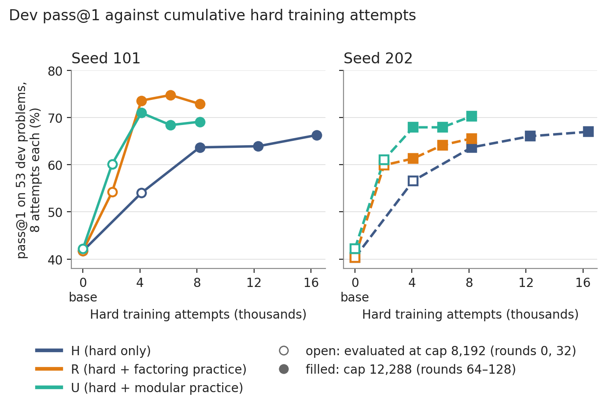

*Figure 5. The same dev evaluations against cumulative hard training attempts: H reaches 16,384 at round 128, R and U
reach 8,192 and also generate 8,192 practice attempts. Markers as in Figure 4; no intervals drawn (sizes in `t03_curves`).*

Dev pass@1 rose from 40.3–42.2% at round 0 to 65.6–72.9% at round 128 across the six runs. The R and U values:

| Seed | Arm | Dev r0 (%) | r32 | r64 | r96 | r128 |
|---|---|---|---|---|---|---|
| 101 | R | 41.7 | 54.2 | 73.6 | 74.8 | 72.9 |
| 101 | U | 42.2 | 60.1 | 71.0 | 68.4 | 69.1 |
| 202 | R | 40.3 | 59.9 | 61.3 | 64.2 | 65.6 |
| 202 | U | 42.2 | 61.1 | 67.9 | 67.9 | 70.3 |

**Earliest observed ordering.** The next table gives R − U at every evaluation round. "First" is the first trained
evaluation round with the round-128 sign; "holds from" is the round from which the sign no longer changes. Absolute
values for every run, panel and round: [`t03_curves.md`](tables/v3/t03_curves.md).

| Seed | Panel | R − U r0 (noise reference) | r32 | r64 | r96 | r128 | First | Holds from |
|---|---|---|---|---|---|---|---|---|
| 101 | dev | −0.5 | −5.9 | +2.6 | +6.4 | +3.8 | 64 | 64 |
| 101 | J_H | −1.6 | −9.4 | +0.4 | +7.0 | +6.2 | 64 | 64 |
| 101 | J_R | 0.0 | +0.9 | +4.0 | +1.3 | −1.3 | 128 | 128 |
| 101 | J_U | −0.4 | −2.0 | +3.5 | −0.8 | +2.0 | 64 | 128 |
| 202 | dev | −1.9 | −1.2 | −6.6 | −3.8 | −4.7 | 32 | 32 |
| 202 | J_H | −2.3 | −2.0 | −7.8 | −0.4 | −5.9 | 32 | 32 |
| 202 | J_R | −0.9 | +5.4 | −5.8 | −2.7 | −1.8 | 64 | 64 |
| 202 | J_U | −1.2 | −1.6 | −3.9 | −8.2 | −2.3 | 32 | 32 |

Points; 8 attempts per problem. Every interval at the "first" round includes zero
([`pass-b/train.md`](../research/audit-a26/pass-b/train.md) §3).

- **Seed 101.** R − U first took its round-128 sign at round 64 on dev, J_H and J_U. Training and the cap change are
  confounded in that window.
- **Seed 202.** U was already ahead at round 32, before the cap change, on dev (−1.2), J_H (−2.0) and J_U (−1.6). Each
  gap is no larger than the round-0 gap between identical policies (−1.9, −2.3, −1.2), so the seed-202 timing is
  unresolved at 8 attempts × 53 problems. In the training records, mean reward on the shared hard problems first favoured U in rounds 25–32
  (−0.2 points; [`discrepancies.md`](../research/audit-a26/discrepancies.md) I3).
- **Stress panels.** No seed has both an R and a U checkpoint below round 128, so no earlier stress ordering exists.

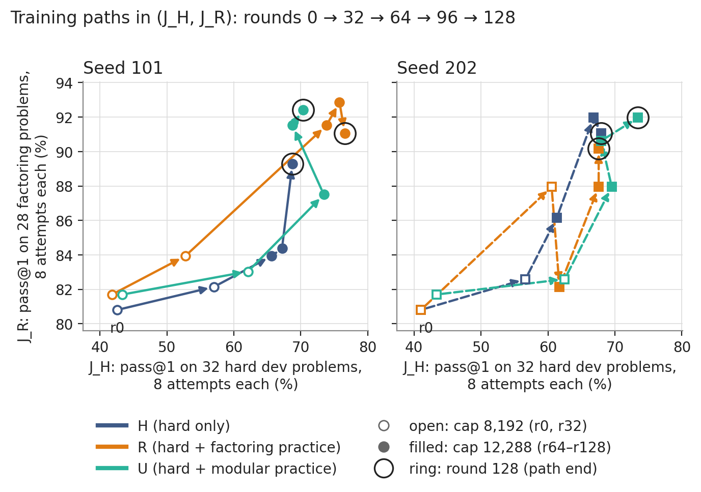

*Figure 6. Path of each run through rounds 0 → 128 (arrows; large black-edged marker and arm letter at round 128),
one panel per seed. x: J_H (32 problems × 8 attempts); y: J_R (28 × 8). Every policy is scored on every probe. Open
markers: cap 8,192; filled: 12,288. No intervals drawn; 95% problem-bootstrap intervals are ±11.3 to ±14.6 points
(J_H) and ±6.0 to ±11.6 points (J_R).*

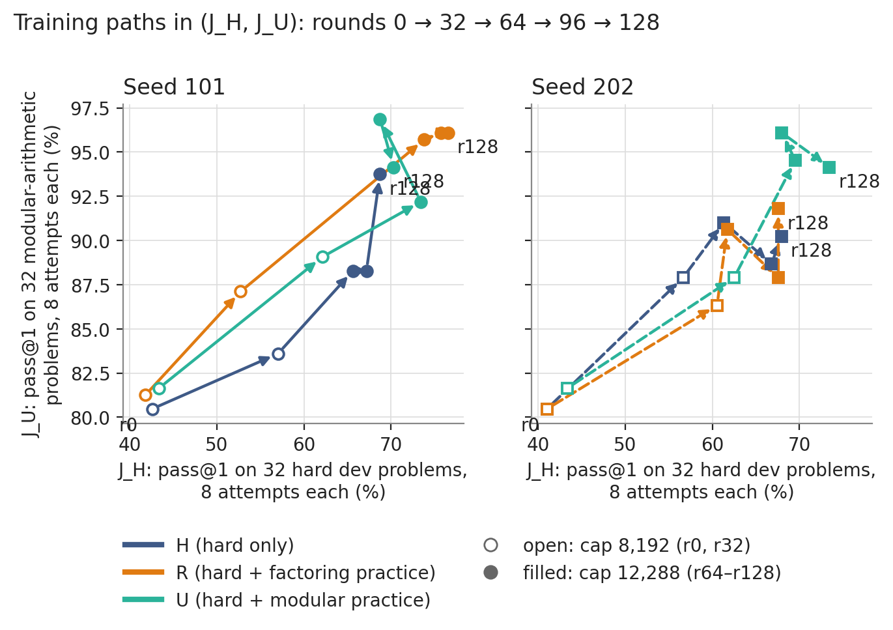

*Figure 7. As Figure 6, with y: J_U (32 modular-arithmetic problems × 8 attempts); J_U intervals are ±2.5 to ±10.9
points. J_U rises in H and R, which never practise modular arithmetic (§5.3).*

Over the six runs, J_H rose from 41.0–43.4% at round 0 to 67.6–76.6% at round 128, J_R from 80.8–81.7% to 89.3–92.4%,
and J_U from 80.5–81.6% to 90.2–96.1%, including in the runs that never practise those skills.

### 5.3 Why J_U and J_R rise in every arm

**Why and what.** U is the only arm that practises modular arithmetic, yet J_U rose in H and R by as much as in U. Two
analyses, planned before their outputs existed ([`transfer/PREREG.md`](../research/audit-a26/transfer/PREREG.md)), test
why: a failure taxonomy of every in-run probe attempt, and a new control panel of 64 MATH test problems from four
subjects no arm practises (base and six endpoints, 8 attempts, cap 12,288).

| Run | Control base (%) | Control endpoint (%) | Control gain (points) | 95% interval | J_U gain r0 → r128 (points) | 95% interval | J_R gain r0 → r128 (points) | 95% interval |
|---|---|---|---|---|---|---|---|---|
| H-s101 | 50.8 | 73.4 | +22.7 | [+14.5, +30.9] | +13.3 | [+5.1, +22.7] | +8.5 | [+3.1, +15.2] |
| H-s202 | 50.8 | 75.6 | +24.8 | [+16.6, +33.0] | +9.8 | [+2.3, +18.4] | +10.3 | [+2.2, +19.6] |
| R-s101 | 50.8 | 79.1 | +28.3 | [+19.9, +36.9] | +14.8 | [+7.8, +23.0] | +9.4 | [+0.4, +18.8] |
| R-s202 | 50.8 | 72.1 | +21.3 | [+15.0, +27.5] | +11.3 | [+3.9, +19.5] | +9.4 | [+3.6, +16.1] |
| U-s101 | 50.8 | 76.2 | +25.4 | [+17.8, +33.4] | +12.5 | [+5.1, +21.1] | +10.7 | [+3.6, +18.8] |
| U-s202 | 50.8 | 73.4 | +22.7 | [+15.4, +30.1] | +12.5 | [+5.1, +20.7] | +10.3 | [+4.0, +17.4] |

Intervals: paired problem bootstrap, 10,000 draws. Probe gains compare round 128 (cap 12,288) with round 0 (cap 8,192);
their absolute values are in [`t03_curves.md`](tables/v3/t03_curves.md). Source: [`t09_control.md`](tables/v3/t09_control.md).

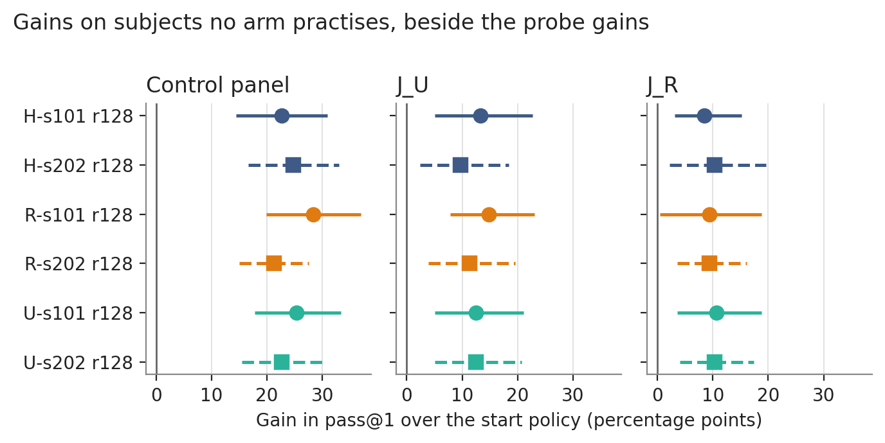

*Figure 8. Six round-128 endpoints. Top: gain over the base policy on the control panel (64 problems × 8 attempts, cap
12,288). Middle and bottom: the same run's J_U and J_R gain from round 0 to round 128 (in-run, 8 attempts). Bars: 95%
paired problem-bootstrap intervals (10,000 draws). The base scores 50.8% on control and about 81% on J_U and J_R, so the
control panel has more room to gain.*

**What happened.**
- Every endpoint gained 21.3 to 28.3 points on the control panel, and every interval excludes zero. Arm differences on
  control are at most 5.7 points and change sign between seeds ([`transfer/control.md`](../research/audit-a26/transfer/control.md) §3).
- The probe gains are fewer wrong final answers. The base model always writes a box: across 90 probe cells, attempts
  without a box number at most 1 per cell, and lenient re-grading (any box) rescues at most 5 finished attempts per cell.
  On J_U, 23–76% of each run's gain is already present at round 32, where both evaluations used cap 8,192
  ([`transfer/taxonomy.md`](../research/audit-a26/transfer/taxonomy.md)).
- The same J_U problems improve in every arm: per-problem changes correlate 0.94 (H with U), 0.81 (H with R) and 0.82 (R
  with U). Example: `number_theory/train/00372` asks for 1234567890 mod 99. The base model sums single digits and answers
  45 (gold 72); every arm learns to answer it correctly in most attempts.

**Interpretation.** The rise of J_U and J_R in arms that never practise those skills is part of a general improvement
that GRPO training on these mixtures produced on unrelated MATH subjects as well. Answer format, the cap and sampling
noise do not explain it; the mechanism is not identified. The pre-registered "format" rule mislabelled U as borderline:
it counted repeated wrong boxes as format, but lenient grading finds the gold in 0 of the 99 such base attempts.
Consequence for this study: J_R and J_U cannot isolate skill transfer from R or U practice.

### 5.4 Coverage, truncation and local interference

#### 5.4.1 Coverage or reliability

**Why and what.** A gain can come from solving new problems (coverage) or from solving known problems more often
(reliability). E2 asks which one carries the sealed-test contrasts.

| Contrast (sealed test) | A pass@1 (%) | B pass@1 (%) | A − B (points) | Problems solved by both | Their contribution (points) | Problems solved by A only / B only | Their contribution (points) |
|---|---|---|---|---|---|---|---|
| R − U, seed 101 | 81.9 | 77.7 | +4.2 | 125 | +4.2 | 0 / 0 | 0 / 0 |
| R − U, seed 202 | 74.8 | 79.2 | −4.4 | 122 | −4.2 | 1 / 2 | +0.07 / −0.29 |
| U − H, seed 202 | 79.2 | 72.4 | +6.8 | 122 | +6.4 | 2 / 0 | +0.44 / 0 |

Source: [`pass-b/eval.md`](../research/audit-a26/pass-b/eval.md) §5. Reliability carries every seed-101 contrast and at
least 92% of every seed-202 contrast. The R − U reversal is spread over many problems: per-problem R − U values are
unrelated across seeds (Spearman −0.09), and the 34 problems the base model solved in 1–5 of its first 16 attempts carry
−5.7 of the −8.6-point change between seeds ([`pass-a/numbers.md`](../research/audit-a26/pass-a/numbers.md) §4).

#### 5.4.2 Truncation decomposition (descriptive)

**Why and what.** The seed-202 R endpoint hit the cap more often than U (E3). With t the truncated share and a the
accuracy among finished attempts, pass@1 equals (1 − t) × a. R − U then splits exactly into a truncation term,
−(t_R − t_U) × ā, and an accuracy term, (1 − t̄) × (a_R − a_U), where bars denote R/U means.

| Seed | R truncated (%) | U truncated (%) | R accuracy among finished (%) | U accuracy among finished (%) | R − U (points) | Truncation term (points) | 95% interval | Accuracy term (points) | 95% interval |
|---|---|---|---|---|---|---|---|---|---|
| 101 | 10.7 | 12.2 | 91.6 | 88.5 | +4.2 | +1.4 | [+0.0, +2.8] | +2.8 | [+0.9, +4.7] |
| 202 | 13.1 | 8.1 | 86.1 | 86.2 | −4.4 | −4.3 | [−6.0, −2.7] | −0.1 | [−2.4, +2.0] |

Terms: [`pass-b/eval.md`](../research/audit-a26/pass-b/eval.md) §4; intervals (paired problem bootstrap) from pass A,
[`pass-a/numbers.md`](../research/audit-a26/pass-a/numbers.md) §4.

In seed 202 the truncation term carries almost all of R − U. This is an identity, not a causal split. Accuracy among
finished compares *selected* responses: R-s202 left 538 attempts unfinished and U-s202 left 333. Equal accuracy among
the finished attempts does not show that R kept its arithmetic skill; whether R's unfinished attempts would have been as
accurate is unknown (§5.5 measures part of it). Success within 8,192 tokens has the same signs: seed 101 R 76.5% vs U
71.4%, seed 202 R 68.6% vs U 75.7%.

#### 5.4.3 Groups, advantages and momentum-only steps

**Why and what.** GRPO gradients come only from mixed groups; a pool that becomes too easy stops contributing them. This
section counts groups and steps. It does not measure update size.

| Run | Groups, all 16 slots: all-wrong / mixed / all-correct (of 2,048) | Slots 8–15 only: all-wrong / mixed / all-correct (of 1,024) | Momentum-only steps (of 512) | First at round | Per 32-round quarter |
|---|---|---|---|---|---|
| H-s101 | 100 / 1,289 / 659 | 55 / 632 / 337 (extra hard) | 18 | 70 | 0, 0, 6, 12 |
| R-s101 | 58 / 961 / 1,029 | 0 / 315 / 709 (practice) | 66 | 38 | 0, 9, 24, 33 |
| U-s101 | 60 / 930 / 1,058 | 0 / 267 / 757 (practice) | 53 | 27 | 1, 7, 16, 29 |
| H-s202 | 79 / 1,287 / 682 | 44 / 646 / 334 (extra hard) | 20 | 73 | 0, 0, 7, 13 |
| R-s202 | 48 / 1,100 / 900 | 0 / 377 / 647 (practice) | 25 | 59 | 0, 2, 3, 20 |
| U-s202 | 54 / 947 / 1,047 | 0 / 288 / 736 (practice) | 65 | 15 | 1, 8, 23, 33 |

Source: [`pass-b/train.md`](../research/audit-a26/pass-b/train.md) §4; both audit passes found the same counts and the
same (round, minibatch) sets of momentum-only steps.

Practice groups were never all-wrong and became mostly all-correct (647–757 of 1,024 per run). All-correct practice
groups add no direct gradient, but they still shaped every update: they count in the divisor of 32, and every R/U
momentum-only step contained 2 of them. Every optimizer step moved the weights, through the mixed hard groups of its
minibatch or through the stored AdamW moments. The size of each weight change is not logged.

**When the practice pools stopped informing the update.** The question is whether slots 8–15 kept supplying reward
contrast long enough to test the intended skill relationship. The next table and Figure 9 count, per 32-round quarter,
the groups that carried no contrast.

| Run | Slots 8–15 pool | All correct in slots 8–15, r1–32 / r33–64 / r65–96 / r97–128 (of 256 each) | All wrong in slots 0–7 (shared H_train), same quarters |
|---|---|---|---|
| H-s101 | extra H_train | 13 / 65 / 113 / 146 | 32 / 3 / 5 / 5 |
| R-s101 | related | 76 / 176 / 226 / 231 | 27 / 9 / 13 / 9 |
| U-s101 | unrelated | 88 / 200 / 233 / 236 | 22 / 8 / 17 / 13 |
| H-s202 | extra H_train | 15 / 70 / 121 / 128 | 14 / 4 / 9 / 8 |
| R-s202 | related | 76 / 159 / 200 / 212 | 27 / 9 / 1 / 11 |
| U-s202 | unrelated | 90 / 190 / 229 / 227 | 28 / 11 / 7 / 8 |

Source: [`t10_signal.md`](tables/v4/t10_signal.md) (all-wrong and all-correct per pool), built from the audit pass B
group counts. Totals equal the table above.

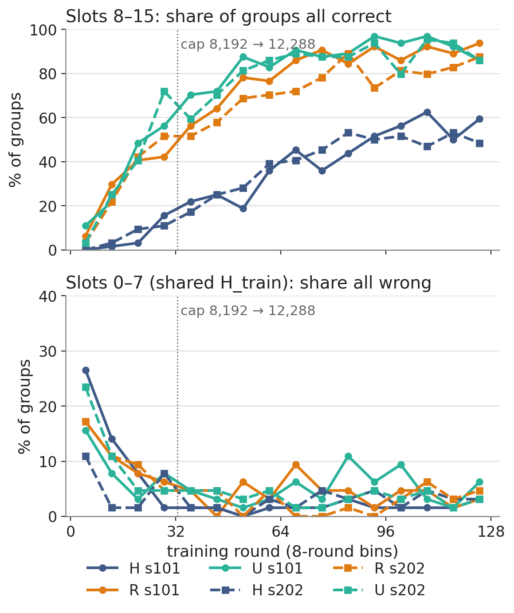

*Figure 9. Top: share of slot 8–15 groups in which all 8 attempts were correct, per 8-round bin (64 groups per bin).
Bottom: share of shared hard groups (slots 0–7) in which all 8 attempts were wrong. Colour: arm; line style and marker:
seed. Dotted line: the cap change after round 32.*

Three observations follow. First, R and U practice lost contrast at similar rates: from round 65 on, 78–92% of practice
groups were all correct in every R and U run (200–236 of 256 per quarter), against 44–57% of H's extra hard groups.
After about round 64, the practice half of each R or U update therefore came mostly from the 8–22% of practice groups
that were still mixed, plus AdamW momentum. Second, all-wrong shared hard groups were common only in rounds 1–32
(14–32 of 256) and rare afterwards (1–17 of 256). Third, R-s202 kept more mixed practice groups than the other R and U
runs (377 of 1,024 against 267–315) and had the fewest all-correct shared hard groups (253 of 1,024 against 301–348).
This is consistent with its lower endpoint, but the count does not say whether slower learning caused or followed it.
**Consequence:** the R/U contrast was tested mainly in the first half of training; in the second half both practice
pools were close to saturated, and the arms differed mostly in which saturated pool filled the divisor.

#### 5.4.4 Ray interference and the local one-step diagnostic

**The mechanism.** Schaul et al. (2019) describe *ray interference*: learning stalls when (a) the gradient for one task
works against the gradient for another, and (b) the data an agent learns from depend on its current performance, as in
on-policy RL. In their two-task bandit, the points where one task is solved and the other is not are saddle points, and
learning can sit near them for a long time. In plain terms: an update that helps task A can lower success on task B; on
policy, lower success on B means fewer rewarded attempts on B, which means less signal to recover B. POPE (Qu et al.,
2026, §3.2 and Figure 5) shows this in a two-problem LLM experiment: plotting J(easy) against J(hard) over training,
mixing in an *unrelated* easy problem gave fast progress on the easy problem while J(hard) stagnated; a *related* easy
problem slightly accelerated learning on the hard one. Figures 6 and 7 above are our POPE-style plots.

**What we measured against each link.**

| Link in the mechanism | Our observation | Same checkpoint or trajectory? |
|---|---|---|
| One update of type X lowers J on type Y | one-step ΔJ (this section): not resolved from reference noise | two source checkpoints: base, R-s101 r64 |
| Lower success removes future reward signal | all-wrong shared hard groups (§5.4.3): frequent only in rounds 1–32 | training records of all six runs; never linked to a ΔJ |
| Loss of a previously solved problem | loss and recovery (§5.4.5): at the rate binomial sampling predicts | training records; different problems from the probes |
| Sustained stall on hard problems | not defined or measured | — |

A local optimizer branch, an all-wrong group and a learning stall are three different observations. Only the R-s101 r64
diagnostic and the R-s101 training records lie on one trajectory. Other explanations fit the observed patterns without
interference: sampling variation (§4.3), truncation (§5.4.2), saturation of easy practice (§5.4.3) and, for R − H and
U − H, twice the hard exposure in H. A two-seed endpoint reversal cannot establish a saddle point.

**Why and what.** The diagnostic tests the first link directly. From two source checkpoints (the base policy with a fresh
optimizer, and R-s101 round 64 with its saved optimizer) it takes one GRPO step on 4 prompts × 8 attempts of one type
(hard, related or unrelated), four draws per type (draw seeds 4101–4104). It then evaluates J_H, J_R and J_U with 16
attempts per problem **at cap 8,192**, below the 12,288 that R-s101 r64 trained with: 2,771 of 7,680 round-64 J_H
attempts (36.1%) hit that cap. Each change ΔJ is measured against a no-update reference: `none` (same job as the
branches) or `none_rerun` (separate L40S job; `none_cycled` gives identical values).

| Source | Update type | Mean J_H after the step (%) | ΔJ_H vs `none` (points) | ΔJ_H vs `none_cycled` (points) | Range of the 4 draws (%) |
|---|---|---|---|---|---|
| base, r0 | none (L40) / none_rerun (L40S) | 40.0 / 43.2 | 0.0 / +3.1 | — | — |
| base, r0 | hard | 41.5 | +1.4 | −1.7 | 40.6–42.2 |
| base, r0 | related | 42.7 | +2.7 | −0.4 | 41.6–43.9 |
| base, r0 | unrelated | 40.5 | +0.5 | −2.6 | 38.5–42.6 |
| R-s101, r64 | none (RTX 6000 Ada) / none_rerun (L40S) | 60.5 / 63.1 | 0.0 / +2.5 | — | — |
| R-s101, r64 | hard | 60.6 | +0.1 | −2.4 | 60.0–61.7 |
| R-s101, r64 | related | 61.6 | +1.0 | −1.5 | 61.1–62.1 |
| R-s101, r64 | unrelated | 60.9 | +0.3 | −2.2 | 59.2–63.3 |

Sources: [`t04_diag.md`](tables/v3/t04_diag.md) (every draw, J_R and J_U); [`pass-b/train.md`](../research/audit-a26/pass-b/train.md) §5.

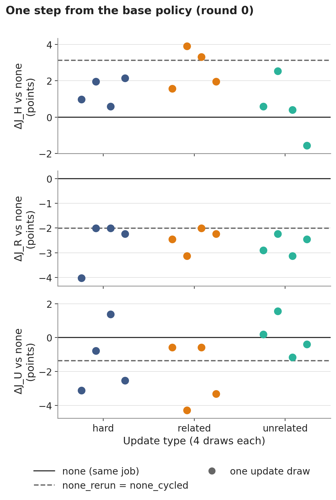

*Figure 10. Each point is one update draw: one GRPO step (4 prompts × 8 attempts; hard, related or unrelated) from the
base policy (round 0), then J_H (32 problems), J_R (28) and J_U (32) at 16 attempts per problem, cap 8,192, identical
evaluation seeds; one panel per probe. y: draw minus `none` (solid line). Dashed line: `none_rerun`; the gap between the
two references (+3.1 J_H points) is the reference noise. No intervals drawn.*

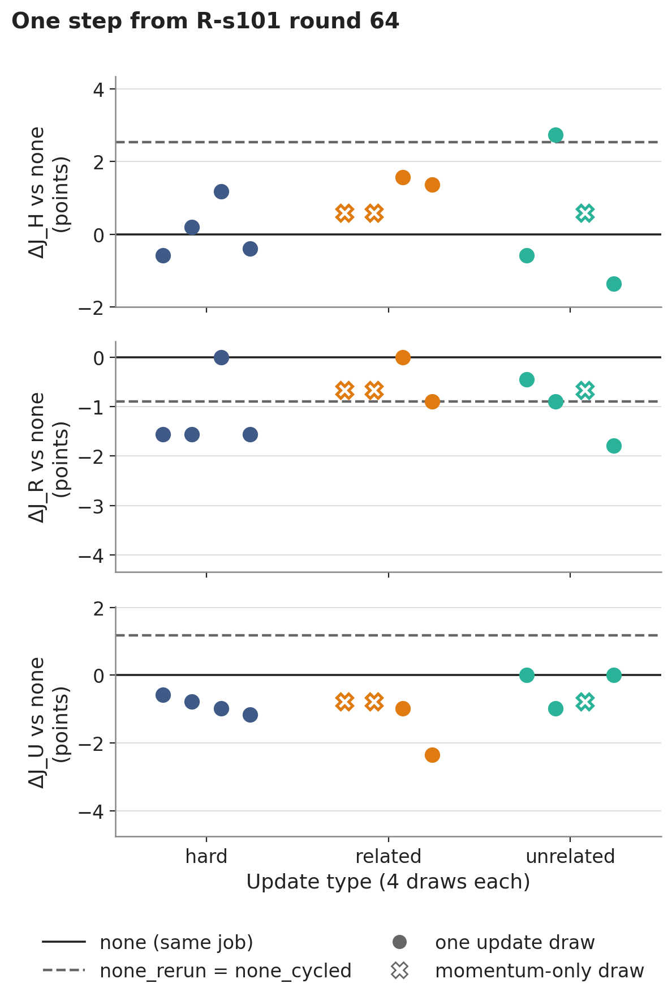

*Figure 11. As Figure 10, from R-s101 round 64; the gap between the two references is +2.5 J_H points. Crossed open
markers: the three draws with exactly zero gradient (related-4101, related-4102, unrelated-4103); AdamW still stepped,
and their evaluations are identical. No intervals drawn.*

**What happened.** The two references for the same weights differ by +3.1 (r0) and +2.5 (r64) J_H points. That gap is
larger than the range of the three type means in 5 of 6 (source, probe) cells. Every type-mean ΔJ_H is positive against
`none` and negative against `none_cycled`, so its sign depends on the reference. No permutation test separates the types
(p ≥ 0.074 in all six cells). The reference-free comparison unrelated − related is −2.2 points at r0 and −0.7 at r64,
within the spread of single draws. At r64, two of the four related draws and one unrelated draw had zero gradient.

**What remains possible.** The diagnostic cannot resolve a one-step effect of this size; it does not show that
interference is absent. It measures change under an 8,192-token budget, at two source checkpoints of one run.

#### 5.4.5 Loss and recovery on training problems; stalls

**Loss and recovery.** A *loss* is an H_train problem with at least 1 correct of 8 attempts at one presentation and 0 of
8 at its next presentation; it is *recovered* when a later presentation has a correct attempt. Losses were 22–38 per run
(of 921–1,924 scored presentations), and all but 1–3 per run recovered by round 128. Observed losses are 0.65–1.07 times
the count that binomial sampling alone predicts from each problem's success rate, so no excess loss appears. No arm order
holds across seeds. Per-run counts: Appendix A.2.

**Sustained stalls.** No record defines or measures a sustained stall, so this link of the mechanism was not tested.

**Which links were measured on the same trajectory.** The R-s101 r64 diagnostic source, the R-s101 in-run curve and the
R-s101 training records (including its 66 momentum-only steps) belong to one trajectory. Never connected: the one-step
ΔJ and any later R-s101 round (no checkpoint between rounds 64 and 128 survives); ΔJ and loss on training problems
(different problems, no shared measurement); any stall measure; and the U and H runs, which have no diagnostic.

### 5.5 Length extension: what did the extra 4,096 tokens change?

**Why and what.** The seed-202 R deficit comes with truncation (§5.4.2), and accuracy among finished cannot say what the
capped attempts would have done with more room (E3). Every attempt of five round-128 endpoints that hit the 12,288-token
cap was continued from its own 12,288 tokens for up to 4,096 more (16,384 in total) and regraded; finished attempts keep
their score. The new tokens come from a new seed stream: same model and decoding, but not the path a 16,384-cap
evaluation would have sampled. H-s202 and the base policy were not extended.

| Panel | Checkpoint | pass@1 at 12,288 (%) | pass@1 at 16,384 (%) | Change (points) | 95% interval | Capped at 12,288 | Recovered (correct) | Finished wrong | Still capped |
|---|---|---|---|---|---|---|---|---|---|
| sealed test | H-s101 | 77.0 | 79.2 | +2.3 | [+1.5, +3.1] | 445 | 93 (20.9%) | 141 | 211 (47.4%) |
| sealed test | R-s101 | 81.9 | 84.2 | +2.3 | [+1.4, +3.3] | 437 | 94 (21.5%) | 50 | 293 (67.0%) |
| sealed test | U-s101 | 77.7 | 80.6 | +2.9 | [+1.9, +4.1] | 501 | 118 (23.6%) | 67 | 316 (63.1%) |
| sealed test | R-s202 | 74.8 | 76.9 | +2.1 | [+1.5, +2.8] | 538 | 87 (16.2%) | 104 | 347 (64.5%) |
| sealed test | U-s202 | 79.2 | 80.8 | +1.6 | [+0.9, +2.4] | 333 | 66 (19.8%) | 65 | 202 (60.7%) |
| stress | H-s101 | 64.1 | 67.3 | +3.1 | [+2.0, +4.4] | 313 | 55 (17.6%) | 126 | 132 (42.2%) |
| stress | R-s101 | 69.5 | 72.3 | +2.8 | [+1.8, +3.8] | 362 | 49 (13.5%) | 61 | 252 (69.6%) |
| stress | U-s101 | 65.3 | 68.2 | +2.9 | [+1.9, +4.0] | 406 | 51 (12.6%) | 64 | 291 (71.7%) |
| stress | R-s202 | 63.2 | 66.0 | +2.8 | [+1.9, +3.8] | 407 | 50 (12.3%) | 96 | 261 (64.1%) |
| stress | U-s202 | 65.8 | 68.2 | +2.3 | [+1.5, +3.3] | 268 | 41 (15.3%) | 81 | 146 (54.5%) |

Sealed test: 4,096 attempts per checkpoint; stress: 1,768. Shares are of the capped attempts. Interval: paired problem
bootstrap of the per-problem change. Source: [`t05_length.md`](tables/v3/t05_length.md).

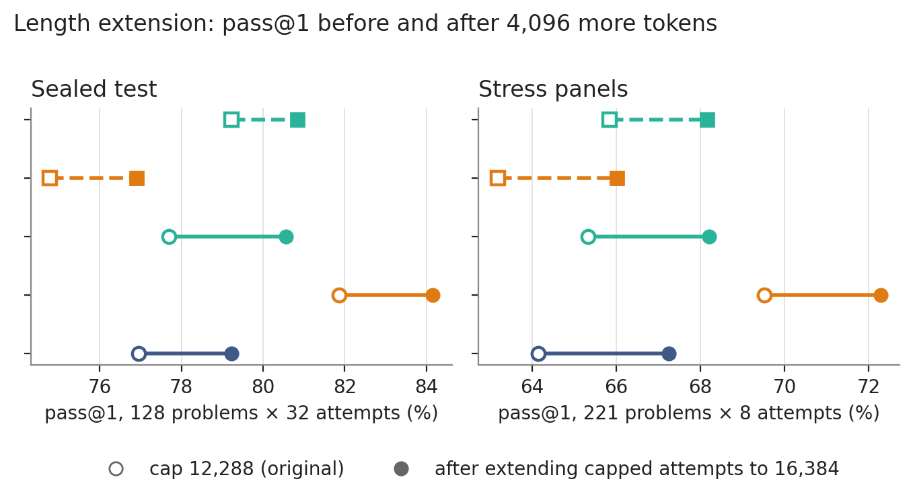

*Figure 12. Five round-128 endpoints (H-s202 not extended). Top: sealed test (128 problems × 32 attempts); bottom: stress
(221 × 8). Open marker: pass@1 at cap 12,288; filled: after every capped attempt was continued by up to 4,096 tokens.
95% paired problem-bootstrap intervals of each gain are in `t05_length`.*

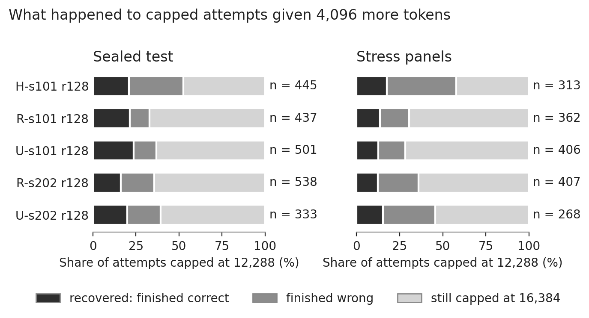

*Figure 13. For the same five endpoints, the attempts capped at 12,288 (n in each row label) split into recovered
(finished and correct), finished wrong and still capped at 16,384; shares are of the capped attempts.*

| Contrast | Panel | At 12,288 (points) | 95% interval | At 16,384 (points) | 95% interval | Change (points) | 95% interval |
|---|---|---|---|---|---|---|---|
| R-s101 − U-s101 | sealed test | +4.2 | [+2.0, +6.3] | +3.6 | [+1.5, +5.7] | −0.6 | [−1.6, +0.4] |
| R-s202 − U-s202 | sealed test | −4.4 | [−7.3, −1.8] | −3.9 | [−6.7, −1.3] | +0.5 | [−0.3, +1.3] |
| R-s101 − U-s101 | stress | +4.2 | [+1.5, +6.8] | +4.1 | [+1.4, +6.7] | −0.1 | [−1.1, +1.0] |
| R-s202 − U-s202 | stress | −2.7 | [−5.0, −0.2] | −2.1 | [−4.6, +0.3] | +0.5 | [−0.5, +1.5] |

The absolute pass@1 values are in the previous table. R − H and U − H for seed 101 change by −0.3 to +0.6 points, every
interval containing zero: [`t06_length_contrasts.md`](tables/v3/t06_length_contrasts.md).

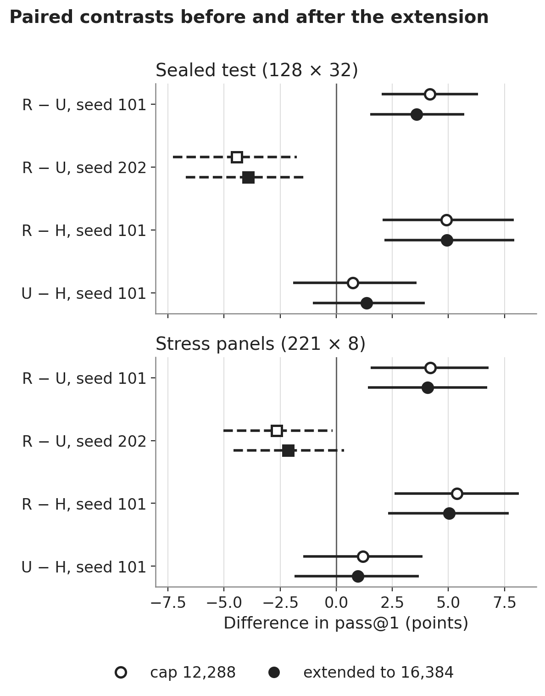

*Figure 14. R − U per seed, and R − H and U − H for seed 101, on the sealed test (128 × 32) and stress (221 × 8). Open
marker: contrast at cap 12,288; filled: at 16,384. Bars: 95% paired problem-bootstrap intervals. Intervals of the change
itself are in `t06_length_contrasts`.*

**What happened.** Two observations, stated separately.
1. **More tokens raised absolute success for every extended checkpoint.** pass@1 rose by 1.6 to 2.9 points on the sealed
   test and by 2.3 to 3.1 points on stress; every change interval excludes zero. On the seed-202 sealed test, R
   recovered 87 of 538 capped attempts (16.2%) and U 66 of 333 (19.8%). Across the five checkpoints and both panels,
   12–24% of capped attempts finished correctly.
2. **The ordering did not change.** R − U moved by at most 0.6 points in either seed on either panel, and every change
   interval for a whole panel contains zero. (One tier-level change, seed-202 Harder, is +1.6 [+0.1, +3.2].) The
   seed-202 sealed-test deficit went from −4.4 to −3.9 points; its interval still excludes zero.

**Token cost.** On the R-s202 sealed test, the extension spent 1,781,371 new tokens on 538 capped attempts: 20,476 new
tokens per recovered answer. The 87 recovered attempts themselves used 1,767 new tokens each on average.

**What remains possible.** Most capped attempts did not convert: 47–67% of capped sealed-test attempts were still capped
at 16,384, and others finished wrong. The extra budget is not neutral, because it helps every checkpoint, but it does
not explain the seed-dependent R − U. In seed 202, R recovered a smaller share of its capped attempts than U (16.2% vs
19.8%). The extension measures inference allowance for these five checkpoints. It does not show what training with a
longer cap would have produced.

### 5.6 Stress panels: transfer to harder factoring problems

**Why and what.** E5 asks whether the training gain and the arm order reach harder factoring problems that no run
trained on. Base, the six round-128 endpoints and the only two intermediate checkpoints evaluated (R-s101 r64 and H-s202
r64) were scored on Harder (95 problems) and SuperHard (126), 8 attempts per problem at cap 12,288.

| Policy | All 221 (%) | 95% interval | Harder (%) | 95% interval | SuperHard (%) | 95% interval | Truncated, all (%) | Solved ≥ 1 of 8, all |
|---|---|---|---|---|---|---|---|---|
| base | 37.3 | [32.6, 42.0] | 52.5 | [45.1, 59.9] | 25.8 | [20.5, 31.3] | 0.1 | 152 |
| H-s101 r128 | 64.1 | [59.1, 69.1] | 79.5 | [73.2, 85.3] | 52.6 | [45.8, 59.4] | 17.7 | 183 |
| R-s101 r128 | 69.5 | [64.5, 74.4] | 84.2 | [78.6, 89.2] | 58.4 | [51.1, 65.7] | 20.5 | 184 |
| U-s101 r128 | 65.3 | [60.4, 70.2] | 80.1 | [74.1, 85.8] | 54.2 | [47.1, 60.9] | 23.0 | 184 |
| H-s202 r128 | 60.1 | [54.9, 65.2] | 74.3 | [67.6, 80.9] | 49.4 | [42.2, 56.5] | 25.5 | 177 |
| R-s202 r128 | 63.2 | [58.1, 68.1] | 76.3 | [69.7, 82.4] | 53.3 | [46.2, 60.3] | 23.0 | 180 |
| U-s202 r128 | 65.8 | [60.9, 70.7] | 79.5 | [73.3, 85.0] | 55.6 | [48.4, 62.5] | 15.2 | 188 |
| R-s101 r64 | 64.3 | [59.2, 69.3] | 78.6 | [72.2, 84.5] | 53.5 | [46.4, 60.4] | 26.1 | 183 |
| H-s202 r64 (trajectory a2-r60) | 62.4 | [57.5, 67.3] | 76.1 | [69.5, 82.1] | 52.1 | [45.3, 58.7] | 15.1 | 183 |

Intervals: problem bootstrap within the tier. Source: [`t07_stress.md`](tables/v3/t07_stress.md).

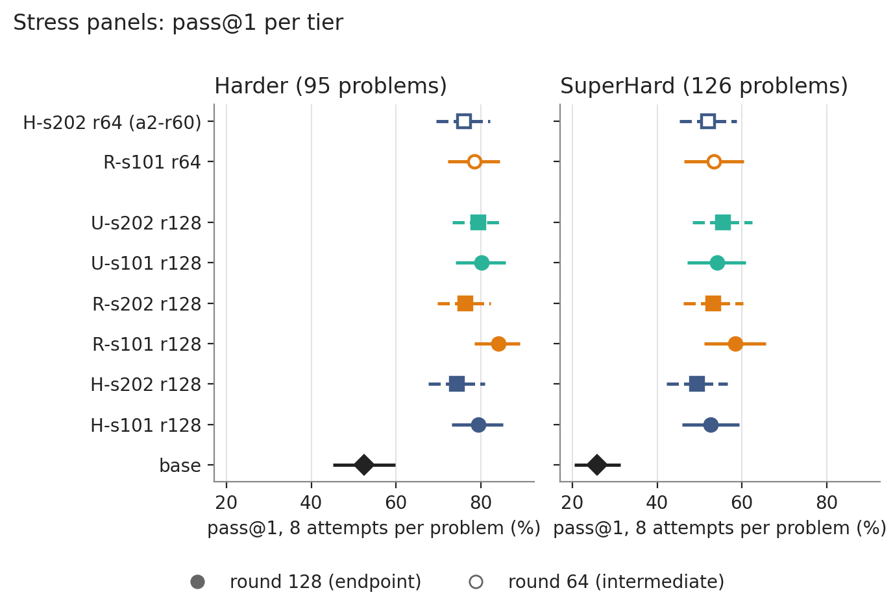

*Figure 15. Stress pass@1 per tier (Harder 95 problems, SuperHard 126; 8 attempts per problem, cap 12,288) for the base,
the six round-128 endpoints (filled markers) and R-s101 r64 and H-s202 r64, trajectory a2-r60 (open markers). Bars: 95%
problem-bootstrap intervals within the tier. All cells ran on L40S except H-s202 r128 (L40 and RTX A6000).*

| Contrast A − B | Seed | Tier | A (%) | B (%) | A − B (points) | 95% interval |
|---|---|---|---|---|---|---|
| R − U | 101 | all | 69.5 | 65.3 | +4.2 | [+1.5, +6.8] |
| R − U | 101 | Harder / SuperHard | 84.2 / 58.4 | 80.1 / 54.2 | +4.1 / +4.3 | [+0.5, +7.6] / [+0.5, +8.0] |
| R − U | 202 | all | 63.2 | 65.8 | −2.7 | [−5.0, −0.2] |
| R − U | 202 | Harder / SuperHard | 76.3 / 53.3 | 79.5 / 55.6 | −3.2 / −2.3 | [−6.7, +0.3] / [−5.7, +1.1] |
| R − H | 101 | all | 69.5 | 64.1 | +5.4 | [+2.6, +8.1] |
| R − H | 202 | all | 63.2 | 60.1 | +3.1 | [−0.1, +6.3] |
| U − H | 101 | all | 65.3 | 64.1 | +1.2 | [−1.5, +3.8] |
| U − H | 202 | all | 65.8 | 60.1 | +5.7 | [+2.4, +9.1] |

Intervals: paired problem bootstrap within the tier. Per-tier R − H and U − H: [`t08_stress_contrasts.md`](tables/v3/t08_stress_contrasts.md).

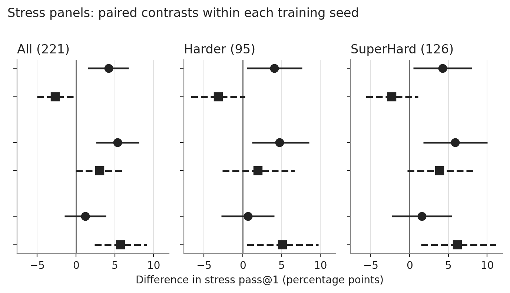

*Figure 16. Stress R − U, R − H and U − H between endpoints of the same seed, on all 221 problems, Harder (95) and
SuperHard (126); 8 attempts per problem. Bars: 95% paired problem-bootstrap intervals within the tier.*

**What happened.**
- Training transferred. The eight trained cells scored 60.1–69.5% on all 221 problems (the six round-128 cells span the
  same range), gains of +22.9 to +32.2 points over the base's 37.3%. On SuperHard the eight trained cells scored
  49.4–58.4% against the base's 25.8%, 1.9 to 2.3 times the base value. Each trained cell solved 33–38 problems that the
  base never solved in 8 attempts and missed 2–8 that the base solved.
- R − U again followed the seed: positive in seed 101, negative in seed 202, overall and in both tiers. Two of the three
  seed-202 intervals include zero (Harder and SuperHard).
- R − H and U − H point estimates are positive in both seeds. Two of the four overall intervals include zero (R − H in
  seed 202, U − H in seed 101). The H-s202 r128 cell ran on L40 and RTX A6000; every other stress cell ran on L40S.
- In seed 202, R lost through truncation (truncation term −6.3 points) while its accuracy among finished was higher
  (accuracy term +3.6). Unlike the sealed test, coverage differs: U-s202 solved 8 problems that R-s202 never solved, and
  R-s202 solved none that U-s202 missed ([`pass-b/eval.md`](../research/audit-a26/pass-b/eval.md) §6).
- From round 64 to round 128, R-s101 gained +5.3 points [+3.0, +7.6], almost all through fewer truncated attempts. H-s202
  (trajectory a2-r60) changed by −2.3 points [−5.3, +0.6].

**Grading sensitivity.** The frozen rule grades the last box only. A lenient "any box" rule moves stress seed-202 R − U
from −2.66 [−5.09, −0.23] to −2.09 [−4.52, +0.34], and R − H from +3.05 [−0.11, +6.39] to +3.45 [+0.23, +6.84]
(reconcile bootstrap, [`discrepancies.md`](../research/audit-a26/discrepancies.md) §3.2). The exclusion of zero in those
two contrasts is not robust to the grading rule. No sealed-test R − U changes. Two stress problems are multiple choice
with a numeric gold; a response that boxes the option letter last scores 0.

**What remains possible.** Accuracy among finished is not a pure skill measure: a policy that finishes more of its
hardest attempts adds harder problems to its finished pool. The two round-64 cells come from different arms and seeds,
so they cannot date the R/U split.

### 5.7 Cue study and response audit

**Cue study (E6).** 24 unused MATH test problems were shown as written and with one appended sentence ("Consider whether
a factorization could simplify the problem."): 8 attempts per form with paired seeds, cap 12,288; H runs not included.
The cue changed pass@1 by −4.7 (R-s202, 119 → 110 correct of 192) to +4.7 points (U-s202, 124 → 133 of 192); every
per-policy interval includes zero (R-s202's upper bound is 0.0). The difference in cue effect, R minus U, was +2.1 points [−6.3, +11.5] in
seed 101 and −9.4 [−19.3, −1.6] in seed 202. No cue effect is consistent across seeds, and the seed-202 interval rests on
24 problems. Per-policy table: Appendix A.3.

**Response audit (E7).** The sample was fixed before any stress output existed: attempt 0 of 8 Harder and 8 SuperHard
problems for six policies (base, H-s101, R-s101, U-s101, R-s202, U-s202). H-s202 r128 did not exist yet, so the audit
covers five trained policies. Two annotating agents read each of the 96 responses independently and without the arm (192
reads). 35 responses had reward 0, 13 of them capped. Both reads of 2 responses (both on `math:precalculus/train/00152`)
called them grader limitations, which leaves 33 failures (an any-read rule gives 31). Of the 70 reads of the 35 reward-0
responses, 26 said the solver missed the factoring, 17 that it factored and failed later, 11 that it hit the cap, 9 that
it factored incorrectly. Asked "would more factoring practice fix it?", reads said yes 29, no 27, unclear 10, not
applicable 4; both readers said yes for 13 of the 33 failures and no for 10. Three caveats apply. The packets labelled
every reward-0 response "WRONG", including the 13 capped ones. Responses over 8,000 characters were shown as their first
5,000 and last 2,500 characters. "Fixable" is an annotation about a hypothetical intervention, not an observed training
effect. With 4–8 failures per policy, the counts cannot rank the arms. Details: Appendix A.4.

## 6. Discussion, limitations and the next experiment

**What the eight discretionary slots bought.** Training at all bought most of the gain: every round-128 endpoint rose
19.8 to 29.3 points above the base's 52.6% on the sealed test. The choice of what to put in slots 8–15 moved the
endpoint by much less, and its sign depended on the training seed. With slots 0–7 fixed, related practice beat
unrelated practice by 4.2 points in seed 101 (81.9% vs 77.7%) and lost by 4.4 points in seed 202 (74.8% vs 79.2%).
Practice of either kind scored above more hard problems in point estimate in both seeds (R − H +4.9 and +2.4; U − H
+0.7 and +6.8), at lower token cost (52.8–65.1 M training response tokens for R and U against 68.6–74.7 M for H), but
two of those four intervals include zero. The practice pools were close to saturated after round 64 (§5.4.3), so most
of the R/U comparison happened in the first half of training.

**Why the seeds differ, and how much the diagnostics explain.** The seed-202 R deficit is almost entirely a truncation
term (−4.3 of −4.4 points, §5.4.2); it comes from many problems the base already solved sometimes, not from new
problems (§5.4.1); it survives the common-GPU rerun (−3.1 points) and the length extension (−3.9 points). These facts
describe where the deficit sits. They do not identify its cause: the one-step diagnostic cannot resolve interference,
and two runs per arm cannot separate an arm effect from run-to-run variation, which here includes training-GPU changes.

**Limits of transfer (interpretation).** The response audit splits the 70 reads of the 35 reward-0 responses into
missed the factoring (26), factored incorrectly (9), factored then failed later (17), hit the cap (11), grader
limitation (6 reads; both reads of 2 responses) and another method (1). Read as stages, recognising when to factor is the most frequent obstacle, and
finishing within the cap is the next. These are two readers' judgements of the same 35 responses, not 70 independent
model failures. Direct factoring practice targets execution, which was the least frequent obstacle; this may explain
why R gained no consistent edge on Harder and SuperHard, but the audit cannot test that.

**What held across both seeds.**
- Training raised every policy far above the base: +19.8 to +29.3 points on the sealed test (six round-128 endpoints),
  +22.9 to +32.2 on the stress panels (eight trained cells), +21.3 to +28.3 on the control panel (six endpoints).
- The gain was broad. J_U, J_R and the control panel rose in every arm, so the probes do not isolate skill transfer.
- R − U took the sign of the training seed on every panel: sealed test, L40S rerun, stress overall, Harder and
  SuperHard. In seed 202, the R deficit came with more truncation.
- 4,096 more inference tokens raised every extended checkpoint's pass@1 but changed R − U by at most 0.6 points.
- R − H and U − H point estimates were positive on the sealed test and the stress panels in both seeds.

**What changed sign.** R − U (+4.2 and −4.4 points on the sealed test), and the arm differences on the control panel.

**What the experiment cannot settle.**
- Whether R or U is better on average. Each per-seed interval excludes zero, in opposite directions; two runs per arm
  give no estimate of run-to-run spread.
- Whether practice beats more hard problems. Two of four per-seed intervals include zero on the sealed test and on the
  stress panels, and the seed-202 H cells mixed GPU types.
- Whether the seed-202 truncation is an arm effect or a run effect. Training hardware differed between runs and inside
  H-s202 and R-s202, so "run-to-run variation" includes a GPU-type confound.
- Whether interference occurs. The one-step diagnostic could not resolve an effect from reference noise, loss on training
  problems occurred at the sampling rate, and stalls were never defined or measured.
- When seed 202 separated. Its round-32 gaps are no larger than the round-0 noise between identical policies.

**The next comparison.** The most important uncertainty is the run-to-run spread of R − U under the current recipe. The
next experiment should train more seeds of H, R and U with the current recipe, all on one GPU type for training and
evaluation, and estimate the spread of per-run R − U, R − H and U − H. This keeps the question fixed and removes the
hardware confound.

Changing the practice pool (for example, keeping it at mixed success: 647–757 of 1,024 practice groups per run were
all-correct) or the training cap asks a different question: whether another recipe changes the answer. A study that
combines new seeds with a new pool or cap cannot separate run-to-run spread from the effect of the recipe change.

## References

- Schaul, T., Borsa, D., Modayil, J., and Pascanu, R. (2019). *Ray Interference: a Source of Plateaus in Deep
  Reinforcement Learning.* arXiv:1904.11455. Cited: the two ingredients of plateaus (§1) and the saddle points of the
  two-task bandit (§2.2).
- Qu, Y., Setlur, A., Smith, V., Salakhutdinov, R., and Kumar, A. (2026). *POPE: Learning to Reason on Hard Problems
  via Privileged On-Policy Exploration.* arXiv:2601.18779. Cited: §3.2 and Figure 5, the two-problem experiment with
  related and unrelated easy problems.

---

## Appendix I. Raw examples, traced from record to report

Full traces with file paths and seeds: [`pass-a/traces.md`](../research/audit-a26/pass-a/traces.md).

| Case | Problem and attempt | What happened |
|---|---|---|
| Graded success | sealed test `intermediate_algebra/test/00874` (find q(x) from a hole at x = −2, an asymptote at x = 1 and q(3) = −30; gold `-3(x+2)(x-1)`), R-s101 attempt 3 | 2,345 tokens, finished; last box `-3(x + 2)(x - 1)`; reward 1. This policy solved the problem in 16 of 32 attempts. |
| Genuine failure | same problem, R-s101 attempt 0 | finished; boxed `(x + 2)(x - 1)(x - 6)`: the factors are right but the constraint q(3) = −30 is not met; reward 0. |
| Verifier edge case | stress `math:precalculus/train/00152` (gold `2,4`), R-s202 r128 attempt 0 | 8 boxes, the last four `2`, `4`, `2`, `4`; the grader reads only the last box (`4`); reward 0. Both audit readers called it a grader limitation. U-s101 boxed `2 \text{ and } 4` and scored 1. |
| Continued beyond 12,288 | sealed test `algebra/test/00348` (gold `3`), R-s202 attempt 10 | capped at 12,288 tokens mid-derivation (reward 0); continued from its own prefix for 1,068 new tokens to 13,356; boxed `3`; reward 1 at 16,384. |
| Continued, still capped | sealed test `algebra/test/00054` (gold `69`), R-s202 attempt 8 | reached 16,384 tokens without finishing; its text contains `\boxed{60}`, which is wrong and, being capped, scores 0 by rule. |

## Appendix A. Complete tables

All tables are in [`tables/v3/`](tables/v3/) as Markdown and JSON with unrounded values. They were checked against both
audit passes ([`figures/v3/inspection.md`](figures/v3/inspection.md) §3).

| Table | Content |
|---|---|
| [`t01_endpoints`](tables/v3/t01_endpoints.md) | sealed-test pass@1, pass@8, truncation, gains; fallback and reruns |
| [`t02_contrasts_test`](tables/v3/t02_contrasts_test.md) | sealed-test paired contrasts per seed; two-seed summary |
| [`t03_curves`](tables/v3/t03_curves.md) | in-run dev, J_H, J_R, J_U per run and round; cumulative hard attempts |
| [`t04_diag`](tables/v3/t04_diag.md) | local one-step diagnostic, every draw, both references, gradient norms |
| [`t05_length`](tables/v3/t05_length.md) | length extension per checkpoint and panel |
| [`t06_length_contrasts`](tables/v3/t06_length_contrasts.md) | contrasts at 12,288 and 16,384 |
| [`t07_stress`](tables/v3/t07_stress.md) | stress pass@1 per tier |
| [`t08_stress_contrasts`](tables/v3/t08_stress_contrasts.md) | stress contrasts per seed and tier |
| [`t09_control`](tables/v3/t09_control.md) | control-panel and probe gains |
| [`perproblem_counts.json`](tables/v3/perproblem_counts.json) | per-problem correct counts behind every evaluation table |

**A.1 Training success per role** (mean reward per 32-round quarter; checked by one audit pass only,
[`pass-b/train.md`](../research/audit-a26/pass-b/train.md) §2).

| Run | Rounds 1–32: shared hard / slots 8–15 | 33–64 | 65–96 | 97–128 |
|---|---|---|---|---|
| H-s101 | 0.383 / 0.402 | 0.690 / 0.680 | 0.826 / 0.832 | 0.870 / 0.867 |
| R-s101 | 0.397 / 0.784 | 0.704 / 0.932 | 0.789 / 0.969 | 0.825 / 0.983 |
| U-s101 | 0.439 / 0.815 | 0.691 / 0.964 | 0.726 / 0.988 | 0.772 / 0.989 |
| H-s202 | 0.486 / 0.458 | 0.745 / 0.747 | 0.824 / 0.831 | 0.854 / 0.850 |
| R-s202 | 0.437 / 0.785 | 0.645 / 0.924 | 0.755 / 0.957 | 0.792 / 0.961 |
| U-s202 | 0.418 / 0.827 | 0.665 / 0.957 | 0.771 / 0.981 | 0.814 / 0.984 |

**A.2 Loss and recovery on H_train problems** (§5.4.5; [`pass-b/train.md`](../research/audit-a26/pass-b/train.md) §6).
"Expected" is the loss count that binomial sampling of 8 attempts predicts from each problem's success rate in the same
32-round block.

| Run | Presentations scored | Losses | Recovered by round 128 | Not recovered | Expected from sampling alone |
|---|---|---|---|---|---|
| H-s101 (all hard slots) | 1,903 | 38 | 37 | 1 | 40.1 |
| R-s101 (shared slots) | 921 | 22 | 21 | 1 | 26.3 |
| U-s101 (shared slots) | 921 | 29 | 26 | 3 | 30.2 |
| H-s202 (all hard slots) | 1,924 | 29 | 28 | 1 | 32.1 |
| R-s202 (shared slots) | 932 | 25 | 23 | 2 | 23.5 |
| U-s202 (shared slots) | 925 | 23 | 22 | 1 | 28.2 |

**A.3 Cue study** (§5.7; [`pass-b/eval.md`](../research/audit-a26/pass-b/eval.md) §8). 24 problems × 8 attempts per form.

| Policy | Uncued correct / 192 | Uncued pass@1 (%) | Cued correct / 192 | Cued pass@1 (%) | Cued − uncued (points) | 95% interval |
|---|---|---|---|---|---|---|
| base | 81 | 42.2 | 79 | 41.1 | −1.0 | [−7.8, +5.7] |
| R-s101 | 131 | 68.2 | 133 | 69.3 | +1.0 | [−3.6, +6.8] |
| U-s101 | 139 | 72.4 | 137 | 71.4 | −1.0 | [−7.3, +4.2] |
| R-s202 | 119 | 62.0 | 110 | 57.3 | −4.7 | [−9.9, 0.0] |
| U-s202 | 124 | 64.6 | 133 | 69.3 | +4.7 | [−0.5, +10.9] |

**A.4 Response audit** (§5.7; [`pass-b/eval.md`](../research/audit-a26/pass-b/eval.md) §8,
[`pass-a/numbers.md`](../research/audit-a26/pass-a/numbers.md) §3.5; packets and reads in
[`research/evidence/a17/audit/`](../research/evidence/a17/audit/)).

| Quantity | Count |
|---|---|
| Responses (16 problems × 6 policies) / reads (2 per response) | 96 / 192 |
| Responses with reward 0 | 35: base 8, H-s101 5, R-s101 4, U-s101 4, R-s202 8, U-s202 6 |
| of which capped | 13: H-s101 1, R-s101 1, U-s101 3, R-s202 5, U-s202 3 |
| Failures after excluding the 2 responses whose both reads say `grader_issue` | 33 (any-read rule: 31) |
| Category of the 70 reads of reward-0 responses | missed the factoring 26, factored then failed later 17, hit the cap 11, factored incorrectly 9, grader issue 6, other method 1 |
| Responses whose two reads agree on the category | 88 of 96; 29 of the 35 reward-0 responses |
| "Would more factoring practice fix it?" (70 reads) | yes 29, no 27, unclear 10, not applicable 4 |
| Both readers yes / both no (of 33 failures) | 13 / 10 |

## Appendix B. Checkpoint inventory and lineage

**Inventory.** Every retained project checkpoint directory (11) was hashed afresh, loaded and checked with
[`ckpt_audit.py`](../research/audit-a26/tools/ckpt_audit.py), then restored and stepped with the production code path
([`ckpt_replay.py`](../research/audit-a26/tools/ckpt_replay.py)). Full records:
[`pass-a/checkpoints.md`](../research/audit-a26/pass-a/checkpoints.md), [`pass-a/replay.md`](../research/audit-a26/pass-a/replay.md),
[`pass-a/data/checkpoints.json`](../research/audit-a26/pass-a/data/checkpoints.json). Paths are under `$P/ckpt/`, with
`$P = /data/user_data/vineethb/qis`.

| Directory | Round | Files | `model.pt` sha256 | Saved (EST) | Step value in `optim.pt` | Trajectory | Use |
|---|---|---|---|---|---|---|---|
| `qis-main-H-s101-sym/round_0128` | 128 | model, optim, state | `052c8a62…` | 9 Nov 4:47 AM | 512 | a2 | endpoint |
| `qis-main-R-s101-sym/round_0064` | 64 | model, optim, state | `6fe89540…` | 8 Nov 7:15 AM | 256 | a2 | stress r64; diagnostic source |
| `qis-main-R-s101-sym/round_0128` | 128 | model, state (weights only) | `aedcca6e…` | 9 Nov 2:01 AM | — | a2 | endpoint |
| `qis-main-U-s101-sym/round_0128` | 128 | model, state (weights only) | `92aef0d2…` | 8 Nov 9:39 PM | — | a2 | endpoint |
| `qis-main-H-s202-sym/round_0064` | 64 | model, optim, state | `37963fac…` | 10 Nov 10:26 PM | 256 | a2-r60 | stress r64 |
| `qis-main-H-s202-sym-fallback/ckpt` | 116 | model, state (weights only) | `7b9ff3a4…` | 11 Nov 12:35 PM | — | a2-r60 | sealed-test fallback |
| `qis-main-H-s202-sym/round_0128` | 128 | model, optim, state | `25134562…` | 11 Nov 4:44 PM | 512 | a2-r60 | endpoint |
| `qis-main-R-s202-sym/round_0128` | 128 | model, optim, state | `22fd8364…` | 9 Nov 8:30 PM | 512 | a2 | endpoint |
| `qis-main-U-s202-sym/round_0128` | 128 | model, optim, state | `7158b095…` | 10 Nov 4:09 AM | 512 | a2 | endpoint |
| `qis-main-R-s202-sym/round_0004.tmp` | 4 (partial save) | model, optim (no state) | `4c3e30d0…` | 8 Nov 10:16 PM (file time) | 16 | a2, superseded segment | none |
| `qis-main-R-s202-sym/round_0012.tmp` | 12 (partial save) | model, optim (no state) | `a95959b8…` | 9 Nov 12:05 AM (file time) | 48 | a2, superseded segment | none |

**What each check established.**
- All 11 `model.pt` files load: 311 tensors, 2,031,739,904 values, all FP32 and finite, with the base model's tensor
  names and shapes. In all 11, `lm_head.weight` equals `model.embed_tokens.weight` bitwise (tied embeddings, as in the
  base model).
- In the 9 directories with a `state.json`, the fresh sha256 of every present file equals the recorded hash (15 of 15
  files), and every per-tensor checksum matches. Fresh hashes also agree with every contemporaneous job record that names
  them. The two `.tmp` saves have no `state.json`; they come from failed writes and are not valid checkpoints.
- All 8 `optim.pt` files hold finite AdamW moments for 310 parameter tensors (lr 2e-6, betas 0.9 and 0.999, weight
  decay 0) and Python, NumPy, Torch and CUDA random-number state. The AdamW step equals 4 × round in every file and
  equals the count of canonical step rows. The R-s202 r128 `state.json` counter says 524 steps; AdamW says 512 (stale
  counter only).
- Weights-only saves (R-s101 r128, U-s101 r128, the fallback) can be validated for identity and loading only; they
  cannot be resumed.

**Restore and step.** Each checkpoint with a logged entropy fingerprint (mean token entropy of the round-end learner on
8 logged attempts) reproduces it exactly on the logging GPU type (8 of 8). The round-65 replay from the two retained
round-64 states reproduces the first logged optimizer step: gradient norm within 1.94e-4 (H-s202 r64) and 7.5e-5
(R-s101 r64), with exact loss and token counts. Steps 2–4 agree within the 10% spread seen when the same round was
logged repeatedly. A state one round away gives a first-step difference 69 (H-s202) and 977 (R-s101) times larger, so
the test separates the saved state from its neighbours. One disposable step after round 128 (H-s101, H-s202, R-s202,
U-s202) runs with finite loss and weights; no logged reference exists for it. The local-diagnostic restore returns the
exact saved checksums, and the evaluation load into vLLM matches the BF16 cast bitwise (U-s101 r128). The replay
tolerances were set from a calibration run before the replays were submitted, but they were not written down before the
results. The fallback's only replayable step has zero gradient, so its identity rests on hashes alone.

**Unavailable (pruned or never saved).** The round-32 and round-96 policies of all six runs; round 64 of H-s101, U-s101,
R-s202 and U-s202; the resume sources (H-s202 r60, R-s101 r124, R-s202 r16, U-s202 r64); the original H-s202 r116 (its
copy survives); the `optim.pt` of R-s101 and U-s101 r128; and the a2-orig H-s202 round-64 policy, which was never saved.
In-run evaluations read the live policy, so no published evaluation read a pruned file. Integrity of pruned files is not
inferred from copied hashes.

**H-s202 lineage.** H-s202 has two trajectories that both pass round 64. Both carry run attempt `a2`.

| Trajectory | Rounds | Job, GPU | Round-64 dev pass@1 | Weights |
|---|---|---|---|---|
| a2-orig | 1–64 written; 1–60 canonical | 11082192, L40 | 65.8% | round 64 never completed (`round_0064.tmp` only) |
| a2-r60 | resumed from round 60; 61–128 | 11112377, L40S | 63.7% | `round_0064` (`37963fac…`), round-116 copy (`7b9ff3a4…`), `round_0128` (`25134562…`) |

At round 64, a2-orig scored +2.1 dev points [−1.4, +5.7] and +3.9 J_H points [−0.8, +8.6] above a2-r60. The stress cell
"H-s202 r64" is a2-r60, established three ways. `round_0064` was saved by job 11112377 at 10 Nov 10:26 PM with hash
`37963fac…`. The stress job 11115378 started after that save and recorded the same hash. Its entropy fingerprint equals
the logged a2-r60 round-64 value exactly and misses the a2-orig value by 2.78e-2 on a2-orig's own GPU type. The
round-116 fallback and `round_0128` are also a2-r60. The a2-orig round-64 save was interrupted and its partial directory
was removed.

**Resumed trajectories** (canonical row = last write of its key):

| Run | Job and canonical rounds |
|---|---|
| H-s101 | 11081726: 1–128 |
| R-s101 | 11081724: 1–124 (wrote 1–128); 11092945: 125–128 |
| U-s101 | 11081725: 1–128 |
| H-s202 | 11082192: 1–60 (wrote 1–64); 11112338: none; 11112377: 61–128 |
| R-s202 | 11081729: 1–16 (wrote 1–19 and part of 20); 11094190: 17–128 |
| U-s202 | 11094037: 1–64 (wrote 1–80); 11097811: none (wrote 65–81); 11100159: 65–128 |

Source: [DEFINITIONS §3.B](../research/DEFINITIONS.md), [`pass-b/train.md`](../research/audit-a26/pass-b/train.md) §1.

## Appendix C. Job and cost ledger

The study before A26 used 315.6 GPU-h and 2,555.5 CPU-h over 260 ledger jobs (274 allocations). Audit pass B
reproduces these totals exactly on the same 260 jobs ([`comparison.md`](../research/audit-a26/comparison.md) §3). The
A26 audit added 19 ledger jobs (checkpoint inventory 5, control panel 7, checkpoint replays 7): 5.20 GPU-h and 41.65
CPU-h (`sacct`, 12 Nov). The three CPU standbys used for audit reads (11122432, 11122600, 11122601; not ledger jobs) held
4 CPUs each for 3.3 h in total at the time of writing (13.2 CPU-h).

**Per-run training cost.**

| Run | Hard training attempts | Practice attempts | Generated tokens (M) | All allocations (GPU-h) | Superseded first attempt a1 (GPU-h) | Jobs without canonical rows (GPU-h) | Superseded rounds inside canonical jobs (GPU-h, at least) | Canonical training (GPU-h, at most) | Training GPU |
|---|---|---|---|---|---|---|---|---|---|
| H-s101 | 16,384 | 0 | 68.6 | 33.61 | 4.12 | 0.00 | 0.00 | 29.49 | L40 |
| R-s101 | 8,192 | 8,192 | 65.1 | 32.95 | 5.08 | 0.00 | 1.87 | 26.00 | L40S |
| U-s101 | 8,192 | 8,192 | 60.0 | 27.32 | 4.71 | 0.00 | 0.00 | 22.62 | L40S |
| H-s202 | 16,384 | 0 | 74.7 | 31.12 | 0.00 | 0.03 | 1.55 | 29.54 | L40, then L40S |
| R-s202 | 8,192 | 8,192 | 54.1 | 22.79 | 0.00 | 0.00 | 0.52 | 22.27 | L40, then L40S |
| U-s202 | 8,192 | 8,192 | 52.8 | 25.63 | 0.00 | 3.75 | 2.38 | 19.50 | L40S |

Generated tokens: response tokens summed over the 16,384 attempts in each run's 128 canonical training record files
([`tokens_from_records.py`](../research/audit-a26/tools/orchestrator/tokens_from_records.py), 12 Nov). They equal the
run counters in `state.json` except for R-s202, whose counter (55.2 M) is stale after round 16. GPU-h: [`pass-b/train.md`](../research/audit-a26/pass-b/train.md) §7. GPU types
differ, so tokens are the hardware-free cost. Per-job rows: [`pass-a/data/jobs.json`](../research/audit-a26/pass-a/data/jobs.json),
[`pass-a/jobs.md`](../research/audit-a26/pass-a/jobs.md).

## Appendix D. Hardware per evaluation

| Evaluation | GPU |
|---|---|
| Sealed test: base, H-s101, U-s101, U-s202 | L40S |
| Sealed test: R-s101, R-s202 | L40 |
| Sealed test: H-s202 r128 (6 shards) | L40S for k0–k2 (65 problems), RTX A6000 for k3–k5 (63 problems) |
| Sealed test: H-s202 r116 fallback (6 shards); the four L40S reruns | L40S |
| Stress: every cell except H-s202 r128 | L40S |
| Stress: H-s202 r128 (3 shards) | L40 for k0 and k2, RTX A6000 for k1 |
| Length extension (all ten sets); cue | L40S |
| Control: base, H-s101, U-s101, U-s202 / H-s202, R-s101, R-s202 | L40S / L40 |
| Local diagnostic: r0 branches and `none` / r64 branches and `none` / `none_rerun` and `none_cycled` | L40 / RTX 6000 Ada / L40S |

Sources: [`pass-a/eval-map.md`](../research/audit-a26/pass-a/eval-map.md) §2, [`pass-a/jobs.md`](../research/audit-a26/pass-a/jobs.md) §6.
A sharded evaluation uses the same per-problem seeds as an unsharded one; the merged file equals the union of the shards.

## Appendix E. Hashes and commands

| Input | sha256 |
|---|---|
| training bundle `bundle_main_v1.json` (on compute) | `0e255243d8cca981a653c4fd42b38beeeb163cee924886fa166b972d585d8c51` |
| sealed test `target_test_sealed.json` (on compute) | `2ffe70ddd5f81bee5c9feadee6f08335d8b189b33f38ccab474263182dec29ca` |
| [`stress_v1.json`](../data/stress/stress_v1.json) | `757393bef80d5cf017d53bddbfcab84e049c77dee3b07b74898125379f76405d` |
| [`harder_v1.json`](../data/stress/harder_v1.json) / [`superhard_v1.json`](../data/stress/superhard_v1.json) | `0fb3490b38c5b8789c8f08168c7e8ce4549390f37e56fd87af923146432bd757` / `0cf1cf93deb32d9978d1ca610f523589741c843b203e7428ab01b7f6d210f318` |
| [`control_v1.json`](../data/control/control_v1.json) | `fc2ceb70ef920ab3c5a33baa78b7221f9a561db734a04942eba20ba48126e112` |
| cue uncued / cued | `c3399a42dbd346d2530ded4dacd230df0ca6d2f3825f9ae9f1066665a122aede` / `1b3aa7bf6ff62f5c441bb468abec552ead0dec0f19f06360015b1d7361b23aaa` |
| base model | `Qwen/Qwen3-1.7B` revision `70d244cc86ccca08cf5af4e1e306ecf908b1ad5e` |

| Checkpoint `model.pt` | sha256 |
|---|---|
| H-s101 r128 | `052c8a62b300385336538fb396ee537efd03cd081856130a19ac53cbf7c1c811` |
| R-s101 r64 | `6fe89540d80db2eb78b3b3b4b71eb4029ab2fa3c3d54a35528094153a6c69a5a` |
| R-s101 r128 | `aedcca6e6a443c880c153bf1dbcdefd1877632c0a7ba313735518a7c6e39689a` |
| U-s101 r128 | `92aef0d2a53a93139a7759e488500126a324e000ffa47a17cca11ac87d919b70` |
| H-s202 r64 (a2-r60) | `37963facc1cc5b087a2757c77992847b5385c0d63c9e81553f68aa2c8802e7ee` |
| H-s202 r116 fallback | `7b9ff3a400803f69784d43f7c7c025fe8de8a99079cf51a5c35255085ec8e67d` |
| H-s202 r128 | `2513456224d4a7c8fbdac10c60263b732ce1a7bb1705ed4b90cac0dce77f2ee8` |
| R-s202 r128 | `22fd8364b310691203900a1667af292f5c119012d600d2af74cd99cb1ae97c71` |
| U-s202 r128 | `7158b0952ee34f3278c9260a66ddadf57aa25b79fc51f541e61f5e8f41ad1354` |

**Environment.** `$P/env/venv-v1`, unchanged during the study: Python 3.12.13, torch 2.13.0, vllm 0.31.0, transformers
5.10.4, math_verify 0.9.0. Every job ran in a worktree pinned to its ledger commit; all 265 generated job scripts survive
([`pass-a/jobs.md`](../research/audit-a26/pass-a/jobs.md) §4–5). Training commits:
[DEFINITIONS §1](../research/DEFINITIONS.md).

**Commands** (on a compute node, with `PYTHONPATH=src` and `MODEL` set to the base snapshot):

| Step | Command |
|---|---|
| Sealed test, one checkpoint | `python -m qis.evaluate_ckpt --model $MODEL --ckpt $P/ckpt/<run>/round_0128 --panel $P/data/main-v1/target_test_sealed.json --panel-key test --n 32 --out <dir> --seed-label test-final --max-tokens 12288` |
| Same, as shards | `python -m qis.eval_merge --split 6 <panel> test <prefix>`; one `evaluate_ckpt` per shard; `python -m qis.eval_merge <panel> test <out> <shard dirs>` |
| Stress, one checkpoint | `python -m qis.evaluate_ckpt … --panel $P/data/stress/stress_v1.json --panel-key stress --n 8 --seed-label stress-v1 --max-tokens 12288` |
| Length extension | `python -m qis.eval_extend --model $MODEL --ckpt <ckpt> --panel <panel> --panel-key <key> --records <records.jsonl.gz> --select all --out <dir>` |
| Figures and tables | `reports/build/build_v3.py` (steps `extract`, `build`); value check `reports/build/check_v3.py` |
| Independent re-analysis | `research/audit-a26/pass-b/tools/` (no project imports) |

## Appendix F. Audit record

| Record | Content |
|---|---|
| [`DEFINITIONS.md`](../research/DEFINITIONS.md) v1.1 | canonical terms; intended against executed; superseded meanings |
| [`pass-a/`](../research/audit-a26/pass-a/) | data inventory, schedules, code, jobs, evaluation map, traced records, claim-by-claim check |
| [`pass-b/`](../research/audit-a26/pass-b/) | independent reconstruction of evaluations and training, written before seeing pass A's numbers |
| [`comparison.md`](../research/audit-a26/comparison.md) | the two passes compared: 157 of 161 scripted comparisons agree; the other 4 are one convention difference |
| [`discrepancies.md`](../research/audit-a26/discrepancies.md) | 38 defects: 11 change an interpretation, 8 change a number, 19 are wording; sensitivity checks |
| [`transfer/`](../research/audit-a26/transfer/) | pre-registration, probe taxonomy, control panel |
| [`figures/v3/inspection.md`](figures/v3/inspection.md) | figure inspection and value check |

Both passes traced ordinary and difficult records from raw input to reported value: a correct attempt, a capped attempt
and its extension, a multiple-box answer, a resumed run, an all-correct group, a momentum-only step and a sharded
endpoint ([`pass-a/traces.md`](../research/audit-a26/pass-a/traces.md), [`pass-b/eval.md`](../research/audit-a26/pass-b/eval.md)
§9, [`pass-b/train.md`](../research/audit-a26/pass-b/train.md) §8). The project test suite passed 54 of 54 tests.

## Appendix G. Unavailable cells and what could not be verified

| Item | Status | Reason |
|---|---|---|
| Same-seed R/U pair below round 128 (sealed test, stress) | not possible | weights not retained |
| U-s101 round-64 diagnostic source | not possible | weights not retained |
| H-s202 r128 in the response audit, cue study and length extension | not run | audit sample fixed before it existed; cue had no H policy; extension prioritised the R/U endpoints |
| H-s202 endpoint and stress cell on one GPU type | not done | shards ran on L40S, L40 and RTX A6000 |
| Seed 303; clip (0.2, 0.28) sensitivity runs | deferred before any endpoint result | scope reduced to two seeds |
| Identity of the r116 fallback beyond hashes | not testable | its only replayable step has zero gradient |
| Optimizer steps 2–4 after a restore | checkable to about 10% only | the first AdamW step amplifies kernel noise |
| R-s202 prompt tokens from records | not recomputed | run counter stale after round 16; generated tokens were recomputed from records (54.1 M, Appendix C) |
| Token-identical regeneration of any attempt | not possible | vLLM output depends on batch composition and GPU kernels |
| Size of each momentum-only weight change | unknown | not logged |
| Per-attempt log of the extension's regrade check | unavailable | verified by code and by completed jobs only |
| Diagnostic update batches | unavailable | update attempts were not saved |
| Whether earlier-box matches are true grader losses | partial | the project verifier finds 27 earlier-box and 5 split-box cases in 28,672 primary sealed-test attempts |
| Mechanism of the general gain (§5.3) | unknown | not identified by this study |
| Continuation reading of 12 extended attempts (report version 2, §5.5) | not re-checked | single source |
| Factor-mention counts in the cue study | single source | production output only; texts not re-decoded |
| Pretraining exposure of MATH and Omni-MATH problems | unknown | absence from study sets does not show absence from pretraining |

## Appendix H. Changes from report version 2

Version 2 is archived unchanged at [`archive/REPORT-v2-2026-11-11.md`](archive/REPORT-v2-2026-11-11.md). The full
discrepancy log is [`discrepancies.md`](../research/audit-a26/discrepancies.md); the decisions are D162 and D163 in
[`DECISIONS.md`](../research/DECISIONS.md).

**Changed interpretations.**
- Length extension: extra tokens raised every extended checkpoint's pass@1 by 1.6–3.1 points; only the R − U ordering
  stayed. The version-2 claim that R-s202 kept its arithmetic skill is withdrawn (§5.4.2, §5.5).
- Timing: seed 101 separated at round 64; seed 202 shows U ahead from round 32 by no more than the round-0 noise (§5.2).
- Allocation: R − H and U − H are positive point estimates with 2 of 4 per-seed intervals including zero; no curriculum
  recommendation follows (§5.1).
- Updates: all-correct practice groups add no direct gradient, but every optimizer step moved the weights; 18–66 of 512
  steps per run were momentum-only (§5.4.3). The version-2 term for mixed-group counts is retired.
- Interference: the diagnostic ran at cap 8,192 and its sign depends on the reference; loss on training problems occurs
  at the sampling rate; stalls were never measured. The version-2 detection-threshold claim is removed (§5.4.4–5.4.5).
- Hardware: training GPU types differ between and within runs (§4.2).
- Response audit: "fixable" is an annotation about a hypothetical intervention (§5.7).
- Probe rise: J_U and J_R rise as part of a general gain, shown by a new control panel (§5.3).

**Changed numbers.** Ranges now name their checkpoint sets and include H-s202 (sealed test 72.4–81.9%; stress 60.1–69.5%,
SuperHard 49.4–58.4%). Stress length gains are 2.3–3.1 points. The r64 no-update J_H is 60.5%. Per-run canonical GPU-h
use the pass-B definition. Contrasts are printed in their own columns, computed from unrounded data. The Harder manifest
hash printed in version 2 (`0fb34905…`) does not match the file; the file hash is `0fb3490b…`.

## Appendix J. Changes from report version 3 (A27)

No published number from version 3 changed. The version-3 audit records (pass A, pass B, the comparison, and the
38-row discrepancy log) were re-checked for coverage and applicability. The checkpoint inventory and replay
([`pass-a/checkpoints.md`](../research/audit-a26/pass-a/checkpoints.md), [`replay.md`](../research/audit-a26/pass-a/replay.md))
were complete, although the version-3 checklist still marked them active.

| Change | Kind | Where |
|---|---|---|
| Title names the subject: auxiliary math practice during GRPO training of Qwen3-1.7B | wording | title |
| Study-design diagram added | new figure | Figure 1 |
| Worked GRPO group of 8 with advantages | new explanation | §1 |
| Slots defined as positions filled from larger pools | wording | §1 |
| Groups without reward contrast per pool and quarter; practice pools 78–92% all correct from round 65 | new analysis of audited records | §5.4.3, Figure 9, `tables/v4/t10_signal` |
| Consequence: the R/U contrast was tested mainly in rounds 1–64 | new interpretation | §5.4.3, §6 |
| Ray interference explained from the primary sources (Schaul et al. 2019; POPE §3.2, Figure 5); each link mapped to a measurement | new interpretation; no number changed | §5.4.4, References |
| "What the eight slots bought", "Why the seeds differ" and "Limits of transfer" paragraphs | consolidated discussion | §6 |
| Response-audit reads by stage; 6 grader-limitation reads and 1 "other method" read stated | completed count | §6 |
| Raw examples: success, genuine failure, verifier edge case, continued beyond 12,288 | new appendix | Appendix I |
| Figures renumbered in page order (v3 Figures 1–7 → 2–8, 8–14 → 10–16) | numbering | throughout |

