# Does factoring practice help GRPO learn hard math? Qwen3-1.7B, arms H, R and U

This study asks whether related practice helps GRPO reinforcement learning on hard math problems. We trained
Qwen3-1.7B in three arms. In every round, all arms train on the same 8 hard prompts. The other 8 prompts are extra hard
problems (H), factoring practice (R) or modular-arithmetic practice (U). Each arm ran with two training seeds, 101 and
202.

The frozen 128-problem sealed test (section 2) is the primary result. The common-GPU rerun (section 2) is a
reproducibility check. Everything else is exploratory. This includes the divergence timing (section 3.2), the
seed-reversal analyses (section 4), the length diagnostic (section 5), the local-update audit (section 6) and the two
stress panels (section 7). These analyses were added after the design was frozen, and they use outputs that were
already visible.

This is the final report under owner amendment A17 (deadline Wed 11 Nov 2026, 7:30 PM EST). It is a DRAFT: cells
marked ⟨PENDING⟩ await jobs that are still running, mainly the last training run, H-s202. The first report (10 Nov) is
kept unchanged in `archive/REPORT-v1-2026-11-10.md`.

## What we learned

1. **Training gain versus the choice of practice.** On the sealed test, every trained policy beat the base model by a
   wide margin. The base model scored 52.6% pass@1, and the five finished trained policies scored 74.8%–81.9%, a gain
   of +22 to +29 points. The choice of practice changed the result much less, and in no consistent direction. R − U was
   +4.2 points in seed 101 (R 81.9% vs U 77.7%) and −4.4 points in seed 202 (R 74.8% vs U 79.2%); their mean is −0.1
   points. Rerunning R and U on one GPU type keeps both signs (seed 101: R 82.3% vs U 77.8%, +4.4 points; seed 202: R 76.1% vs U
   79.2%, −3.1 points; section 2). ⟨PENDING: H-s202 endpoint; R − H and U − H for seed 202.⟩
2. **Which use of the eight practice slots?** The two seeds do not support a choice between factoring and modular
   practice. In seed 101, factoring practice (R) beat additional hard practice (H) by 4.9 points (R 81.9% vs H 77.0%).
   Modular practice (U) matched H (U 77.7% vs H 77.0%). ⟨PENDING: seed 202 H.⟩ Cost does not decide it either. Per
   run, R and U generated 52.8–65.1 M tokens and used 22.6–27.9 GPU-h on their canonical trajectories, against 68.6 M
   tokens and 29.5 GPU-h for H-s101. After round 32, 62–92% of R and U practice groups were all-correct and carried no
   learning signal. The practice slots therefore mostly cost generation time without updating the model.
3. **What produced the seed reversal: mostly answers that do not finish.** In seed 202, R's answers were cut off at the
   12,288-token cap more often than U's (13.1% vs 8.1% of 4,096 attempts). That accounts for −4.3 of the −4.4-point
   R − U difference. On answers that finished, R and U were equally accurate (86.1% vs 86.2%). In seed 101 the pattern
   flips (R 10.7% vs U 12.2% truncated) and explains +1.4 of the +4.2 points. Continuing every capped answer to 16,384
   tokens barely moves R − U (sealed test, seed 202: R 74.8% → 76.9% and U 79.2% → 80.8%, so −4.4 → −3.9 points;
   section 5), so the capped answers were mostly
   stuck, not near-misses.

   The difference is reliability on problems both arms can solve, not coverage. In seed 202, 122 of 128 problems were
   solved at least once by both arms, and they carry −4.2 of the −4.4 points. Band B1 (34 problems the base model
   solved 1–5 times in 16) carries −5.7 of the −8.6-point swing between seeds. Per-problem R − U values are unrelated
   across seeds (Spearman −0.09).
4. **The ray-interference mechanism.** Ray interference is a proposed chain of three links; we tested each one. Link 1
   (an auxiliary update lowers hard success) was not detected. One unrelated update did not lower the hard probe by 3
   points or more relative to a related or hard update, at the base model or at R-s101 round 64. Link 2 (affected
   problems then produce fewer rewarding attempts) was observed rarely and briefly. 2.5–4.9% of later appearances of
   previously solvable hard prompts were all-wrong, and most such prompts returned to mixed at their next appearance.
   Link 3 (learning then stalls) was not observed.

   The competing explanation that fits the same evidence best is run-to-run variation between training runs. It shows
   up as an arm-and-seed-specific tendency to write long, unconverged answers. These answers hit the cap, get zero
   reward, and appear as "forgetting" in the training records and as a seed-dependent R − U on the test. Length is how
   the difference appears; the evidence does not show that length causes it. The capped answers are long searches that
   do not converge. They rarely repeat text word for word (section 4.3), but a blind read of continued answers judged
   half of them to be cycling through the same steps (section 5.5). Training-time answer length on the shared hard
   prompts does not predict which arm truncates more on the test (R wrote shorter training answers than U in rounds
   65–128 in both seeds; section 3.2).
5. **Transfer to harder problems.** Training transfers; the arm choice again does not. On 221 new, harder factoring
   problems (section 7), the base model scored 37.3% pass@1 and the trained checkpoints 62.4–69.5%. SuperHard pass@1
   roughly doubled (25.8% → 52.1–58.4%). R − U again took the sign of the seed: 69.5 − 65.3 = +4.2 [+1.5, +6.8] in seed
   101 and 63.2 − 65.8 = −2.7 [−5.1, −0.2] in seed 202. In seed 202, R was more accurate on the answers it finished
   (82.1% vs 77.6%) but hit the cap more often (23.0% vs 15.2%). A blind audit of 96 responses found that more
   factoring practice would plausibly fix about 40% of the failures. Both readers said so for 13 of 33 genuine failed
   responses (29 of 66 judged reads); the rest are later errors or cap hits. Two more failures were grader errors. ⟨PENDING: H-s202 r128.⟩
6. **The one larger experiment to run next.** Run R and U with more training seeds (at least 6 per arm), one fixed cap
   for the whole run, and a practice pool that stays at mixed success. Report R − U overall and on finished answers.
   The deciding observation: R − U follows the seed on every panel and does not move when the budget grows by 4,096
   tokens (section 5). The dominant uncertainty is therefore run-to-run variation, not the budget. Details are in Q4.

## Four practical answers

### Q1. Was related practice worth the training slots?

Not on this evidence. Training helped every arm by a wide margin, but the difference between factoring practice (R)
and modular practice (U) changed sign between seeds. The table gives sealed-test pass@1 over 128 problems × 32 attempts
(95% paired problem bootstrap):

| Seed | Base | H | R | U | R − U | R − H | U − H |
|---|---|---|---|---|---|---|---|
| 101 | 52.6% | 77.0% | 81.9% | 77.7% | 81.9 − 77.7 = +4.2 [+2.1, +6.3] | 81.9 − 77.0 = +4.9 [+2.0, +8.0] | 77.7 − 77.0 = +0.7 [−2.0, +3.5] |
| 202 | 52.6% | ⟨PENDING⟩ | 74.8% | 79.2% | 74.8 − 79.2 = −4.4 [−7.2, −1.7] | ⟨PENDING⟩ | ⟨PENDING⟩ |

Two results replicate across seeds: trained − base (base 52.6% against 74.8–81.9% for the five finished runs, +22 to
+29 points), and the sign of
R − U on the stress panels following the seed (section 7). One result does not replicate: the sign of R − U. R − H and
U − H exist for seed 101 only until the H-s202 endpoint lands. ⟨PENDING: H-s202.⟩

The next table gives the cost per run on its canonical trajectory. Every run used 128 rounds × 16 prompts × 8 answers =
16,384 answers. H spends all 16 prompts on hard problems; R and U spend 8 of 16 on practice.

| Run | Hard answers | Prompt tokens (M) | Generated tokens (M) | GPU-h |
|---|---|---|---|---|
| H-s101 | 16,384 | 1.67 | 68.6 | 29.5 |
| R-s101 | 8,192 | 1.45 | 65.1 | 27.9 |
| U-s101 | 8,192 | 1.44 | 60.0 | 22.6 |
| R-s202 | 8,192 | 1.48 * | 54.1 | 22.8 |
| U-s202 | 8,192 | 1.44 | 52.8 | 25.6 |
| H-s202 (a2-r60) | 16,384 | 1.67 | 74.7 | ⟨final cost run⟩ |

Prompt tokens count each prompt once per answer. * R-s202's counter includes 3 rounds replayed after a resume (D127);
its generated tokens are from the attempt records. The GPU-h figures mix GPU types because training nodes differed, so
tokens are the hardware-free cost. After round 32, 62–92% of R and U practice groups were all-correct and gave no
learning signal.

### Q2. Did the policy lose accuracy, or did it stop finishing within budget?

It stopped finishing, and more room does not rescue those answers. In practice the two are therefore the same failure.
Two kinds of evidence appear side by side below. The **descriptive split** writes R − U = truncation term +
accuracy-on-finished term (section 4.3, exact identity). The **length experiment** continues every capped answer from
its own 12,288 tokens to 16,384 and regrades it (section 5). It measures what the capped answers would have done with
more room.

| Seed | Panel | R − U at 12,288 | Truncation term | Accuracy term | R − U at 16,384 (same trajectories) |
|---|---|---|---|---|---|
| 101 | sealed test | 81.9 − 77.7 = +4.2 | +1.4 | +2.8 | 84.2 − 80.6 = +3.6 (change −0.6 [−1.6, +0.4]) |
| 101 | stress (221) | 69.5 − 65.3 = +4.2 | +2.1 | +2.0 | 72.3 − 68.2 = +4.1 (change −0.1 [−1.1, +1.0]) |
| 202 | sealed test | 74.8 − 79.2 = −4.4 | −4.3 | −0.1 | 76.9 − 80.8 = −3.9 (change +0.5 [−0.3, +1.3]) |
| 202 | stress (221) | 63.2 − 65.8 = −2.7 | −6.3 | +3.6 | 66.0 − 68.2 = −2.1 (change +0.5 [−0.5, +1.5]) |

**Seed 202 (R behind).** By the descriptive split, R lost nothing on the answers it finished (sealed test 86.1% vs
86.2%; stress 82.1% vs 77.6%). It lost everything through the cap (13.1% vs 8.1% of sealed-test answers cut off). The
length experiment shows that those capped answers were not near-misses. With 4,096 more tokens, R recovers 16.2% of its
capped sealed-test answers and U 19.8% (stress: 12.3% and 15.3%). R − U moves from 74.8 − 79.2 = −4.4 to 76.9 − 80.8 = −3.9 points (stress: −2.7 to
−2.1). In a blind read of preselected continuations, most capped answers kept looping or ended wrong. So R-s202 did not
lose arithmetic skill. It more often entered long searches that do not converge, and a bigger budget does not convert
them.

**Seed 101 (R ahead).** R led on both terms (truncation +1.4, accuracy +2.8 on the sealed test). More room changes
little: +4.2 → +3.6 on the sealed test, +4.2 → +4.1 on the stress panels.

**Reading.** The truncation term is real, but it is a symptom, not a budget accident. A capped answer is mostly a
failed attempt that has not stopped yet. "Less likely to finish within budget" therefore means "more often stuck". A
larger inference budget is not a fix for these checkpoints. This concerns inference allowance only. It does not show
what training with a longer cap would have produced.

### Q3. When did the difference emerge, and did it reach harder problems?

**When.** In both seeds the endpoint sign of R − U appeared between rounds 32 and 64. This is the first window after
the cap rose from 8,192 to 12,288 tokens (section 3.2). Dev R − U at round 32 → 64 was −5.9 → +2.6 points in seed 101
(R 54.2% vs U 60.1%, then 73.6% vs 71.0%) and −1.2 → −6.6 points in seed 202 (59.9% vs 61.1%, then 61.3% vs 67.9%). Training success on the shared hard prompts split in the same window (seed 101: R
ahead from rounds 41–48 on; seed 202: U ahead in rounds 33–48). These are measured trajectories from training records.
Checkpoint coverage has a gap: no same-seed R/U pair survives below round 128. No intermediate pair could therefore be
put on the stress panels or the sealed test.

**Harder problems.** Yes, the pattern extends, and SuperHard was harder in fact, not only by label. The table gives
stress-panel pass@1 (with the share of attempts cut off at 12,288 tokens in brackets), 8 attempts per problem:

| Tier | Base | R-s101 | U-s101 | R − U s101 | R-s202 | U-s202 | R − U s202 |
|---|---|---|---|---|---|---|---|
| Harder (95) | 52.5% (0.1%) | 84.2% (9.9%) | 80.1% (11.4%) | 84.2 − 80.1 = +4.1 [+0.7, +7.8] | 76.3% (13.4%) | 79.5% (9.2%) | 76.3 − 79.5 = −3.2 [−6.7, +0.3] |
| SuperHard (126) | 25.8% (0.0%) | 58.4% (28.5%) | 54.2% (31.6%) | 58.4 − 54.2 = +4.3 [+0.5, +8.0] | 53.3% (30.3%) | 55.6% (19.6%) | 53.3 − 55.6 = −2.3 [−5.6, +1.0] |

The base model solved half as often on SuperHard as on Harder (25.8% vs 52.5%), and trained models hit the cap two to
three times as often there. R − U takes the sign of the seed in both tiers. In seed 202 on SuperHard, R was more
accurate on finished answers (76.4% vs 69.1%) but was cut off more often (30.3% vs 19.6%). The only round-64 stress
cells are R-s101 (Harder 78.6%, SuperHard 53.5%) and H-s202 (76.1%, 52.1%). They come from different arms and seeds
and cannot date the R/U split. Accuracy on finished answers, correct/attempt counts and distinct problems solved for each tier
and checkpoint are in section 7.2.

### Q4. What should the next experiment change?

**More training seeds, with the auxiliary practice kept informative.** Not length control first.

One observation decided it. R − U takes the sign of the training seed on every panel (sealed test, common-GPU rerun,
Harder, SuperHard). Adding 4,096 more tokens leaves it nearly unchanged (sealed test: +4.2 → +3.6 and −4.4 → −3.9
points; stress: +4.2 → +4.1 and −2.7 → −2.1). The difference lives in the trained policies and varies from run to run; it is
not an artefact of the budget. Two seeds cannot say whether R or U is better on average, and per-problem R − U is
unrelated across seeds (Spearman −0.09). Both runs of each pair split in the first window after the cap change (rounds
33–64), in opposite directions. That is what run-to-run path differences look like.

Length control should not come first. Extending the budget did not move R − U, and the capped answers are mostly stuck
searches, so a length penalty would treat the symptom. The practice should change. After round 32, 62–92% of R and U
practice groups were all-correct and gave no gradient. The arms therefore differed little in what they trained on,
exactly when the runs diverged. The next study should run at least 6 seeds per arm with a fixed cap for the whole run.
Its practice pool should stay at mixed success (harder or adaptively chosen factoring items), and it should report
R − U both overall and on finished answers. The judgement would change if the accuracy-on-finished term agreed in sign
across the new seeds and exceeded the seed spread.

## 1. The study in brief

The study compares three uses of 8 training slots per round. All arms share the other 8 slots, which hold the same
hard prompts.

| Arm | Prompts per round (16 × 8 answers) | Purpose |
|---|---|---|
| H | 8 shared hard + 8 extra hard | control: more hard practice |
| R | 8 shared hard + 8 factoring practice | treatment |
| U | 8 shared hard + 8 modular-arithmetic practice | control: same practice dose, unrelated skill |

We trained Qwen3-1.7B (`70d244cc`) with full-parameter GRPO in non-thinking mode. GRPO samples a group of answers per
prompt and rewards each answer relative to the rest of its group. The settings were T = 1.0, lr 2e-6, symmetric clip
0.2, no KL, 4 optimizer steps per round and 128 rounds. Every run capped answers at 8,192 tokens for rounds 1–32 and at
12,288 from round 33. An answer that reaches the cap without finishing is truncated and scores 0. The data were H_train
(46 hard problems), practice pools of 63 + 63 matched items, a dev set of 53 problems and a sealed test of 128 MATH test
problems. A run name gives arm and seed (R-s202 is arm R, seed 202); r64 and r128 mean the checkpoints at rounds 64
and 128.

**How to read the numbers.** pass@1 is the share of correct attempts, with each problem weighted equally. pass@8 is
the chance that at least one of 8 attempts is correct. Differences are in percentage points. Intervals in brackets are
95% paired problem bootstraps over the problems (10,000 draws). They describe these trained checkpoints. Two training
seeds say little about the next training run. The sealed test is the primary result; the opening paragraph lists the
exploratory analyses.

The next section gives the primary result.

## 2. Did the choice of practice change the endpoint?

Training raised every arm far above the base model. The choice of practice moved the endpoint by about 4 points, in
opposite directions in the two seeds, and a rerun on one GPU type keeps that reversal.

The sealed target_test holds 128 MATH problems. Each checkpoint made 32 attempts per problem under the 12,288 cap,
graded by a frozen verifier.

**Primary: original evaluations**

| Seed | H | R | U | R − U | R − H | U − H |
|---|---|---|---|---|---|---|
| 101 | 77.0% | 81.9% | 77.7% | 81.9 − 77.7 = +4.2 [+2.1, +6.3] | 81.9 − 77.0 = +4.9 [+2.0, +8.0] | 77.7 − 77.0 = +0.7 [−2.0, +3.5] |
| 202 | ⟨PENDING⟩ | 74.8% | 79.2% | 74.8 − 79.2 = −4.4 [−7.2, −1.7] | ⟨PENDING⟩ | ⟨PENDING⟩ |
| Mean | ⟨PENDING⟩ | 78.3% | 78.5% | 78.3 − 78.5 = −0.1 [−1.8, +1.5] | ⟨PENDING⟩ | ⟨PENDING⟩ |

The base model scored 52.6% pass@1 and 83.5% pass@8.

**H-s202 at round 116 (incomplete run; not an endpoint).** H-s202 was still training at the D150 decision time, so its
latest saved checkpoint, round 116, was tested on the same sealed recipe (128 problems × 32 attempts, L40S, six shards
merged; model.pt `7b9ff3a4…`). It scored 74.3% pass@1 and 92.8% pass@8, with 14.8% of answers capped. This value
stays outside the table above: a run stopped 12 rounds early is not comparable with the 128-round R and U endpoints.
⟨PENDING: H-s202 round-128 endpoint replaces the H cells above.⟩

**Reproducibility check: one GPU type.** The original evaluations did not share hardware. In both seeds, R ran on an
L40 GPU and U on an L40S (`sacct` node lists, D141). The common recipe uses L40S for every cell, unchanged code and the
original per-item sampling seeds. It was frozen in D141 before any rerun score. Because the seeds are the same, a U
rerun should reproduce its original exactly, and an R rerun changes only the hardware. H-s101 and the base model
already ran on L40S under this recipe, so their originals are the common cells.

| Seed | H | R | U | R − U | R − H | U − H |
|---|---|---|---|---|---|---|
| 101 | 77.0% | 82.3% | 77.8% | 82.3 − 77.8 = +4.4 [+2.4, +6.5] | 82.3 − 77.0 = +5.3 [+2.5, +8.2] | 77.8 − 77.0 = +0.9 [−1.8, +3.5] |
| 202 | ⟨PENDING⟩ | 76.1% | 79.2% | 76.1 − 79.2 = −3.1 [−6.0, −0.4] | ⟨PENDING⟩ | ⟨PENDING⟩ |
| Mean | ⟨PENDING⟩ | 79.2% | 78.5% | 79.2 − 78.5 = +0.7 [−1.0, +2.3] | ⟨PENDING⟩ | ⟨PENDING⟩ |

The next table shows how closely each rerun reproduced its original (4,096 attempts each; every request seed
identical):

| Checkpoint | GPU: original → rerun | Identical token sequences | Identical score per problem (c/32) | pass@1 rerun − original |
|---|---|---|---|---|
| R-s101 | L40 → L40S | 48/4,096 | 62/128 | 82.3 − 81.9 = +0.4 [−0.8, +1.6] |
| R-s202 | L40 → L40S | 133/4,096 | 46/128 | 76.1 − 74.8 = +1.3 [+0.2, +2.5] |
| U-s101 | L40S → L40S | 1,964/4,096 | 79/128 | 77.8 − 77.7 = +0.1 [−1.0, +1.2] |
| U-s202 | L40S → L40S | 4,096/4,096 | 128/128 | 79.2 − 79.2 = +0.0 |

The GPU type does not explain the seed reversal. On one GPU type, R − U is still 82.3 − 77.8 = +4.4 points in seed 101 and 76.1 − 79.2 = −3.1 in
seed 202. A rerun moved pass@1 by at most 1.3 points, even where most token sequences changed. Even the same GPU type
does not guarantee identical sequences. U-s202 reproduced exactly, but U-s101 matched on only 48% of attempts (a
different node and a run two days later; the cause is unknown).

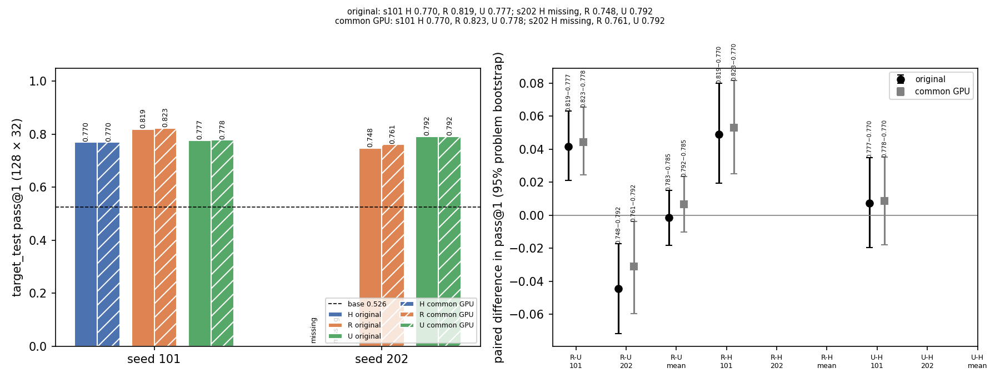

The endpoint therefore depends on the training seed. Section 3 asks when, during training, the two arms separated.

## 3. How learning unfolded, and when R and U diverged

Every arm improved steadily on held-out problems. R and U separated soon after the cap change, in opposite directions
in the two seeds.

### 3.1 Learning curves and probes

The figure shows how each run learned over its 128 rounds.

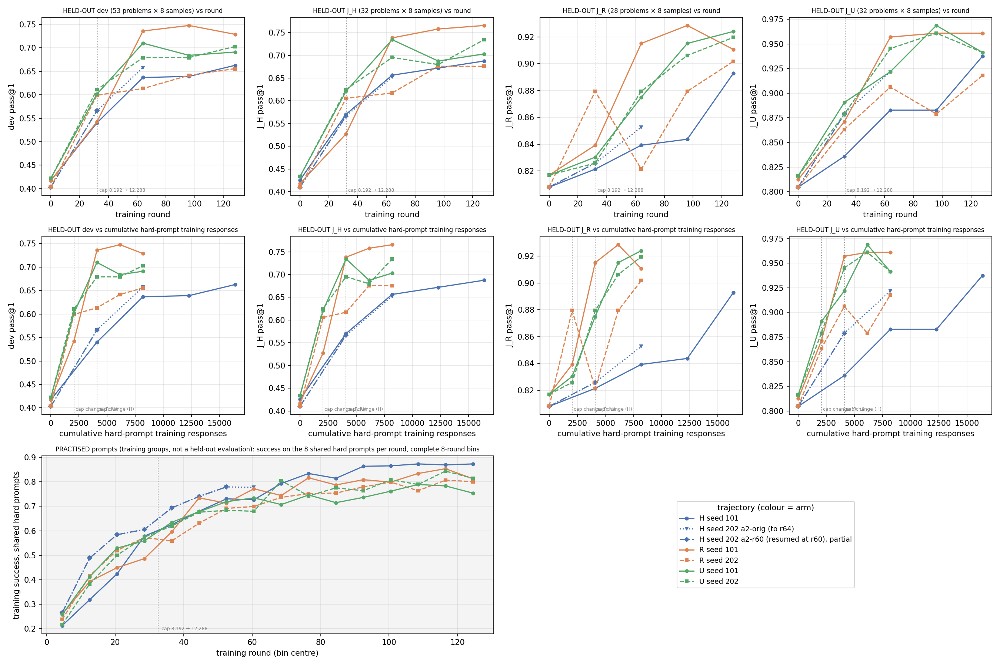

Rows 1–2 show held-out dev (53 problems × 8 attempts) and the three probes, against training round and against
cumulative hard-prompt training responses. Row 3 shows success on the practised shared hard prompts during training;
it is not a held-out evaluation. The dotted line marks the cap change from 8,192 to 12,288 tokens after round 32. H
trains on 16 hard prompts per round and R/U on 8, so H reaches a given hard exposure in half the rounds. H-s202 (trajectory a2-r60) reached round 128 at 20:42Z; its dev
pass@1 at rounds 64 / 96 / 128 was 63.7% / 66.0% / 67.0%.

**Probes.** Three probes track single skills during training, all at 8 attempts:
- `J_H`: 32 hard dev problems (held out).
- `J_R`: 28 factoring practice-style problems (held out from training pools).
- `J_U`: 32 modular-arithmetic practice-style problems (held out).

The two figures below plot the hard probe against each practice probe.

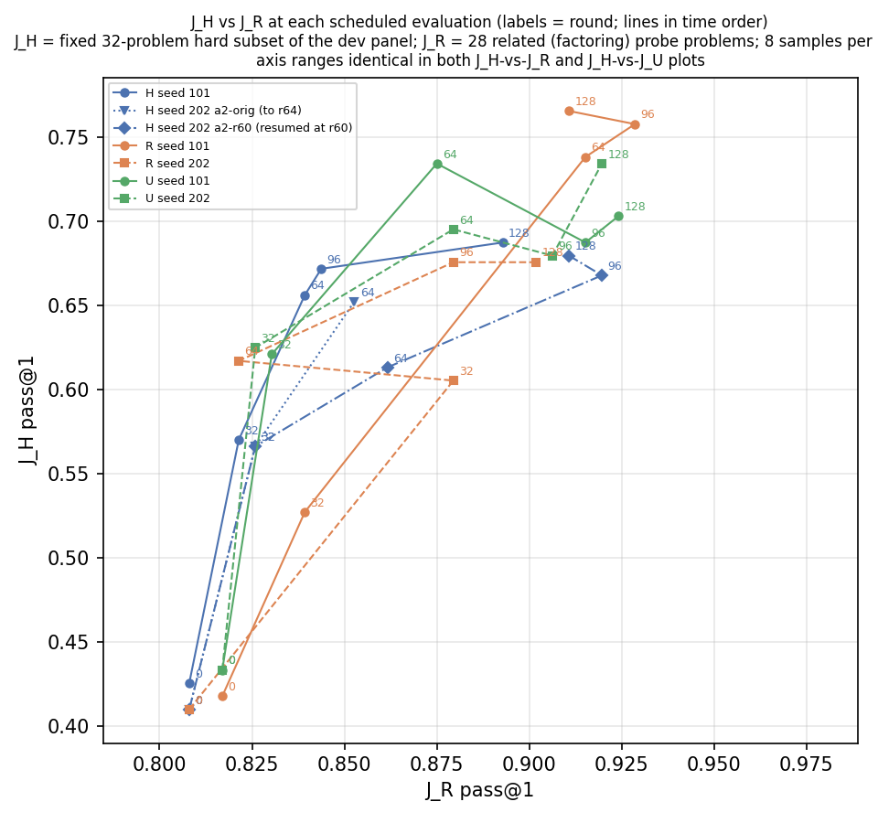
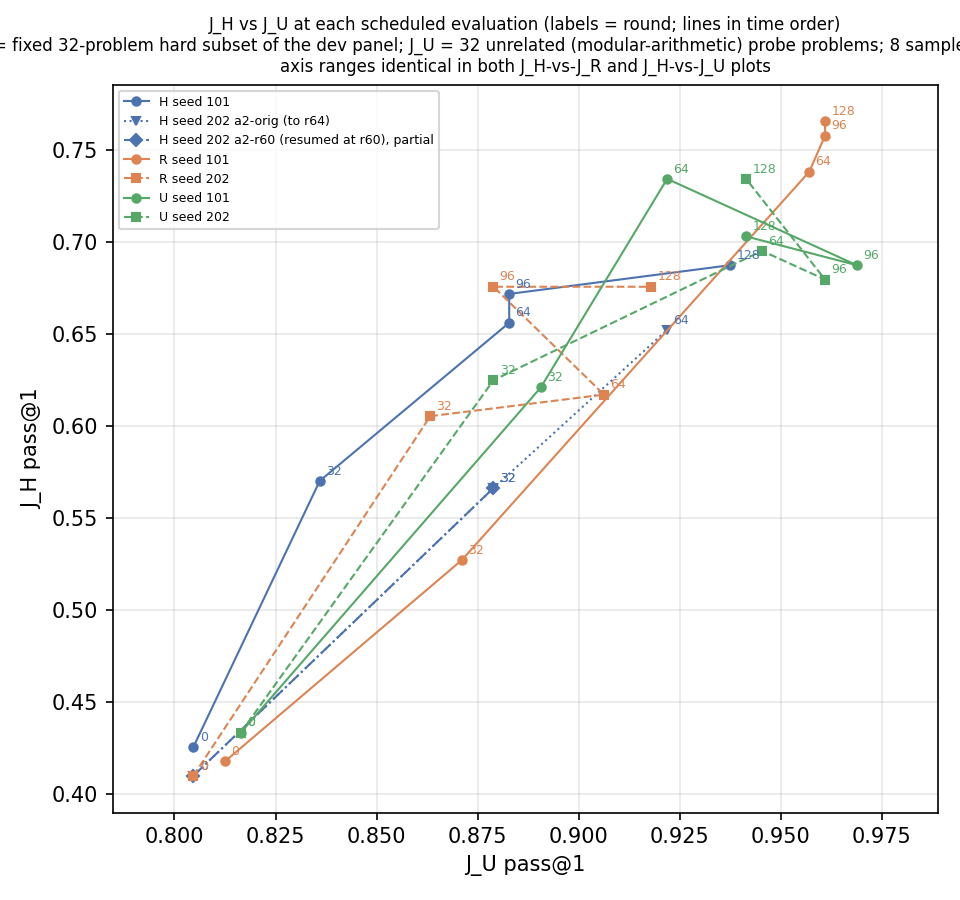

### 3.2 When did R and U diverge?

The final sign of R − U appeared in rounds 33–64 in both seeds. No checkpoint pair from that window survives, so this
timing comes from measurements taken during training.

The trainer kept only the latest checkpoint, plus round 64 for R-s101 and H-s202. No same-seed R/U checkpoint pair
therefore survives below round 128. Two training-time measurements remain. Dev is 53 problems × 8 attempts at fixed
rounds (sd ≈ 2 points per value, D50). The shared hard prompts are the same hard prompts in the same order in every arm
of a seed (2,048 answers per arm per 32-round window).

| Seed | Dev round | R | U | R − U |
|---|---|---|---|---|
| 101 | 0 | 41.7% | 42.2% | −0.5 |
| 101 | 32 | 54.2% | 60.1% | −5.9 |
| 101 | 64 | 73.6% | 71.0% | +2.6 |
| 101 | 96 | 74.8% | 68.4% | +6.4 |
| 101 | 128 | 72.9% | 69.1% | +3.8 |
| 202 | 0 | 40.3% | 42.2% | −1.9 |
| 202 | 32 | 59.9% | 61.1% | −1.2 |
| 202 | 64 | 61.3% | 67.9% | −6.6 |
| 202 | 96 | 64.2% | 67.9% | −3.8 |
| 202 | 128 | 65.6% | 70.3% | −4.7 |

In both seeds the endpoint sign appeared between rounds 32 and 64, the first window after the cap rose from 8,192 to
12,288 tokens at round 33. Training success on the shared hard prompts shows the same timing. In seed 101, R led U by
+3.7 to +7.2 points in 10 of the 11 eight-round bins after round 40 (U led by 0.6 points in rounds 49–56). In seed 202,
U led by 4.5–6.1 points in rounds 33–48. After that, the gap stayed within ±7 points and changed sign often.

Answer length on the shared hard prompts does not track the sign. In seed 202, R wrote shorter answers than U in every
window after round 32 (4,435 vs 4,755 tokens in rounds 33–64; 4,874 vs 5,590 in rounds 65–96). Yet R was cut off more
often on the test (section 4.3). Source: `research/evidence/a19/divergence/divergence.md`.

What this cannot show: whether the split in rounds 33–64 is an arm effect, or the point where two different runs of
each arm took different paths. Checkpoint coverage has a gap: no R/U pair exists at rounds 32, 64 or 96 to evaluate on
the stress panels.

Section 4 looks inside the final checkpoints to find which problems, and which kind of failure, carry the reversal.

## 4. Why the two seeds disagree

This analysis is exploratory. The reversal is spread over many problems that both arms can solve. It follows which
policy more often hits the token cap, not a loss of reach or a lasting loss of skill on the training prompts.

### 4.1 Which problems carry the reversal

Problems that the base model rarely solved carry most of the swing, and no small set of items dominates it.

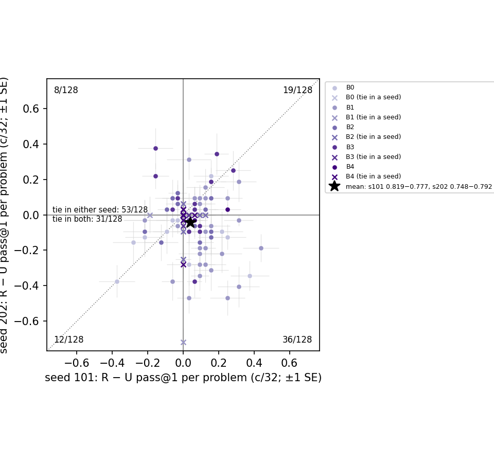

Each point is one test problem: its R − U success difference (c/32) in seed 101 against seed 202. Of 128 problems, 31
have the same sign in both seeds, 44 opposite signs, and 53 a tie in at least one seed. Of these, 31 tie in both: 3 at
0/32 for all four policies and 26 at 32/32. The per-problem differences are unrelated across seeds (Spearman −0.09
overall, −0.04 within B1).

| Band (base k of 16) | Problems | R − U seed 101 | R − U seed 202 | Contribution to the swing (s202 − s101) |
|---|---|---|---|---|
| B0 (0) | 15 | 30.6 − 29.8 = +0.8 | 18.1 − 28.3 = −10.2 | −1.3 |
| B1 (1–5) | 34 | 75.5 − 65.8 = +9.7 | 59.2 − 71.0 = −11.8 | −5.7 |
| B2 (6–10) | 26 | 88.1 − 85.1 = +3.0 | 85.5 − 88.3 = −2.9 | −1.2 |
| B3 (11–15) | 32 | 95.9 − 93.5 = +2.4 | 93.8 − 91.2 = +2.6 | +0.0 |
| B4 (16) | 21 | 99.7 − 97.9 = +1.8 | 98.2 − 99.4 = −1.2 | −0.5 |
| All | 128 | 81.9 − 77.7 = +4.2 | 74.8 − 79.2 = −4.4 | −8.6 |

Bands group problems by how often the base model solved them in attempts 0–15. A band's contribution is its share of
128 times its R − U. B1 carries two-thirds of the swing. Within B1, the 3 largest item changes carry 30% of B1's share
and the top 5 carry 45%; the rest is spread over many items whose order changed. For example, `algebra/test/00213`
went from R 23/32 vs U 13/32 in seed 101 to R 11/32 vs U 24/32 in seed 202.

### 4.2 Coverage or reliability

Training both reached new problems and made reachable problems more reliable, but most of the gain is reliability.
R − U follows the same pattern.

| Policy | pass@1 | pass@8 | Solved ≥ 1 of 32 | 0/32 | Truncated attempts |
|---|---|---|---|---|---|
| base | 52.6% | 83.5% | 116/128 | 12/128 | 2/4,096 |
| H-s101 | 77.0% | 93.7% | 125/128 | 3/128 | 445/4,096 (10.9%) |
| R-s101 | 81.9% | 96.1% | 125/128 | 3/128 | 437/4,096 (10.7%) |
| U-s101 | 77.7% | 94.5% | 125/128 | 3/128 | 501/4,096 (12.2%) |
| R-s202 | 74.8% | 92.2% | 123/128 | 5/128 | 538/4,096 (13.1%) |
| U-s202 | 79.2% | 94.9% | 124/128 | 4/128 | 333/4,096 (8.1%) |
| H-s202 | ⟨PENDING⟩ | | | | |

The comparison uses an independent baseline: base attempts 16–31. Against it, 14 problems were unreachable at baseline
(0/16). Training made 9–11 of them reachable, at low pass@1 (19–40%). On the 114 reachable problems, pass@1 rose from
59.6% to 82.5–88.0%. Of each policy's total gain over base (+21.7 to +28.8 points), the reachable problems carry +20.4
to +25.3. The R − U split is the same. In seed 202, R − U is −4.4 points: −4.2 comes from the 122 problems both arms
reach and −0.2 from the 3 that only one arm reaches.

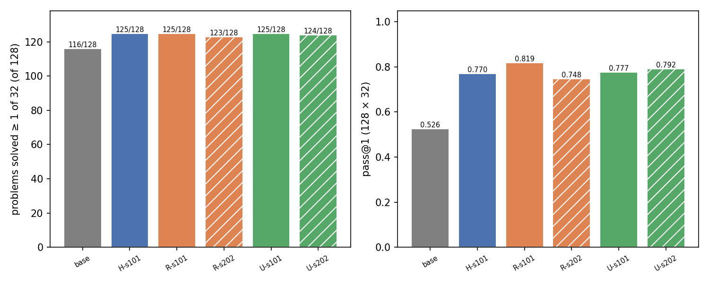

### 4.3 Truncation: the main driver of R − U

Truncation is the main driver. In seed 202, R's higher truncation rate accounts for almost all of R − U.

A truncated answer scores 0. Let t be the truncated share and a the accuracy on finished answers. Then
pass@1 = (1 − t)·a, and R − U = −(t_R − t_U)·ā + (1 − t̄)·(a_R − a_U) exactly (bars are R/U means). The first part is
the truncation term; the second is the accuracy term.

| Seed | R − U pass@1 | Truncation term | Accuracy term |
|---|---|---|---|
| 101 | 81.9 − 77.7 = +4.2 | t: 10.7% vs 12.2% → +1.4 [+0.0, +2.8] | a: 91.6% vs 88.5% → +2.8 [+0.9, +4.7] |
| 202 | 74.8 − 79.2 = −4.4 | t: 13.1% vs 8.1% → −4.3 [−6.1, −2.7] | a: 86.1% vs 86.2% → −0.1 [−2.4, +2.0] |

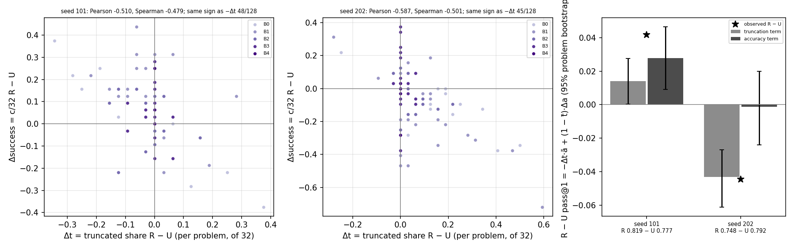

Per problem, R − U success falls as R − U truncation rises (Pearson −0.51 in seed 101, −0.59 in seed 202). The
12,288 cap does not create the reversal. Counting only answers that finish within 8,192 tokens, R − U is +5.1 [+3.1,
+7.3] (R 76.5% vs U 71.4%) in seed 101 and −7.0 [−10.0, −4.2] (R 68.6% vs U 75.7%) in seed 202. The reversal follows
which policy writes longer answers.

The truncated answers are not degenerate loops. Of R-s202's 538 truncated answers, 0 repeat ≥ 50% of their final
32-token windows (median repeated share 4.7%). They are long searches that do not converge. For example,
`intermediate_algebra/test/00220` asks for a product that telescopes once n⁴ + ¼ is factored. R-s202 tried numeric
patterns for 12,288 tokens and never factored. R-s202 also generated more tokens than U-s202 late in training (16.4 M
vs 15.1 M in rounds 97–128). In seed 101 the two were close (19.0 M vs 19.1 M).

### 4.4 How much learning signal each arm received

The practice prompts stopped giving a learning signal after round 32. The shared hard prompts gave similar signal in R
and U.

Each prompt gets a group of 8 answers. Only mixed groups (some right, some wrong) carry a GRPO gradient. A mixed-group
count shows reward variation; it does not give the size or direction of the update.

| Run | Rounds | Shared hard: all-wrong / mixed / all-correct | Second pool: all-wrong / mixed / all-correct |
|---|---|---|---|
| R-s101 | 1–32 / 97–128 | 27 / 220 / 9 → 9 / 119 / 128 | factoring 0 / 180 / 76 → 0 / 25 / 231 |
| U-s101 | 1–32 / 97–128 | 22 / 222 / 12 → 13 / 122 / 121 | modular 0 / 168 / 88 → 0 / 20 / 236 |
| R-s202 | 1–32 / 97–128 | 27 / 214 / 15 → 11 / 130 / 115 | factoring 0 / 180 / 76 → 0 / 44 / 212 |
| U-s202 | 1–32 / 97–128 | 28 / 212 / 16 → 8 / 119 / 129 | modular 0 / 166 / 90 → 0 / 29 / 227 |
| H-s101 | 1–32 / 97–128 | 32 / 216 / 8 → 5 / 111 / 140 | extra hard 31 / 212 / 13 → 8 / 102 / 146 |
| H-s202 (a2-r60) | 1–32 / 97–128 | 14 / 226 / 16 → 8 / 112 / 136 | extra hard 23 / 218 / 15 → 7 / 121 / 128 |

Each cell counts 256 groups (32 rounds × 8 prompts). The next table gives running totals per run. It counts all 16
prompts per round. Mixed groups and generated tokens are taken at the end of rounds 32 / 64 / 96 / 128; GPU-h is for
the canonical trajectory (`tables/cost.md`).

| Run | Mixed groups, cumulative | Generated tokens, cumulative (M) | GPU-h |
|---|---|---|---|
| H-s101 | 428 / 800 / 1,076 / 1,289 | 12.8 / 31.6 / 48.6 / 68.6 | 29.5 |
| R-s101 | 400 / 658 / 817 / 961 | 10.6 / 25.9 / 46.1 / 65.1 | 27.9 |
| U-s101 | 390 / 625 / 788 / 930 | 9.2 / 23.0 / 40.9 / 60.0 | 22.6 |
| R-s202 | 394 / 690 / 926 / 1,100 | 10.0 / 23.2 / 37.7 / 54.1 | 22.8 |
| U-s202 | 378 / 627 / 799 / 947 | 9.3 / 22.3 / 37.7 / 52.8 | 25.6 |
| H-s202 (a2-r60) | 444 / 796 / 1,054 / 1,287 | 12.7 / 29.6 / 51.2 / 74.7 | ⟨final cost run⟩ |

Both H runs kept producing mixed groups longest (1,289 and 1,287 over the run against 930–1,100 for R and U). Its extra prompts are hard
problems, which stay at mixed success; R's and U's practice prompts stopped doing so after round 32. The practice pools
became easy. After round 32, the share of all-correct practice groups was 62–90% for R and 74–92% for U, so most
practice prompts gave no reward contrast. The shared hard prompts gave similar signal in R and U. Full windows, tokens,
gradient norms (logged per optimizer step) and clip fractions (per round) are in
`research/evidence/a17/analysis/train/signal.md`.

### 4.5 Did apparent forgetting persist?

Mostly not. Losses on previously solvable hard prompts were rare and usually temporary.

This analysis matches the same shared hard prompt and round across arms. A prompt is "previously solvable" (PS) if it
had ≥ 1 correct answer at an earlier appearance in the same run.

| Run | Rounds | PS → all-wrong (of later PS appearances) | Capped answers in those groups: 0 / some / all 8 | Next appearance: all-wrong / mixed / all-correct / none |
|---|---|---|---|---|
| R-s101 | 33–128 | 29 / 765 (3.8%) | 12 / 13 / 4 | 18 / 10 / 0 / 1 |
| U-s101 | 33–128 | 38 / 768 (4.9%) | 7 / 23 / 8 | 17 / 18 / 0 / 3 |
| R-s202 | 33–128 | 19 / 765 (2.5%) | 13 / 3 / 3 | 7 / 10 / 0 / 2 |
| U-s202 | 33–128 | 26 / 768 (3.4%) | 18 / 6 / 2 | 13 / 11 / 1 / 1 |
| H-s101 | 33–128 | 13 / 768 (1.7%) | 11 / 2 / 0 | 8 / 4 / 0 / 1 |
| H-s202 (a2-r60) | 33–128 | 21 / 768 (2.7%) | 14 / 3 / 4 | 15 / 5 / 0 / 1 |

Rounds 1–32 (cap 8,192) are in `persistence.md`. In matched cells for rounds 33–128, a prompt was all-wrong in R only
vs U only 17 vs 24 times in seed 101 and 11 vs 16 times in seed 202. Losses were rare, not much more frequent in U than
R, and usually temporary. At the next appearance, most such prompts were mixed again or still all-wrong; almost none
jumped to all-correct. One capped answer in a group does not show that a longer allowance would have rescued it.

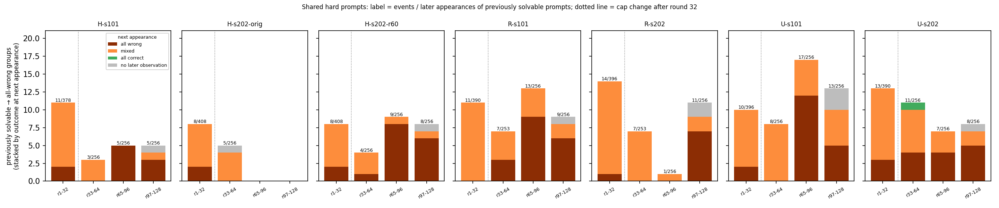

### 4.6 How often sampling alone creates an apparent loss

Sampling alone produces as many apparent losses as the dev evaluations show.

First, a correction. The first report described dev "losses" as "≥ 1 correct of 16 → 0". That was wrong: every
scheduled dev evaluation used **8** attempts per problem (all 28 dev rows and the per-attempt records show n = 8;
`dev_transitions.md`). The loss counts themselves were correct.

Take an unchanged checkpoint and a problem it solves with probability p per attempt. Two disjoint groups of 8 attempts
make the problem look lost (some → none) with probability P = (1 − (1 − p)^8)(1 − p)^8. P peaks at 0.25 when
p ≈ 0.08. On the 128 test problems, the expected count of chance losses per comparison of two 8-attempt groups is 1.7–5.7,
depending on the policy (observed with fixed splits: 0–5 losses; gains, equal in expectation, reached 6). On the dev panel (53 problems × 8 attempts), each run lost 0–5 problems
between consecutive evaluations. That is the same range that sampling alone produces. Splits reuse the same attempts,
so these rates are a reference, not independent experiments.

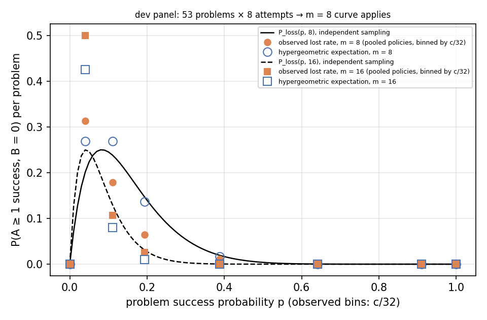

Section 4.3 showed that truncation drives R − U. Section 5 asks whether the truncated answers would have succeeded
with more room.

## 5. Would longer answers have succeeded?

Mostly not. This analysis is exploratory. Given 4,096 more tokens, most capped answers stay capped or end wrong, and
R − U barely moves on any panel.

### 5.1 Method

The method (D154) was fixed before any output. Each stress attempt that hit the 12,288-token cap was continued from its
own saved tokens, with 4,096 more tokens allowed. The total budget is therefore 16,384, and the first 12,288 tokens are
unchanged. Finished attempts were not regenerated. The 12,288 score is the original stored score; every selected
attempt was re-graded and matched. The 16,384 score uses the same grader on the full answer, and an answer still
capped scores 0. Decoding is as in every evaluation (T 1.0, top_p 1.0). All four checkpoints share the continuation
seeds, and all runs used L40S GPUs. D155 applied the same method to the sealed test.

### 5.2 Sealed test

On the primary panel, 4,096 more tokens add 1.6–2.9 points to every checkpoint, recover 16–24% of capped answers, and
move R − U by less than one point in either seed. The panel is 128 problems × 32 attempts = 4,096 per checkpoint, from
the original records (D155).

| Checkpoint | pass@1 at 12,288 | pass@1 at 16,384 | Capped at 12,288 | Recovered | Finished wrong | Still capped | Extra tokens per recovered answer |
|---|---|---|---|---|---|---|---|
| R-s101 | 81.9% | 84.2% | 437 | 94 (21.5%) | 50 | 293 (67.0%) | 15,689 |
| U-s101 | 77.7% | 80.6% | 501 | 118 (23.6%) | 67 | 316 (63.1%) | 13,845 |
| R-s202 | 74.8% | 76.9% | 538 | 87 (16.2%) | 104 | 347 (64.5%) | 20,476 |
| U-s202 | 79.2% | 80.8% | 333 | 66 (19.8%) | 65 | 202 (60.7%) | 16,674 |
| H-s101 | 77.0% | 79.2% | 445 | 93 (20.9%) | 141 | 211 (47.4%) | 14,002 |

| Seed | R − U at 12,288 | R − U at 16,384 | Change |
|---|---|---|---|
| 101 | 81.9 − 77.7 = +4.2 [+2.1, +6.2] | 84.2 − 80.6 = +3.6 [+1.5, +5.7] | −0.6 [−1.6, +0.4] |
| 202 | 74.8 − 79.2 = −4.4 [−7.3, −1.8] | 76.9 − 80.8 = −3.9 [−6.7, −1.3] | +0.5 [−0.3, +1.3] |

Both seeds keep their sign and their interval away from zero. R-s202 had the most capped answers (538) and recovered
the smallest share (16.2%). The 12,288 values equal the original sealed-test scores. Intervals come from this
analysis's own bootstrap draws and can differ from section 2 in the last digit.

The H-s101 control (D157) answers the same question for R's lead over additional hard practice in seed 101. Seed-101
R − H is 81.9 − 77.0 = +4.9 [+2.0, +8.0] at 12,288 and 84.2 − 79.2 = +4.9 [+2.0, +8.0] at 16,384 (change 0.0 [−0.8,
+0.9]); U − H goes from 77.7 − 77.0 = +0.7 [−2.1, +3.6] to 80.6 − 79.2 = +1.3 [−1.2, +3.9] (change +0.6 [−0.2, +1.5]).
H's capped answers more often finish wrong (141 of 445) than R's or U's. Source:
`research/evidence/a19/length/test/length.md`.

### 5.3 Full stress panel

The full stress panel gives the same answer as the sealed test. It covers all 221 problems × 8 attempts = 1,768 per
checkpoint, with tranche 1 (section 5.4) included.

| Checkpoint | pass@1 at 12,288 | pass@1 at 16,384 | Capped at 12,288 | Recovered | Finished wrong | Still capped | Extra tokens per recovered answer |
|---|---|---|---|---|---|---|---|
| R-s101 | 69.5% | 72.3% | 362 | 49 (13.5%) | 61 | 252 (69.6%) | 25,435 |
| U-s101 | 65.3% | 68.2% | 406 | 51 (12.6%) | 64 | 291 (71.7%) | 28,075 |
| R-s202 | 63.2% | 66.0% | 407 | 50 (12.3%) | 96 | 261 (64.1%) | 27,437 |
| U-s202 | 65.8% | 68.2% | 268 | 41 (15.3%) | 81 | 146 (54.5%) | 19,914 |
| H-s101 | 64.1% | 67.3% | 313 | 55 (17.6%) | 126 | 132 (42.2%) | 15,933 |

| Seed | Tier | R − U at 12,288 | R − U at 16,384 | Change |
|---|---|---|---|---|
| 101 | all (221) | 69.5 − 65.3 = +4.2 [+1.6, +6.8] | 72.3 − 68.2 = +4.1 [+1.4, +6.7] | −0.1 [−1.1, +1.0] |
| 101 | Harder (95) | 84.2 − 80.1 = +4.1 [+0.5, +7.8] | 86.1 − 81.8 = +4.2 [+0.7, +7.8] | +0.1 [−1.1, +1.4] |
| 101 | SuperHard (126) | 58.4 − 54.2 = +4.3 [+0.6, +8.0] | 61.9 − 57.9 = +4.0 [+0.2, +7.8] | −0.3 [−1.8, +1.3] |
| 202 | all (221) | 63.2 − 65.8 = −2.7 [−5.1, −0.2] | 66.0 − 68.2 = −2.1 [−4.6, +0.3] | +0.5 [−0.5, +1.5] |
| 202 | Harder (95) | 76.3 − 79.5 = −3.2 [−6.6, +0.3] | 79.3 − 80.9 = −1.6 [−4.6, +1.4] | +1.6 [+0.1, +3.2] |
| 202 | SuperHard (126) | 53.3 − 55.6 = −2.3 [−5.6, +1.1] | 56.0 − 58.5 = −2.6 [−6.2, +1.0] | −0.3 [−1.7, +1.1] |

Every checkpoint gains 2.4–2.9 points of pass@1 from 4,096 more tokens, and the gain is nearly the same in R and U.
R − U moves by at most 0.5 points overall in either seed (1.6 points on seed-202 Harder, where R had more capped
answers to recover). Only 12–15% of capped answers recover; 55–72% are still capped at 16,384 tokens. R-s202 hits the
cap far more than U-s202 (407 vs 268 attempts), but its capped answers are no more recoverable (12.3% vs 15.3%). The
full panel also removes the one hint from tranche 1: the seed-101 widening seen there (+2.0) was sampling noise, and on
the full panel the change is −0.1.

The H-s101 control (added under D157) behaves the same way. It gains 3.2 points (64.1% → 67.3%); its capped answers
more often finish with a wrong answer (126 of 313) than stay capped (132). Seed-101 R − H moves from 69.5 − 64.1 =
+5.4 [+2.5, +8.3] to 72.3 − 67.3 = +5.0 [+2.3, +7.8] (change −0.3 [−1.5, +0.8]); U − H from 65.3 − 64.1 = +1.2
[−1.5, +3.9] to 68.2 − 67.3 = +1.0 [−1.8, +3.7] (change −0.2 [−1.4, +0.9]). R's lead over H in seed 101 is not a budget
effect either. Source: `research/evidence/a19/length/full/length.md`.

### 5.4 Tranche 1

Tranche 1 was the first, smaller sample. It was fixed before generation: 64 problems (32 per tier, stratified by
source), attempts 0–3, so 256 attempts per checkpoint. In the table, counts are attempts out of 256, and pass@1 weights
problems equally.

| Checkpoint | pass@1 at 12,288 | pass@1 at 16,384 | Capped at 12,288 | Recovered | Finished wrong | Still capped | Extra tokens per recovered answer |
|---|---|---|---|---|---|---|---|
| R-s101 | 71.5% | 75.8% | 54 | 11 | 5 | 38 | 16,805 |
| U-s101 | 67.6% | 69.9% | 47 | 6 | 10 | 31 | 27,348 |
| R-s202 | 67.6% | 71.1% | 56 | 9 | 13 | 34 | 20,331 |
| U-s202 | 69.5% | 73.0% | 41 | 9 | 11 | 21 | 12,910 |

| Seed | R − U at 12,288 | R − U at 16,384 | Change |
|---|---|---|---|
| 101 | 71.5 − 67.6 = +3.9 [−2.0, +10.2] | 75.8 − 69.9 = +5.9 [−0.4, +12.5] | +2.0 [−1.2, +5.1] |
| 202 | 67.6 − 69.5 = −2.0 [−9.0, +4.3] | 71.1 − 73.0 = −2.0 [−8.6, +4.3] | 0.0 [−3.1, +3.1] |

Few capped answers recover: 6–11 of 41–56 per checkpoint (13–22%). Most (51–70%) are still capped at 16,384 tokens,
and the rest finish with a wrong answer. Extra room does not close the seed-202 gap: R and U each recover 9 answers,
and R − U stays at −2.0 points. In seed 101, R recovers more (11 vs 6, mostly on SuperHard), so R − U widens by 2.0
points; the interval includes zero, and section 5.3 shows this was noise. Per tier:
`research/evidence/a19/length/t1/length.md`.

### 5.5 What the extra tokens did

Most continuations kept looping or reached a wrong answer. An arm-blind reader classified 12 continuations, chosen by a
hash rule before generation (3 capped attempts per checkpoint). Of these, 6 kept looping (re-deriving the same steps or
equation systems), 3 reached a wrong answer, and 1 finished sound reasoning correctly. One more found and fixed an
error and wrote the correct boxed answer. It then hit 16,384 tokens before its final write-up (scored 0 by the frozen
cap rule). One was still making progress when cut off. The reader judged 8 of the 12 off track before the
12,288-token cut (1 unclear). Loops were split evenly (R 3, U 3). "Looping" here is the reader's judgement that the
answer re-derives the same steps; the test in section 4.3 counted repeated text, which these answers rarely contain.
Source: `research/evidence/a19/length/t1/inspect_read.md`.

**Scope.** This measures inference allowance for these five checkpoints only (R, U × two seeds and H-s101). It does not show what training with a
longer cap would have produced.

The length results show that the budget does not explain R − U. Section 6 tests the cause that the study was designed
around: interference from a single practice update.

## 6. Did one update hurt hard skills?

We did not detect it. This analysis is exploratory. One unrelated (modular) update did not lower hard-probe success
more than a related (factoring) or hard update; the differences lie within the spread between minibatch draws.

Each branch takes one GRPO/AdamW step on 4 prompts × 8 answers of one kind: hard, related = factoring, or unrelated =
modular. Branches start from the base model (fresh optimizer) and from R-s101 round 64 (its saved optimizer). Each
branch is then scored on `J_H`, `J_R` and `J_U` at 16 attempts per problem. There are four minibatch draws per branch.
The U-s101 round-64 checkpoint was not retained, so that source is missing.

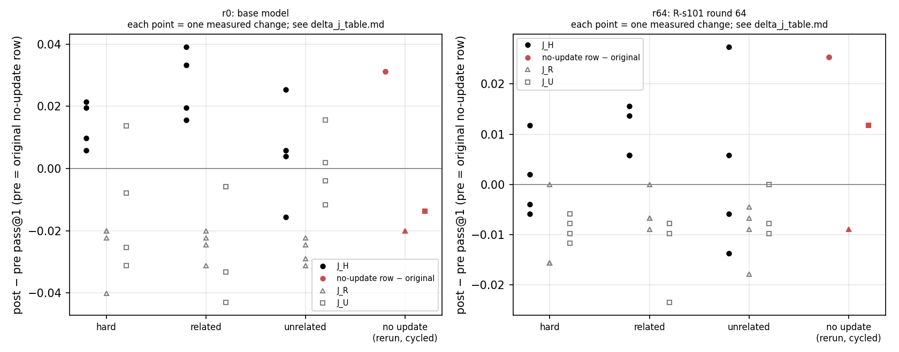

| Checkpoint | No-update J_H (original / rerun) | Hard (mean of 4) | Related | Unrelated | Unrelated − related | Unrelated − hard |
|---|---|---|---|---|---|---|
| base (r0) | 40.0% / 43.2% | 41.5% | 42.7% | 40.5% | 40.5 − 42.7 = −2.2 | 40.5 − 41.5 = −0.9 |
| R-s101 r64 | 60.6% / 63.1% | 60.6% | 61.6% | 60.9% | 60.9 − 61.6 = −0.7 | 60.9 − 60.6 = +0.2 |

The full per-draw table with J_R and J_U, mixed groups and gradient norms is in `delta_j_table.md` and `branches.md`.

Three caveats limit this test. First, the no-update reference is itself noisy. Two evaluations of the same base weights
on different GPUs gave J_H 40.0% and 43.2% (r64: 60.6% and 63.1%). A change measured against one reference therefore
cannot be read as absolute; the direct branch comparisons above do not depend on it.

Second, single draws spread by up to 4 points within a branch (unrelated at r64: 59.2%–63.3%). We do not claim a
detection threshold; differences of 2–3 points between branch means are within this spread.

Third, at r64 three draws (related 4101, 4102; unrelated 4103) had no mixed group, so their reward gradient was exactly
0. AdamW still stepped from its stored moments, and the three produced identical scores (J_H 61.1%, J_R 89.5%,
J_U 93.2%). This is a "momentum-only" step, not an unchanged checkpoint. At r0 the optimizer is fresh, and no draw had
zero mixed groups.

**Mechanism, one link at a time.** The table checks each link of the ray-interference chain against the evidence.

| Link | Evidence | Kind | Finding |
|---|---|---|---|
| 1. An auxiliary update lowers hard success | branch experiment (section 6) | direct, 2 checkpoints, 1 arm | not detected; unrelated vs related −2.2 / −0.7 points, within draw spread |
| 2. Affected problems then produce fewer rewarding attempts | training records (4.5) | observational | rare (2.5–4.9% of later PS appearances after round 32), often with capped answers, mostly temporary |
| 3. Their learning then stalls | training records, dev curves | observational | not observed; from round 0 to 128, dev pass@1 rose from 40–42% to 66–73% and practised shared-hard success (8-round bins) from 21–26% to 75–87% in every finished run, with dips of up to about 5 points between evaluations |
| Endpoint difference | sealed test (2, 4.3) | outcome only | R − U flips sign with seed and follows truncation; it cannot establish the chain |

Section 7 asks whether the patterns from the sealed test hold on harder problems.

## 7. Harder problems: stress panels and response audit

Training transfers to harder factoring problems, and R − U again follows the seed. This analysis is exploratory. We
built two new panels, Harder and SuperHard, and audited a sample of the failures that remain.

### 7.1 Construction

The rubric came first (`research/evidence/a17/panels/RUBRIC-stress-v1.md`); it was committed before any candidate was
exported. A Harder problem needs a substantive factoring step that must be recognised inside a longer solution, with
no cue. A SuperHard problem is a Harder problem plus a documented obstacle: hidden substitution, approach choice, case
analysis after factoring, non-obvious grouping, or several factorizations. The candidates were 2,039 unused problems
from MATH (pinned, Levels 4–5), Omni-MATH and OlympiadBench. An agent annotated every candidate (labelled
`agent:claude-sonnet`).

Selection used hash order with family, source and duplicate rules (`qis.data.stress_panels`). Checks compared the
candidates against every training, calibration, practice, dev, probe, cue and sealed-test text. The panels were frozen
before any model was evaluated on them (D143). They were re-frozen in D145 after the second read found one
cross-source duplicate.

| Panel | Items | Sources | Notes |
|---|---|---|---|
| SuperHard-126 | 126 | MATH 60, Omni-MATH 52, OlympiadBench 14 | obstacles: case analysis 45, hidden substitution 29, non-obvious grouping 26, approach choice 14, several factorizations 12 |
| Harder-95 | 95 | MATH 69, Omni-MATH 15, OlympiadBench 11 | — |

Fewer than 128 items qualified in each panel. The whole 2,039-item pool was annotated, and only 126 SuperHard and 99
Harder items met the rubric and the checks at the first freeze (D143). Before any evaluation, the blind second read
found a cross-source duplicate and a prose-form gold answer. A fixed text normaliser also caught close variants of
study items. The re-freeze (D145) left Harder at 95.

The versioned manifests are `data/stress/harder_v1.json` (sha256 `0fb34905…`), `data/stress/superhard_v1.json`
(`0cf1cf93…`) and the combined `data/stress/stress_v1.json` (`757393be…`). They give provenance, family ID, gold,
technique and (SuperHard) obstacle for every item. A blind second read (different agents, problem and solution only)
agreed on eligibility for 207 of 219 items and on the tier for 171 of 219 (78%). It confirmed every gold answer
(219/219). Absence from the study's sets does not show absence from pretraining data.

### 7.2 Results

Each checkpoint made 8 attempts per problem under the 12,288 cap, on L40S, with seed label stress-v1. Every cell has
1,768/1,768 attempts and 0 ungradable answers. Every trained checkpoint's model.pt hash matched its record. H-s202
round 128 runs only after that training run ends (section 9).

| Checkpoint | All 221 pass@1 | SuperHard-126 | Harder-95 | Truncated (all) | Accuracy on finished (all) | Solved ≥ 1 of 8 (all) |
|---|---|---|---|---|---|---|
| Base | 37.3% | 25.8% | 52.5% | 0.1% | 37.3% | 152/221 |
| H-s101 r128 | 64.1% | 52.6% | 79.5% | 17.7% | 77.9% | 183/221 |
| R-s101 r128 | 69.5% | 58.4% | 84.2% | 20.5% | 87.4% | 184/221 |
| U-s101 r128 | 65.3% | 54.2% | 80.1% | 23.0% | 84.8% | 184/221 |
| H-s202 r128 | ⟨PENDING⟩ | | | | | |
| R-s202 r128 | 63.2% | 53.3% | 76.3% | 23.0% | 82.1% | 180/221 |
| U-s202 r128 | 65.8% | 55.6% | 79.5% | 15.2% | 77.6% | 188/221 |
| R-s101 r64 | 64.3% | 53.5% | 78.6% | 26.1% | 87.0% | 183/221 |
| H-s202 r64 | 62.4% | 52.1% | 76.1% | 15.1% | 73.5% | 183/221 |

**Which checkpoint was measured on which panel.** ✓ = measured; ⟨pending⟩ = queued; — = not run (not required);
✗ = not possible (weights not retained).

| Checkpoint | Sealed test (original) | Sealed test (one GPU type, L40S) | Stress panels (8 attempts) | Length diagnostic, stress | Length diagnostic, sealed test | Response audit |
|---|---|---|---|---|---|---|
| Base | ✓ | ✓ (original ran on L40S) | ✓ | — (0.1% capped) | — (0.05% capped) | ✓ |
| H-s101 r128 | ✓ | ✓ (original ran on L40S) | ✓ | ✓ | ✓ | ✓ |
| R-s101 r128 | ✓ | ✓ | ✓ | ✓ | ✓ | ✓ |
| U-s101 r128 | ✓ | ✓ | ✓ | ✓ | ✓ | ✓ |
| H-s202 r128 | ⟨pending⟩ | ⟨pending⟩ (runs on L40S) | ⟨pending⟩ | — | — | — (sample fixed before it existed) |
| R-s202 r128 | ✓ | ✓ | ✓ | ✓ | ✓ | ✓ |
| U-s202 r128 | ✓ | ✓ | ✓ | ✓ | ✓ | ✓ |
| R-s101 r64 | — | — | ✓ | — | — | — |
| H-s202 r64 (a2-r60) | — | — | ✓ | — | — | — |
| H-s202 r116 (fallback) | ⟨pending⟩ | — | — | — | — | — |
| U-s101, R-s202, U-s202 r64 | ✗ | ✗ | ✗ | ✗ | ✗ | ✗ |

**Each tier separately.** The table uses 8 attempts per problem. "Solved ≥ 1 of 8" counts distinct problems, so it
separates first successes on new problems from repeated successes on the same problem.

| Checkpoint | Tier | pass@1 | Correct / attempts | Solved ≥ 1 of 8 | 0/8 | Truncated | Accuracy on finished |
|---|---|---|---|---|---|---|---|
| Base | Harder-95 | 52.5% | 399 / 760 | 78/95 | 17 | 0.1% | 52.6% |
| H-s101 r128 | Harder-95 | 79.5% | 604 / 760 | 88/95 | 7 | 9.1% | 87.4% |
| R-s101 r128 | Harder-95 | 84.2% | 640 / 760 | 90/95 | 5 | 9.9% | 93.4% |
| U-s101 r128 | Harder-95 | 80.1% | 609 / 760 | 90/95 | 5 | 11.4% | 90.5% |
| R-s202 r128 | Harder-95 | 76.3% | 580 / 760 | 89/95 | 6 | 13.4% | 88.1% |
| U-s202 r128 | Harder-95 | 79.5% | 604 / 760 | 91/95 | 4 | 9.2% | 87.5% |
| R-s101 r64 | Harder-95 | 78.6% | 597 / 760 | 89/95 | 6 | 14.6% | 92.0% |
| H-s202 r64 | Harder-95 | 76.1% | 578 / 760 | 89/95 | 6 | 8.7% | 83.3% |
| Base | SuperHard-126 | 25.8% | 260 / 1,008 | 74/126 | 52 | 0.0% | 25.8% |
| H-s101 r128 | SuperHard-126 | 52.6% | 530 / 1,008 | 95/126 | 31 | 24.2% | 69.4% |
| R-s101 r128 | SuperHard-126 | 58.4% | 589 / 1,008 | 94/126 | 32 | 28.5% | 81.7% |
| U-s101 r128 | SuperHard-126 | 54.2% | 546 / 1,008 | 94/126 | 32 | 31.6% | 79.2% |
| R-s202 r128 | SuperHard-126 | 53.3% | 537 / 1,008 | 91/126 | 35 | 30.3% | 76.4% |
| U-s202 r128 | SuperHard-126 | 55.6% | 560 / 1,008 | 97/126 | 29 | 19.6% | 69.1% |
| R-s101 r64 | SuperHard-126 | 53.5% | 539 / 1,008 | 94/126 | 32 | 34.8% | 82.0% |
| H-s202 r64 | SuperHard-126 | 52.1% | 525 / 1,008 | 94/126 | 32 | 19.9% | 65.1% |

The next table gives contrasts on all 221 problems, in points. It uses the same exact split into a truncation term and
an accuracy term as section 4.3 (95% paired bootstrap over problems, 10,000 draws).

| Contrast | pass@1 A − B | Truncation term | Accuracy term | pass@8 A, B |
|---|---|---|---|---|
| R − U, seed 101 | 69.5 − 65.3 = +4.2 [+1.5, +6.8] | t: 20.5% vs 23.0% → +2.1 [+0.4, +3.9] | a: 87.4% vs 84.8% → +2.0 [−0.1, +4.1] | 83.3%, 83.3% |
| R − U, seed 202 | 63.2 − 65.8 = −2.7 [−5.1, −0.2] | t: 23.0% vs 15.2% → −6.3 [−8.2, −4.3] | a: 82.1% vs 77.6% → +3.6 [+1.2, +6.1] | 81.4%, 85.1% |
| R − H, seed 101 | 69.5 − 64.1 = +5.4 [+2.5, +8.2] | t: 20.5% vs 17.7% → −2.3 [−4.6, +0.0] | a: 87.4% vs 77.9% → +7.7 [+5.2, +10.1] | 83.3%, 82.8% |
| U − H, seed 101 | 65.3 − 64.1 = +1.2 [−1.4, +3.8] | t: 23.0% vs 17.7% → −4.3 [−6.3, −2.2] | a: 84.8% vs 77.9% → +5.5 [+2.9, +8.0] | 83.3%, 82.8% |
| R-s101 r128 − r64 | 69.5 − 64.3 = +5.3 [+3.0, +7.6] | t: 20.5% vs 26.1% → +4.9 [+3.0, +6.9] | a: 87.4% vs 87.0% → +0.3 [−1.4, +2.0] | 83.3%, 82.8% |

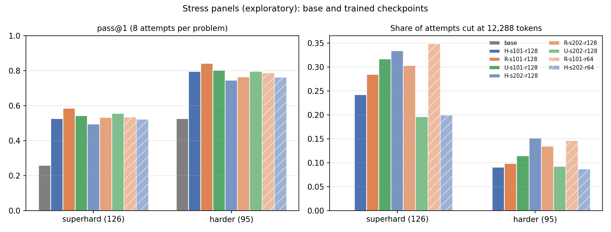

The stress panels show four things:
1. **Training transfers to harder problems.** Every trained checkpoint gains 25–32 points over the base model on all
   221 problems, and SuperHard pass@1 roughly doubles (25.8% → 52.1–58.4%). Each checkpoint solves 33–38 problems that
   the base model never solved in 8 attempts. It loses 2–5 that the base model solved. That is fewer than the ≈ 12 that
   a second 8-attempt draw from the base model would lose by chance.
2. **The arm order follows the seed again.** R − U is positive in seed 101 and negative in seed 202, as on the sealed
   test. pass@8 (solved at least once) differs by at most 3.7 points between arms, so the arms differ in reliability,
   not reach.
3. **Length again moves the result.** In seed 202, R loses because more of its attempts hit the cap (23.0% vs 15.2%),
   although it is more accurate on the answers it finishes. In R-s101, the gain from round 64 to round 128 is almost
   all fewer capped answers (26.1% → 20.5%); accuracy on finished answers stays at 87%.
4. **Caution on the accuracy term.** Accuracy on finished answers is not a pure skill measure. A policy that finishes
   more of its hardest attempts adds harder problems to its finished pool. That is why the two least-truncated
   policies (U-s202 and H) also show the lowest accuracy on finished answers.

### 7.3 Response audit

Would more direct factoring practice fix the failures that remain? Partly. Both readers judged 13 of 33 genuine
failures fixable by more factoring practice.

The sample is 16 items (8 per tier, fixed by hash before any stress output existed, D144) × attempt 0 × six policies
(base and the five finished round-128 checkpoints) = 96 responses. Each response was shown under a random code,
shuffled within its item. Two annotating agents (Claude Sonnet) read each response independently, with the problem,
gold, reference route and verifier result (D153). Responses over 8,000 characters were shown as their first 5,000 and
last 2,500 characters. The two reads agreed on the category for 88 of 96 responses (29 of the 35 failures). Counts
below are reads, two per response.

| Policy | Failures of 16 | Missed the factoring | Factored wrongly | Factored, failed later | Hit the cap | Grader | Fixable by factoring practice: yes / no / unclear / n.a. |
|---|---|---|---|---|---|---|---|
| Base | 8 | 6 | 5 | 4 | 0 | 0 | 8 / 5 / 3 / 0 |
| H-s101 | 5 | 4 | 2 | 1 | 0 | 3 | 4 / 3 / 1 / 2 |
| R-s101 | 4 | 2 | 1 | 4 | 1 | 0 | 2 / 5 / 1 / 0 |
| U-s101 | 4 | 6 | 0 | 0 | 2 | 0 | 5 / 1 / 2 / 0 |
| R-s202 | 8 | 4 | 0 | 5 | 4 | 3 | 6 / 8 / 0 / 2 |
| U-s202 | 6 | 4 | 1 | 3 | 4 | 0 | 4 / 5 / 3 / 0 |
| All | 35 | 26 | 9 | 17 | 11 | 6 | 29 / 27 / 10 / 4 |

One base read chose "other method". The Grader column shows reads as given; 2 of its 6 reads, on `00352`, are
adjudicated below as wrong answers.

The audit holds 35 failed responses and 70 reads of them (two per response). Of the 70 reads, 29 judged the failure
fixable by more factoring practice, 27 not, 10 unclear, and 4 "not applicable". The 4 come from 2 responses (R-s202
and H-s101 on `precalculus/train/00152`) that both readers called grader errors (see below). Per response, of the 33
genuine failures, both readers said fixable for 13 and not fixable for 10. The other 10 were split or unclear
(no/unclear 6, unclear/yes 2, unclear/unclear 1, no/yes 1).

After training, a larger share of failures came after the factoring step (a later error or the cap): 24 of 54
trained-policy failure reads (44%), against 4 of 16 (25%) for the base model. Missed factoring steps remain in every arm, R
included (6 of 24 R failure reads, 10 of 20 U failure reads). With 4–8 failures per policy, these counts describe the
sample; they cannot rank the arms.

**Grader limitation.** One grader limitation was confirmed. On `math:precalculus/train/00152` (gold `2,4`), a response
that puts 2 and 4 in separate boxes is extracted as `4` and scored wrong. That affects at most 7 of 1,768 attempts in
any stress cell (≤ 0.4 points of pass@1). It affects at most 3 attempts between R and U in either seed (≤ 0.2 points).
Scores are left as graded (frozen verifier). The same pattern barely touches the sealed test. A scan of the 8 sealed
items with several gold values found 9 finished attempts scored wrong whose separate boxes match the gold. That is at
most 3 of 4,096 in any cell (≤ 0.07 points; H-s101 3, R-s101 2, base 3, R-s101 common-GPU 1;
`research/evidence/a17/audit/twobox.py`).

The two "0, 1" answers on `math:algebra/test/00352` list the integers instead of their count (gold 2). They are wrong
answers, not grader errors. Data: `research/evidence/a17/audit/`.

## 8. Strategy cue

A written cue to consider factoring changed what the models wrote, but not how often they succeeded. This result comes
from the first report and is separate from the interference evidence.

The panel holds 24 unused MATH problems where factoring is central. Each problem was shown as written and with one
appended sentence ("Consider whether a factorization could simplify the problem."), with 8 attempts each and paired
seeds. The cue added +9 to +15 points more mentions of "factor". For example, R-s202 scored 62.0% uncued and 57.3%
cued (cue gain −4.7 [−9.9, 0.0]); U-s202 scored 64.6% and 69.3% (+4.7 [−0.5, +10.9]). The difference in cue gain was
+2.1 [−6.3, +12.0] in seed 101 and −9.4 [−19.3, −1.6] in seed 202. Full table: `archive/REPORT-v1-2026-11-10.md` §5.

## 9. What ran, what it cost, and what is incomplete

The study has used 283.0 GPU-h over 225 ledger jobs so far. One training run, H-s202, is still running, so the cost
table is provisional, and several cells wait for it.

GPU-hours = elapsed time × GPUs allocated, summed over every allocation of every ledger job (225 jobs, 239
allocations; `sacct -D` keeps requeued allocations). Failed, cancelled and preempted allocations are charged. CPU
standby jobs are not ledger jobs and are not charged. "Canonical" means the job chains that produced the reported
trajectories. Source: `tables/cost.md`, from `reports/tables/sacct.txt`. PROVISIONAL (13:51Z, 11 Nov): H-s202 job
11112377 counts its elapsed time so far; the final run replaces this table.

| Category | Jobs | Allocations | GPU-h | of which canonical | CPU-h | Final states |
|---|---|---|---|---|---|---|
| CPU jobs | 126 | 131 | 0.0 | 0.0 | 31.0 | CANCELLED 12, COMPLETED 103, FAILED 11, PREEMPTED 5 |
| common-GPU rerun (A17) | 4 | 8 | 18.9 | 0.0 | 151.1 | COMPLETED 4, PREEMPTED 4 |
| local-update diagnostic | 8 | 8 | 14.9 | 0.0 | 118.9 | CANCELLED 4, COMPLETED 3, FAILED 1 |
| main H-s101 | 2 | 2 | 33.6 | 29.5 | 268.9 | CANCELLED 1, COMPLETED 1 |
| main H-s202 | 4 | 4 | 23.2 | 23.2 | 185.9 | CANCELLED 3, RUNNING 1 |
| main H-s303 | 2 | 2 | 0.0 | 0.0 | 0.0 | CANCELLED 2 |
| main R-s101 | 3 | 3 | 32.9 | 27.9 | 263.6 | CANCELLED 1, COMPLETED 1, FAILED 1 |
| main R-s202 | 3 | 3 | 22.8 | 22.8 | 182.3 | CANCELLED 2, COMPLETED 1 |
| main R-s303 | 1 | 1 | 0.0 | 0.0 | 0.0 | CANCELLED 1 |
| main U-s101 | 2 | 2 | 27.3 | 22.6 | 218.6 | CANCELLED 1, COMPLETED 1 |
| main U-s202 | 5 | 5 | 25.6 | 25.6 | 205.0 | CANCELLED 2, COMPLETED 1, FAILED 2 |
| main U-s303 | 1 | 1 | 0.0 | 0.0 | 0.0 | CANCELLED 1 |
| other GPU jobs (screening, calibration, smoke, A10/A11 studies) | 42 | 42 | 42.0 | 0.0 | 335.6 | CANCELLED 6, COMPLETED 29, FAILED 7 |
| sealed test evaluation | 8 | 8 | 21.5 | 0.0 | 171.8 | CANCELLED 2, COMPLETED 6 |
| strategy-cue panel (A15.4) | 2 | 2 | 2.2 | 0.0 | 17.7 | CANCELLED 1, COMPLETED 1 |
| stress evaluation (A17) | 12 | 17 | 18.1 | 0.0 | 144.8 | CANCELLED 4, COMPLETED 8, PREEMPTED 5 |
| **Total** | 225 | 239 | 283.0 | | 2295.2 | |

Work under A17 so far used 18.9 GPU-h for common-GPU reruns, 18.1 GPU-h for stress evaluations and 12.2 GPU-h for the
H-s202 resume. Preempted allocations (4 rerun, 5 stress) are charged in full, including any work repeated after
requeue. The H-s202 canonical figure includes job 11082192 to round 64; the a2-r60 trajectory reuses only its rounds
1–60.

**Which jobs produced each reported run.** All reported runs are attempt a2 (the A11 restart from round 0, D82); the
first attempt a1 (jobs 11078086, 11078164, 11078180, 11078181, 11078184, 11078185) was superseded and is only charged
above. A run that spans several jobs resumed from its last verified checkpoint.

| Run | Canonical job chain (ledger IDs) | Rounds | Status |
|---|---|---|---|
| H-s101 | 11081726 | 1–128 | complete |
| R-s101 | 11081724 → 11092945 | 1–128 | complete |
| U-s101 | 11081725 | 1–128 | complete |
| R-s202 | 11081729 → 11094190 (resumed at round 16, D105; counter offset D127) | 1–128 | complete |
| U-s202 | 11081731 → 11094037 → 11097811 → 11100159 | 1–128 | complete |
| H-s202 a2-orig | 11082192 | 1–64 | stopped (A16); records kept, not an endpoint |
| H-s202 a2-r60 | 11082192 (rounds 1–60) → 11112377 (resumed at round 60, D143) | 61–128 | ⟨running⟩; the endpoint trajectory |

⟨PENDING: final cost run.⟩

**Incomplete cells** (status at the final commit; ⟨update at delivery⟩):

| Cell | Status | Reason | Where it would appear |
|---|---|---|---|
| H-s202 round-128 sealed test | ⟨pending⟩ | run finishes ≈ 6:05–6:45 PM EST; test ≈ 1 h after | section 2, Q1 |
| H-s202 round-128 stress cell | ⟨pending⟩ | queued after the sealed test | section 7 |
| H-s202 in the response audit | not done | audit sample fixed on r128 checkpoints before H-s202 existed (D144) | section 7 |
| R − H and U − H for seed 202 | ⟨pending⟩ | needs the H-s202 endpoint | section 2, Q1 |
| Same-seed R/U pair below round 128 | not possible | weights not retained (only R-s101 and H-s202 kept round 64) | section 3.2 |
| U-s101 round-64 local-update source | not possible | checkpoint not retained | section 6 |
| Seed 303, clipping sensitivity | not run | deferred by A9 | — |
| Stress panels of 128 items | not possible | candidate pool exhausted: Harder 95, SuperHard 126 (D145) | section 7 |

## Reproduction

Code: branch of this repository at commit ⟨final commit⟩. Every job was pinned to a commit; the ledger
(`slurm-agentic-engineering/state/LEDGER.jsonl`, outside the repository) maps each job to its commit and recipe hash.
Run on a compute node, never on a login node, with `P=/data/user_data/$USER/qis`, the environment `$P/env/venv-v1`
(analysis) or `$P/env/venv-report` (figures), and `PYTHONPATH=src`. Model: `Qwen/Qwen3-1.7B` at `70d244cc`.

| Step | Command |
|---|---|
| Sealed-test endpoint (one checkpoint, L40S) | `python -m qis.evaluate_ckpt --model $MODEL --ckpt $P/ckpt/<run>/round_0128 --panel $P/data/main-v1/target_test_sealed.json --panel-key test --n 32 --out <dir> --seed-label test-final --max-tokens 12288` |
| Same, as six shards (H-s202) | `python -m qis.eval_merge --split 6 <panel> test <prefix>`, one `evaluate_ckpt` per shard panel, then `python -m qis.eval_merge <panel> test <out> <shard dirs>` |
| Stress panels (construction) | `python -m qis.data.stress_panels data/external/a17/candidates_v1.jsonl research/evidence/a17/panels/annotations <out> $P/data $PWD/data` |
| Stress evaluation (one checkpoint) | `python -m qis.evaluate_ckpt --model $MODEL --ckpt <ckpt or base> --panel $P/data/stress/stress_v1.json --panel-key stress --n 8 --out $P/stress-eval/<label> --seed-label stress-v1 --max-tokens 12288` |
| Test analyses (sections 2, 4) | `python -m qis.analysis.a17_test $P/test-eval <out> --cgpu-root $P/test-eval-cgpu` |
| Training analyses (sections 3.1, 4 and 6) | `python -m qis.analysis.a17_train $P/runs <out> --diag $P/diag-local/r0/diag_r0.jsonl $P/diag-local/r64/diag_r64.jsonl --diag-ref research/evidence/a15/diag_r0_ref.jsonl research/evidence/a15/diag_r64_ref.jsonl --gpu-hours reports/tables/cost.json` |
| Stress analysis (section 7) | `python -m qis.analysis.a17_stress $P/data/stress/stress_v1.json $P/stress-eval <out>`; figure: `python -m qis.analysis.a17_stress plot <out> <fig dir>` |
| Response audit packets (section 7) | `python research/evidence/a17/audit/build.py research/evidence/a17/panels/audit_sample_v1.json` |
| Length diagnostic, stress (section 5; D154) | `python -m qis.eval_extend --model $MODEL --ckpt $P/ckpt/<run>/round_0128 --panel $P/data/stress/stress_v1.json --panel-key stress --records $P/stress-eval/<label>/records.jsonl.gz --out <dir>/t1 --select tranche1`, then `--select rest --exclude <dir>/t1 --out <dir>/rest` |
| Length diagnostic, sealed test (section 5; D155) | same with `--panel $P/data/main-v1/target_test_sealed.json --panel-key test --records $P/test-eval/qis-test-<run>/records.jsonl.gz --select all --seed-label extend-test-v1` |
| Length analysis | `python -m qis.analysis.a19_length $P/data/stress/stress_v1.json $P/length-diag <out> --model $MODEL`; sealed test: `python -m qis.analysis.a19_length $P/data/main-v1/target_test_sealed.json $P/length-test <out> --panel-key test --sets all=all` |
| Divergence timing (section 3.2) | `python -m qis.analysis.a19_divergence research/evidence/a17/analysis/train <out>` |
| Independent recomputation (no project code) | `python3 research/audits/a19/recompute.py $P <out.json>` |
| Stress cell as shards (H-s202, D156) | `python -m qis.eval_merge --split 3 $P/data/stress/stress_v1.json stress <prefix>`, one `evaluate_ckpt` per shard (n 8, seed label stress-v1), then `python -m qis.eval_merge ... stress <out> <shard dirs>` |

**Deliverables in this repository.** Report and figures: `reports/REPORT.md`, `reports/figures/a17/`. Versioned panel
manifests: `data/stress/harder_v1.json`, `data/stress/superhard_v1.json`, `data/stress/stress_v1.json` (rubric
`research/evidence/a17/panels/RUBRIC-stress-v1.md`, annotations under `research/evidence/a17/panels/`). Machine-readable
results: `research/evidence/a17/analysis/{test,test-cgpu,train,stress}/*.json`, `research/evidence/a19/length/{t1,full,test}/length.json`,
`research/evidence/a19/divergence/divergence.json`, `research/evidence/a17/audit/audit_merged.json`, `reports/tables/cost.json`,
`research/evidence/a17/manifest/manifest.json`. Verification records: `research/audits/a19/`. Attempt records (large) stay
on the cluster under `$P/{test-eval,test-eval-cgpu,stress-eval,length-diag,length-test}`.

Frozen inputs and their sha256: sealed test `2ffe70ddd5f81bee5c9feadee6f08335d8b189b33f38ccab474263182dec29ca`,
stress panel `757393bef80d5cf017d53bddbfcab84e049c77dee3b07b74898125379f76405d` (rehashed 14:51Z, 11 Nov).
Checkpoint hashes below come from each evaluation's `summary.json` (`ckpt_model_sha256`, recorded by
`evaluate_ckpt`). Every checkpoint used by more than one evaluation has the same hash in each. Source:
`research/evidence/a17/manifest/manifest.json`. ⟨PENDING: H-s202 round-128 or fallback row.⟩

| Checkpoint (`$P/ckpt/…`) | model.pt sha256 | Used in |
|---|---|---|
| `qis-main-H-s101-sym/round_0128` | `052c8a62b300385336538fb396ee537efd03cd081856130a19ac53cbf7c1c811` | sealed test, stress |
| `qis-main-H-s202-sym/round_0064` | `37963facc1cc5b087a2757c77992847b5385c0d63c9e81553f68aa2c8802e7ee` | stress |
| `qis-main-R-s101-sym/round_0064` | `6fe89540d80db2eb78b3b3b4b71eb4029ab2fa3c3d54a35528094153a6c69a5a` | stress |
| `qis-main-R-s101-sym/round_0128` | `aedcca6e6a443c880c153bf1dbcdefd1877632c0a7ba313735518a7c6e39689a` | sealed test, common GPU, stress |
| `qis-main-R-s202-sym/round_0128` | `22fd8364b310691203900a1667af292f5c119012d600d2af74cd99cb1ae97c71` | sealed test, common GPU, stress |
| `qis-main-U-s101-sym/round_0128` | `92aef0d2a53a93139a7759e488500126a324e000ffa47a17cca11ac87d919b70` | sealed test, common GPU, stress |
| `qis-main-U-s202-sym/round_0128` | `7158b0952ee34f3278c9260a66ddadf57aa25b79fc51f541e61f5e8f41ad1354` | sealed test, common GPU, stress |
| base `Qwen/Qwen3-1.7B` | HF revision `70d244cc86ccca08cf5af4e1e306ecf908b1ad5e` | sealed test, stress |
