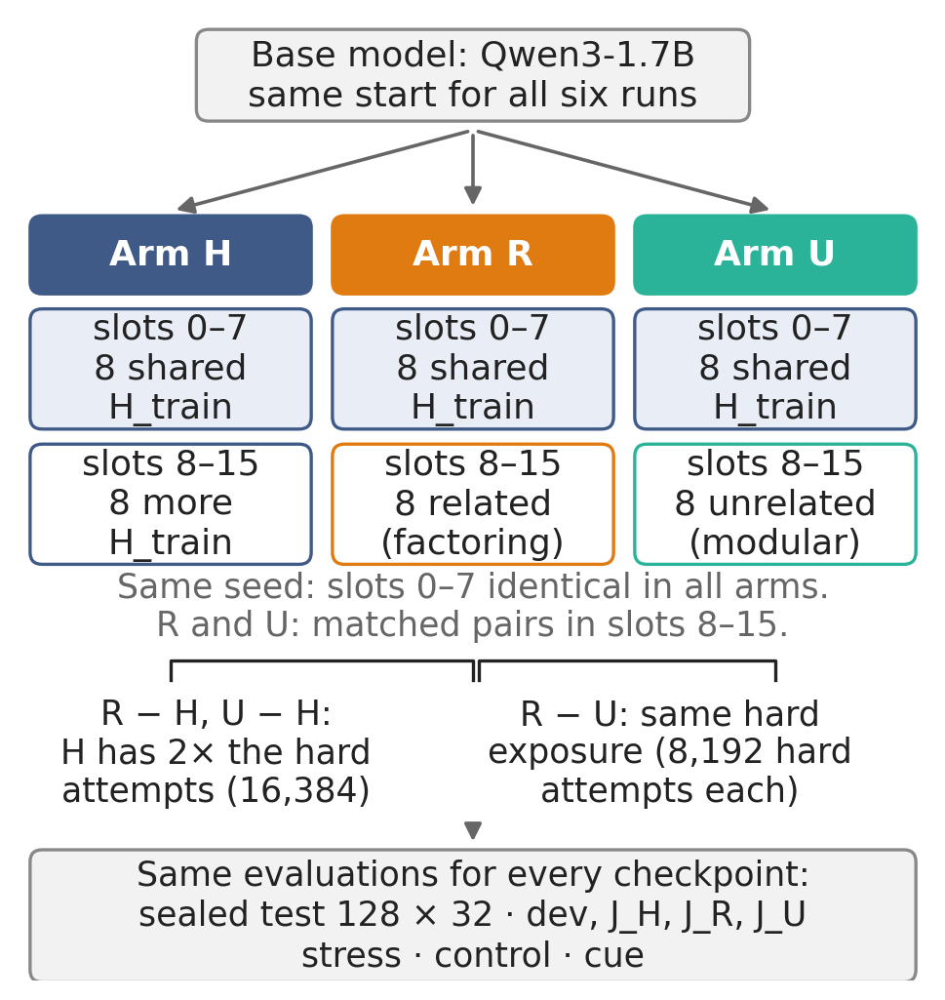
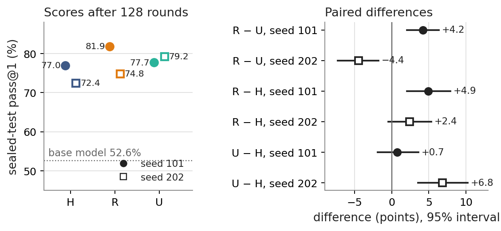
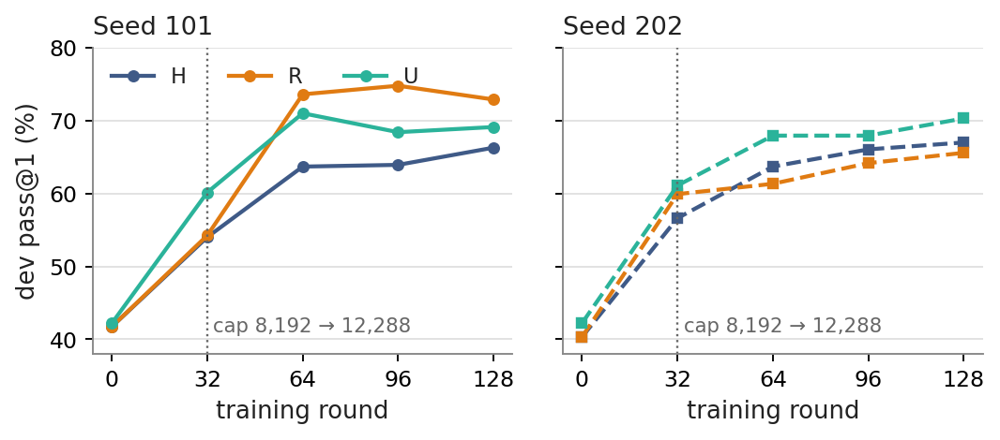
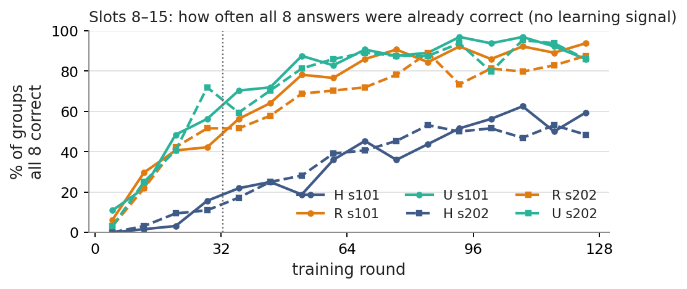
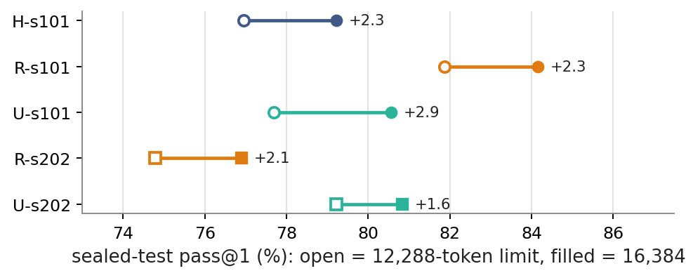

# Auxiliary math practice during GRPO training of Qwen3-1.7B — short version

A 5–10 minute summary of the full report ([`REPORT.md`](REPORT.md), version 4). Every number below comes from the
audited tables of the full report. Differences are in percentage points ("points").

## 1. The question

We trained a small language model (Qwen3-1.7B) to solve math problems with reinforcement learning (GRPO). In each
training round the model sees 16 problems. Half of them (8) are always **hard problems**. The question is what to do
with the other 8:

- **R (related practice):** easy exercises that ask directly for the skill the hard problems need — factoring.
- **U (unrelated practice):** easy exercises of a different skill — modular arithmetic (remainders).
- **H (more hard problems):** 8 more hard problems.

The idea under test: practising a needed skill on easy problems (R) should help with hard problems more than practising
an unneeded skill (U). A competing idea, *ray interference*, says easy practice can instead slow learning on hard
problems (§6).

*Study design. All six runs (3 arms × 2 training seeds) start from the same model. Within a seed, the first 8 slots
hold the same hard problems in all arms, so R vs U compares only the second 8 slots.*

### What "hard" and "factoring" mean here

The hard problems never ask for factoring. The model has to notice that factoring helps. Two examples from the data:

| Kind | Example | What the solver must do |
|---|---|---|
| Direct factoring exercise (R) | "For how many values of x is (x² − 9) / ((x² + 2x − 3)(x − 3)) undefined?" | Factor the denominator and count the roots. |
| Hard problem (H) | "Evaluate the infinite sum Σ n / (n⁴ + 4)." | Notice that n⁴ + 4 = (n² + 2n + 2)(n² − 2n + 2); the sum then telescopes. |

## 2. The datasets

**Short answer to "are they only factoring problems?":** the training hard problems and all main evaluation sets
(dev, the sealed test, the stress sets) are algebra-style problems in which factoring is a key step. Annotators chose
them for that. They are ordinary competition-style problems, not factoring drills, and none of them asks for factoring.
Two sets deliberately contain no factoring: the J_U probe (remainders) and the control set (other subjects).

| Set | What it is | Size | Source and subjects | Used for |
|---|---|---|---|---|
| Hard training problems (H_train) | factoring is needed but not asked for; the base model solves them only 2–12 times in 32 tries | 46 | MATH intermediate algebra 23, algebra 2; Omni-MATH 21 | training (all arms) |
| R practice pool | direct factoring exercises; base model solves 12–24 of 32 | 63 | 9 from MATH, 54 written for the study | training (R only) |
| U practice pool | direct remainder (modular arithmetic) exercises, matched to R in difficulty and length | 63 | 9 from MATH number theory, 54 written | training (U only) |
| **dev** | held-out problems of the same kind as the hard ones, to track progress *during* training | 53 | MATH intermediate algebra 38, algebra 15 | scored at rounds 0, 32, 64, 96, 128 |
| J_H | "hard" score: the first 32 dev problems | 32 | as dev | same as dev |
| J_R | "factoring" score: direct factoring problems | 28 | MATH algebra 17, intermediate algebra 11 | same as dev |
| J_U | "remainder" score: modular-arithmetic problems | 32 | MATH number theory | same as dev |
| **sealed test** | the main final exam; same kind as dev; scored only once, at the end | 128 | MATH official test: intermediate algebra 85, algebra 43 | final score |
| Harder / SuperHard ("stress") | harder factoring problems with factoring buried in a long solution (SuperHard adds a further obstacle) | 95 / 126 | MATH, Omni-MATH, OlympiadBench | transfer check |
| control | problems from subjects no arm practised | 64 | MATH test: geometry, counting, precalculus, prealgebra | checks for general improvement |

The model never trained on any dev, probe, test, stress or control problem.

**How scores are measured.** *pass@1* is the share of answers that are correct. On the sealed test each problem gets 32
answers, so each final score is based on 4,096 answers. An answer is correct when its last `\boxed{}` matches the
reference answer and it finishes within the token limit. The token limit was 8,192 in rounds 1–32 and 12,288 afterwards.

## 3. Main result: training helps a lot; the mixture choice matters less and flips with the seed

*Left: sealed-test pass@1 of each run after 128 rounds (128 problems × 32 answers). Right: differences between arms
of the same seed, with 95% intervals over problems. Intervals describe uncertainty about these fixed models, not
how much a new training run would vary.*

| | H | R | U |
|---|---|---|---|
| Seed 101 | 77.0% | **81.9%** | 77.7% |
| Seed 202 | 72.4% | 74.8% | **79.2%** |
| Base model (before training) | 52.6% | | |

1. **Training at all is the big effect.** Every run gained 20 to 29 points over the base model.
2. **R vs U flips sign between seeds.** R beat U by 4.2 points in seed 101 and lost by 4.4 points in seed 202. Both
   differences are clearly non-zero for these models. With only two seeds per arm, we cannot say which arm is better
   on average.
3. **Practice vs more hard problems.** R and U scored above H in all four comparisons, by 0.7 to 6.8 points. Two of the
   four intervals include zero. Practice was also cheaper: R and U runs generated 53–65 million training tokens, H runs
   69–75 million.

**Checks.** Re-scoring the R and U models on one GPU type kept both signs (+4.4 and −3.1 points). Removing two test
problems that closely resemble training problems changed no difference by more than 0.3 points.

## 4. When did the arms separate?

*Dev pass@1 (53 problems × 8 answers) during training. At round 0 all runs are the same model; the spread there
(40–42%) shows the measurement noise.*

In seed 101, R pulled ahead of U at round 64. In seed 202, U led from round 32 onward. At round 32, though, the
seed-202 gap was no bigger than the noise at round 0. The token limit also rose after round 32, so training and the
limit change are mixed together in that window.

**The practice ran out of signal.** GRPO learns only from a problem where some of the 8 answers are right and some are
wrong. If all 8 are right, the problem teaches nothing. The easy practice problems quickly became "all right":

*Share of slot 8–15 problems where all 8 answers were correct, per 8-round window. Colour = arm; dashed = seed 202.*

After round 64, only 8–22% of R and U practice problems still gave a learning signal. For H's extra hard problems, the
figure was 40–54%. So most of the R-vs-U comparison happened in the first half of training. The second half could add
little practice-specific learning. Part of the rise around round 33 coincides with the longer token limit.

## 5. Why did R lose in seed 202? Mostly unfinished answers

In seed 202, R's answers hit the 12,288-token limit more often (13.1% of answers) than U's (8.1%). An answer that hits
the limit scores zero. Among answers that did finish, R and U were equally accurate (86.1% vs 86.2%). Unfinished
answers therefore account for almost all of the 4.4-point gap (4.3 points). This is an accounting identity, not proof
of cause.

Almost all of the gap (−4.2 of −4.4 points) came from problems that both models solved at least sometimes, which R
answered less reliably. Problems that only one model ever solved added little.

**Would more tokens fix it?** We continued every cut-off answer for up to 4,096 more tokens (16,384 in total):

*Sealed-test pass@1 at the 12,288-token limit (open) and after continuing cut-off answers to 16,384 (filled). The
H-s202 model was not extended.*

Extra tokens helped every model by 1.6 to 2.9 points. In seed 202, R rescued 87 of 538 cut-off answers (16%) and U
rescued 66 of 333 (20%). But the ranking did not change: R vs U moved by at most 0.6 points, and the seed-202 gap stayed
(−3.9 points). Most cut-off answers stayed unfinished even at 16,384 tokens.

## 6. Did practice interfere with hard-problem learning?

*Ray interference* (Schaul et al., 2019) is a stall in learning. It needs two things. First, an update that helps one
task hurts another. Second, the learner generates its own training data, so falling success on a task also means less
learning signal for that task. POPE (Qu et al., 2026, Figure 5) showed this in a small language-model experiment. An
unrelated easy problem stalled progress on a hard problem, while a related one did less harm.

We tested the pieces we could:

| Piece of the mechanism | What we found |
|---|---|
| One update on practice problems lowers the hard score | Not detectable: two no-update measurements of the same model differed by 2.5–3.1 points, more than any update effect |
| Hard problems become "all wrong", so the signal disappears | Rare after round 32 (0.4–7% of hard problems) |
| The model loses problems it used to solve | At the rate expected from random sampling |
| A long stall in learning | Not measured |

**Verdict:** we found no evidence of interference. The test also could not have detected a small effect.

## 7. Did the gains transfer?

- **To harder factoring problems (stress sets):** yes. The base model scored 37.3%. The trained models scored
  60.1–69.5% (SuperHard alone: 25.8% → 49.4–58.4%). R vs U followed the same seed pattern as the sealed test
  (+4.2 points in seed 101, −2.7 in seed 202).
- **To subjects nobody practised (control set):** yes, strongly. Every model gained 21–28 points over the base
  model's 50.8% on geometry, counting, precalculus and prealgebra. This explains why the remainder score (J_U) rose even
  in runs that never practised remainders. Training improved math in general, so J_R and J_U cannot show skill-specific
  transfer.
- **A written hint** ("Consider whether a factorization could simplify the problem.") had no consistent effect
  (between −4.7 and +4.7 points per model; every interval includes zero).
- **Reading failed answers:** two readers rated 35 failed answers on hard stress problems. Missing that factoring would
  help was the most common judgement (26 of 70 readings). Factoring and then failing later came next (17), then running
  out of tokens (11). Factoring done wrongly was the least common (9). This is an interpretation: direct factoring
  practice trains the step that failed least often.

## 8. What we can and cannot conclude

**Holds in both seeds**
- GRPO training raised every model by about 20–29 points on the main test, and by similar amounts on harder and
  unrelated problems.
- Extra answer length helps every model a little but does not change the ranking.
- The easy practice pools stopped giving learning signal after about round 64.

**Does not hold, or cannot be settled**
- Whether factoring practice (R) beats remainder practice (U): the answer flips with the seed.
- Whether practice beats more hard problems: point estimates favour practice, but the evidence is weak.
- Why seed 202 differs: it shows up as more cut-off answers for R, but two runs per arm cannot separate an arm effect
  from run-to-run variation. Runs also trained on different GPU types.
- Whether interference occurred: the measurements were too noisy, and the stall was never measured.

**Next experiment.** Train more seeds of H, R and U with the same recipe, all on one GPU type. This measures how much
R − U varies from run to run, which is the main open question. Changing the practice pool, for example to keep it
challenging, asks a different question and should be a separate study.

## References

- Schaul, T., Borsa, D., Modayil, J., Pascanu, R. (2019). *Ray Interference: a Source of Plateaus in Deep Reinforcement
  Learning.* arXiv:1904.11455.
- Qu, Y., Setlur, A., Smith, V., Salakhutdinov, R., Kumar, A. (2026). *POPE: Learning to Reason on Hard Problems via
  Privileged On-Policy Exploration.* arXiv:2601.18779.
